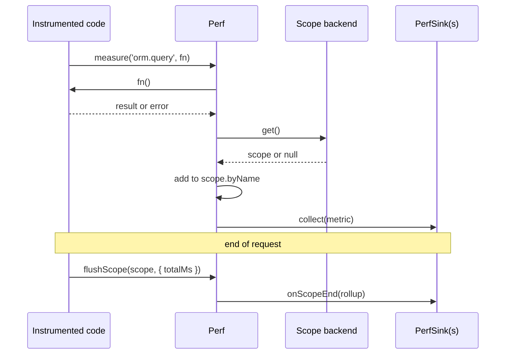

# Perf instrumentation

`Perf` is a process-wide facade for timing code and counting events. It sends each measurement to every registered `PerfSink` and, when a per-request scope is active, adds it to that request's rollup. Instrument library code with `Perf` once; which sinks receive the data (log lines, Prometheus, an in-memory snapshot) is decided by what the app registers.

## How it works

1. **Measure.** Code calls `Perf.measure(name, fn)`, `Perf.start(name).end()`, `Perf.count(name)` or `Perf.value(name, n)`.
2. **Time.** `measure()` and `start()` take `Date.now()` as `startedAt` and `performance.now()` for the duration. `measure()` handles sync and async `fn`; when `fn` throws or rejects, the span is recorded with `error` and the error is rethrown.
3. **Scope.** The scope backend's `get()` returns the active `IPerfScope` or `null`. Spans add to `scope.byName[name]` (`count`, `totalMs`, `maxMs`); counters add `delta` to `count`. The metric carries `scope.requestId`.
4. **Emit.** The facade resolves `DI.resolve(Array.ofType(PerfSink))` once, caches the list, and calls `collect(metric)` on each sink. A sink that throws is skipped; the measured code and other sinks are not affected.
5. **Roll up.** At the end of a request, `Perf.flushScope(scope, { labels, totalMs })` calls `onScopeEnd(rollup)` on each sink that has it. In `@spinajs/http`, the `PerfRollup` middleware does this.



## API

### `Perf`

| Member | Meaning |
| --- | --- |
| `Enabled: boolean` | `true` by default. `false` makes `measure()` call `fn` directly, `start()` return a span whose `end()` does nothing, and `count()` / `value()` do nothing. |
| `measure<T>(name, fn, opts?): Promise<T> \| T` | Time `fn`, emit a `span`, return `fn`'s result. |
| `start(name, opts?): IPerfSpan` | Open a span; `end(fields?)` records it once (later calls are ignored) and merges `fields` into the metric's fields. |
| `count(name, delta = 1, labels?)` | Emit a `counter` and add `delta` to the scope's `count`. |
| `value(name, n, labels?)` | Emit a `value` (gauge-like). Not added to the scope. |
| `flushScope(scope, extra?)` | Send `{ requestId, labels, totalMs, byName }` to every sink's `onScopeEnd`. No-op for `null`. |
| `refreshSinks()` | Drop the cached sink list; the next emit resolves it again. |

### Types

| Type | Shape |
| --- | --- |
| `PerfKind` | `'span' \| 'counter' \| 'value'` |
| `IPerfMetric` | `name`, `kind`, `durationMs?`, `value?`, `labels?` (low cardinality, safe as Prometheus labels), `fields?` (rich payload for logs only), `startedAt?`, `requestId?`, `error?` |
| `IMeasureOpts` | `{ labels?, fields? }` |
| `IPerfSpan` | `{ end(fields?): void }` |
| `IPerfScope` | `{ requestId?: string; byName: Record<string, IPerfRollupEntry> }` |
| `IPerfRollupEntry` | `{ count: number; totalMs: number; maxMs: number }` |
| `IPerfRollup` | `{ requestId?, labels?, totalMs: number, byName }` |
| `IPerfScopeBackend` | `{ get(): IPerfScope \| null }` |
| `setPerfScopeBackend(backend)` | Install the scope backend; `null` or `undefined` restores the no-op one. |

## Services and extension points

| Service | DI token and lifetime | Default implementation | Alternatives | How to replace or extend |
| --- | --- | --- | --- | --- |
| Perf sink | `PerfSink` (class token), resolved as a list with `Array.ofType(PerfSink)`. Register with `@Injectable(PerfSink)`; use `@Singleton()` | none here | `LogMetricSink` (`@spinajs/log`: perf lines on the `perf` logger, slow spans at `warn`), `PromMetricSink` and `InMemoryPerfSink` (`@spinajs/telemetry`) | Add a sink: subclass `PerfSink`, `@Injectable(PerfSink)`. Every registered sink receives every metric. Replace `LogMetricSink`'s output by subclassing it and registering the subclass under `PerfSink`, or turn it off with `logger.perf.enabled: false`. |
| Perf scope backend | Not in DI; one module-level object, process-wide | `{ get: () => null }`: no rollups | `@spinajs/log` (Node): `wirePerfScope()` in `LogBotstrapper.bootstrap()` returns `LogContext.active().perf`, the scope the HTTP `PerfRollup` middleware puts in `req.storage` | `setPerfScopeBackend(backend)`. The last call wins. |

### PerfSink: custom implementation

Write a sink to send measurements somewhere new: a tracing backend, StatsD, a slow-query alert. `collect()` runs inline with the measured code, so keep it fast and never let it throw. Implement `onScopeEnd()` only if the sink uses per-request rollups.

Register the sink before the first measurement, or call `Perf.refreshSinks()` afterwards: the facade caches the sink list on first use.

```ts sample
import { Injectable, Singleton } from '@spinajs/di';
import { IPerfMetric, IPerfRollup, Perf, PerfSink } from '@spinajs/log-common';

// Collects queries slower than 500 ms and requests that ran more than 50 queries.
@Singleton()
@Injectable(PerfSink)
class SlowQuerySink extends PerfSink {
  public readonly SlowQueries: { sql: unknown; ms: number; requestId?: string }[] = [];
  public readonly ChattyRequests: string[] = [];

  public collect(metric: IPerfMetric): void {
    if (metric.kind === 'span' && metric.name === 'orm.query' && (metric.durationMs ?? 0) > 500) {
      this.SlowQueries.push({ sql: metric.fields?.sql, ms: metric.durationMs!, requestId: metric.requestId });
    }
  }

  public onScopeEnd(rollup: IPerfRollup): void {
    const queries = rollup.byName['orm.query']?.count ?? 0;
    if (queries > 50 && rollup.requestId) this.ChattyRequests.push(rollup.requestId);
  }
}

Perf.refreshSinks(); // pick up a sink registered after Perf was first used

async function loadInvoices(): Promise<number[]> {
  return Perf.measure('orm.query', async () => [1, 2, 3], {
    labels: { table: 'invoices' },
    fields: { sql: 'SELECT id FROM invoices WHERE paid = 0' },
  });
}

void loadInvoices();
```

### Perf scope backend: custom implementation

Install a backend to get per-unit rollups where `@spinajs/log` does not provide one: a queue worker, a CLI job, a browser page. Without a backend, measurements still reach the sinks, but no scope accumulates and `requestId` is empty.

```ts sample
import { IPerfScope, Perf, setPerfScopeBackend } from '@spinajs/log-common';

// A worker runs one job at a time; each job gets its own perf scope.
let current: IPerfScope | null = null;
setPerfScopeBackend({ get: () => current });

async function runJob(jobId: string, work: () => Promise<void>): Promise<void> {
  const scope: IPerfScope = { requestId: jobId, byName: {} };
  const started = Date.now();
  current = scope;
  try {
    await work();
  } finally {
    current = null;
    Perf.flushScope(scope, { labels: { queue: 'reports' }, totalMs: Date.now() - started });
  }
}

void runJob('job-17', async () => {
  await Perf.measure('report.render', async () => 'pdf');
  Perf.count('report.pages', 12);
});
```

## Configuration

`Perf` itself has no configuration keys. The shipped sinks read their own:

- `logger.perf.*` for `LogMetricSink`; see [`@spinajs/log`](../log/README.md).
- `telemetry.perf.*` for `InMemoryPerfSink` in `@spinajs/telemetry`.

## Important behaviour

- `Perf.start()` checks `Enabled` when the span opens. A span opened while enabled is still recorded when `Enabled` is switched off before `end()`.
- `value()` metrics are not added to the scope, so they never appear in a rollup.
- `measure()` returns `fn`'s result unchanged: a sync `fn` stays sync, an async one returns a promise.
- `labels` become Prometheus labels in `PromMetricSink`. Put SQL text, ids and other high-cardinality data in `fields`, never in `labels`.
- The sink list is cached on the first emit. A sink registered later is invisible until `Perf.refreshSinks()`.
- The scope backend is global. In Node, a plain variable as in the sample above is shared by concurrent jobs; use `AsyncLocalStorage` when jobs overlap.
- The scope is mutated in place. `flushScope()` hands the same `byName` object to every sink; a sink must not modify it.

## Best practices

- Name metrics `<area>.<operation>` (`orm.query`, `http.request`, `email.send`); `LogMetricSink` thresholds and rollup tables key on these names.
- Use `measure()` for a block, `start()`/`end()` when start and end are in different callbacks.
- Count cheap events (`cache.hit`, `orm.query`) with `count()` rather than timing them.

## Patterns and antipatterns

```ts
// Don't: a unique value as a label creates one Prometheus series per request.
Perf.measure('orm.query', run, { labels: { sql } });

// Do: low-cardinality labels, rich data in fields.
Perf.measure('orm.query', run, { labels: { table: 'invoices' }, fields: { sql } });
```

## Related

- [Ambient log context](04-ambient-log-context.md): the matching seam for log fields.
- [`@spinajs/log`](../log/README.md): `LogMetricSink`, `wirePerfScope()` and `logger.perf` settings.
- [`@spinajs/di` multiple implementations](../di/06-multiple-implementations.md): how `Array.ofType(PerfSink)` collects sinks.
