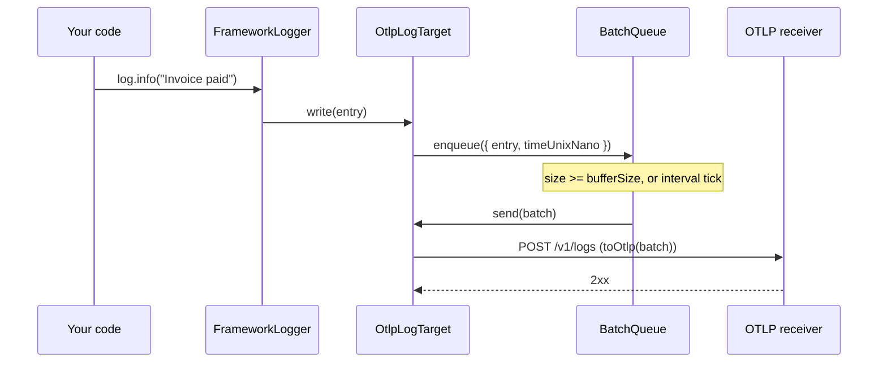

# OTLP log target

`OtlpLogTarget` is a `@spinajs/log` target that buffers log entries and exports them in batches to an OTLP/HTTP receiver. Use it to ship logs from a SpinaJS app to an OpenTelemetry Collector or any backend that accepts OTLP logs over HTTP with a JSON body.

## How it works

Startup:

1. A logger reads its `targets` and `rules` config and calls `DI.resolve("OtlpLogTarget", [targetDef])` for each target with `type: "OtlpLogTarget"`.
2. DI asks every cached `OtlpLogTarget` `__checkInstance__([targetDef])`. An instance with the same `name` is returned as is; otherwise a new one is built. All loggers that route to target `"Otlp"` share one instance.
3. The constructor merges defaults (`interval`, `bufferSize`, `maxBufferSize`, `timeout`, `scopeName`) with the definition, then copies the nested `options` object over the result.
4. DI calls `resolve()`. It creates the axios client (`baseURL` = `endpoint`, `Content-Type: application/json` plus your `headers`, `timeout`), the retry pipeline and the `BatchQueue`.

Each log call:

1. The logger calls `OtlpLogTarget.write(entry)`. A target with `enabled: false` returns at once.
2. `write()` wraps the entry in an `IOtlpRecord` with `timeUnixNano` = `Date.now()` in nanoseconds, and calls `BatchQueue.enqueue()` without awaiting it.
3. The queue flushes when it holds `bufferSize` records, and every `interval` ms on a timer.
4. The flush calls `send(batch)`. It builds the payload with `toOtlp()` and POSTs it to `/v1/logs` through the retry pipeline.
5. On success it clears `HasError`. On failure it requeues the batch (transient error) or drops it (permanent error). See [Delivery, retry and buffering](03-delivery-retry-and-buffering.md).



## Configuration

A target definition sits in `logger.targets`. The target-specific keys go in its `options` object.

| Key | Type | Default | Allowed values | Meaning |
| --- | --- | --- | --- | --- |
| `logger.targets[].name` | `string` | required | any unique name | Target name. Rules refer to it, and DI shares one instance per name |
| `logger.targets[].type` | `string` | required | `"OtlpLogTarget"` or a subclass's DI name | DI name of the class to resolve |
| `logger.targets[].enabled` | `boolean` | `true` | `true`, `false` | `false`: the target is never constructed; `write()` also returns early when the merged `enabled` is `false` |
| `logger.targets[].filters` | `ILogFilterOptions[]` | `[]` | filter specs | Per-target filters, run by the logger before `write()` |
| `logger.targets[].options.endpoint` | `string` | none | base URL of an OTLP/HTTP receiver | Records are POSTed to `${endpoint}/v1/logs`. Not validated |
| `logger.targets[].options.headers` | `Record<string, string>` | `{}` | any HTTP headers | Sent with every export, after `Content-Type: application/json`, so they can override it |
| `logger.targets[].options.resource` | `Record<string, string \| number \| boolean>` | none | OTel resource attributes | Emitted on `resourceLogs[0].resource.attributes` |
| `logger.targets[].options.scopeName` | `string` | `"@spinajs/log"` | any string | Emitted as `scopeLogs[0].scope.name` |
| `logger.targets[].options.interval` | `number` (ms) | `3000` | `> 0` | Timer flush period |
| `logger.targets[].options.bufferSize` | `number` | `10` | `>= 1` | Records that trigger a size flush |
| `logger.targets[].options.maxBufferSize` | `number` | `1000` | `>= bufferSize` | Hard cap on buffered records; the oldest are dropped beyond it |
| `logger.targets[].options.timeout` | `number` (ms) | `5000` | `> 0` | Timeout of one HTTP request (one retry attempt) |

The target ignores `layout`: the OTLP body is the raw `message` variable, not a rendered line.

The retry policy (5 retries, exponential backoff from 1 s to 5 s, jitter) is fixed. To change it, subclass the target; see [Extending the OTLP target](05-extending-the-otlp-target.md#change-the-retry-policy).

```ts
// Partial: one entry of logger.targets
{
  name: 'Otlp',
  type: 'OtlpLogTarget',
  options: {
    endpoint: 'https://otlp.eu.example-observability.com',
    headers: { 'x-api-key': process.env.OTLP_API_KEY ?? '' },
    resource: { 'service.name': 'billing-api', 'service.version': '4.2.0' },
    scopeName: 'billing-api',
    interval: 5000,
    bufferSize: 50,
    maxBufferSize: 5000,
    timeout: 10000,
  },
}
```

## Services and extension points

| Service | DI token and lifetime | Default implementation | Alternatives | How to replace or extend |
| --- | --- | --- | --- | --- |
| `OtlpLogTarget` | `"OtlpLogTarget"` (string name) and the class itself, both via `@Injectable("OtlpLogTarget")`. Lifetime `@PerInstanceCheck()`: one instance per target `name` | `OtlpLogTarget` | none shipped | Subclass and register under a new name (select it with `type`), or under `"OtlpLogTarget"` to replace it for every config. See [Extending the OTLP target](05-extending-the-otlp-target.md) |
| `OtlpLogTarget.OnDropped` | Public property inherited from `LogTarget`, `null` by default | `null` (undelivered entries are discarded) | Set by `FallbackGroupTarget` | Assign a function, or wrap the target in `FallbackGroupTarget`. See [Drop hook and fallback targets](04-drop-hook-and-fallback.md) |

Resolution details:

- The logger resolves targets by string, `DI.resolve(def.type, [def])`. The **last** class registered under a name wins.
- `__checkInstance__(creationOptions)` compares `this.Options.name` with `creationOptions[0].name`. Two definitions with the same `name` share one instance, even when their `options` differ: the first one built wins.
- `Log.flush()`, `Log.flushAll()` and `Log.clearLoggers()` call `forceFlush()` on the target. The DI container calls `dispose()` on teardown.

Public members a user can rely on:

| Member | Effect |
| --- | --- |
| `write(entry: ILogEntry): void` | Buffers one entry. Never throws and never rejects |
| `forceFlush(): Promise<void>` | Exports everything buffered now; waits for an in-flight export first. Resolves even when the export fails |
| `dispose(): Promise<void>` | Stops the flush timer and makes a final flush |
| `HasError: boolean`, `Error: unknown` | Set after a failed export, cleared after a successful one |
| `Options: IOtlpTargetOptions` | The merged, flattened options |

## Important behaviour

- **Self-logging.** The target logs through its own logger named `LogOtlpTarget`: a `trace` line after every successful export, `warn` on buffer overflow, `error` on failed exports. A `"*"` rule that routes those levels to the OTLP target feeds them back into it. With `level: "trace"`, every export enqueues one more record, so the target exports at least once per `interval` forever. Add a `final` rule for `LogOtlpTarget` before `"*"`, as in the [quick start](README.md#quick-start).
- **Same name, same instance.** Two target definitions named `"Otlp"` with different endpoints resolve to one instance, configured by whichever was built first. Give every OTLP target a unique `name`.
- **Event time is capture time.** `timeUnixNano` and `observedTimeUnixNano` both come from `Date.now()` inside `write()`, in millisecond precision.
- **`write()` is fire-and-forget.** It returns `void` and never rejects, so `RetryingTarget` has no effect on this target. Failures surface through `HasError`, the target's own logger and `OnDropped`.
- **No endpoint validation.** A missing or malformed `endpoint` fails every export with an error that has no HTTP response. That counts as retryable, so batches are retried and requeued until `maxBufferSize` drops them.
- **`dispose()` before `resolve()` throws.** `dispose()` calls `this.Queue.shutdown()` without a guard; `forceFlush()` is guarded.
- **`__checkInstance__` needs options.** `DI.resolve("OtlpLogTarget")` with no options array throws a `TypeError` once one instance is cached.
- **Interface typing.** `IOtlpTargetOptions` declares `interval`, `bufferSize`, `maxBufferSize` and `timeout` as required, although the constructor defaults them. Pass them all when you call `new OtlpLogTarget(...)` from TypeScript.

## Best practices

- Set `resource["service.name"]`: most OTLP backends group and search logs by it.
- Keep `bufferSize` well below `maxBufferSize`, so a few failed exports can be retried before records are dropped.
- Put secrets in `options.headers` from configuration or environment, not in the `endpoint` URL: the URL is logged in the target's trace line.
- Route the OTLP target behind a `FallbackGroupTarget` when losing logs during a collector outage is not acceptable. See [Drop hook and fallback targets](04-drop-hook-and-fallback.md).
- Call `Log.flushAll()` before `process.exit()`. The automatic `beforeExit` drain from `@spinajs/log` does not run on hard exits.

## Patterns and antipatterns

```ts
// Don't: the target's own trace and error lines are routed back into it,
// so it keeps exporting its own "Wrote buffered messages" record.
rules: [{ name: '*', level: 'trace', target: 'Otlp' }]

// Do: send the target's diagnostics to the console only, then route everything else.
rules: [
  { name: 'LogOtlpTarget', level: 'warn', target: 'Console', final: true },
  { name: '*', level: 'trace', target: 'Otlp' },
]
```

```ts
// Don't: both definitions resolve to ONE instance; the second endpoint is never used.
targets: [
  { name: 'Otlp', type: 'OtlpLogTarget', options: { endpoint: 'http://collector-a:4318' } },
  { name: 'Otlp', type: 'OtlpLogTarget', options: { endpoint: 'http://collector-b:4318' } },
]

// Do: one unique name per endpoint.
targets: [
  { name: 'OtlpPrimary', type: 'OtlpLogTarget', options: { endpoint: 'http://collector-a:4318' } },
  { name: 'OtlpAudit', type: 'OtlpLogTarget', options: { endpoint: 'http://collector-b:4318' } },
]
```

## Examples

### Send audit logs to a second collector

Audit loggers (`audit*`) go to a dedicated collector; everything at `warn` and above goes to the main one.

```ts sample
import '@spinajs/log-otlp';

export const logger = {
  targets: [
    { name: 'Console', type: 'ConsoleTarget' },
    {
      name: 'OtlpMain',
      type: 'OtlpLogTarget',
      options: { endpoint: 'http://otel-collector:4318', resource: { 'service.name': 'billing-api' } },
    },
    {
      name: 'OtlpAudit',
      type: 'OtlpLogTarget',
      options: {
        endpoint: 'https://audit-collector.internal:4318',
        headers: { Authorization: 'Bearer <audit-token>' },
        resource: { 'service.name': 'billing-api' },
        scopeName: 'billing-api.audit',
        bufferSize: 1,
      },
    },
  ],
  rules: [
    { name: 'LogOtlpTarget', level: 'warn', target: 'Console', final: true },
    { name: 'audit*', level: 'trace', target: 'OtlpAudit' },
    { name: '*', level: 'warn', target: ['Console', 'OtlpMain'] },
  ],
};
```

### Flush before a hard exit

```ts sample
import { Log } from '@spinajs/log';
import '@spinajs/log-otlp';

process.on('SIGTERM', async () => {
  await Log.flushAll();
  process.exit(0);
});
```

## Related

- [OTLP log record mapping](02-otlp-log-record-mapping.md): what `send()` puts in the payload.
- [Delivery, retry and buffering](03-delivery-retry-and-buffering.md): what happens when an export fails.
- [`@spinajs/log`](../log/README.md): rules, the target contract and the `Log.flushAll()` shutdown helpers.
- [Lifetimes](../di/04-lifetimes.md): how `@PerInstanceCheck()` picks a cached instance.
