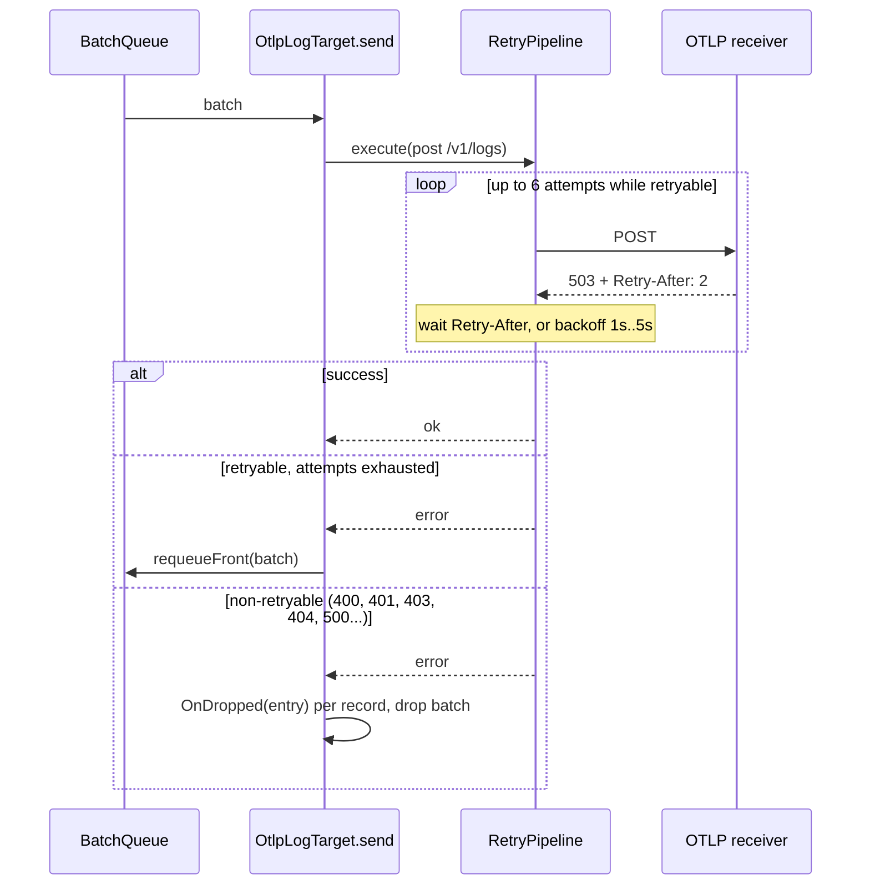

# Delivery, retry and buffering

`OtlpLogTarget` buffers records in memory, exports them in batches, retries transient failures and drops records only on a permanent error or when the buffer is full. This page shows when records are sent, retried, kept or lost.

## How it works

1. `write()` calls `BatchQueue.enqueue(record)`. `enqueue()` appends the record, then enforces the `maxBufferSize` cap.
2. A flush starts when the buffer reaches `bufferSize`, on the `interval` timer, or on `forceFlush()`. Only one flush runs at a time; a flush requested during another one joins it.
3. The flush takes the whole buffer and calls `OtlpLogTarget.send(batch)`.
4. `send()` builds the payload and runs `AxiosInstance.post("/v1/logs", payload)` inside `RetryPipeline`:
   1. A failure that `isRetryableOtlpError()` accepts is retried, up to 5 retries after the first attempt.
   2. The delay is the `Retry-After` header when the response has one (`retryAfterMs()`), otherwise exponential backoff from 1 s, capped at 5 s, with jitter.
   3. Any other failure leaves the pipeline at once.
5. On success: `HasError = false`, `Error = null`, the overflow warning is re-armed, and a `trace` line is logged.
6. On a retryable failure after the last retry: `HasError = true`, an `error` line is logged, and `Queue.requeueFront(batch)` puts the batch back at the front of the buffer for the next flush.
7. On a non-retryable failure: `HasError = true`, `OnDropped(entry)` is called for each record of the batch, an `error` line is logged, and the batch is dropped.
8. Whenever the buffer exceeds `maxBufferSize` (after `enqueue()` or `requeueFront()`), the queue removes the **oldest** records, calls `OnDropped(entry)` for each, and the target logs one `warn` per overflow episode.

`send()` never rejects, so `forceFlush()` and `dispose()` never reject either.



## Error classification

`isRetryableOtlpError(error)` decides between requeue and drop:

| Failure | Example | Retryable | Outcome after retries |
| --- | --- | --- | --- |
| No HTTP response | `ECONNREFUSED`, `ETIMEDOUT`, `ECONNRESET`, `EAI_AGAIN`, request timeout | yes | Batch requeued |
| HTTP `429` | rate limited | yes | Batch requeued |
| HTTP `502`, `503`, `504` | gateway or upstream down | yes | Batch requeued |
| Any other HTTP status | `400` bad payload, `401`/`403` bad credentials, `404` wrong path, `500` | no | Batch dropped, `OnDropped` called |

`retryAfterMs(error)` reads the `retry-after` response header:

| Header value | Result |
| --- | --- |
| Number or numeric string (`5`, `"3"`) | seconds × 1000, at least 0 |
| HTTP date (`Wed, 21 Oct 2026 07:28:00 GMT`) | milliseconds until that date, at least 0 |
| Array | the first element, parsed as above |
| Missing, empty or unparsable | `undefined`: the backoff delay is used |

## Retry policy

| Setting | Value | Configurable |
| --- | --- | --- |
| Retries after the first attempt | 5 | no, subclass the target |
| Base delay | 1 s | no |
| Maximum backoff delay | 5 s (does not cap `Retry-After`) | no |
| Backoff | exponential, with jitter | no |
| Request timeout | `options.timeout`, default 5000 ms, per attempt | yes |

To change the policy, override `resolve()` and replace `RetryPipeline`; see [Extending the OTLP target](05-extending-the-otlp-target.md#change-the-retry-policy).

## Services and extension points

| Service | DI token and lifetime | Default implementation | Alternatives | How to replace or extend |
| --- | --- | --- | --- | --- |
| `OtlpLogTarget.RetryPipeline` | Protected field, built in `resolve()` per target instance | `ResiliencePipelineBuilder<void>().addRetry({...})` as above | any `ResiliencePipeline<void>` | Subclass, call `super.resolve()`, then assign a new pipeline |
| `OtlpLogTarget.send(batch)` | Protected method, wired as the queue's `onFlush` | export with retry, requeue or drop | none | Override in a subclass. It must resolve, never reject, and must either requeue or drop each batch |
| `isRetryableOtlpError`, `retryAfterMs` | Exported functions | as described above | your own predicate | Reuse them in a custom pipeline's `ShouldHandle` and `DelayGenerator` |

## Important behaviour

- **Exports are serial.** While one batch is being retried, no other batch is sent. New records keep buffering, and the cap drops the oldest once `maxBufferSize` is reached.
- **One flush can take long.** Six attempts with the default 5 s timeout plus the backoff delays can block the queue for roughly 45 s before the batch is requeued.
- **`Retry-After` is not capped.** A receiver that answers `Retry-After: 3600` makes the target wait an hour inside one flush, and `dispose()` waits with it.
- **Requeued batches do not call `OnDropped`.** Only the cap and permanent errors do. A record that is requeued and later pushed out by the cap does reach `OnDropped`.
- **Records requeued during shutdown are lost.** `dispose()` stops the queue, then flushes once. If that last export fails with a retryable error, the batch goes back into a stopped queue, is never sent and never reaches `OnDropped`.
- **The overflow warning is logged once per episode.** It is re-armed only by a successful export.
- **Partial success is ignored.** A `2xx` response is a success; an OTLP `partialSuccess` body with rejected records is not read.
- **Timers do not keep the process alive.** The flush timer is `unref()`'d; buffered records are exported only by a later tick, a flush call or the `beforeExit` drain from `@spinajs/log`.

## Best practices

- Size `maxBufferSize` for your longest expected collector outage: records per second × outage seconds. Records beyond it are dropped, oldest first.
- Watch `HasError` and `Error` on the target in a health check; they stay set until the next successful export.
- Use a `FallbackGroupTarget` with a file target as the last element to keep what the cap or a permanent error drops. See [Drop hook and fallback targets](04-drop-hook-and-fallback.md).
- Do not wrap `OtlpLogTarget` in `RetryingTarget`: `write()` never rejects, so the wrapper never retries.

## Patterns and antipatterns

```ts
// Don't: RetryingTarget retries only on write() rejection, which this target never does.
{ name: 'Otlp', type: 'RetryingTarget', options: {
  target: { name: 'OtlpInner', type: 'OtlpLogTarget', options: { endpoint: 'http://collector:4318' } },
} }

// Do: the target retries exports itself; add a fallback for what it gives up on.
{ name: 'Otlp', type: 'FallbackGroupTarget', options: { targets: [
  { name: 'OtlpInner', type: 'OtlpLogTarget', options: { endpoint: 'http://collector:4318' } },
  { name: 'OtlpSpill', type: 'JsonFileTarget', options: { path: 'logs/otlp-undelivered.ndjson' } },
] } }
```

## Examples

### Report export health on a status endpoint

Read the target's error state for a `/health` response. Resolving with the same `name` returns the instance the logger uses.

```ts sample
import { DI } from '@spinajs/di';
import { OtlpLogTarget } from '@spinajs/log-otlp';

export function otlpHealth(): { otlp: 'ok' | 'failing'; reason?: string } {
  const target = DI.resolve<OtlpLogTarget>('OtlpLogTarget', [{ name: 'Otlp' }]);

  if (!target.HasError) {
    return { otlp: 'ok' };
  }

  const reason = target.Error instanceof Error ? target.Error.message : String(target.Error);
  return { otlp: 'failing', reason };
}
```

Call it only after the logger has resolved its targets. Before that, the call builds a new instance from `{ name: 'Otlp' }`, with no `endpoint`.

## Related

- [OTLP log target](01-otlp-log-target.md): the `interval`, `bufferSize`, `maxBufferSize` and `timeout` keys.
- [Drop hook and fallback targets](04-drop-hook-and-fallback.md): where dropped records can go.
- [Extending the OTLP target](05-extending-the-otlp-target.md): replace the retry policy or the HTTP client.
- [`@spinajs/log`](../log/README.md): `BatchQueue`, `RetryingTarget` and `FallbackGroupTarget`.
