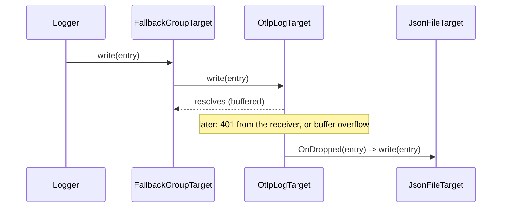

# Drop hook and fallback targets

`OtlpLogTarget` resolves every `write()` and handles failures later, in the background. The entries it finally gives up on are passed to its `OnDropped` hook. Use the hook, or a `FallbackGroupTarget` that sets it for you, to keep logs that never reached the OTLP receiver.

## How it works

1. `OnDropped` is a public property inherited from `LogTarget`, typed `((entry: ILogEntry) => void) | null`, `null` by default.
2. `OtlpLogTarget` calls `this.OnDropped?.(entry)` once per entry it gives up on:
   - **Buffer overflow.** The queue exceeds `maxBufferSize` and removes the oldest records; each removed record's `entry` is passed to the hook.
   - **Permanent export error.** The receiver answers with a non-retryable status (for example `400` or `401`); every entry of the batch is passed to the hook, then the batch is dropped.
3. Entries reach the hook unwrapped: the original `ILogEntry`, without the `timeUnixNano` the target recorded.
4. `FallbackGroupTarget` (from `@spinajs/log`) resolves its child targets in order and, in its `resolve()`, sets `child[i].OnDropped` to call `child[i + 1].write(entry)`. The last child keeps `OnDropped = null`.



Entries are **not** passed to the hook when:

- a transient error exhausts its retries: the batch is requeued instead;
- `write()` is called on a disabled target;
- a retryable export fails during `dispose()`: the batch is requeued into a stopped queue and lost.

## Configuration

`FallbackGroupTarget` is configured in `logger.targets`; its children are full target definitions.

| Key | Type | Default | Allowed values | Meaning |
| --- | --- | --- | --- | --- |
| `logger.targets[].type` | `string` | required | `"FallbackGroupTarget"` | The wrapper |
| `logger.targets[].options.targets` | `ITargetsOption[]` | required | ordered target definitions | Primary first, fallbacks after. Each is resolved through DI like a top-level target |

```ts
// Partial: one entry of logger.targets
{
  name: 'Otlp',
  type: 'FallbackGroupTarget',
  options: {
    targets: [
      { name: 'OtlpPrimary', type: 'OtlpLogTarget', options: { endpoint: 'http://otel-collector:4318' } },
      { name: 'OtlpSpill', type: 'JsonFileTarget', options: { path: 'logs/otlp-undelivered.ndjson' } },
    ],
  },
}
```

## Services and extension points

| Service | DI token and lifetime | Default implementation | Alternatives | How to replace or extend |
| --- | --- | --- | --- | --- |
| `OtlpLogTarget.OnDropped` | Public property on each target instance | `null`: dropped entries are discarded | Set by `FallbackGroupTarget` to the next child's `write()` | Assign your own function after the target is resolved, or list the OTLP target first in a `FallbackGroupTarget` |
| `FallbackGroupTarget` | `"FallbackGroupTarget"`, `@Singleton()`, in `@spinajs/log` | `FallbackGroupTarget` | none | See [`@spinajs/log`](../log/README.md) |

### `OnDropped`: custom handler

Assign the hook when the fallback is not a log target: a metric, a queue, stderr. Assign it after the logger has resolved its targets, and keep any hook already set, so a `FallbackGroupTarget` chain still works.

```ts sample
import { DI } from '@spinajs/di';
import { ILogEntry } from '@spinajs/log';
import { OtlpLogTarget } from '@spinajs/log-otlp';

export function spillUndeliveredToStderr(targetName: string): void {
  const target = DI.resolve<OtlpLogTarget>('OtlpLogTarget', [{ name: targetName }]);
  const previous = target.OnDropped;

  target.OnDropped = (entry: ILogEntry) => {
    process.stderr.write(`${JSON.stringify({ undelivered: true, level: entry.Variables.level, message: entry.Variables.message })}\n`);
    previous?.(entry);
  };
}
```

## Important behaviour

- **No duplicates.** An entry reaches the fallback only when the OTLP target gave up on it. Entries that were delivered, or are still buffered for retry, never reach it.
- **The hook runs synchronously** inside the queue's overflow handling or inside `send()`. Keep it fast and never let it throw; `FallbackGroupTarget` already swallows rejections from the next child.
- **Overflow during an outage spills the oldest entries.** With a fallback, a long outage writes the oldest records to the fallback and keeps the newest `maxBufferSize` in memory for retry.
- **Children are owned by the group.** `FallbackGroupTarget` forwards `forceFlush()` and `dispose()` to them. Do not also route a rule to a child's `name`.
- **Child names share instances.** Children are resolved with `@PerInstanceCheck()` like top-level targets. A child named like a top-level `OtlpLogTarget` is the same instance, and the group overwrites its `OnDropped`.

## Best practices

- Put a local, durable target last (`JsonFileTarget`), so the final stage cannot itself fail over the network.
- Give the spill file its own path and ship it later with your log collector, for example the Collector's file log receiver.
- Keep `maxBufferSize` high enough that short outages are retried from memory instead of spilled.

## Patterns and antipatterns

```ts
// Don't: overwrites the hook FallbackGroupTarget set, so nothing reaches the spill file any more.
target.OnDropped = (entry) => droppedCounter.inc();

// Do: chain to the existing hook.
const previous = target.OnDropped;
target.OnDropped = (entry) => {
  droppedCounter.inc();
  previous?.(entry);
};
```

## Examples

### Keep logs on disk while the collector is down

```ts sample
import '@spinajs/log-otlp';

export const logger = {
  targets: [
    { name: 'Console', type: 'ConsoleTarget' },
    {
      name: 'Otlp',
      type: 'FallbackGroupTarget',
      options: {
        targets: [
          {
            name: 'OtlpPrimary',
            type: 'OtlpLogTarget',
            options: {
              endpoint: 'http://otel-collector:4318',
              resource: { 'service.name': 'billing-api' },
              maxBufferSize: 20000,
            },
          },
          { name: 'OtlpSpill', type: 'JsonFileTarget', options: { path: 'logs/otlp-undelivered.ndjson' } },
        ],
      },
    },
  ],
  rules: [
    { name: 'LogOtlpTarget', level: 'warn', target: 'Console', final: true },
    { name: '*', level: 'info', target: ['Console', 'Otlp'] },
  ],
};
```

## Related

- [Delivery, retry and buffering](03-delivery-retry-and-buffering.md): when an entry is retried and when it is given up on.
- [OTLP log target](01-otlp-log-target.md): `maxBufferSize` and the target name rules.
- [`@spinajs/log`](../log/README.md): `LogTarget.OnDropped`, `FallbackGroupTarget` and `JsonFileTarget`.
