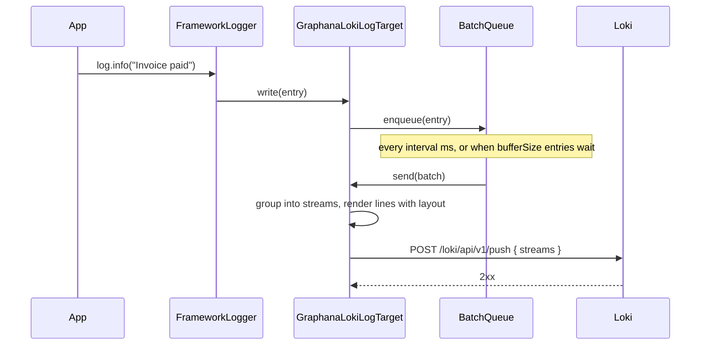

# Loki target

`GraphanaLokiLogTarget` is a log target registered under the type name `GraphanaLogTarget`. Route a logger rule to it and every matching entry is batched, grouped into Loki streams and pushed to `POST <host>/loki/api/v1/push`.

## How it works

1. `import '@spinajs/log-source-graphana-loki'` runs `@Injectable("GraphanaLogTarget")`, which registers `GraphanaLokiLogTarget` in DI under the string `GraphanaLogTarget` and under the class itself.
2. A logger whose rule names the target calls `DI.resolve("GraphanaLogTarget", [definition])` in `FrameworkLogger.buildTargetDesc()`. The `@PerInstanceCheck()` lifetime returns the cached instance whose `__checkInstance__()` reports the same `name`.
3. The constructor merges the definition over the `LogTarget` defaults (`enabled: true`, the default layout), then copies every key of the nested `options` object over the flat keys, then fills `interval`, `bufferSize`, `maxBufferSize` and `timeout` defaults.
4. `resolve()` (run by DI right after construction) builds:
   - `AxiosInstance`: `baseURL` = `host`, `Content-Type: application/json`, a Basic `Authorization` header when `auth.username` is set, request `timeout`;
   - `RetryPipeline`: retry with exponential backoff, see [Delivery, retry and buffering](02-delivery-and-retry.md);
   - `Queue`: a `BatchQueue<ILogEntry>` that flushes every `interval` ms or when `bufferSize` entries are buffered.
5. `write(entry)` returns at once when `enabled` is `false`. Otherwise it enqueues a copy of the entry, with `Variables.n_timestamp` set to the current time in nanoseconds, without awaiting.
6. On flush, `send(batch)` groups the batch into streams. Entries with the same `labels.app`, `logger`, `level` and label values share one stream. Each value is `[n_timestamp as string, format(entry.Variables, layout)]`.
7. `send()` posts `{ streams }` to `/loki/api/v1/push` through `RetryPipeline`. Success clears `HasError`; a failure keeps or drops the batch, see [Delivery, retry and buffering](02-delivery-and-retry.md#how-it-works).



## Configuration

Target definitions live in `logger.targets`. The keys below can sit flat on the definition or nested in `options`; a nested key wins. Keep `name`, `type` and `enabled` at the top level, because the logger reads them there.

| Key | Type | Default | Allowed values | Meaning |
| --- | --- | --- | --- | --- |
| `logger.targets[].name` | `string` | none | unique per target | Rules route to this name. Also the instance identity: one target instance per `name`. |
| `logger.targets[].type` | `string` | none | `GraphanaLogTarget` | DI name of this target. |
| `logger.targets[].enabled` | `boolean` | `true` | `true`, `false` | `false`: the logger never constructs the target. |
| `logger.targets[].layout` | `string` | `${datetime} ${level} ${message}${?error} Exception: ${error:message}${/error} (${logger})` | any layout string | Renders the log line sent as the Loki value. |
| `logger.targets[].options.host` | `string` | none | Loki base URL, eg. `http://loki:3100` | Base URL of the push request. |
| `logger.targets[].options.auth.username` | `string` | none | any | When set, every request carries `Authorization: Basic base64(username:password)`. |
| `logger.targets[].options.auth.password` | `string` | none | any | Password for Basic auth. |
| `logger.targets[].options.labels.app` | `string` | none | any | Stream label `app`, also part of the stream key. `labels` is optional. |
| `logger.targets[].options.labels.<label>` | `string` | none | Loki label values | Extra static labels added to every stream. |
| `logger.targets[].options.interval` | `number` (ms) | `3000` | `> 0` | Periodic flush tick. |
| `logger.targets[].options.bufferSize` | `number` | `10` | `>= 1` | Flush as soon as this many entries are buffered. |
| `logger.targets[].options.maxBufferSize` | `number` | `1000` | `>= bufferSize` | Hard cap on buffered and retained entries; the oldest are dropped beyond it. |
| `logger.targets[].options.timeout` | `number` (ms) | `1000` | `> 0` | Timeout of each HTTP attempt. |

```ts sample
// config/logger.js
export default {
  logger: {
    targets: [
      { name: 'Console', type: 'ConsoleTarget' },
      {
        name: 'Loki',
        type: 'GraphanaLogTarget',
        layout: '${level} ${message} (${logger})',
        options: {
          host: 'http://loki:3100',
          auth: { username: 'loki-writer', password: 'change-me' },
          labels: { app: 'billing-api', env: 'production' },
          interval: 3000,
          bufferSize: 10,
          maxBufferSize: 1000,
          timeout: 1000,
        },
      },
    ],
    rules: [
      { name: '*', level: 'info', target: ['Console', 'Loki'] },
    ],
  },
};
```

`IGraphanaOptions` types `labels` as an optional `{ app: string }`. Extra labels work at runtime; in typed code add them with a cast or an extended interface.

### The push request

One flush sends one request. Its body for two `INFO` entries and one `WARN` entry from the `billing` logger:

```json
{
  "streams": [
    {
      "stream": { "logger": "billing", "level": "INFO", "app": "billing-api", "env": "production" },
      "values": [
        ["1792195200123000000", "INFO Invoice INV-1042 paid (billing)"],
        ["1792195200456000000", "INFO Invoice INV-1043 paid (billing)"]
      ]
    },
    {
      "stream": { "logger": "billing", "level": "WARN", "app": "billing-api", "env": "production" },
      "values": [["1792195200789000000", "WARN Card declined for INV-1044 (billing)"]]
    }
  ]
}
```

- `level` is the upper-case level name (`INFO`, `WARN`, `ERROR`).
- `logger` is the logger name passed to `DI.resolve(Log, [name])`.
- A `labels` key named `logger` or `level` is ignored; the entry's own value wins.

## Services and extension points

| Service | DI token and lifetime | Default implementation | Alternatives | How to replace or extend |
| --- | --- | --- | --- | --- |
| Loki log target | String `GraphanaLogTarget` and the class `GraphanaLokiLogTarget`; `@PerInstanceCheck()`, one cached instance per target `name` | `GraphanaLokiLogTarget` | none shipped; `OtlpLogTarget` from `@spinajs/log-otlp` for OTLP backends | Subclass and register under a new type name, or `DI.register(Sub).as("GraphanaLogTarget")`. See [Extending the Loki target](03-extending-the-loki-target.md). |

## Important behaviour

- The target registers only when the package is imported. Without the import, DI returns `null` for `GraphanaLogTarget` and the logger fails with `InvalidOperation` when it dispatches to that target.
- `labels` has no default. A target without `labels`, or a `labels` object without `app`, pushes streams with no `app` label.
- `write()` stamps `n_timestamp` on a copy of the entry, so other targets sharing the original entry do not see it.
- The Loki timestamp is the time `write()` ran, not the time the entry was created.
- Each distinct label set is its own Loki stream. Keep `labels` static and low-cardinality; put request ids and user ids in the message, not in `labels`.
- The DI cache keeps the instance of the **first** Loki target name only. A second Loki target with another `name` is rebuilt for every logger that routes to it, each with its own buffer and timer. See [DI lifetimes](../di/04-lifetimes.md#important-behaviour).
- The target logs its own failures through the logger named `LogLokiTarget`. A `*` rule that routes to Loki sends those messages back into the Loki buffer.

## Best practices

- Route the target's own logger away from Loki: add `{ name: 'LogLokiTarget', level: 'warn', target: 'Console', final: true }` before the `*` rule.
- Put secrets in `auth` through a config var protocol, not in a committed config file. See [Config var protocols](../configuration/05-config-var-protocols.md).
- Set `layout` without `${datetime}` when Grafana shows the Loki timestamp anyway; it shortens every line.

## Patterns and antipatterns

```ts
// Don't: a per-request label creates one Loki stream per request id
{ name: 'Loki', type: 'GraphanaLogTarget', options: {
  host: 'http://loki:3100',
  labels: { app: 'billing-api', requestId: process.env.REQUEST_ID },
} }

// Do: static labels; the request id goes into the line through the layout
{ name: 'Loki', type: 'GraphanaLogTarget', layout: '${level} [${requestId}] ${message}', options: {
  host: 'http://loki:3100',
  labels: { app: 'billing-api', env: 'production' },
} }
```

## Examples

### Send warnings and errors of every service to Loki, all levels to the console

```ts sample
import { DI } from '@spinajs/di';
import { Configuration, FrameworkConfiguration } from '@spinajs/configuration';
import { Log } from '@spinajs/log';
import '@spinajs/log-source-graphana-loki';

class AppConfiguration extends FrameworkConfiguration {
  protected onLoad(): unknown {
    return {
      logger: {
        targets: [
          { name: 'Console', type: 'ConsoleTarget' },
          {
            name: 'Loki',
            type: 'GraphanaLogTarget',
            options: {
              host: 'http://loki:3100',
              labels: { app: 'orders-api', env: 'staging' },
              bufferSize: 50,
              interval: 5000,
            },
          },
        ],
        rules: [
          { name: 'LogLokiTarget', level: 'trace', target: 'Console', final: true },
          { name: '*', level: 'trace', target: 'Console' },
          { name: '*', level: 'warn', target: 'Loki' },
        ],
      },
    };
  }
}

async function main() {
  DI.register(AppConfiguration).as(Configuration);
  await DI.resolve(Configuration);

  const log = DI.resolve(Log, ['orders']);
  log.debug('Cart recalculated');
  log.warn({ orderId: 'ORD-7781' }, 'Payment for ${orderId} retried');

  await Log.flushAll();
}

void main();
```

### Attach a Loki target at runtime

```ts sample
import { DI } from '@spinajs/di';
import { Log } from '@spinajs/log';
import { IGraphanaOptions } from '@spinajs/log-source-graphana-loki';

export function streamImportJobToLoki(jobId: string) {
  const log = DI.resolve(Log, ['import-job']);

  const loki = log.addTarget(
    {
      name: 'ImportLoki',
      type: 'GraphanaLogTarget',
      options: {
        host: 'http://loki:3100',
        labels: { app: 'importer' },
      } as IGraphanaOptions,
    },
    { level: 'info' },
  );

  log.info({ jobId }, 'Import ${jobId} started');

  return async () => {
    log.info({ jobId }, 'Import ${jobId} finished');
    await log.removeTarget('ImportLoki');
    return loki?.HasError ?? false;
  };
}
```

## Related

- [Delivery, retry and buffering](02-delivery-and-retry.md): what happens after `write()`.
- [Extending the Loki target](03-extending-the-loki-target.md): custom headers, payloads and retry policies.
- [`@spinajs/log`](../log/README.md): rules, layouts, `addTarget()` and the other targets.
- [Config files](../configuration/03-config-files.md): where `config/logger.js` is loaded from.
