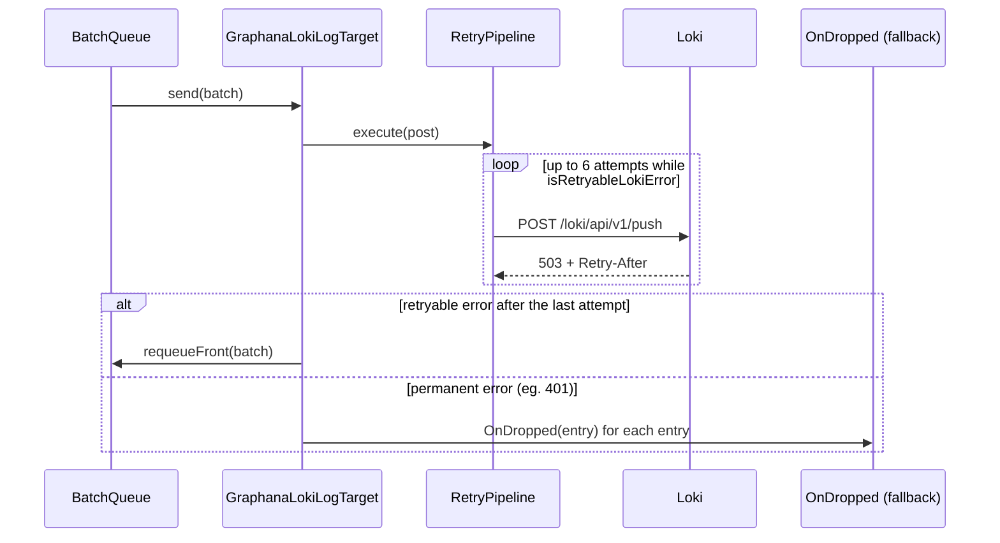

# Delivery, retry and buffering

The Loki target never blocks or throws into the code that logs. It buffers entries, retries transient push failures with backoff, keeps undelivered batches for the next flush, and caps memory by dropping the oldest entries. Entries it gives up on go to the `OnDropped` hook, so a fallback target can catch them.

## How it works

1. `write()` calls `Queue.enqueue(entry)` (`BatchQueue` from `@spinajs/log-common`) and does not await it.
2. `enqueue()` enforces the cap: when the buffer holds more than `maxBufferSize` entries, the oldest are removed and `onOverflow(droppedItems)` runs:
   - the first overflow of an episode logs a warning through the logger `LogLokiTarget`;
   - every dropped entry goes to `OnDropped(entry)` when a wrapper set it.
3. A flush starts when the buffer reaches `bufferSize`, on every `interval` tick, on `forceFlush()` and on `dispose()`. Only one flush runs at a time; a second call returns the running flush. Entries written during a flush wait for the next one.
4. The flush hands the whole buffer to `send(batch)`, which posts it through `RetryPipeline`. The pipeline retries transient failures (table below), up to 5 retries.
5. Success: `HasError` becomes `false`, `Error` becomes `null`, the overflow warning re-arms, and a trace message reports the count.
6. Transient failure after the last retry: `HasError` becomes `true`, `Error` holds the error, an error is logged, and `Queue.requeueFront(batch)` puts the batch back at the front. The cap applies again, so a long outage drops the oldest entries.
7. Permanent failure: `HasError` becomes `true`, every entry of the batch goes to `OnDropped(entry)`, an error is logged, and the batch is dropped. It is **not** retried.



### Which failures are retried

`isRetryableLokiError(error)` decides. The same function decides between requeue and drop after the retries.

| Failure | Retried | When retries run out |
| --- | --- | --- |
| No HTTP response: `ECONNREFUSED`, `ETIMEDOUT`, `ECONNRESET`, `EAI_AGAIN`, the axios `timeout` | yes | batch requeued |
| HTTP `429`, `502`, `503`, `504` | yes | batch requeued |
| HTTP `400`, `401`, `403`, `404`, `500` and every other status | no | batch dropped, sent to `OnDropped` |

### Retry schedule

| Setting | Value |
| --- | --- |
| Retries | `5` (6 attempts in total) |
| Base delay | `1 s`, exponential: 1, 2, 4, 8, 16 s |
| Jitter | on: each delay is a random value between 0.5x and 1.5x |
| Delay cap | `5 s` |
| `Retry-After` header | when present, its delay replaces the computed one, capped at the `5 s` delay cap |
| Attempt timeout | `options.timeout` (default `1000` ms) per HTTP request |

`retryAfterMs(error)` reads `Retry-After` as delta-seconds (`5`, `"5"`) or as an HTTP date, and returns milliseconds (never negative). It returns `undefined` when the header is missing or unreadable.

## Configuration

| Key | Type | Default | Allowed values | Meaning |
| --- | --- | --- | --- | --- |
| `logger.targets[].options.interval` | `number` (ms) | `3000` | `> 0` | Periodic flush tick. The timer is `unref()`'d and does not keep the process alive. |
| `logger.targets[].options.bufferSize` | `number` | `10` | `>= 1` | Buffer size that triggers a flush at once. |
| `logger.targets[].options.maxBufferSize` | `number` | `1000` | `>= bufferSize` | Cap on buffered plus requeued entries. Beyond it the oldest are dropped. |
| `logger.targets[].options.timeout` | `number` (ms) | `1000` | `> 0` | Timeout of one HTTP attempt. |

The retry schedule is fixed in `resolve()`. Change it by subclassing, see [Custom retry policy](03-extending-the-loki-target.md#retry-policy-custom-implementation).

## Services and extension points

| Service | DI token and lifetime | Default implementation | Alternatives | How to replace or extend |
| --- | --- | --- | --- | --- |
| Drop hook `OnDropped` | Public field of the target instance, `null` by default | none: dropped entries are discarded | `FallbackGroupTarget` (`@spinajs/log`) wires it to the next target's `write()` | Wrap the target in `FallbackGroupTarget`, or assign `target.OnDropped` yourself. |
| Retry pipeline `RetryPipeline` | Protected field, built in `resolve()`, one per target instance | `ResiliencePipelineBuilder<void>().addRetry(...)` as in the table above | none shipped | Subclass, call `super.resolve()`, assign a new pipeline. See [Extending the Loki target](03-extending-the-loki-target.md#retry-policy-custom-implementation). |
| Error classification | Exported functions `isRetryableLokiError`, `retryAfterMs` | as documented above | none | Reuse them in a custom pipeline; override `send()` to change the requeue-or-drop decision. |
| Batch queue `Queue` | Protected `BatchQueue<ILogEntry>` field, built in `resolve()` | `BatchQueue` from `@spinajs/log-common` | none | Read `Queue.size` in a subclass; `forceFlush()` and `dispose()` drive it. |

### Drop hook: custom implementation

Set `OnDropped` when you want the entries Loki gave up on, without a second target. The hook receives each entry dropped by overflow and each entry of a batch that failed permanently. Set it after the target is resolved; `FallbackGroupTarget` overwrites it when it wraps the target.

```ts sample
import { DI } from '@spinajs/di';
import { ILogEntry, Log } from '@spinajs/log';
import { IGraphanaOptions } from '@spinajs/log-source-graphana-loki';

const undelivered: ILogEntry[] = [];

export function attachPaymentsLoki() {
  const log = DI.resolve(Log, ['payments']);

  const loki = log.addTarget({
    name: 'PaymentsLoki',
    type: 'GraphanaLogTarget',
    options: { host: 'http://loki:3100', labels: { app: 'payments' } } as IGraphanaOptions,
  });

  if (loki) {
    loki.OnDropped = (entry: ILogEntry) => {
      undelivered.push(entry);
      if (undelivered.length > 500) {
        undelivered.shift();
      }
    };
  }

  return function lokiHealth() {
    return {
      healthy: loki ? !loki.HasError : false,
      lastError: loki?.Error instanceof Error ? loki.Error.message : null,
      undelivered: undelivered.length,
    };
  };
}
```

## Important behaviour

- `send()` resolves on every push failure, so `forceFlush()`, `log.flush()` and `dispose()` do not reject because Loki is down.
- Retries run inside one flush. With the defaults a fully failing flush takes up to about 25 s (6 attempts of 1 s plus delays capped at 5 s). New entries buffer meanwhile, up to `maxBufferSize`.
- A `Retry-After` delay is capped at `5 s`, so `Retry-After: 3600` waits 5 s per retry.
- HTTP `500` is permanent: the batch is dropped, not retried.
- A request that reached Loki but timed out is retried, so its lines can arrive twice.
- A requeued batch keeps its original `n_timestamp` values and goes out with the next flush.
- The overflow warning fires once per episode and re-arms after the next successful push.
- `HasError` and `Error` describe the last flush only; one successful push clears them.
- The flush timer is `unref()`'d. Entries still buffered when the process ends are lost unless something flushes: the `beforeExit` hook of `@spinajs/log` runs `Log.flushAll()` on a clean exit only.
- `dispose()` stops the timer and flushes once; later `write()` calls are ignored by the stopped queue.

## Best practices

- Wrap the target in `FallbackGroupTarget` with a file target behind it when losing logs during a Loki outage is not acceptable.
- Call `await Log.flushAll()` before `process.exit()` in CLI commands and workers; `beforeExit` does not run on `process.exit()`.
- Raise `maxBufferSize` for bursty services instead of `bufferSize`; `bufferSize` only sets how soon a flush starts.
- Watch `HasError` from a health check; a `401` or `400` means a config problem that retrying never fixes.

## Patterns and antipatterns

```ts
// Don't: exit right after logging; buffered entries never reach Loki
log.error(err, 'Import failed');
process.exit(1);

// Do: drain the buffers first
log.error(err, 'Import failed');
await Log.flushAll();
process.exit(1);
```

## Examples

### Spill undelivered entries to a local NDJSON file

```ts sample
// config/logger.js
export default {
  logger: {
    targets: [
      {
        name: 'Durable',
        type: 'FallbackGroupTarget',
        options: {
          targets: [
            {
              name: 'Loki',
              type: 'GraphanaLogTarget',
              options: { host: 'http://loki:3100', labels: { app: 'billing-api' }, maxBufferSize: 5000 },
            },
            { name: 'Spill', type: 'JsonFileTarget', options: { path: 'logs/undelivered.ndjson' } },
          ],
        },
      },
    ],
    rules: [{ name: '*', level: 'info', target: 'Durable' }],
  },
};
```

`FallbackGroupTarget` sets the Loki target's `OnDropped` to `Spill.write()`. Overflowed entries and batches rejected with a permanent error land in the file. Batches that only failed transiently stay in the Loki buffer and are not written to the file.

### Drain Loki before a worker exits

```ts sample
import { DI } from '@spinajs/di';
import { Log } from '@spinajs/log';
import '@spinajs/log-source-graphana-loki';

export async function runNightlyExport(exportInvoices: () => Promise<number>) {
  const log = DI.resolve(Log, ['nightly-export']);

  try {
    const count = await exportInvoices();
    log.info({ count }, 'Exported ${count} invoices');
  } catch (err) {
    log.error(err as Error, 'Nightly export failed');
    process.exitCode = 1;
  } finally {
    await Log.flushAll();
  }
}
```

## Related

- [Loki target](01-loki-target.md): configuration and the push request.
- [Extending the Loki target](03-extending-the-loki-target.md): custom retry policy and requeue rules.
- [`@spinajs/log`](../log/README.md): `FallbackGroupTarget`, `RetryingTarget`, `Log.flushAll()`.
- [`@spinajs/log-common`](../log-common/README.md): `BatchQueue` and the `LogTarget.OnDropped` contract.
- [`@spinajs/util`](../util/README.md): `ResiliencePipelineBuilder` and `BackoffType`.
