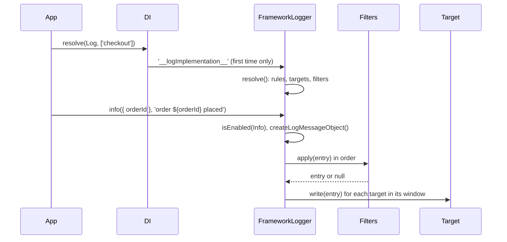

# Logging API

A logger is a named `Log` resolved from DI. Call one of its eight level methods with a message, an `Error` or an object of fields; the logger builds an entry and hands it to the targets its rules select.

## How it works

1. `DI.resolve(Log, ['checkout'])` calls the factory registered for `Log` in `log.ts`.
2. The factory returns the cached logger from `Log.Loggers` when one with that name exists.
3. When no `Configuration` is registered yet, it returns an `InternalLoggerProxy` from `@spinajs/internal-logger` and caches it in `Log.InternalLoggers`. See [Bootstrap, flushing and shutdown](14-bootstrap-flushing-and-shutdown.md#logging-before-configuration).
4. Otherwise it resolves `'__logImplementation__'` (by default `FrameworkLogger`) with the name. `FrameworkLogger.resolve()` reads `logger` config, matches rules, resolves targets and filters, and stores itself in `Log.Loggers`.
5. A level method, eg. `info()`, first checks `isEnabled(level)` against the effective level. A disabled call returns before any entry is built.
6. `wrapWrite()` picks the call shape from the first argument and calls `createLogMessageObject()`, which merges ambient context, the core fields (`logger`, `level`, `message`, `error`) and the logger variables, then runs the [serializers](11-structured-logging-and-serializers.md).
7. `FrameworkLogger.write()` runs the logger [filters](09-filters.md), then writes the entry to every target whose level window holds its level. The result is `Promise.allSettled()` of the target writes, so one failing target never fails the call.



## Levels

| Level | `LogLevel` value | OTel `severityNumber` | Console method |
| --- | --- | --- | --- |
| `trace` | `0` | `1` | `console.debug` |
| `debug` | `1` | `5` | `console.debug` |
| `info` | `2` | `9` | `console.log` |
| `success` | `3` | `11` | `console.log` |
| `warn` | `4` | `13` | `console.warn` |
| `error` | `5` | `17` | `console.error` |
| `fatal` | `6` | `21` | `console.error` |
| `security` | `999` | `23` | `console.error` |

- `StrToLogLevel` maps a name to its value, `LogLevelStrings` maps back, `normalizeLevel()` accepts either and throws on an unknown name.
- `LogLevelToSeverityNumber` holds the OpenTelemetry column; the JSON targets write it as `severityNumber`.
- `SILENT_LEVEL` (`1000`) sits above `security`; `disableAll()` uses it.

## Getting a logger

| Way | Code | Notes |
| --- | --- | --- |
| Resolve by name | `DI.resolve(Log, ['orders'])` | Same name returns the same instance. Synchronous: `Log` is a `SyncService`. |
| Property decorator | `@Logger('orders') protected Log: Log;` | Lazy getter. Looks for a resolved logger with that name first, then resolves one. |
| Child logger | `log.child('db')` | Resolves a logger named `<parent>.db`. It matches rules under that dotted name. |
| String token | `DI.resolve<Log>('__log__', ['orders'])` | Same factory under a string, for packages that cannot import `Log`. Not for application code. |

## Decorators

| Decorator | Target | Options | Effect |
| --- | --- | --- | --- |
| `@Logger(name, variables?)` | property | `name`: logger name; `variables`: see Important behaviour | Defines a non-enumerable, non-configurable getter on the prototype that returns the logger `name`, resolved on first read. |

## Call shapes

Every level method (`trace`, `debug`, `info`, `success`, `warn`, `error`, `fatal`, `security`) takes three shapes. The first argument decides which.

| First argument | Example | Result |
| --- | --- | --- |
| `string` | `log.info('user %s logged in', userId)` | Message is a printf format; arguments fill it. |
| `Error` | `log.error(err, 'cannot save order %d', id)` | `error` field holds the serialized error. With no message, the message is `err.message`. |
| plain object | `log.info({ orderId, total }, 'order ${orderId} placed')` | Fields merge into the entry. The message is a template over **these fields only**, then printf arguments apply. |

`log.warnOnce(key, ...)` takes the same shapes after a key and writes only the first time the process sees that key on a logger of that name; see [Logger contract](../log-common/01-logger-contract.md#once-only-and-rate-limited-lines).

### printf specifiers

| Spec | Renders |
| --- | --- |
| `%s` | `String(arg)`; objects as JSON |
| `%d` | `Number(arg)` |
| `%i` | `parseInt(arg, 10)` |
| `%f` | `parseFloat(arg)` |
| `%j`, `%o`, `%O` | JSON, `String()` when it cannot stringify |
| `%%` | `%`, consumes no argument |

A specifier with no argument left stays as written. Arguments left after the format are appended, space-separated, objects as JSON.

### Field templates

In the object shape, the message is rendered by `renderTemplate()`:

- `${name}` takes the field `name` of the call, rendered by `renderValue()`: plain tokens as they are, objects as JSON, anything else quoted; control and bidi characters and `$` are escaped.
- `${?name} ... ${/name}` keeps its body only when the field is set and not empty.
- A name the call does not pass renders empty. Ambient context and logger variables never fill it.
- `${name:option}` is left for the target layout.

## Logger API

| Member | Effect |
| --- | --- |
| `Name` | Logger name. |
| `addVariable(name, value)` | Adds a variable to every later entry of this logger. A function value is called by text layouts with the `${name:option}` option. |
| `child(name, variables?)` | Logger named `<Name>.<name>`. |
| `timeStart(name)` / `timeEnd(name)` | `timeEnd` returns elapsed milliseconds and forgets the timer; `0` for an unknown timer. A second `timeStart` with the same name keeps the first start. |
| `getLevel()`, `setLevel()`, `setDefaultLevel()`, `resetLevel()`, `enableAll()`, `disableAll()` | Runtime level control, see [Runtime targets and levels](13-runtime-targets-and-levels.md#runtime-levels). |
| `addTarget(def, opts?)`, `removeTarget(name)` | Attach or detach a target at runtime, see [Runtime targets and levels](13-runtime-targets-and-levels.md). |
| `flush()` | Force-flushes this logger's targets. |
| `write(entry)` | Low-level dispatch of a built `ILogEntry`; skips entries whose `logger` variable is not this logger's name. |
| `Log.Loggers` (static) | `Map` of resolved loggers by name. |
| `Log.flushAll()`, `Log.clearLoggers()` (static) | See [Bootstrap, flushing and shutdown](14-bootstrap-flushing-and-shutdown.md). |

## Important behaviour

- **Variables passed at resolve time are dropped.** The factory hands only the name to `'__logImplementation__'`, so the `variables` of `DI.resolve(Log, [name, variables])`, `@Logger(name, variables)` and `child(name, variables)` never reach the logger. A child also does **not** inherit the parent's `addVariable()` values. Call `addVariable()` on the logger you use.
- **Reserved field names.** Object fields merge after the core fields, so a field named `message` or `level` replaces them. A field named `logger` changes the entry's logger, and `write()` then drops the entry silently.
- **Text layouts expand `${...}` inside the message.** The console and file targets render `message` through `format()` again, so a printf argument like `'${env:DB_PASSWORD}'` prints the environment variable. Field templates escape `$`, so untrusted values are safe only in the object shape.
- A logger resolves its rules and targets once, on first resolve. Changing `logger` config later does not affect existing loggers; `Log.clearLoggers()` and a new resolve do.
- Until an instance of `Configuration` is resolved (`DI.has(Configuration)`), `DI.resolve(Log, ...)` returns an `InternalLoggerProxy`. A reference taken then stays a proxy: its calls replay into the real logger, but `setLevel()`, `addTarget()` and `flush()` on it do nothing.
- `@Logger` defines the property on the class prototype, so assigning to it in a subclass or a test throws in strict mode.

## Best practices

- Name loggers after a module or a dotted namespace (`orders`, `orders.payments`) so rules can route them with `orders*` or `orders.*`.
- Put untrusted input into fields, never into the message string: `log.warn({ email }, 'login failed for ${email}')`.
- Pass the `Error` as the first argument; the `error` serializer then keeps its stack, `cause` chain and `code`.
- Resolve the logger once (a property, a module constant) instead of on every call; the factory is cheap but the decorator is cheaper.

## Patterns and antipatterns

```ts
// Don't: user input in a printf argument is re-expanded by text layouts
log.warn('login failed for %s', req.body.email);

// Do: fields are escaped and stay structured in JSON targets
log.warn({ email: req.body.email }, 'login failed for ${email}');
```

```ts
// Don't: these variables are dropped by the factory
const log = DI.resolve(Log, ['billing', { region: 'eu-west-1' }]);

// Do
const log = DI.resolve(Log, ['billing']);
log.addVariable('region', 'eu-west-1');
```

## Examples

### Inject a logger into a service and time an import

```ts sample
import { Injectable, Singleton } from '@spinajs/di';
import { Log, Logger } from '@spinajs/log';

@Singleton()
@Injectable()
export class ProductImportService {
  @Logger('catalog.import')
  protected Log!: Log;

  public async importFeed(feedUrl: string, rows: Array<{ sku: string; price: number }>): Promise<number> {
    this.Log.timeStart(feedUrl);
    let imported = 0;

    for (const row of rows) {
      if (row.price <= 0) {
        this.Log.warn({ sku: row.sku, price: row.price }, 'skipping ${sku}: invalid price ${price}');
        continue;
      }
      imported++;
    }

    const ms = this.Log.timeEnd(feedUrl);
    this.Log.success({ feedUrl, imported, ms }, 'imported ${imported} products in ${ms}ms');
    return imported;
  }
}
```

### Log a failed call with its error chain

```ts sample
import { DI } from '@spinajs/di';
import { Log } from '@spinajs/log';

export async function chargeCard(orderId: number, charge: () => Promise<void>): Promise<boolean> {
  const log = DI.resolve(Log, ['payments']);
  log.addVariable('provider', 'stripe');

  try {
    await charge();
    return true;
  } catch (err) {
    log.error(new Error(`charge failed for order ${orderId}`, { cause: err }), 'payment for order %d rejected', orderId);
    return false;
  }
}
```

## Related

- [Configuration and rules](02-configuration-and-rules.md): which targets a logger name reaches.
- [Structured logging and serializers](11-structured-logging-and-serializers.md): what the object shape produces in JSON targets.
- [Replacing the logger](17-replacing-the-logger.md): the factory and `'__logImplementation__'` behind `DI.resolve(Log, ...)`.
