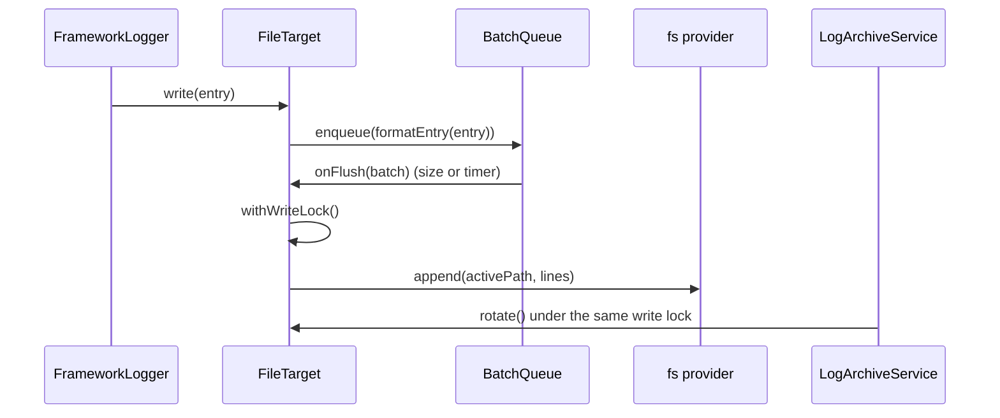

# File target

`FileTarget` writes text lines and `JsonFileTarget` writes NDJSON to a file through an [`@spinajs/fs`](../fs/README.md) provider, so the active log and its archives can live on local disk, S3, FTP or any other provider. Entries are buffered and appended in batches; rotation and retention run in the [archive service](06-file-rotation-and-retention.md).

## How it works

1. **Resolve.** `FileTarget.resolve()` merges options, lowest first: `LOG_FILE_DEFAULTS`, the `logger.file` config, the target's `options`. It throws `InvalidOption` when `path` is missing.
2. **Async init.** It starts `init()` and keeps the promise in `Ready`:
   1. `getFs(options.fs)` and `getFs(options.archiveFs)` (default: the same provider);
   2. `mkdir` of the active log's directory, and of `archivePath` when set;
   3. builds the `ILogArchiveContext` and resolves a `LogArchiveService`, which starts the rotation strategy.
   A failed init sets `HasError` and `Error` and logs to the `LogFileTarget` logger.
3. **Queue.** It creates a `BatchQueue<string>` with `maxBatch = maxBufferSize`, `maxQueue = maxQueueSize`, a `flushInterval` timer (`unref()`'d) and `onFlush = append`.
4. **Write.** `write(entry)` returns at once when disabled or disposed. Otherwise it calls `formatEntry(entry)` (layout for `FileTarget`, JSON for `JsonFileTarget`) and enqueues the line. When the buffer reaches `maxBufferSize`, `write()` awaits the flush.
5. **Append.** `append(batch)` awaits `Ready`, takes the write lock, recomputes the active path and calls `fs.append(path, lines.join(EOL) + EOL)`. On failure it logs the error and puts the batch back at the front of the queue.
6. **Overflow.** Past `maxQueueSize` the oldest lines are dropped, and one warning per overflow episode goes to the `LogFileTarget` logger.
7. **Dispose.** `dispose()` stops accepting writes, flushes the queue and stops the archive service.



## Configuration

`FileTarget` and `JsonFileTarget` read their settings under `options`. Defaults come from `logger.file`, which the package ships and your config overrides.

| Key | Type | Default | Allowed values | Meaning |
| --- | --- | --- | --- | --- |
| `logger.targets[].options.path` | `string` | required | relative path, [layout](03-layouts.md) placeholders | Active log, relative to the `fs` provider base path. Recomputed on every append. |
| `logger.targets[].options.archivePath` | `string` | directory of `path` | relative path, placeholders | Archive directory on `archiveFs`. Rendered once, at init. |
| `logger.targets[].options.fs` | `string` | `'fs-log-default'` | a registered fs provider name | Provider of the active log. |
| `logger.targets[].options.archiveFs` | `string` | same as `fs` | a registered fs provider name | Provider archives move to. |
| `logger.targets[].options.maxBufferSize` | `integer` | `100` | `>= 1` | Lines buffered before a flush. |
| `logger.targets[].options.maxQueueSize` | `integer` | `100000` | `>= 1` | Hard cap of buffered lines; oldest dropped past it. |
| `logger.targets[].options.flushInterval` | `integer` | `1000` | `>= 1` (ms) | Flush tick for a partial buffer. |
| `logger.targets[].options.archiveStrategy` | `string` | `'SizeLogArchiveStrategy'` | a `LogArchiveStrategy` class name | When to rotate. See [File rotation and retention](06-file-rotation-and-retention.md). |
| `logger.targets[].options.retentionStrategies` | `string[]` | `['CountLogRetentionStrategy']` | `LogRetentionStrategy` class names | Which archives to delete after a rotation. |
| `logger.targets[].options.maxSize` | `integer` | `1048576` | `>= 1` (bytes) | Size limit for `SizeLogArchiveStrategy`. |
| `logger.targets[].options.archiveInterval` | `integer` | `60` | `>= 1` (s) | Size check period of `SizeLogArchiveStrategy`. |
| `logger.targets[].options.rotate` | `string` | none | 6-field cron | Schedule of `CronLogArchiveStrategy`. |
| `logger.targets[].options.compress` | `boolean` | `false` | | Zip each archive and delete the raw copy. |
| `logger.targets[].options.maxArchiveFiles` | `integer` | `5` | `>= 1` | Archives kept by `CountLogRetentionStrategy`. |
| `logger.targets[].options.maxAge` | `integer` | `604800` | `>= 1` (s) | Archive age limit of `AgeLogRetentionStrategy`. |
| `logger.file.*` | same keys | values above | | Defaults for every file target. |
| `fs.providers` (shipped) | | `{ name: 'fs-log-default', service: 'fsNative', basePath: process.cwd() }` | | Appended to your providers by the package config. |
| `fs.defaultProvider` (shipped) | `string` | `'fs-log-default'` | | Set by the package config; your config overrides it. |

`layout` (flat, on the definition) sets the line format of `FileTarget`; `JsonFileTarget` ignores it.

```js
// config/logger.js
module.exports = {
  fs: {
    providers: [{ service: 'fsNative', name: 'app-logs', basePath: '/var/log/shop' }],
  },
  logger: {
    file: { maxBufferSize: 500, compress: true },
    targets: [
      {
        name: 'App',
        type: 'FileTarget',
        layout: '${utcdatetime} ${level} ${message} (${logger})',
        options: { fs: 'app-logs', path: 'app_${date:yyyy_MM_dd}.log', archivePath: 'archive', maxArchiveFiles: 14 },
      },
      { name: 'Events', type: 'JsonFileTarget', options: { fs: 'app-logs', path: 'events/events.ndjson' } },
    ],
    rules: [
      { name: '*', level: 'info', target: 'App' },
      { name: 'events.*', level: 'trace', target: 'Events' },
    ],
  },
};
```

## Services and extension points

| Service | DI token and lifetime | Default implementation | Alternatives | How to replace or extend |
| --- | --- | --- | --- | --- |
| Text file writer | `'FileTarget'`, `@PerInstanceCheck()` keyed by target `name` | `FileTarget` | `JsonFileTarget` | Subclass and override `formatEntry()`, register under a new name. See [Custom targets](08-custom-targets.md#extending-filetarget-change-only-the-line-format). |
| NDJSON file writer | `'JsonFileTarget'`, `@PerInstanceCheck()` keyed by target `name` | `JsonFileTarget` | | Subclass and override `formatEntry()`. |
| Rotation and retention | `LogArchiveService`, `@NewInstance()`, resolved by `init()` | `LogArchiveService` | | See [File rotation and retention](06-file-rotation-and-retention.md). |
| Storage | fs provider named by `options.fs` / `archiveFs` | `fs-log-default` (`fsNative` at the working directory) | any [`@spinajs/fs`](../fs/README.md) provider | Configure a provider and name it in `options.fs`. |

Overridable members of `FileTarget`: `formatEntry(entry)` (one line per entry), `activePath()` (path of the active log), `normalize(path)`, `append(batch)`, `init()`. `withWriteLock(fn)` runs `fn` under the lock shared with rotation.

## Important behaviour

- **`${logger}` in `path` is the target name**, not the logger name: one file target serves every logger routed to it.
- **Only the first file target is shared.** DI caches the first `FileTarget` instance it builds; every other `FileTarget` definition gets a new instance each time a logger resolves it. N loggers routed to it make N writers, each with its own buffer, flush timer and archive service, appending to the same file.
- **Init is never retried.** When the fs provider is missing at init (eg. `fsService` has not booted), the target keeps `HasError`, never writes, and holds lines until `maxQueueSize`. Boot `@spinajs/fs` before the first logger that routes to a file.
- **Self-logging loop.** The target logs its own errors to the `LogFileTarget` logger. When that logger routes back to the same target and `path` has no directory and no `archivePath` is set, init fails with `Circular dependency detected for FileTarget`. Give the path a directory, or route `LogFileTarget` elsewhere with a `final` rule.
- A date-based `path` switches files on the next append, but the archive context keeps the path computed at init, so the size strategy keeps checking the first file.
- `write()` resolves even when appends fail (self-healing): `RetryingTarget` and `FallbackGroupTarget` do not see file failures as rejections.
- Lines dropped on overflow are strings, so they never reach `OnDropped`.
- The flush timer is `unref()`'d: it never keeps the process alive. Buffered lines are lost on a hard exit unless you flush; see [Bootstrap, flushing and shutdown](14-bootstrap-flushing-and-shutdown.md).
- `JsonFileTarget` stamps `time` in `formatEntry()`, before buffering, so it is the log time, not the flush time.
- The browser entry does not include `FileTarget`, `JsonFileTarget` or the archive module.

## Best practices

- Put file logs on a dedicated fs provider (`options.fs`) instead of `fs-log-default`, which writes into the working directory.
- Raise `maxBufferSize` for chatty loggers to reduce appends; wrap the target in [`AutoFlushTarget`](07-wrapper-targets.md) so `error` and above reach the disk at once.
- Keep one `FileTarget` definition per file and route many loggers to it with rules.

## Patterns and antipatterns

```js
// Don't: expects one file per logger; ${logger} is the target name, so this writes log_App.txt
{ name: 'App', type: 'FileTarget', options: { path: 'logs/log_${logger}.txt' } }

// Do: one target per file you want, routed by rules
targets: [
  { name: 'Orders', type: 'FileTarget', options: { path: 'logs/orders.log' } },
  { name: 'Payments', type: 'FileTarget', options: { path: 'logs/payments.log' } },
],
rules: [
  { name: 'orders*', level: 'info', target: 'Orders' },
  { name: 'payments*', level: 'info', target: 'Payments' },
]
```

## Examples

### Drain the file buffer before a deploy hook exits

```ts sample
import { DI } from '@spinajs/di';
import { Log } from '@spinajs/log';

// config: targets: [{ name: 'Deploy', type: 'FileTarget', options: { path: 'logs/deploy.log', maxBufferSize: 1000 } }]
export async function runMigrations(steps: Array<{ name: string; run: () => Promise<void> }>): Promise<void> {
  const log = DI.resolve(Log, ['deploy']);

  for (const step of steps) {
    log.info({ step: step.name }, 'running ${step}');
    await step.run();
  }

  log.success({ count: steps.length }, '${count} migrations applied');
  await log.flush();
}
```

## Related

- [File rotation and retention](06-file-rotation-and-retention.md): when the active file is archived and which archives are deleted.
- [Wrapper targets](07-wrapper-targets.md): `AutoFlushTarget` around a file target.
- [`@spinajs/fs` providers](../fs/01-providers-and-configuration.md): configuring the storage behind `options.fs`.
