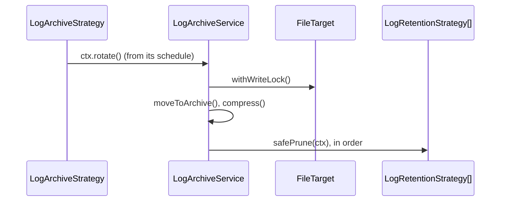

# File rotation and retention

Every `FileTarget` and `JsonFileTarget` owns a `LogArchiveService` that runs one **rotation strategy** (when to archive the active file) and a list of **retention strategies** (which archives to delete afterwards). Both are picked by class name in the target options, and both are extension points.

## How it works

1. `FileTarget.init()` builds an `ILogArchiveContext` and resolves a fresh `LogArchiveService` (`@NewInstance()`).
2. `LogArchiveService.start(ctx)` looks up `options.archiveStrategy` among the classes registered under `LogArchiveStrategy` (`DI.RootContainer.Registry.getTypes(LogArchiveStrategy)`, matched on the class `name`) and resolves it. It does the same for each name in `options.retentionStrategies` under `LogRetentionStrategy`. An unknown name throws `ResolveException`, which fails the target's init.
3. It calls `strategy.start(ctx)`. The strategy owns its schedule and calls `triggerRotation(ctx)` when a rotation is due.
4. `triggerRotation()` calls `ctx.rotate()`, which is `LogArchiveService.rotate(ctx)`, and turns any error into a warning on the `LogFileTarget` logger.
5. `rotate(ctx)`, under the target's write lock:
   1. returns when the active file does not exist;
   2. renames it to `archived_<name>_<seq><ext>` in the archive directory (`seq` = highest existing + 1; a millisecond timestamp when that name is taken). Across providers it renames inside `fs`, then `move()`s into `archiveFs`;
   3. with `compress: true`, zips it to `<archive>.zip` on `archiveFs` and removes the raw file.
6. Outside the lock, each retention strategy runs `safePrune(ctx)` in order; an error in one is logged and the next still runs.
7. `FileTarget.dispose()` calls `LogArchiveService.stop()`, which calls `strategy.stop()`.



## Configuration

All keys live under the file target's `options` (defaults from `logger.file`). See [File target](05-file-target.md#configuration) for the full list.

| Key | Type | Default | Allowed values | Meaning |
| --- | --- | --- | --- | --- |
| `logger.targets[].options.archiveStrategy` | `string` | `'SizeLogArchiveStrategy'` | class name registered under `LogArchiveStrategy` | Rotation trigger. |
| `logger.targets[].options.retentionStrategies` | `string[]` | `['CountLogRetentionStrategy']` | class names registered under `LogRetentionStrategy` | Pruning after each rotation, in order. `[]` keeps every archive. |
| `logger.targets[].options.maxSize` | `integer` | `1048576` | bytes | `SizeLogArchiveStrategy`: rotate when the file is larger. |
| `logger.targets[].options.archiveInterval` | `integer` | `60` | seconds | `SizeLogArchiveStrategy`: check period. |
| `logger.targets[].options.rotate` | `string` | none | 6-field cron, seconds first | `CronLogArchiveStrategy`: schedule. Required by it. |
| `logger.targets[].options.maxArchiveFiles` | `integer` | `5` | `>= 1` | `CountLogRetentionStrategy`: newest archives kept. |
| `logger.targets[].options.maxAge` | `integer` | `604800` | seconds | `AgeLogRetentionStrategy`: archives older than this are deleted. |
| `logger.targets[].options.compress` | `boolean` | `false` | | Zip archives. |
| `logger.targets[].options.archivePath` / `archiveFs` | `string` | log directory / `fs` | | Where archives go. |

```js
{
  name: 'App',
  type: 'FileTarget',
  options: {
    path: 'logs/app.log',
    archivePath: 'logs/archive',
    archiveStrategy: 'CronLogArchiveStrategy',
    rotate: '0 0 1 * * *', // 01:00 every day
    retentionStrategies: ['CountLogRetentionStrategy', 'AgeLogRetentionStrategy'],
    maxArchiveFiles: 30,
    maxAge: 30 * 24 * 60 * 60,
    compress: true,
  },
}
```

## Services and extension points

| Service | DI token and lifetime | Default implementation | Alternatives | How to replace or extend |
| --- | --- | --- | --- | --- |
| Rotation strategy | `LogArchiveStrategy`, `@NewInstance()`; picked by class name from `archiveStrategy` | `SizeLogArchiveStrategy` | `CronLogArchiveStrategy` | Subclass `LogArchiveStrategy` or a shipped strategy, decorate `@Injectable(LogArchiveStrategy)` and `@NewInstance()`, name it in `archiveStrategy`. |
| Retention strategy | `LogRetentionStrategy`, `@NewInstance()`; list picked by class names from `retentionStrategies` | `CountLogRetentionStrategy` | `AgeLogRetentionStrategy` | Subclass `LogRetentionStrategy`, decorate `@Injectable(LogRetentionStrategy)` and `@NewInstance()`, add its name to `retentionStrategies`. |
| Archive orchestration | `LogArchiveService`, `@NewInstance()`; resolved by class in `FileTarget.init()` | `LogArchiveService` | none | `DI.register(MyArchiveService).as(LogArchiveService)` with a `@NewInstance()` subclass; override `rotate()`, `moveToArchive()`, `compress()`, `nextSequence()` or `resolveStrategy()`. |

### Shipped strategies

| Strategy | Base | Schedule or rule |
| --- | --- | --- |
| `SizeLogArchiveStrategy` | `LogArchiveStrategy` | `setInterval` every `archiveInterval` s; rotates when the active file exists and `stat().Size > maxSize`. |
| `CronLogArchiveStrategy` | `LogArchiveStrategy` | `CronJob` on `rotate`; `start()` throws `InvalidOption` when `rotate` is missing or invalid. |
| `CountLogRetentionStrategy` | `LogRetentionStrategy` | Lists archives oldest first by `ModifiedTime`, deletes all but the newest `maxArchiveFiles`. |
| `AgeLogRetentionStrategy` | `LogRetentionStrategy` | Deletes archives whose `ModifiedTime` is more than `maxAge` s ago; skips archives without a valid time. |

### Contracts

| Member | Contract |
| --- | --- |
| `LogArchiveStrategy.start(ctx)` | Start the schedule. Call `this.stop()` first so a second start does not leak a timer. |
| `LogArchiveStrategy.stop()` | Stop the schedule. Safe to call more than once. |
| `LogArchiveStrategy.triggerRotation(ctx)` | Protected. Rotate now; never throws. Call it from your schedule. |
| `LogRetentionStrategy.prune(ctx)` | Delete archives from `ctx.archiveDir` on `ctx.archiveFs`. |
| `LogRetentionStrategy.safePrune(ctx)` | Runs `prune()`, logs a warning instead of throwing. |
| `Logger` | Protected `Log` named `LogFileTarget` on both bases. |

`ILogArchiveContext` gives a strategy: `fs`, `archiveFs`, `activePath`, `archiveDir`, `options` (the merged target options, custom keys included), `logger`, `rotate()` and `withWriteLock(fn)`. Helpers: `ARCHIVE_PREFIX` (`'archived_'`), `archivePath(ctx, name)` and `listArchives(ctx)` (archives oldest first, with their `IStat`).

### Custom rotation strategy: rotate at midnight or when too big

Use a custom strategy when neither size nor a fixed schedule alone fits. This one checks every minute and rotates when the day changed or the file passed `maxSize`.

```ts sample
import { Injectable, NewInstance } from '@spinajs/di';
import { ILogArchiveContext, LogArchiveStrategy } from '@spinajs/log';

// config: options: { path: 'logs/app.log', archiveStrategy: 'DailyOrSizeLogArchiveStrategy', maxSize: 50 * 1024 * 1024 }
@Injectable(LogArchiveStrategy)
@NewInstance()
export class DailyOrSizeLogArchiveStrategy extends LogArchiveStrategy {
  protected timer: NodeJS.Timeout | null = null;
  protected day = new Date().toDateString();

  public start(ctx: ILogArchiveContext): void {
    this.stop();
    this.timer = setInterval(() => void this.check(ctx), 60_000);
    this.timer.unref();
  }

  public stop(): void {
    if (this.timer) {
      clearInterval(this.timer);
      this.timer = null;
    }
  }

  protected async check(ctx: ILogArchiveContext): Promise<void> {
    const today = new Date().toDateString();
    const dayChanged = today !== this.day;
    this.day = today;

    const tooBig = (await ctx.fs.exists(ctx.activePath)) && ((await ctx.fs.stat(ctx.activePath)).Size ?? 0) > ctx.options.maxSize;

    if (dayChanged || tooBig) {
      await this.triggerRotation(ctx);
    }
  }
}
```

Import the module before the first logger that routes to the file target resolves; the name is looked up in `init()`.

### Custom retention strategy: move old archives to cold storage

Retention does not have to delete. This one moves archives older than a week to another fs provider, read from a custom option.

```ts sample
import { Injectable, NewInstance } from '@spinajs/di';
import { getFs } from '@spinajs/fs';
import { ILogArchiveContext, listArchives, LogRetentionStrategy } from '@spinajs/log';

// config: options: { path: 'logs/app.log', retentionStrategies: ['ColdStorageLogRetentionStrategy', 'CountLogRetentionStrategy'],
//                    coldStorageFs: 's3-log-archive', coldAfterDays: 7 }
@Injectable(LogRetentionStrategy)
@NewInstance()
export class ColdStorageLogRetentionStrategy extends LogRetentionStrategy {
  public async prune(ctx: ILogArchiveContext): Promise<void> {
    const opts = ctx.options as typeof ctx.options & { coldStorageFs?: string; coldAfterDays?: number };
    if (!opts.coldStorageFs) {
      return;
    }

    const cold = getFs(opts.coldStorageFs);
    const limitMs = (opts.coldAfterDays ?? 7) * 24 * 60 * 60 * 1000;

    for (const archive of await listArchives(ctx)) {
      const modified = archive.stat.ModifiedTime?.toMillis() ?? Date.now();
      if (Date.now() - modified > limitMs) {
        await ctx.archiveFs.move(archive.path, archive.path, cold);
        this.Logger.info({ archive: archive.path, target: opts.coldStorageFs }, 'moved ${archive} to ${target}');
      }
    }
  }
}
```

Order matters: put it before `CountLogRetentionStrategy`, or the count strategy deletes the archives first.

### Extending a shipped strategy: also rotate at startup

```ts sample
import { Injectable, NewInstance } from '@spinajs/di';
import { ILogArchiveContext, LogArchiveStrategy, SizeLogArchiveStrategy } from '@spinajs/log';

// config: archiveStrategy: 'RotateOnStartLogArchiveStrategy'
@Injectable(LogArchiveStrategy)
@NewInstance()
export class RotateOnStartLogArchiveStrategy extends SizeLogArchiveStrategy {
  public start(ctx: ILogArchiveContext): void {
    super.start(ctx);
    void this.triggerRotation(ctx);
  }
}
```

### Replacing `LogArchiveService`

Replace the service when every rotation must do more, eg. notify a log shipper. `FileTarget` resolves it by class, so the last registration wins.

```ts sample
import { DI, Injectable, NewInstance } from '@spinajs/di';
import { ILogArchiveContext, LogArchiveService } from '@spinajs/log';

@Injectable()
@NewInstance()
export class NotifyingLogArchiveService extends LogArchiveService {
  public async rotate(ctx: ILogArchiveContext): Promise<void> {
    await super.rotate(ctx);
    await fetch('http://log-shipper.internal/rotated', {
      method: 'POST',
      headers: { 'content-type': 'application/json' },
      body: JSON.stringify({ file: ctx.activePath, archiveDir: ctx.archiveDir }),
    });
  }
}

DI.register(NotifyingLogArchiveService).as(LogArchiveService);
```

## Important behaviour

- Strategies are matched by **class name**, so minifying or renaming a class breaks the config value.
- Without `@NewInstance()`, a strategy is a singleton: two file targets share one schedule, and the second `start()` stops the first.
- An exception from `start()` (eg. `CronLogArchiveStrategy` without `rotate`) or an unknown strategy name fails the target's init: the target never writes. The error goes to the `LogFileTarget` logger.
- `SizeLogArchiveStrategy`'s interval and `CronLogArchiveStrategy`'s job are **not** `unref()`'d: a process with a file target does not exit on its own until the target is disposed.
- Retention sees only files starting with `archived_` in the archive directory, so it never touches the active log or other files in a shared directory.
- `ctx.activePath` is computed once, at init. With a date-based `path`, the size strategy keeps checking the first file.
- When the active file does not exist, `rotate()` moves nothing, but the retention strategies still run.

## Best practices

- Combine `CountLogRetentionStrategy` and `AgeLogRetentionStrategy` so both disk use and age are bounded.
- Call `triggerRotation()`, not `ctx.rotate()`, from a custom schedule; a failing remote fs must not crash a timer callback.
- `unref()` your own timers, as the custom example does, so the strategy does not hold the process open.
- Read custom keys from `ctx.options`; they come from the same target `options` object.

## Patterns and antipatterns

```ts
// Don't: singleton strategy, one schedule shared by every file target
@Injectable(LogArchiveStrategy)
export class NightlyRotation extends CronLogArchiveStrategy {}

// Do
@Injectable(LogArchiveStrategy)
@NewInstance()
export class NightlyRotation extends CronLogArchiveStrategy {}
```

## Examples

### Rotate an access log hourly onto an archive disk

```js
module.exports = {
  fs: {
    providers: [
      { service: 'fsNative', name: 'logs-hot', basePath: '/var/log/shop' },
      { service: 'fsNative', name: 'logs-archive', basePath: '/mnt/archive/shop' },
    ],
  },
  logger: {
    targets: [
      {
        name: 'Access',
        type: 'JsonFileTarget',
        options: {
          fs: 'logs-hot',
          archiveFs: 'logs-archive',
          path: 'access/access.ndjson',
          archivePath: 'access',
          archiveStrategy: 'CronLogArchiveStrategy',
          rotate: '0 0 * * * *',
          compress: true,
          retentionStrategies: ['AgeLogRetentionStrategy'],
          maxAge: 90 * 24 * 60 * 60,
        },
      },
    ],
    rules: [{ name: 'http.access', level: 'info', target: 'Access', final: true }],
  },
};
```

## Related

- [File target](05-file-target.md): the target that owns the archive service.
- [`@spinajs/fs`](../fs/02-file-operations.md): `rename`, `move`, `zip`, `list`, `stat` used by rotation.
- [`@spinajs/fs` temp cleanup strategies](../fs/05-temp-cleanup-strategies.md): the same class-name strategy pattern.
