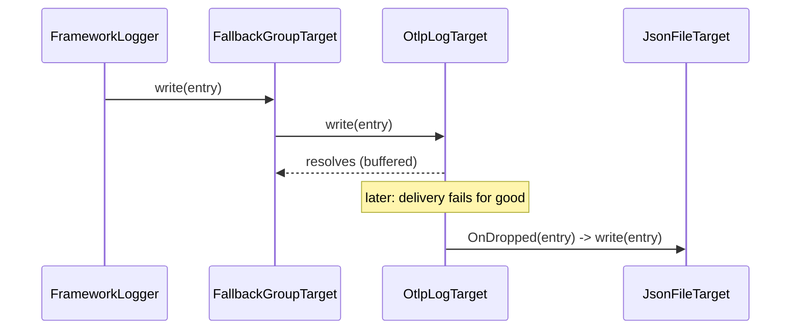

# Wrapper targets

Wrapper targets decorate other targets declared inline under `options`: fan out to many (`SplitGroupTarget`), flush on severe entries (`AutoFlushTarget`), retry rejected writes (`RetryingTarget`), or fail over to a fallback (`FallbackGroupTarget`). They nest, so any combination is a config change.

## How it works

1. A rule routes to the wrapper's `name`, like any target.
2. In `resolve()`, the wrapper resolves each inline definition by its `type` (`DI.resolve(def.type, [def])`), exactly as `FrameworkLogger` resolves top-level targets.
3. On `write(entry)`, it calls the inner targets' `write()`:

| Wrapper | `write()` | `forceFlush()` | `dispose()` |
| --- | --- | --- | --- |
| `SplitGroupTarget` | All inner writes in parallel, `Promise.allSettled`; never rejects. | All inner. | All inner. |
| `AutoFlushTarget` | Inner write, then `inner.forceFlush()` when `entry.Level >= flushLevel`. | Inner. | Inner. |
| `RetryingTarget` | Inner write through a `@spinajs/util` retry pipeline (exponential backoff with jitter); rejects after the last attempt. | Inner. | Inner. |
| `FallbackGroupTarget` | Inner targets in order; resolves on the first that does not reject; when all reject, logs a warning and resolves. | All inner. | All inner. |

### The write-rejection contract

`LogTarget.write()` may reject to say "not accepted". Wrappers act on that:

- **Strict targets** (console, custom targets that throw) reject, so `RetryingTarget` retries them and `FallbackGroupTarget` moves to the next.
- **Self-healing targets** (`FileTarget`, `JsonFileTarget`, Loki, OTLP) buffer and retry internally and always resolve. Wrapping them in `RetryingTarget` does nothing.
- Self-healing targets call `this.OnDropped?.(entry)` for entries they give up on (buffer overflow, non-retryable delivery error). `FallbackGroupTarget.resolve()` sets each inner target's `OnDropped` to write into the next inner target, so late drops also reach the fallback, with no duplicates. The last target's `OnDropped` stays `null`.



## Configuration

Wrappers read their settings under `options`.

| Key | Type | Default | Allowed values | Meaning |
| --- | --- | --- | --- | --- |
| `options.targets` (`SplitGroupTarget`) | `ITargetsOption[]` | required | target definitions | Targets every entry goes to. |
| `options.target` (`AutoFlushTarget`) | `ITargetsOption` | required | a target definition | The wrapped target. |
| `options.flushLevel` (`AutoFlushTarget`) | `string` | `'error'` | level name | Lowest level that triggers `forceFlush()` after the write. |
| `options.target` (`RetryingTarget`) | `ITargetsOption` | required | a target definition | The wrapped target. |
| `options.maxAttempts` (`RetryingTarget`) | `number` | `3` | `>= 1` | Total attempts, the first included. |
| `options.delayMs` (`RetryingTarget`) | `number` | `100` | ms | Base delay; exponential backoff with jitter on top. |
| `options.targets` (`FallbackGroupTarget`) | `ITargetsOption[]` | required | target definitions | Primary first, then fallbacks. |

```js
targets: [
  {
    name: 'Everywhere',
    type: 'SplitGroupTarget',
    options: {
      targets: [
        { name: 'Console', type: 'ConsoleTarget' },
        { name: 'File', type: 'FileTarget', options: { path: 'logs/app.log' } },
      ],
    },
  },
  {
    name: 'SafeFile',
    type: 'AutoFlushTarget',
    options: { target: { name: 'Crash', type: 'FileTarget', options: { path: 'logs/crash.log' } }, flushLevel: 'fatal' },
  },
  {
    name: 'Durable',
    type: 'FallbackGroupTarget',
    options: {
      targets: [
        { name: 'Otlp', type: 'OtlpLogTarget', options: { endpoint: 'http://collector:4318' } },
        { name: 'Spill', type: 'JsonFileTarget', options: { path: 'logs/undelivered.ndjson' } },
      ],
    },
  },
]
```

## Services and extension points

| Service | DI token and lifetime | Default implementation | Alternatives | How to replace or extend |
| --- | --- | --- | --- | --- |
| Fan-out | `'SplitGroupTarget'`, `@Singleton()` | `SplitGroupTarget` | | Subclass and override `write()`, eg. to route by level. |
| Flush on severity | `'AutoFlushTarget'`, `@Singleton()` | `AutoFlushTarget` | | Subclass; `Inner` and `Threshold` are protected. |
| Retry | `'RetryingTarget'`, `@Singleton()` | `RetryingTarget` | | Subclass and replace the protected `RetryPipeline` in `resolve()`. |
| Failover | `'FallbackGroupTarget'`, `@Singleton()` | `FallbackGroupTarget` | | Subclass; `Inner` is protected. |
| Drop hook | `LogTarget.OnDropped`, a property set by the wrapper | `null` | | Call `this.OnDropped?.(entry)` in your own buffered target, see [Custom targets](08-custom-targets.md#taking-part-in-fallback-chains). |

### Custom target inside wrappers: retried webhook alerts with a file fallback

A strict target rejects on failure, so the wrappers can act on it.

```ts sample
import { Injectable, NewInstance } from '@spinajs/di';
import { ICommonTargetOptions, ILogEntry, LogTarget } from '@spinajs/log';

interface IWebhookTargetOptions extends ICommonTargetOptions {
  url: string;
}

// config:
// { name: 'Alerts', type: 'FallbackGroupTarget', options: { targets: [
//     { name: 'AlertRetry', type: 'RetryingTarget', options: { maxAttempts: 4, delayMs: 250,
//         target: { name: 'Webhook', type: 'WebhookAlertTarget', url: 'https://hooks.example.com/ops' } } },
//     { name: 'AlertSpill', type: 'JsonFileTarget', options: { path: 'logs/alerts-undelivered.ndjson' } },
// ] } }
// rules: [{ name: '*', level: 'error', target: 'Alerts' }]
@NewInstance()
@Injectable('WebhookAlertTarget')
export class WebhookAlertTarget extends LogTarget<IWebhookTargetOptions> {
  public async write(entry: ILogEntry): Promise<void> {
    if (!this.Options.enabled) {
      return;
    }

    const res = await fetch(this.Options.url, {
      method: 'POST',
      headers: { 'content-type': 'application/json' },
      body: JSON.stringify({ text: `[${entry.Variables.level}] ${entry.Variables.logger}: ${entry.Variables.message}` }),
    });

    if (!res.ok) {
      throw new Error(`webhook answered ${res.status}`);
    }
  }
}
```

## Important behaviour

- Wrappers are singletons per type: a second definition of the same wrapper type reuses the first one's instance, options and inner targets. Use one definition per wrapper type, or a subclass registered under another name.
- Inner definitions bypass logger routing: their `enabled: false` does not stop construction (most targets then ignore writes), and their `filters` are **not** applied.
- Inner targets resolve through DI like any other, so an inner `ConsoleTarget` is the same singleton as a top-level `ConsoleTarget`, and the wrapper's `dispose()` disposes that shared instance.
- `SplitGroupTarget` never rejects, so nested inside `FallbackGroupTarget` it never triggers the fallback.
- `FallbackGroupTarget` swallows the final rejection and warns on the `FallbackGroupTarget` logger; a caller never sees it.
- `RetryingTarget` holds the logger's `write()` promise for the whole backoff; the caller does not wait, because level methods do not await `write()`.

## Best practices

- Wrap buffered file targets in `AutoFlushTarget` so a `fatal` line hits disk before a crash.
- Use `FallbackGroupTarget` with a network target first and `JsonFileTarget` last; `OnDropped` covers late failures.
- Use `RetryingTarget` only around strict targets; around self-healing ones it adds nothing.

## Patterns and antipatterns

```js
// Don't: RetryingTarget around a FileTarget; FileTarget never rejects, so nothing is retried
{ name: 'R', type: 'RetryingTarget', options: { target: { name: 'F', type: 'FileTarget', options: { path: 'logs/a.log' } } } }

// Do: retry the strict target, fall back to the file
{ name: 'Alerts', type: 'FallbackGroupTarget', options: { targets: [
  { name: 'R', type: 'RetryingTarget', options: { target: { name: 'Hook', type: 'WebhookAlertTarget', url: 'https://hooks.example.com/ops' } } },
  { name: 'F', type: 'JsonFileTarget', options: { path: 'logs/alerts.ndjson' } },
] } }
```

## Examples

### Console in development, console plus durable OTLP in production

```js
const prod = process.env.NODE_ENV === 'production';

module.exports = {
  logger: {
    targets: [
      { name: 'Console', type: 'ConsoleTarget' },
      {
        name: 'Remote',
        type: 'FallbackGroupTarget',
        enabled: prod,
        options: {
          targets: [
            { name: 'Otlp', type: 'OtlpLogTarget', options: { endpoint: process.env.OTLP_ENDPOINT, resource: { 'service.name': 'shop-api' } } },
            { name: 'Spill', type: 'JsonFileTarget', options: { path: 'logs/otlp-undelivered.ndjson' } },
          ],
        },
      },
    ],
    rules: [
      { name: '*', level: 'info', target: 'Console' },
      { name: '*', level: 'info', target: 'Remote' },
    ],
  },
};
```

## Related

- [Custom targets](08-custom-targets.md): writing strict and self-healing targets.
- [File target](05-file-target.md): the self-healing target used as a fallback.
- `@spinajs/log-otlp`, `@spinajs/log-source-graphana-loki`: network targets that call `OnDropped`.
