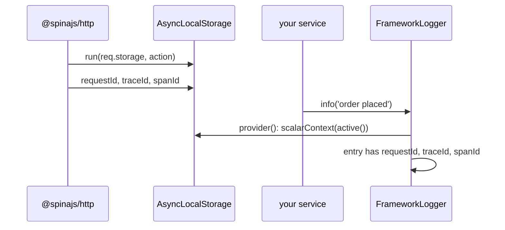

# Async context and tracing

`LogContext` holds ambient fields for the current async operation (a request, a job). Every entry logged inside it, by any logger, at any depth, gets those fields without passing them around. W3C `traceparent` helpers put a shared trace id into that context.

## How it works

1. `LogContext` resolves the DI singleton `AsyncLocalStorage` from `node:async_hooks` on every call. `@spinajs/http` runs each action inside the same instance with `req.storage` as the store.
2. `LogBotstrapper.bootstrap()` calls `setLogContextProvider(() => scalarContext(LogContext.active()))`.
3. `createLogMessageObject()` calls the provider for every entry and merges the result at the **lowest** precedence: core fields, logger variables and call fields override it. A provider that throws is ignored.
4. `scalarContext()` keeps only `string`, `number`, `boolean` and `bigint` values, plus `Principal` rendered as `type:id`. Objects, arrays, dates, `null` and functions are dropped.
5. In `@spinajs/http`, the `RequestId` middleware sets `requestId`, continues an inbound `traceparent` (or starts a trace) with `newTraceContext()`, stores `traceId` and `spanId` in `req.storage`, and sends `traceparent` and `x-request-id` response headers.



## API

| Member | Effect |
| --- | --- |
| `LogContext.active()` | Current store, or `{}` outside any context. |
| `LogContext.with(vars, fn)` | Runs `fn` with `{ ...active(), ...vars }` as the store and returns its result. Nested calls accumulate; the outer store is not changed. |
| `LogContext.set(key, value)` | Writes into the current store in place. No-op outside a context. |
| `LogContext.bind(fn)` | Returns `fn` bound to the current store, for callbacks run later (timers, emitters). Returns `fn` itself outside a context. |
| `scalarContext(ctx)` | The scalar projection used for log entries. |
| `setLogContextProvider(fn)` | Replaces the provider `createLogMessageObject()` calls. From `@spinajs/log-common`, re-exported. |
| `parseTraceparent(value)` | `{ version, traceId, parentId, flags, sampled }`, or `null` for missing, malformed, version `ff` or all-zero ids. Case-insensitive. |
| `newTraceContext(inbound?)` | Continues a valid inbound header (same `traceId` and `sampled`, new `spanId`) or starts a sampled trace. |
| `formatTraceparent(ctx)` | `00-<traceId>-<spanId>-<01 \| 00>`. |
| `randomTraceId()`, `randomSpanId()` | 32 and 16 lowercase hex chars from `crypto.getRandomValues`. |
| `ITraceContext` | `{ traceId, spanId, sampled }`. |

## Services and extension points

| Service | DI token and lifetime | Default implementation | Alternatives | How to replace or extend |
| --- | --- | --- | --- | --- |
| Ambient store | `AsyncLocalStorage`, DI singleton (resolved by class) | the instance `@spinajs/http` runs actions in | | Shared on purpose; register another instance only if you also want to detach from http's request store. |
| Context provider | `setLogContextProvider(fn)`, one module-level function | `() => scalarContext(LogContext.active())`, set by `LogBotstrapper` | browser entry: same, set at import | Call `setLogContextProvider()` **after** `LogBotstrapper.bootstrap()`, which overwrites it. |

### Replacing the context provider

Replace it to add process-wide fields or to read another store. Keep it cheap and non-throwing: it runs for every entry.

```ts sample
import { Bootstrapper, DI } from '@spinajs/di';
import { LogContext, scalarContext, setLogContextProvider } from '@spinajs/log';
import { hostname } from 'os';

const node = { host: hostname(), region: process.env.AWS_REGION ?? 'local', pid: process.pid };

export async function bootApp(): Promise<void> {
  for (const b of await DI.resolve(Array.ofType(Bootstrapper))) {
    await b.bootstrap();
  }

  // After LogBotstrapper: it installs the default provider during bootstrap().
  setLogContextProvider(() => ({ ...node, ...scalarContext(LogContext.active()) }));
}
```

## Important behaviour

- On Node, without `LogBotstrapper.bootstrap()`, the provider stays the default `() => ({})`: `LogContext` still works for your own reads, but entries get no ambient fields.
- Only scalars reach entries. Pass objects as call fields.
- `Principal` (set by authentication) is rendered as `type:id`; `%` and `:` in `type` are percent-encoded and control characters escaped, so an id cannot forge a log line.
- `set()` mutates the store object, which inside a request is `req.storage`; other code reading `req.storage` sees the key.
- `with()` copies the store: keys set inside it are lost when it returns. `set()` inside `with()` changes only the copy.
- Callbacks registered outside a context (eg. an `EventEmitter` listener added at boot) run without it; wrap them with `LogContext.bind()` when they are registered inside one.
- The browser `LogContext` has no async isolation: `with()` holds the context only for the synchronous part of `fn`. See [Browser build](18-browser-build.md).

## Best practices

- Wrap each unit of background work (queue job, cron tick, socket message) in `LogContext.with({ jobId, ... }, ...)`.
- Propagate traces on outgoing calls: send `formatTraceparent(...)` built from the current `traceId`.
- Keep ambient keys short and stable (`requestId`, `tenant`, `jobId`); they appear on every line and every JSON record.

## Patterns and antipatterns

```ts
// Don't: thread the job id through every call by hand
await processInvoice(jobId, invoice, log);

// Do: set it once; every logger inside sees it
await LogContext.with({ jobId }, () => processInvoice(invoice));
```

## Examples

### Correlate a queue job with the request that queued it

```ts sample
import { DI } from '@spinajs/di';
import { Log, LogContext, formatTraceparent, newTraceContext } from '@spinajs/log';

interface IJob {
  id: string;
  tenant: string;
  traceparent?: string;
  payload: { invoiceId: number };
}

export async function runJob(job: IJob, handler: (payload: IJob['payload']) => Promise<void>): Promise<void> {
  const trace = newTraceContext(job.traceparent);
  const log = DI.resolve(Log, ['jobs.invoices']);

  await LogContext.with({ jobId: job.id, tenant: job.tenant, traceId: trace.traceId, spanId: trace.spanId }, async () => {
    log.info({ invoiceId: job.payload.invoiceId }, 'processing invoice ${invoiceId}');

    await fetch('http://billing.internal/render', {
      method: 'POST',
      headers: { traceparent: formatTraceparent(trace), 'content-type': 'application/json' },
      body: JSON.stringify(job.payload),
    });

    await handler(job.payload);
    log.success('invoice job done');
  });
}

export function enqueueFromRequest(payload: IJob['payload']): IJob {
  const ctx = LogContext.active();
  const traceparent = typeof ctx.traceId === 'string' && typeof ctx.spanId === 'string' ? formatTraceparent({ traceId: ctx.traceId, spanId: ctx.spanId, sampled: true }) : undefined;
  return { id: crypto.randomUUID(), tenant: String(ctx.tenant ?? 'default'), traceparent, payload };
}
```

## Related

- [Layouts](03-layouts.md): print `${requestId}` or `${traceId}` on text lines.
- [Performance measurement](15-performance-measurement.md): the per-request `perf` accumulator lives in the same store.
- `@spinajs/http`: the `RequestId` middleware and the per-action store.
