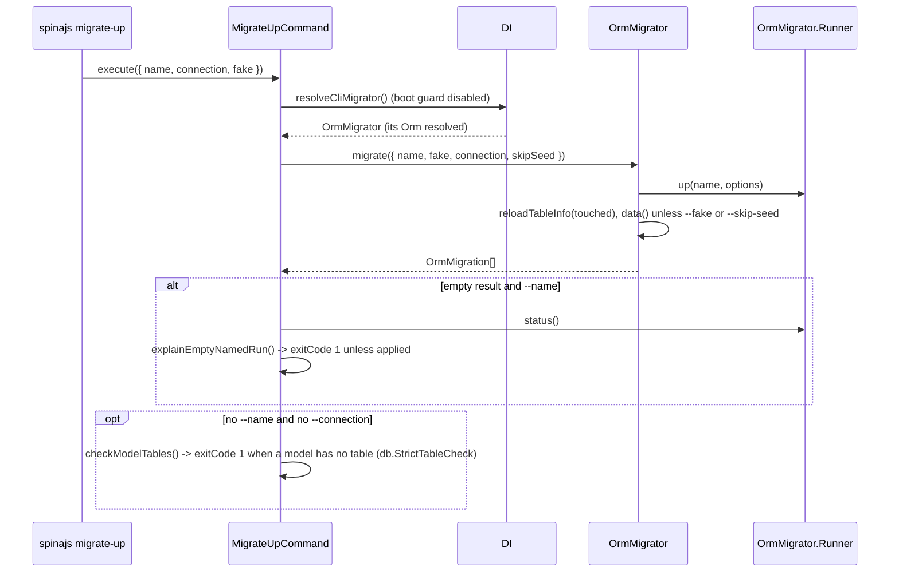

# Applying migrations

`migrate-up` applies pending migrations and their `data()` seeds through `OrmMigrator.migrate()`. It is the deploy step: the application never migrates, and its `Orm.resolve()` refuses to boot while a migration is pending or failed (see [Migrations: boot check](../orm/10-migrations.md#boot-check-diresolveorm)). Run it before the application starts.

```sh
spinajs migrate-up                                              # everything pending, every connection
spinajs migrate-up --name CreateInvoices_2026_10_01_09_00_00    # exactly one migration
spinajs migrate-up --connection reporting                       # one connection only
spinajs migrate-up --fake                                       # record as applied, run nothing
spinajs migrate-up --skip-seed                                  # apply, run no data() seeds
spinajs migrate-up --dry-run                                    # print what would be applied, apply nothing
spinajs migrate-up --env production                             # with the configuration of one environment
```

## In a deploy

Run `npx spinajs migrate-up` once per release, before the new application version starts, with `--env <env>` when the application runs with one:

- a release step of the platform, or a pipeline job before the rollout;
- a Kubernetes `Job` the rollout waits for, or an init container of the application's pod;
- a `predeploy` script in `package.json`.

Several replicas or init containers running it at the same time are safe. Each run holds one lock per connection for the whole run, seeds included (see [Migrations: locking](../orm/10-migrations.md#locking)), so the others wait and then find nothing pending. Behind PgBouncer in transaction pooling, or on a mysql multi-primary cluster, set `Migration.Lock.Mode: 'table'` first.

```json
{
  "scripts": {
    "predeploy": "spinajs migrate-up --env production",
    "deploy": "..."
  }
}
```

```yaml
# Kubernetes: an init container migrates before the application container starts
initContainers:
  - name: migrate
    image: registry.example.com/shop:1.4.0
    command: ['npx', 'spinajs', 'migrate-up', '--env', 'production']
```

A start that skipped the step fails at `Orm.resolve()` with `PendingMigrationsException`, whose message names the pending migrations, their connections and `npx spinajs migrate-up`.

## How it works

1. `MigrateUpCommand.execute(options)` calls [`resolveCliMigrator()`](06-cli-orm.md). The migrator and its `Orm` resolve in tool mode: no boot check, nothing applied.
   - With `--dry-run` it calls `MigrateUpCommand.printPlan(migrator, options)` and stops: see [Dry run](#dry-run).
2. It calls `migrator.migrate({ name, fake, connection, skipSeed })`.
3. `OrmMigrator.Runner` plans, orders and applies the migrations; the migrator then re-reads the table info of the models they touched and runs their `data()` hooks (none with `--fake` or `--skip-seed`). See [Migrations: `OrmMigrator`](../orm/10-migrations.md#ormmigrator). Ordering, batches, locking and transactions are described in [Migrations: a run](../orm/10-migrations.md#a-run-migrationrunnerup). It throws, and the command fails, when:
   - `--name` matches no registered migration (`OrmException`, message contains `not registered`);
   - `--connection` matches no configured connection or alias (`OrmException` naming it);
   - the connection holds a [failed](../orm/10-migrations.md#migration-states) migration;
   - a migration's `up()` throws;
   - a `data()` hook throws (`OrmException` `Migration data() phase failed for: ...`, after every hook ran).
4. `MigrateUpCommand.reportRun(migrator, executed, options)` reports the result. With a non-empty result, it logs `Applied <n> migration(s): <names>` at `success` level, or `Recorded as applied ( --fake, nothing was executed ) ...` with `--fake`.
5. With an empty result and no `--name`, it logs that nothing is pending (naming the connection when `--connection` was given). Exit code `0`.
6. With an empty result and a `--name`, `MigrateUpCommand.explainEmptyNamedRun()` calls `migrator.Runner.status()`, unfiltered, and finds the entry:
   - no entry: the migration is registered, but its connection is not configured here or it has no `@Migration()`. Logs an error, sets `process.exitCode = 1`;
   - applied: logs `already applied ... nothing to do`. Exit code `0`;
   - otherwise: logs a connection mismatch when `--connection` was given, then that the migration is failed or still pending. Sets `process.exitCode = 1`.
7. Without `--name` and `--connection`, `MigrateUpCommand.checkModelTables(orm, fake)` checks the model tables:
   - with [`db.StrictTableCheck`](../orm/01-connections.md#configuration) `false`, it returns at once: the `Orm` resolve already logged each missing table as a warning;
   - otherwise it calls `orm.reloadTableInfo({ strict: true })`. A registered model whose table is still missing makes it log `Migrations are applied, but the application will not boot: Missing tables (db.StrictTableCheck): ...` at error level (`Migrations are recorded as applied ( --fake ), but ...` with `--fake`) and set `process.exitCode = 1`. The migrations stay applied;
   - any other error from `reloadTableInfo()` is rethrown, and the command fails.



## Options

| Option | Type | Default | Meaning |
| --- | --- | --- | --- |
| `-n, --name [name]` | `string` | none | Apply only this migration, by class name (`<Prefix>_yyyy_MM_dd_HH_mm_ss`) |
| `-c, --connection [connection]` | `string` | none | Apply only on this connection, by name or alias. Other connections are not touched; their tracking tables are not even created |
| `-f, --fake` | `boolean` | `false` | Write the tracking rows as applied without calling `up()` or `data()` |
| `--skip-seed` | `boolean` | `false` | Apply without running the `data()` seeds; run them later with [`migrate-seed`](09-seeding.md) |
| `--dry-run` | `boolean` | `false` | Print what would be applied, in order, and apply nothing. Honours `--name` and `--connection` |

`execute()` takes `IMigrateUpCommandOptions`: `{ name?: string; connection?: string; fake?: boolean; skipSeed?: boolean; dryRun?: boolean }`.

## Dry run

`--dry-run` prints `OrmMigrator.plan({ name, connection })` on stdout with `console.log`, as `migrate-status` prints its report:

```text
Would apply 2 migration(s), in this order ( BATCH  CONNECTION  MIGRATION ):
  3  default  CreateInvoices_2026_10_01_09_00_00
  3  default  AddInvoiceIndex_2026_10_02_09_00_00
```

- The batch is the one the run would record: one past the connection's highest applied batch. It counts registered migrations only: an applied row whose class is gone, in a higher batch, makes the printed batch lower than the recorded one.
- A `FAILED` migration on a connection the run would touch is printed in its own block, whatever `--name` is, because the real run refuses that connection. The run throws at the connection's first migration, so nothing from that point on, on any connection, is listed under `Would apply`. Clear it with [`migrate-resolve`](04-resolving-failed-migrations.md):

```text
Blocked by 1 FAILED migration(s), the run stops at the first one ( BATCH  CONNECTION  MIGRATION ):
  3  default  CreateInvoices_2026_10_01_09_00_00  FAILED - blocks default, run migrate-resolve
```

- It reads without DDL: no tracking table or lock table is created and no lock is taken. It runs no `up()` and no `data()`.
- It exits `1` when the plan has entries, failed ones included. It prints `Nothing to apply` and exits `0` when the plan is empty, so it works as "is a migration due?" in a deploy script.
- It does not run the model table check of a full run.

## Exit codes

| Result | Exit code |
| --- | --- |
| Migrations applied, or nothing pending | `0` |
| `--dry-run` with nothing to apply | `0` |
| `--dry-run` with at least one migration to apply, or a FAILED one blocking the run | `1` |
| `--name` given and the migration is already applied | `0` |
| `--name` given and the migration did not run (connection not configured, excluded by `--connection`, failed or still pending) | `1` |
| A full run (no `--name`, no `--connection`) leaves a registered model without its table, with `db.StrictTableCheck` on | `1` |
| Unknown `--name`, unknown `--connection`, a failed row on the connection, a migration or a `data()` hook that throws, a table check that fails for another reason than a missing table | `-1` (255 on POSIX), the error through the `CLI` logger |

## Services and extension points

| Service | DI token and lifetime | Default implementation | Alternatives | How to replace or extend |
| --- | --- | --- | --- | --- |
| `MigrateUpCommand` | Class token `MigrateUpCommand`, singleton (no lifetime decorator); `@Command` also registers it under `'__cli_command__'`. `Cli` resolves it lazily, only when `migrate-up` is invoked | `MigrateUpCommand` | none shipped | `DI.register(MySub).as(MigrateUpCommand)` before `Cli` dispatches; override `execute()`, `printPlan()`, `reportRun()`, `explainEmptyNamedRun()` or `checkModelTables()`. See [Customizing commands](08-customizing-commands.md) |
| Migration service per connection | `db.Connections[].Migration.Service` (a DI token), resolved by the runner | `DefaultMigrationService` from `@spinajs/orm` | none shipped | Owned by `@spinajs/orm`; see [Migrations: services](../orm/10-migrations.md#services-and-extension-points). `migrate-up` uses whatever service the connection configures |

### `MigrateUpCommand`: refuse to migrate production without a confirmation

`execute()` runs the migrations and calls the hooks: `reportRun(migrator, executed, options)` logs the result, `explainEmptyNamedRun(migrator, name, connection?)` decides how an empty named run is reported, and `checkModelTables(orm, fake?)` checks the tables after a full run. This subclass adds a guard before the shipped behaviour.

```ts sample
import { DI } from '@spinajs/di';
import { InvalidArgument } from '@spinajs/exceptions';
import { IMigrateUpCommandOptions, MigrateUpCommand } from '@spinajs/orm-cli';

/** `migrate-up` that runs against production only when MIGRATE_CONFIRM=yes is set. */
export class ConfirmedMigrateUpCommand extends MigrateUpCommand {
  public async execute(options: IMigrateUpCommandOptions): Promise<void> {
    const production = (process.env.APP_ENV ?? 'production').startsWith('prod');

    if (production && !options.fake && process.env.MIGRATE_CONFIRM !== 'yes') {
      throw new InvalidArgument('Refusing to migrate production: set MIGRATE_CONFIRM=yes to apply, or pass --fake to only record');
    }

    await super.execute(options);
  }
}

// In your own CLI entry point, before `DI.resolve(Cli)`:
DI.register(ConfirmedMigrateUpCommand).as(MigrateUpCommand);
```

Keep the subclass out of every `system.dirs.cli` directory: it inherits the `migrate-up` metadata and would be added as a second `migrate-up` command.

## Important behaviour

- **The command boots in tool mode.** An ordinary `DI.resolve(Orm)` would refuse the pending migrations this command is meant to apply; `resolveCliMigrator()` disables that check. See [The CLI migrator](06-cli-orm.md).
- **It runs on a configuration still written for 3.0.** Tool mode does not read `Migration.OnStartup`, so the first `migrate-up` after the upgrade works; the application's boot then fails until the key is removed.
- **`migrate-up` seeds what it applied.** `data()` runs once every migration of the run is applied, under the run lock; it may resolve services that inject the `Orm`. A run that fails on a migration seeds none of the ones it applied before it, and a later run finds them applied: run [`migrate-seed`](09-seeding.md) for them. `--skip-seed` leaves every seed to `migrate-seed`.
- **An unknown `--name` or `--connection` throws.** An empty, successful-looking run from a typo would read as "already current".
- **A named migration on an unconfigured connection exits `1`.** The runner only warns and returns `[]` there; the command checks `status()` to tell that apart from "already applied".
- **`status()` in step 6 is not narrowed by `--connection`.** A migration on a connection the filter excluded still has an entry, so the command can say which connection it belongs to.
- **`--connection` matches aliases.** The error message states the mismatch as a possibility, because the requested name and the reported connection can be two names for one driver.
- **Only a full run checks the tables.** A run narrowed by `--name` or `--connection` left other migrations out, so it says nothing about their tables and never exits `1` for a missing one.
- **A missing table does not undo the run.** `migrate-up` exits `1` after the migrations are applied (or recorded with `--fake`); fix the cause and run it again, or let the next boot name the table.
- **A failed migration blocks the whole connection.** `migrate-up` throws until [`migrate-resolve`](04-resolving-failed-migrations.md) records its outcome.
- **An interrupted migration does not block.** The next `migrate-up` re-runs it from the top, with a warning from the migration service. Check [`migrate-status`](03-migration-status.md) first.
- **The blocking guarantee is best effort.** When the ORM fails to write the failure row too (dropped connection, locked table), it logs that error instead of raising it. The row then reads as `INTERRUPTED`, and the next `migrate-up` re-runs the migration instead of refusing. After an incident, check `migrate-status` instead of trusting a later successful run.

## Best practices

- Run `migrate-status` before `migrate-up` in a deploy, and stop on a `FAILED` or `INTERRUPTED` line.
- Use `--fake` only to bring the tracking table in line with a database changed by hand; it calls neither `up()` nor `data()`.
- Write `data()` hooks so a rerun is harmless: a deploy that retries `migrate-up` after a seed failure does not run them again, and an operator runs them by hand.
- Pass `--name` together with `--connection` only when you know the migration's connection; otherwise leave `--connection` out.
- Run the deploy step's `migrate-up` without `--name` and `--connection`, so a model left without its table fails the deploy instead of the first start.

## Patterns and antipatterns

```ts
// Don't: DI.resolve(Orm) runs the application's boot check, which rejects with PendingMigrationsException
// on exactly the database this script means to migrate
const orm = await DI.resolve(Orm);

// Do: resolve the CLI migrator, then run exactly the migrations you asked for
const migrator = await resolveCliMigrator();
await migrator.migrate({ connection: 'reporting' });
```

## Examples

### Apply one connection from a maintenance script

```ts sample
import { DI } from '@spinajs/di';
import { Configuration } from '@spinajs/configuration';
import { MigrateUpCommand } from '@spinajs/orm-cli';
import '@spinajs/log';

/** Applies pending migrations on the reporting replica only, during its maintenance window. */
async function migrateReporting(): Promise<void> {
  await DI.resolve(Configuration);

  const up = await DI.resolve(MigrateUpCommand);
  await up.execute({ connection: 'reporting' });

  // a run narrowed by connection skips the table check; errors have already thrown
  process.exit(process.exitCode ?? 0);
}

void migrateReporting();
```

## Related

- [Migrations](../orm/10-migrations.md): what `OrmMigrator.migrate()` and `MigrationRunner.up()` do, the tracking table and the lock.
- [Rolling back migrations](02-rolling-back-migrations.md): the reverse operation.
- [Migration status](03-migration-status.md): check the result.
- [The CLI migrator](06-cli-orm.md): why the command boots without the application's boot check.
- [Seeding](09-seeding.md): `--skip-seed` and `migrate-seed`.
