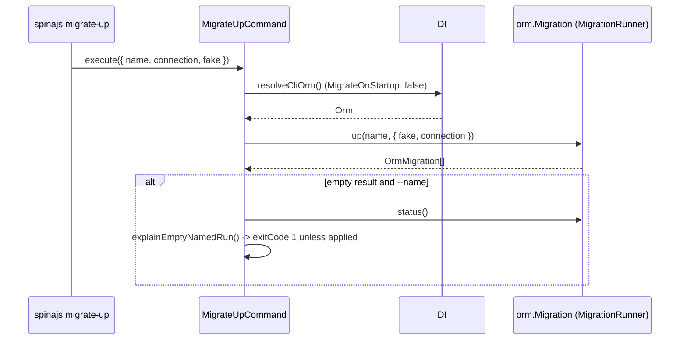

# Applying migrations

`migrate-up` applies pending migrations through `orm.Migration.up()`. Use it in a deploy step, or to apply a migration on a connection whose `Migration.OnStartup` is off.

```sh
spinajs migrate-up                                              # everything pending, every connection
spinajs migrate-up --name CreateInvoices_2026_10_01_09_00_00    # exactly one migration
spinajs migrate-up --connection reporting                       # one connection only
spinajs migrate-up --fake                                       # record as applied, run nothing
```

## How it works

1. `MigrateUpCommand.execute(options)` calls [`resolveCliOrm()`](06-cli-orm.md). The `Orm` boots without its own migration pass.
2. It calls `orm.Migration.up(options.name, { fake, connection })`. `force` is left at its default `true`, so connections with `Migration.OnStartup: false` run too.
3. The runner plans, orders and applies the migrations. Ordering, batches, locking and transactions are described in [Migrations: a run](../orm/10-migrations.md#a-run-migrationrunnerup). It throws, and the command fails, when:
   - `--name` matches no registered migration (`OrmException`, message contains `not registered`);
   - `--connection` matches no configured connection or alias (`OrmException` naming it);
   - the connection holds a [failed](../orm/10-migrations.md#migration-states) migration;
   - a migration's `up()` throws.
4. With a non-empty result, the command logs `Applied <n> migration(s): <names>` at `success` level, or `Recorded as applied ( --fake, nothing was executed ) ...` with `--fake`.
5. With an empty result and no `--name`, it logs that nothing is pending (naming the connection when `--connection` was given). Exit code `0`.
6. With an empty result and a `--name`, `MigrateUpCommand.explainEmptyNamedRun()` calls `orm.Migration.status()`, unfiltered, and finds the entry:
   - no entry: the migration is registered, but its connection is not configured here or it has no `@Migration()`. Logs an error, sets `process.exitCode = 1`;
   - applied: logs `already applied ... nothing to do`. Exit code `0`;
   - otherwise: logs a connection mismatch when `--connection` was given, then that the migration is failed or still pending. Sets `process.exitCode = 1`.



## Options

| Option | Type | Default | Meaning |
| --- | --- | --- | --- |
| `-n, --name [name]` | `string` | none | Apply only this migration, by class name (`<Prefix>_yyyy_MM_dd_HH_mm_ss`) |
| `-c, --connection [connection]` | `string` | none | Apply only on this connection, by name or alias. Other connections are not touched; their tracking tables are not even created |
| `-f, --fake` | `boolean` | `false` | Write the tracking rows as applied without calling `up()` |

`execute()` takes `IMigrateUpCommandOptions`: `{ name?: string; connection?: string; fake?: boolean }`.

## Exit codes

| Result | Exit code |
| --- | --- |
| Migrations applied, or nothing pending | `0` |
| `--name` given and the migration is already applied | `0` |
| `--name` given and the migration did not run (connection not configured, excluded by `--connection`, failed or still pending) | `1` |
| Unknown `--name`, unknown `--connection`, a failed row on the connection, a migration that throws | `-1` (255 on POSIX), the error through the `CLI` logger |

## Services and extension points

| Service | DI token and lifetime | Default implementation | Alternatives | How to replace or extend |
| --- | --- | --- | --- | --- |
| `MigrateUpCommand` | Class token `MigrateUpCommand`, singleton (no lifetime decorator); `@Command` also registers it under `'__cli_command__'`. `Cli` resolves it lazily, only when `migrate-up` is invoked | `MigrateUpCommand` | none shipped | `DI.register(MySub).as(MigrateUpCommand)` before `Cli` dispatches; override `execute()` or `explainEmptyNamedRun()`. See [Customizing commands](08-customizing-commands.md) |
| Migration service per connection | `db.Connections[].Migration.Service` (a DI token), resolved by the runner | `DefaultMigrationService` from `@spinajs/orm` | none shipped | Owned by `@spinajs/orm`; see [Migrations: services](../orm/10-migrations.md#services-and-extension-points). `migrate-up` uses whatever service the connection configures |

### `MigrateUpCommand`: refuse to migrate production without a confirmation

`execute()` is the whole command, and `explainEmptyNamedRun(orm, name, connection?)` decides how an empty named run is reported. This subclass adds a guard before the shipped behaviour.

```ts sample
import { DI } from '@spinajs/di';
import { InvalidArgument } from '@spinajs/exceptions';
import { IMigrateUpCommandOptions, MigrateUpCommand } from '@spinajs/orm-cli';

/** `migrate-up` that runs against production only when MIGRATE_CONFIRM=yes is set. */
export class ConfirmedMigrateUpCommand extends MigrateUpCommand {
  public async execute(options: IMigrateUpCommandOptions): Promise<void> {
    const production = (process.env.APP_ENV ?? 'production').startsWith('prod');

    if (production && !options.fake && process.env.MIGRATE_CONFIRM !== 'yes') {
      throw new InvalidArgument('Refusing to migrate production: set MIGRATE_CONFIRM=yes to apply, or pass --fake to only record');
    }

    await super.execute(options);
  }
}

// In your own CLI entry point, before `DI.resolve(Cli)`:
DI.register(ConfirmedMigrateUpCommand).as(MigrateUpCommand);
```

Keep the subclass out of every `system.dirs.cli` directory: it inherits the `migrate-up` metadata and would be added as a second `migrate-up` command.

## Important behaviour

- **The `Orm` applies nothing on its way in.** Without `resolveCliOrm()`, a boot pass would run every pending migration on `OnStartup` connections before `--fake` could take effect. See [The CLI `Orm`](06-cli-orm.md).
- **A migration applied by `migrate-up` never gets its `data()` hook.** The ORM seeds only what its boot pass applied, and a later boot finds the migration already applied. Apply migrations that seed data through an application boot.
- **An unknown `--name` or `--connection` throws.** An empty, successful-looking run from a typo would read as "already current".
- **A named migration on an unconfigured connection exits `1`.** The runner only warns and returns `[]` there; the command checks `status()` to tell that apart from "already applied".
- **`status()` in step 6 is not narrowed by `--connection`.** A migration on a connection the filter excluded still has an entry, so the command can say which connection it belongs to.
- **`--connection` matches aliases.** The error message states the mismatch as a possibility, because the requested name and the reported connection can be two names for one driver.
- **A failed migration blocks the whole connection.** `migrate-up` throws until [`migrate-resolve`](04-resolving-failed-migrations.md) records its outcome.
- **An interrupted migration does not block.** The next `migrate-up` re-runs it from the top, with a warning from the migration service. Check [`migrate-status`](03-migration-status.md) first.
- **The blocking guarantee is best effort.** When the ORM fails to write the failure row too (dropped connection, locked table), it logs that error instead of raising it. The row then reads as `INTERRUPTED`, and the next `migrate-up` re-runs the migration instead of refusing. After an incident, check `migrate-status` instead of trusting a later successful run.

## Best practices

- Run `migrate-status` before `migrate-up` in a deploy, and stop on a `FAILED` or `INTERRUPTED` line.
- Use `--fake` only to bring the tracking table in line with a database changed by hand; it calls neither `up()` nor `data()`.
- Pass `--name` together with `--connection` only when you know the migration's connection; otherwise leave `--connection` out.

## Patterns and antipatterns

```ts
// Don't: DI.resolve(Orm) runs the boot pass, so pending migrations on OnStartup connections are
// applied (and data() seeded) before this line, and the explicit run below applies nothing
const orm = await DI.resolve(Orm);
await orm.Migration.up();

// Do: resolve the CLI Orm, then run exactly the migrations you asked for
const orm = await resolveCliOrm();
await orm.Migration.up(undefined, { connection: 'reporting' });
```

## Examples

### Apply one connection from a maintenance script

```ts sample
import { DI } from '@spinajs/di';
import { Configuration } from '@spinajs/configuration';
import { MigrateUpCommand } from '@spinajs/orm-cli';
import '@spinajs/log';

/** Applies pending migrations on the reporting replica only, during its maintenance window. */
async function migrateReporting(): Promise<void> {
  await DI.resolve(Configuration);

  const up = await DI.resolve(MigrateUpCommand);
  await up.execute({ connection: 'reporting' });

  // exitCode is 1 only for an empty named run; errors have already thrown
  process.exit(process.exitCode ?? 0);
}

void migrateReporting();
```

## Related

- [Migrations](../orm/10-migrations.md): what `orm.Migration.up()` does, the tracking table and the lock.
- [Rolling back migrations](02-rolling-back-migrations.md): the reverse operation.
- [Migration status](03-migration-status.md): check the result.
- [The CLI `Orm`](06-cli-orm.md): why the command does not use `DI.resolve(Orm)`.
