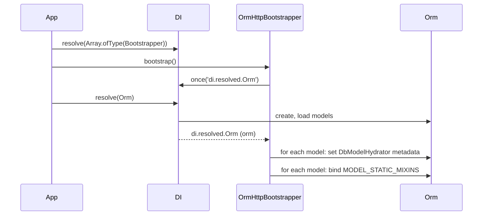

# Bootstrapping

Importing `@spinajs/orm-http` registers its route arguments, its `404` response and a bootstrapper. When the ORM resolves, `OrmHttpBootstrapper` gives every model a request hydrator and the `filter()`, `filterColumns()` and `filterSchema()` statics.

## How it works

At import time, before any bootstrapper runs:

| Module | Registers |
| --- | --- |
| `index.ts` | `FromDbModel`, `AsDbModel` under their class names (`@Injectable()`), `OrmHttpBootstrapper` under `Bootstrapper` |
| `route-arg.ts` | `FilterModelRouteArg` under its class name |
| `builders.ts` | `SelectQueryBuilder.prototype.filter`, by direct prototype assignment |
| `response-methods/OrmNotFound.ts` | `OrmNotFound` under `Response` and in the http error map for `OrmNotFoundException` |

Then, during application start:

1. The application resolves `Array.ofType(Bootstrapper)` and calls `bootstrap()` on each one.
2. `OrmHttpBootstrapper.bootstrap()` subscribes once to the DI event `di.resolved.Orm`. It does nothing else.
3. The application resolves `Orm`. DI emits `di.resolved.Orm` with the instance.
4. The listener walks `orm.Models` and sets `custom:arg_hydrator` metadata to `{ hydrator: DbModelHydrator }` on every model class that has no hydrator yet.
5. The listener copies every key of `MODEL_STATIC_MIXINS` onto every model class, bound to that class: `filter()`, `filterColumns()`, `filterSchema()`.



## Services and extension points

| Service | DI token and lifetime | Default implementation | Alternatives | How to replace or extend |
| --- | --- | --- | --- | --- |
| Model setup at ORM resolve | `Bootstrapper` (list, resolved with `Array.ofType(Bootstrapper)`), singleton | `OrmHttpBootstrapper` | none shipped | Add your own `Bootstrapper` that listens to `di.resolved.Orm` after it. Removing it is not supported: without it no model has `filter()` or `DbModelHydrator`. |
| Model statics | `MODEL_STATIC_MIXINS` object, read once per ORM resolve | `filter`, `filterColumns`, `filterSchema` | none | Add a key before the ORM resolves; see [Model statics and builder extension](10-model-statics-and-builder-extension.md). |
| Model request hydrator | `custom:arg_hydrator` metadata on each model class | `DbModelHydrator` | your own `ArgHydrator` | Replace globally through DI, or per model after this bootstrapper; see [Custom route arguments and hydrators](08-custom-route-args-and-hydrators.md). |

### OrmHttpBootstrapper: running your own step after it

Use this when one model needs its own request hydrator and you cannot put `@Hydrator()` on its class. `OrmHttpBootstrapper` keeps a hydrator a model already has, so `@Hydrator()` on the class is enough when you own it. Otherwise set the metadata from a later `di.resolved.Orm` listener.

Listeners fire in the order they subscribed, and bootstrappers run in registration order. Import `@spinajs/orm-http` before the module that declares your bootstrapper.

```ts sample
import 'reflect-metadata';
import { Bootstrapper, DI, Injectable } from '@spinajs/di';
import { ArgHydrator, IRouteParameter } from '@spinajs/http';
import { Connection, Model, ModelBase, Primary } from '@spinajs/orm';
import '@spinajs/orm-http';

@Connection('default')
@Model('audit_entries')
export class AuditEntry extends ModelBase<AuditEntry> {
  @Primary()
  public Id: number;

  public Action: string;

  public CreatedAt: string;
}

/** Audit entries are append-only: a client never picks the id or the timestamp. */
export class AuditEntryHydrator extends ArgHydrator {
  public async hydrate(input: any, _parameter: IRouteParameter): Promise<AuditEntry> {
    return new AuditEntry({ Action: input?.Action });
  }
}

@Injectable(Bootstrapper)
export class AuditHydratorBootstrapper extends Bootstrapper {
  public bootstrap(): void {
    // Subscribes after OrmHttpBootstrapper, so this runs after it set DbModelHydrator.
    DI.once('di.resolved.Orm', () => {
      Reflect.defineMetadata('custom:arg_hydrator', { hydrator: AuditEntryHydrator }, AuditEntry);
    });
  }
}
```

## Important behaviour

- The listener is `DI.once`: it runs on the first `Orm` resolve only. A model not in `orm.Models` at that moment gets neither the hydrator nor the statics.
- If `Orm` resolves before the bootstrappers run, the event is missed. No model gets `filter()`, and `@Filter(Model)` fails at request time.
- The statics exist only after the ORM resolves. They are **not** there while controllers are decorated, which is why `FilterModelRouteArg` builds the filter schema per request.
- A model that already has `custom:arg_hydrator` metadata, own or inherited (for example from `@Hydrator()`), keeps it.
- `SelectQueryBuilder.prototype.filter` exists from import time, on every select builder of every model, whether or not the bootstrapper ran. It calls the model's `filterColumns()` static unless you pass the columns yourself.

## Best practices

- Run all bootstrappers before the first `DI.resolve(Orm)`. The `Bootstrapper` loop below is the order the package expects.
- Pass the column list to `.filter(filters, op, columns)` when the builder may belong to a model the ORM did not load. It then does not depend on the bootstrapper.

## Patterns and antipatterns

```ts
// Don't: Orm resolves before the bootstrappers, so di.resolved.Orm fires with no listener
const orm = await DI.resolve(Orm);
for (const b of await DI.resolve(Array.ofType(Bootstrapper))) await b.bootstrap();

// Do
for (const b of await DI.resolve(Array.ofType(Bootstrapper))) await b.bootstrap();
const orm = await DI.resolve(Orm);
```

## Examples

### Start an application with orm-http wired in

```ts sample
import { DI, Bootstrapper } from '@spinajs/di';
import { Orm } from '@spinajs/orm';
import '@spinajs/orm-http';

export async function bootstrap() {
  const bootstrappers = await DI.resolve(Array.ofType(Bootstrapper));
  for (const b of bootstrappers) {
    await b.bootstrap();
  }

  // OrmHttpBootstrapper's di.resolved.Orm listener runs here.
  return await DI.resolve(Orm);
}
```

## Related

- [Model statics and builder extension](10-model-statics-and-builder-extension.md): the statics this bootstrapper binds, and how to add your own.
- [Custom route arguments and hydrators](08-custom-route-args-and-hydrators.md): replacing `DbModelHydrator` for every model at once.
- [Container events](../di/12-container-events.md): `di.resolved.<Name>` and the other DI events.
- [Multiple implementations](../di/06-multiple-implementations.md): how `Array.ofType(Bootstrapper)` collects bootstrappers.
