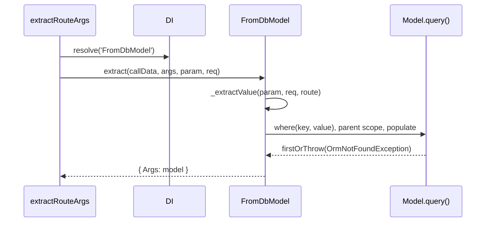

# Route arguments

`@FromModel()` loads an existing row from a value in the request and injects the model; a missing row answers `404`. `@AsModel()` builds a new, unsaved model from the request body. A model typed `@Body()` is hydrated the same way through `DbModelHydrator`.

## How it works

### `@FromModel(options?)`

1. `@FromModel()` records a route parameter of type `'FromDbModel'`. At request time `extractRouteArgs()` (http) resolves `DI.resolve('FromDbModel')`, which is `FromDbModel` unless you registered a replacement.
2. Route arguments run in the reverse of their declaration order (TypeScript applies parameter decorators right to left), unless a `RouteArgs` sets `Priority`. Each one passes a `Payload` to the next; `FromDbModel` reads the payload of the argument extracted just before it.
3. `FromDbModel.extract()` picks the model class: `options.model()` when set, else the parameter's reflected type.
4. With `options.query`, it calls `query.call(Model.query(), args, value)` and runs `firstOrThrow(new OrmNotFoundException('Resource not found'))` on the result.
5. Without it, `fromDbModelDefaultQueryFunction()` builds the query:
   1. `_extractValue()` reads the key from `paramType` (`FromParams` by default) under `paramField` (the argument name by default).
   2. A model with a composite primary key and no `queryField` throws `BadRequest`.
   3. `SELECT *` from the model's table, aliased `$<table>`, `WHERE <queryField or primary key> = <value>`.
   4. **Parent scoping**: for every `belongsTo` relation whose name matches a key of `Payload.Param.Args` (case-insensitive, optionally `_`-prefixed), it adds `WHERE <foreign key> = <that value>`. A matching key with an empty value throws `InvalidArgument`.
   5. `populate(options.include)` when set.
   6. Unless `noInclude`, `populate()` of `Payload.Query.Args.include` or `_include`.
   7. `firstOrThrow(new OrmNotFoundException('Resource not found'))`.
6. The row becomes the argument. `FromDbModel` does not validate it against a schema and does not run `ArgInputFilter`s.



### `@AsModel(field?, type?)`

1. `@AsModel()` records a route parameter of type `'AsDbModel'`, resolved as `DI.resolve('AsDbModel')`.
2. `AsDbModel.extract()` throws `BadRequest` when `req.body` is empty.
3. It takes `req.body[<argument name>]` when that value is truthy; otherwise the whole body when the route has exactly one `AsDbModel` argument; otherwise `null`.
4. `RouteArgs.tryHydrateParam()` runs input filters, validates against the model's schema, and calls the model's hydrator: `DbModelHydrator` after bootstrapping.
5. `DbModelHydrator.hydrate()` throws `OrmException('primary key cannot be null')` for `null` input, else returns `new Model()` with `hydrate(input)` applied. Nothing is read from or written to the database.

A model typed `@Body()` takes steps 4 and 5 through `FromBody`.

## Decorators

| Decorator | Target | Options | Effect |
| --- | --- | --- | --- |
| `@FromModel<T>(options?)` | Route method parameter | `FromModelOptions<T>` | Loads one row of the model; `404` when absent. |
| `@AsModel(field?, type?)` | Route method parameter | `field?: string`, `type?: ParameterType`; stored, not read by `AsDbModel` | Builds an unsaved model from the request body. |

### `FromModelOptions`

| Option | Type | Default | Meaning |
| --- | --- | --- | --- |
| `paramField` | `string` | the argument name | Request field that holds the key. |
| `paramType` | `string` (`ParameterType` value) | `ParameterType.FromParams` | Where to read it: `FromParams`, `FromQuery`, `FromBody`, `FromHeader`. Any other value reads url params. |
| `queryField` | `string` | the model's single primary key column | Column the key is matched against. Required for a composite primary key. |
| `include` | `string[]` | none | Relations always populated. |
| `noInclude` | `boolean` | `false` | Ignore the request's `include` / `_include`. `include` above still applies. |
| `model` | `() => T` | the reflected parameter type | Model class to query, evaluated per request. The handler keeps the base type. |
| `query` | `(this: SelectQueryBuilder, routeParams, value) => SelectQueryBuilder` | none | Replaces the default query: no key column, parent scoping or includes are added. Return the builder, not a promise. |

## Services and extension points

| Service | DI token and lifetime | Default implementation | Alternatives | How to replace or extend |
| --- | --- | --- | --- | --- |
| `@FromModel` extractor | name `'FromDbModel'`, singleton, resolved per route by name | `FromDbModel` | none shipped | `@Injectable(FromDbModel)` on a subclass; override `extract()`, `_extractValue()` or `fromDbModelDefaultQueryFunction()`. |
| `@AsModel` extractor | name `'AsDbModel'`, singleton, resolved per route by name | `AsDbModel` | none shipped | `@Injectable(AsDbModel)` on a subclass; override `extract()`. |
| Model hydrator | `custom:arg_hydrator` metadata → class `DbModelHydrator`, resolved with `DI.resolve(DbModelHydrator)`, singleton | `DbModelHydrator` | none shipped | `@Injectable(DbModelHydrator)` on a subclass replaces it for every model. |

Complete replacement samples are in [Custom route arguments and hydrators](08-custom-route-args-and-hydrators.md).

## Important behaviour

- **Argument order matters.** Parent scoping and request includes read the payload of the argument extracted just before `@FromModel()`. Extraction runs right to left, so declare that `@Param()` or `@Query()` **directly after** `@FromModel()`. Each `@Param()` / `@Query()` replaces the payload, so one `@FromModel()` gets either parent scoping or request includes, not both.
- A parent `@Param()` declared before `@FromModel()` is extracted after it, and the lookup is **not** scoped to the parent.
- A missing url parameter throws `InvalidArgument` (`400`) naming the argument, the url parameter it reads and the parameters the request has. It is checked against `req.params`, so a placeholder from `@BasePath` counts.
- Header keys are lowercased before lookup.
- `AsDbModel` ignores `field` and `type`: it reads `req.body[<argument name>]`. A falsy value there (`0`, `''`) falls back to the whole-body rule.
- Two `@AsModel()` arguments with no matching body keys get `null`, and `DbModelHydrator` throws `OrmException('primary key cannot be null')`, which answers `500`.

| Failure | Thrown | Status |
| --- | --- | --- |
| Row not found | `OrmNotFoundException` | `404` |
| Url parameter missing | `InvalidArgument` | `400` |
| Composite key without `queryField` | `BadRequest` | `400` |
| Parent relation key empty | `InvalidArgument` | `400` |
| `@AsModel` with empty body | `BadRequest` | `400` |
| `@AsModel` body fails the model schema | `ValidationFailed` | `400` |
| `null` input to `DbModelHydrator` | `OrmException` | `500` |

## Best practices

- Name the argument after the url placeholder (`@Get(':article') byId(@FromModel() article)`), or state it with `paramField`.
- Use `queryField` for natural keys (`Slug`, `Uuid`) instead of a custom `query`; you keep parent scoping and includes.
- Use `model: () => Subclass` when the concrete model class is registered in DI after decoration time.
- For an update, combine `@FromModel()` for the row and `@AsModel()` or `@Body()` for the changes.

## Patterns and antipatterns

```ts
// Don't: author is extracted AFTER article, so the lookup is not scoped to the author
@Get(':author/articles/:article')
public one(@Param() author: number, @FromModel() article: Article) {}

// Do: the parent parameter directly after @FromModel()
@Get(':author/articles/:article')
public one(@FromModel() article: Article, @Param() author: number) {}
```

```ts
// Don't: a custom query only to change the lookup column; you lose parent scoping and includes
@FromModel<typeof Article>({ paramField: 'slug', query: function (_p, v) { return this.where('Slug', v); } })

// Do
@FromModel<typeof Article>({ paramField: 'slug', queryField: 'Slug' })
```

## Examples

### Load an article by id

```ts sample
import { BaseController, BasePath, Get, Ok } from '@spinajs/http';
import { Connection, Model, ModelBase, Primary } from '@spinajs/orm';
import { FromModel } from '@spinajs/orm-http';

@Connection('default')
@Model('articles')
export class Article extends ModelBase<Article> {
  @Primary()
  public Id: number;

  public Title: string;

  public Slug: string;
}

@BasePath('articles')
export class ArticleController extends BaseController {
  /** GET /articles/:article: the argument name is the url parameter read. */
  @Get(':article')
  public byId(@FromModel() article: Article) {
    return new Ok(article.dehydrate());
  }
}
```

### Look up by slug, by query string, or with fixed includes

```ts sample
import { BaseController, BasePath, Get, Ok, ParameterType } from '@spinajs/http';
import { Connection, Model, ModelBase, Primary } from '@spinajs/orm';
import { FromModel } from '@spinajs/orm-http';

@Connection('default')
@Model('articles')
export class Article extends ModelBase<Article> {
  @Primary()
  public Id: number;

  public Slug: string;

  public Title: string;
}

@BasePath('articles')
export class ArticleController extends BaseController {
  /** GET /articles/by-slug/:slug */
  @Get('by-slug/:slug')
  public bySlug(@FromModel<typeof Article>({ paramField: 'slug', queryField: 'Slug' }) article: Article) {
    return new Ok(article.dehydrate());
  }

  /** GET /articles/current?id=123 */
  @Get('current')
  public fromQuery(@FromModel<typeof Article>({ paramField: 'id', paramType: ParameterType.FromQuery }) article: Article) {
    return new Ok(article.dehydrate());
  }

  /** Always populate Author, and ignore any include the caller asks for. */
  @Get('fixed/:article')
  public fixedIncludes(@FromModel<typeof Article>({ include: ['Author'], noInclude: true }) article: Article) {
    return new Ok(article.dehydrateWithRelations());
  }
}
```

### Let the client choose relations to include

```ts sample
import { BaseController, BasePath, Get, Ok, Query } from '@spinajs/http';
import { Connection, Model, ModelBase, Primary, BelongsTo, SingleRelation } from '@spinajs/orm';
import { FromModel } from '@spinajs/orm-http';

@Connection('default')
@Model('authors')
export class Author extends ModelBase<Author> {
  @Primary()
  public Id: number;

  public Name: string;
}

@Connection('default')
@Model('articles')
export class Article extends ModelBase<Article> {
  @Primary()
  public Id: number;

  public author_id: number;

  @BelongsTo(Author, 'author_id', 'Id')
  public Author: SingleRelation<Author>;
}

@BasePath('articles')
export class IncludeController extends BaseController {
  /**
   * GET /articles/:article?include=["Author"]
   * `_include` sits directly after @FromModel(), so its value reaches FromDbModel.
   */
  @Get(':article')
  public one(@FromModel() article: Article, @Query() _include: string[]) {
    return new Ok(article.dehydrateWithRelations());
  }
}
```

### Scope a nested resource to its parent

```ts sample
import { BaseController, BasePath, Get, Ok, Param } from '@spinajs/http';
import { Connection, Model, ModelBase, Primary, BelongsTo, SingleRelation } from '@spinajs/orm';
import { FromModel } from '@spinajs/orm-http';

@Connection('default')
@Model('authors')
export class Author extends ModelBase<Author> {
  @Primary()
  public Id: number;

  public Name: string;
}

@Connection('default')
@Model('articles')
export class Article extends ModelBase<Article> {
  @Primary()
  public Id: number;

  public author_id: number;

  public Title: string;

  @BelongsTo(Author, 'author_id', 'Id')
  public Author: SingleRelation<Author>;
}

@BasePath('authors')
export class NestedController extends BaseController {
  /**
   * GET /authors/:author/articles/:article
   * `author` matches the Author relation by name, so the query adds author_id = :author.
   * An article of another author answers 404 instead of leaking.
   */
  @Get(':author/articles/:article')
  public one(@FromModel() article: Article, @Param() author: number) {
    return new Ok({ ...article.dehydrate(), author });
  }
}
```

### Load only published articles with a custom query

```ts sample
import { BaseController, BasePath, Get, Ok } from '@spinajs/http';
import { Connection, Model, ModelBase, Primary, SelectQueryBuilder } from '@spinajs/orm';
import { FromModel } from '@spinajs/orm-http';

@Connection('default')
@Model('articles')
export class Article extends ModelBase<Article> {
  @Primary()
  public Id: number;

  public Slug: string;

  public Published: boolean;
}

@BasePath('articles')
export class CustomQueryController extends BaseController {
  @Get('published/:slug')
  public published(
    @FromModel<typeof Article>({
      paramField: 'slug',
      query: function (this: SelectQueryBuilder<typeof Article>, _routeParams: any, value: any) {
        return (this as unknown as SelectQueryBuilder<Article>).select('*').where('Slug', value).andWhere('Published', true) as SelectQueryBuilder;
      },
    })
    article: Article,
  ) {
    return new Ok(article.dehydrate());
  }
}
```

### Create from the body, and patch an existing row

```ts sample
import { BaseController, BasePath, Post, Ok, Patch } from '@spinajs/http';
import { Connection, Model, ModelBase, Primary } from '@spinajs/orm';
import { AsModel, FromModel } from '@spinajs/orm-http';

@Connection('default')
@Model('articles')
export class Article extends ModelBase<Article> {
  @Primary()
  public Id: number;

  public Title: string;

  public Body: string;
}

@BasePath('articles')
export class WriteController extends BaseController {
  /** POST /articles { "Title": "...", "Body": "..." }: the only AsModel argument takes the whole body. */
  @Post()
  public async create(@AsModel() article: Article) {
    await article.insert();
    return new Ok(article.dehydrate());
  }

  /** PATCH /articles/:article { "patch": { "Title": "..." } }: `patch` is read by argument name. */
  @Patch(':article')
  public async update(@FromModel() article: Article, @AsModel() patch: Article) {
    article.hydrate(patch.dehydrate({ ignoreNullable: true }) as Partial<Article>);
    await article.update();
    return new Ok(article.dehydrate());
  }
}
```

### Accept a model as a plain `@Body()`

```ts sample
import { BaseController, BasePath, Post, Ok, Body } from '@spinajs/http';
import { Connection, Model, ModelBase, Primary } from '@spinajs/orm';

@Connection('default')
@Model('articles')
export class Article extends ModelBase<Article> {
  @Primary()
  public Id: number;

  public Title: string;
}

@BasePath('articles')
export class BodyController extends BaseController {
  /** `article` arrives as an Article instance: DbModelHydrator built it. */
  @Post()
  public async create(@Body() article: Article) {
    await article.insert();
    return new Ok({ Id: article.Id });
  }
}
```

## Related

- [Custom route arguments and hydrators](08-custom-route-args-and-hydrators.md): replace or extend `FromDbModel`, `AsDbModel` and `DbModelHydrator`.
- [Not-found response](09-not-found-response.md): how `OrmNotFoundException` becomes `404`.
- [DTO relations](04-dto-relations.md): resolve ids inside a body DTO instead of a route parameter.
- [Route arguments in http](../http/04-route-arguments.md): `@Param`, `@Query`, `@Body` and the payload they pass on.
- [Parameters and request bodies](../http-swagger/03-parameters-and-request-bodies.md): how `@FromModel` appears in the OpenAPI document.
