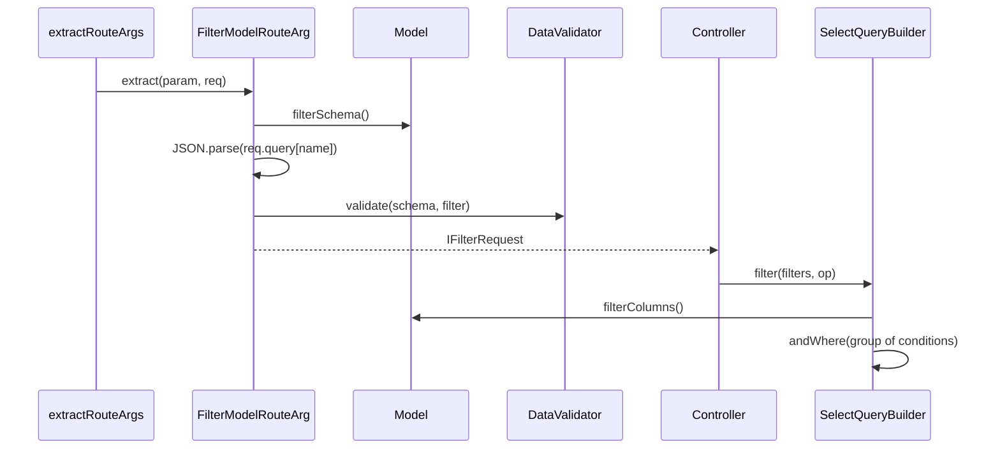

# Filtering

The model declares which columns a client may filter on and with which operators. `@Filter()` validates the incoming filter against a JSON schema built from those declarations, and `SelectQueryBuilder.filter()` turns it into one bracketed `WHERE` group. A client cannot filter on a column you did not open, or with an operator you did not allow.

## How it works

Declaring:

1. `@Filterable(operators)` on a model property adds `{ operators, query }` to `IModelDescriptor.FilterableColumns` under the property name.
2. When the property has no column descriptor, it adds a `Virtual`, nullable one, so the ORM accepts it in `where()`. The third argument sets the column's `Aggregate` flag.
3. `@Filterable(OtherModel)` copies `OtherModel`'s filterable columns under `<property>.<column>`.

Reading a request:

1. `@Filter(ModelOrColumns)` records a route parameter of type `'FilterModelRouteArg'`, resolved with `DI.resolve('FilterModelRouteArg')`.
2. `FilterModelRouteArg.extract()` reads `req.query[<argument name>]`, then `req.body[<argument name>]`.
3. It builds the schema per request: `Model.filterSchema()` for a model, `filterSchemaFor(columns)` for an inline column list.
4. A string value is parsed with `JSON.parse`; invalid JSON throws `InvalidArgument` (`400`).
5. `RouteArgs.tryHydrateParam()` runs input filters and validates the value against the schema. An absent filter is `undefined` and is not validated.

Applying:

1. `query.filter(filters, op?, columns?)` returns the builder unchanged for `undefined`, `null` or `[]`.
2. More than 100 top-level entries throw `InvalidArgument` (`400`).
3. `columns` defaults to the model's `filterColumns()`.
4. Inside one `andWhere(function () { ... })` group, each entry is checked (object, `Column`, known `Operator`, filterable column, operator allowed; a failed check throws `InvalidArgument`) and applied with `andWhere` (op `and` or absent) or `orWhere` (op `or`).
5. A nested group `{ op, filters }` becomes one bracketed condition with its own operator.
6. A column with a custom `query` calls it instead of the built-in operator, as one bracketed condition joined like any other entry; see [Custom filter columns](07-custom-filter-columns.md).
7. A relation column (`Author.Name`) or an aggregate column is applied on the query itself, outside the group, so `populate()` and `HAVING` work. That only keeps its meaning while the condition is ANDed with everything else; under an `or` level with other entries it throws `InvalidArgument`.



## Decorators

| Decorator | Target | Options | Effect |
| --- | --- | --- | --- |
| `@Filterable(operators, queryFunc?, isAggregate?)` | Model property | `operators: FilterableOperators[]`; `queryFunc`: custom SQL, or `null`; `isAggregate`: sets the column's `Aggregate` flag | Makes the column filterable with these operators. |
| `@Filterable(Model)` | Model property | a model class | Copies that model's filterable columns as `<property>.<column>`. |
| `@Filter(ModelOrColumns)` | Route method parameter | a model class, or `IColumnFilter[]` | Reads, parses and validates an `IFilterRequest`. |

### Operators

| Operator | SQL | Value check |
| --- | --- | --- |
| `eq` | `= ?` | defined |
| `neq` | `!= ?` | defined |
| `gt` / `gte` / `lt` / `lte` | `> ?` / `>= ?` / `< ?` / `<= ?` | defined |
| `like` | `LIKE '%value%'` | non-empty string; `null` / `undefined` skip the check |
| `b-like` | `LIKE '%value'`: wildcard before, matches values ending with it | as `like` |
| `e-like` | `LIKE 'value%'`: wildcard at the end, matches values starting with it | as `like` |
| `regexp` | `REGEXP ?` | as `like` |
| `between` / `notbetween` | `BETWEEN` / `NOT BETWEEN` | array, at least 2 values |
| `in` / `nin` | `IN (...)` / `NOT IN (...)` | array, at least 1 value |
| `in-set` / `nin-set` | `whereInSet` / `whereNotInSet` | array, at least 1 value |
| `isnull` / `notnull` | `IS NULL` / `IS NOT NULL` | none |
| `exists` / `n-exists` | `whereExist(column)` / `whereNotExists(column)` on a relation | none |

A failed value check throws `InvalidArgument` (`400`).

### Request shape

```json
{
  "op": "and",
  "filters": [
    { "Column": "Title", "Operator": "like", "Value": "typescript" },
    { "op": "or", "filters": [
      { "Column": "Views", "Operator": "gt", "Value": 1000 },
      { "Column": "Featured", "Operator": "eq", "Value": true }
    ] }
  ]
}
```

- Field names are capitalised: `Column`, `Operator`, `Value`.
- `op` is `and` or `or` (`FilterableLogicalOperators`). Anything but `or` means `and`, at every level.
- In a query string the whole object is JSON: `?filter=%7B%22op%22%3A%22and%22%2C...%7D`.

### The generated schema

`Model.filterSchema()` and `filterSchemaFor(columns)` return:

```json
{
  "type": "object",
  "properties": {
    "op": { "type": "string", "enum": ["and", "or"] },
    "filters": {
      "type": "array",
      "items": {
        "type": "object",
        "anyOf": [
          {
            "type": "object",
            "required": ["Column", "Operator"],
            "properties": {
              "Column": { "const": "Title" },
              "Value": { "type": ["string", "integer", "array", "boolean"] },
              "Operator": { "type": "string", "enum": ["eq", "like"] }
            }
          },
          {
            "type": "object",
            "required": ["filters"],
            "properties": {
              "op": { "type": "string", "enum": ["and", "or"] },
              "filters": { "type": "array", "items": { "type": "object", "anyOf": ["<the column items above>"] } }
            }
          }
        ]
      }
    }
  }
}
```

- `Value` is not required: `isnull`, `notnull`, `exists` and `n-exists` carry none.
- Groups nest one level in the schema. `.filter()` itself walks any depth.
- A model with no `@Filterable` column returns `{}` from `filterSchema()` and `[]` from `filterColumns()`.

## Services and extension points

| Service | DI token and lifetime | Default implementation | Alternatives | How to replace or extend |
| --- | --- | --- | --- | --- |
| `@Filter` extractor | name `'FilterModelRouteArg'`, singleton, resolved per route by name | `FilterModelRouteArg` | none shipped | `@Injectable(FilterModelRouteArg)` on a subclass; see [Custom route arguments and hydrators](08-custom-route-args-and-hydrators.md). |
| Per-column SQL | `IColumnFilter.query` | built-in operator map | any function returning a `WhereFunction` | See [Custom filter columns](07-custom-filter-columns.md). |
| `SelectQueryBuilder.filter()` | prototype method, installed at import | `builders.ts` | none | Wrap the prototype method; see [Model statics and builder extension](10-model-statics-and-builder-extension.md). |
| Filter statics | `MODEL_STATIC_MIXINS` bound by `OrmHttpBootstrapper` | `filter`, `filterColumns`, `filterSchema` | none | See [Model statics and builder extension](10-model-statics-and-builder-extension.md). |

The operator map is private to `builders.ts`. You cannot add an operator name; give a column a custom `query` instead.

## Important behaviour

- All conditions sit in one `andWhere(...)` group, so they AND with conditions you add yourself.
- Validation errors from `.filter()` (unknown operator, non-filterable column, more than 100 entries) are `InvalidArgument` and answer `400`. `@Filter()` rejects most of them earlier, also with a `400`.
- The schema does not limit how many filters a request carries; the 100-entry limit in `.filter()` does.
- Columns copied with `@Filterable(OtherModel)` (`Author.Name`) populate the relation and AND the condition onto the whole query. They cannot be ORed with other entries.
- A column marked aggregate (`@Filterable(ops, null, true)`) lands in `HAVING`, ANDed with the rest of the query. It cannot be ORed with other entries either.
- `filter()` needs the columns: from `filterColumns()` (bound by the bootstrapper) or from the third argument.
- `@Filterable` on a property without a column creates a virtual column. It is never selected or written; filter on it with a custom `query`.

## Best practices

- Keep the operator list per column short: `like` on an unindexed text column is a full scan.
- Call `filter(filter?.filters, filter?.op)`: the argument is `undefined` when the client sent no filter, and `filter()` treats that as no-op.
- Pass the same column list to `@Filter([...])` and to `.filter(..., columns)` when you filter on inline columns, so validation and application agree.

## Patterns and antipatterns

```ts
// Don't: skip @Filter and hand the raw query string to filter(); invalid JSON becomes a 500 and the schema is never checked
@Get()
public async list(@Query() filter: any) {
  return new Ok(await Article.select().filter(JSON.parse(filter).filters));
}

// Do: @Filter validates against the schema first and answers 400 on bad input
@Get()
public async list(@Filter(Article) filter: IFilterRequest) {
  return new Ok(await Article.select().filter(filter?.filters, filter?.op));
}
```

## Examples

### Declare filterable columns

```ts sample
import { Connection, Model, ModelBase, Primary } from '@spinajs/orm';
import { Filterable } from '@spinajs/orm-http';

@Connection('default')
@Model('articles')
export class Article extends ModelBase<Article> {
  @Primary()
  public Id: number;

  @Filterable(['eq', 'like', 'b-like', 'e-like'])
  public Title: string;

  @Filterable(['eq', 'gt', 'gte', 'lt', 'lte', 'between'])
  public Views: number;

  @Filterable(['isnull', 'notnull'])
  public PublishedAt: string;
}
```

### Filter a listing from the model or from inline columns

```ts sample
import { BaseController, BasePath, Get, Ok } from '@spinajs/http';
import { Connection, Model, ModelBase, Primary } from '@spinajs/orm';
import { Filter, Filterable, IColumnFilter, IFilterRequest } from '@spinajs/orm-http';

@Connection('default')
@Model('articles')
export class Article extends ModelBase<Article> {
  @Primary()
  public Id: number;

  @Filterable(['eq', 'like'])
  public Title: string;

  @Filterable(['eq', 'gt', 'lt'])
  public Views: number;
}

const PUBLIC_COLUMNS: IColumnFilter<Article>[] = [
  { column: 'Title', operators: ['like'] },
  { column: 'Views', operators: ['gt'] },
];

@BasePath('articles')
export class ArticleController extends BaseController {
  /** Columns and operators come from the model's @Filterable declarations. */
  @Get()
  public async list(@Filter(Article) filter: IFilterRequest) {
    const rows = await Article.select().filter(filter?.filters, filter?.op);
    return new Ok(rows.map((r) => r.dehydrate()));
  }

  /** A narrower set for the public listing; the same list validates and applies. */
  @Get('public')
  public async publicList(@Filter(PUBLIC_COLUMNS) filter: IFilterRequest) {
    const rows = await Article.select().filter(filter?.filters, filter?.op, PUBLIC_COLUMNS);
    return new Ok(rows.map((r) => r.dehydrate()));
  }
}
```

### Combine a client filter with your own conditions and a nested group

```ts sample
import { Connection, Model, ModelBase, Primary } from '@spinajs/orm';
import { Filterable, FilterableLogicalOperators, IFilterGroup, IFilterRequest } from '@spinajs/orm-http';

@Connection('default')
@Model('articles')
export class Article extends ModelBase<Article> {
  @Primary()
  public Id: number;

  public Published: boolean;

  @Filterable(['eq', 'like'])
  public Title: string;

  @Filterable(['like'])
  public Slug: string;
}

export async function search(filter: IFilterRequest | undefined, text: string) {
  const textSearch: IFilterGroup = {
    op: FilterableLogicalOperators.Or,
    filters: [
      { Column: 'Title', Operator: 'like', Value: text },
      { Column: 'Slug', Operator: 'like', Value: text },
    ],
  };

  // Published AND (client filter) AND (Title LIKE text OR Slug LIKE text)
  return await Article.select()
    .where('Published', true)
    .filter(filter?.filters, filter?.op)
    .filter([textSearch])
    .orderByDescending('Id')
    .take(50);
}
```

### Filter the rows of a populated relation

```ts sample
import { BaseController, BasePath, Get, Ok } from '@spinajs/http';
import { Connection, Model, ModelBase, Primary, HasMany, Relation } from '@spinajs/orm';
import { Filter, Filterable, IFilterRequest } from '@spinajs/orm-http';

@Connection('default')
@Model('comments')
export class Comment extends ModelBase<Comment> {
  @Primary()
  public Id: number;

  public article_id: number;

  @Filterable(['eq', 'like'])
  public Body: string;
}

@Connection('default')
@Model('articles')
export class Article extends ModelBase<Article> {
  @Primary()
  public Id: number;

  @HasMany(Comment, { foreignKey: 'article_id', primaryKey: 'Id' })
  public Comments: Relation<Comment, Article>;
}

@BasePath('articles')
export class RelationFilterController extends BaseController {
  @Get('with-comments')
  public async list(@Filter(Comment) filter: IFilterRequest) {
    const rows = await Article.select().populate('Comments', function () {
      this.filter(filter?.filters, filter?.op);
    });

    return new Ok(rows.map((r) => r.dehydrateWithRelations()));
  }
}
```

### Inspect what is filterable

```ts sample
import { Connection, Model, ModelBase, Primary } from '@spinajs/orm';
import { Filterable } from '@spinajs/orm-http';

@Connection('default')
@Model('articles')
export class Article extends ModelBase<Article> {
  @Primary()
  public Id: number;

  @Filterable(['eq', 'like'])
  public Title: string;
}

export function describeFilters() {
  return {
    // [{ column: 'Title', operators: ['eq', 'like'], query: undefined }]
    columns: Article.filterColumns(),
    schema: Article.filterSchema(),
  };
}
```

Use both to build client-side filter UIs. `@spinajs/http-swagger` documents `@Filter` parameters with `filterSchema()`.

## Related

- [Custom filter columns](07-custom-filter-columns.md): your own SQL per column, and column sets for models you cannot decorate.
- [Model statics and builder extension](10-model-statics-and-builder-extension.md): where `filter()` and the statics come from.
- [Query builder](../orm/05-query-builder.md): `where`, `whereIn`, `whereExist` and the other calls the operators map to.
- [Relations](../orm/06-relations.md): `exists` / `n-exists` filter on relations through `whereExist()`.
- [Parameters and request bodies](../http-swagger/03-parameters-and-request-bodies.md): how `@Filter` appears in the OpenAPI document.
