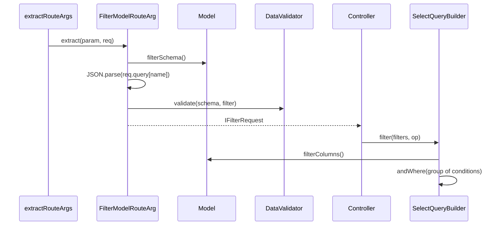

# Filtering

The model declares which columns a client may filter on and with which operators. `@Filter()` validates the incoming filter against a JSON schema built from those declarations, and `SelectQueryBuilder.filter()` turns it into one bracketed `WHERE` group. A client cannot filter on a column you did not open, or with an operator you did not allow.

## How it works

Declaring:

1. `@Filterable(operators)` or `@Filterable({ operators, query, aggregate, value })` on a model property adds `{ operators, query, value }` to `IModelDescriptor.FilterableColumns` under the property name.
2. When the property has no column descriptor, it adds a `Virtual`, nullable one, so the ORM accepts it in `where()`. The third argument (or `aggregate`) sets the column's `Aggregate` flag.
3. `@Filterable(OtherModel)` copies `OtherModel`'s filterable columns under `<property>.<column>`.

Reading a request:

1. `@Filter(ModelOrColumns)` records a route parameter of type `'FilterModelRouteArg'`, resolved with `DI.resolve('FilterModelRouteArg')`.
2. `FilterModelRouteArg.extract()` reads `req.query[<argument name>]`, then `req.body[<argument name>]`.
3. It takes the schema from `Model.filterSchema()` for a model, `filterSchemaFor(columns)` for an inline column list. Both are built once and reused, so the validator compiles them once; a model's schema is built again after the ORM reads its columns again.
4. A string value is parsed with `JSON.parse`; invalid JSON throws `InvalidArgument` (`400`).
5. `RouteArgs.tryHydrateParam()` runs input filters and validates the value against the schema. An absent filter is `undefined` and is not validated.

Applying:

1. `query.filter(filters, op?, columns?)` returns the builder unchanged for `undefined`, `null` or `[]`.
2. More than 100 top-level entries throw `InvalidArgument` (`400`).
3. `columns` defaults to the model's `filterColumns()`.
4. Inside one `andWhere(function () { ... })` group, each entry is checked (object, `Column`, known `Operator`, filterable column, operator allowed; a failed check throws `InvalidArgument`) and applied with `andWhere` (op `and` or absent) or `orWhere` (op `or`).
5. A nested group `{ op, filters }` becomes one bracketed condition with its own operator; with `not: true` it becomes `NOT ( … )`.
6. A column with a custom `query` calls it instead of the built-in operator, as one bracketed condition joined like any other entry; see [Custom filter columns](07-custom-filter-columns.md).
7. A relation column (`Author.Name`) or an aggregate column is applied on the query itself, outside the group, so `populate()` and `HAVING` work. That only keeps its meaning while the condition is ANDed with everything else; under an `or` level with other entries it throws `InvalidArgument`.



## Decorators

| Decorator | Target | Options | Effect |
| --- | --- | --- | --- |
| `@Filterable(operators, queryFunc?, isAggregate?)` | Model property | `operators: FilterableOperators[]`; `queryFunc`: custom SQL, or `null`; `isAggregate`: sets the column's `Aggregate` flag | Makes the column filterable with these operators. |
| `@Filterable({ operators, query?, aggregate?, value? })` | Model property | `IFilterableOptions`: the same three, and `value`, the JSON schema of one filter value | As above; `value` replaces the value type read from the column. |
| `@Filterable(Model)` | Model property | a model class | Copies that model's filterable columns as `<property>.<column>`. |
| `@Filter(ModelOrColumns)` | Route method parameter | a model class, or `IColumnFilter[]` | Reads, parses and validates an `IFilterRequest`. |

### Operators

| Operator | SQL | Value check |
| --- | --- | --- |
| `eq` | `= ?`; `IS NULL` for a `null` value | defined, not an array |
| `neq` | `!= ?`; `IS NOT NULL` for a `null` value | defined, not an array |
| `gt` / `gte` / `lt` / `lte` | `> ?` / `>= ?` / `< ?` / `<= ?` | defined, not an array; a `null` value throws `InvalidArgument` from the where builder |
| `like` | `LIKE '%value%' ESCAPE '~'`: values containing it | non-empty string; `null` / `undefined` skip the check and are searched as the text `"null"` / `"undefined"` |
| `b-like` | `LIKE '%value' ESCAPE '~'`: values **ending** with it | as `like` |
| `e-like` | `LIKE 'value%' ESCAPE '~'`: values **beginning** with it | as `like` |
| `nlike` | `NOT ( … LIKE '%value%' … )`: text that does not contain the value | as `like` |
| `nb-like` | `NOT ( … LIKE '%value' … )`: text that does not **end** with the value | as `like` |
| `ne-like` | `NOT ( … LIKE 'value%' … )`: text that does not **begin** with the value | as `like` |
| `empty` | `IS NULL OR = ''`: null or empty text | none |
| `nempty` | `IS NOT NULL AND != ''`: text that is neither null nor empty | none |
| `regexp` | `REGEXP ?` | as `like` |
| `between` / `notbetween` | `BETWEEN ? AND ?` / `NOT BETWEEN ? AND ?`, bounds converted like an `eq` value | array of exactly 2 values `[from, to]`, neither `null` |
| `in` / `nin` | `IN (...)` / `NOT IN (...)` | array, at least 1 value |
| `in-set` / `nin-set` | `whereInSet` / `whereNotInSet` | array, at least 1 value |
| `isnull` / `notnull` | `IS NULL` / `IS NOT NULL` | none |
| `exists` / `n-exists` | `whereExist(column)` / `whereNotExists(column)` on a relation | none |

A failed value check throws `InvalidArgument` (`400`). These checks run in `.filter()`; `@Filter()` checks the value earlier and closer, see [Value schema](#value-schema).

The value of `like`, `b-like` and `e-like` is matched literally: `%` and `_` (and `[` on MSSQL) in it match only themselves, and on MySQL and PostgreSQL a backslash is no longer an escape. A client searching for `%` gets the rows containing a `%`, not every row. Case sensitivity stays the database's: SQLite, MySQL with a `_ci` collation and MSSQL with a `CI` collation ignore case, PostgreSQL does not.

The names `b-like` and `e-like` read backwards: `b-like` is "ends with", `e-like` is "begins with". Existing clients depend on that meaning, so it stays. The negated forms keep the same prefixes: `nb-like` is "does not end with", `ne-like` "does not begin with".

A row whose column is null matches neither `like` nor `nlike`: SQL compares null with nothing, so `NOT ( null LIKE … )` is not true either. To keep such rows, put the negated operator and `empty` (or `isnull`) in an `or` group.

### Negated groups

A group with `"not": true` keeps the rows its conditions do not match. It is ANDed or ORed with the entries beside it like any other group.

```json
{ "filters": [ { "Column": "Amount", "Operator": "gte", "Value": 100 },
               { "not": true, "op": "or", "filters": [ { "Column": "Status", "Operator": "eq", "Value": "paid" },
                                                       { "Column": "Note", "Operator": "empty" } ] } ] }
```

A relation column (`Author.Name`) or an aggregate column cannot sit inside a negated group: it is applied on the whole query, which would drop the negation, so `.filter()` throws `InvalidArgument`.

### Request shape

```json
{
  "op": "and",
  "filters": [
    { "Column": "Title", "Operator": "like", "Value": "typescript" },
    { "op": "or", "filters": [
      { "Column": "Views", "Operator": "gt", "Value": 1000 },
      { "Column": "Featured", "Operator": "eq", "Value": true }
    ] }
  ]
}
```

- Field names are capitalised: `Column`, `Operator`, `Value`.
- `op` is `and` or `or` (`FilterableLogicalOperators`). Anything but `or` means `and`, at every level.
- A group may carry `"not": true`; see [Negated groups](#negated-groups).
- In a query string the whole object is JSON: `?filter=%7B%22op%22%3A%22and%22%2C...%7D`.

### Value schema

`@Filter()` checks each `Value` against its operator and its column. A value of the wrong shape answers `400` before the query runs.

| Operators | `Value` |
| --- | --- |
| `eq`, `neq`, `gt`, `gte`, `lt`, `lte` | one value of the column's type, required |
| `like`, `b-like`, `e-like`, `nlike`, `nb-like`, `ne-like`, `regexp` | a string, whatever the column's type, required |
| `in`, `nin`, `in-set`, `nin-set` | an array of at least one value of the column's type, required |
| `between`, `notbetween` | an array of exactly two values of the column's type, required |
| `isnull`, `notnull`, `exists`, `n-exists`, `empty`, `nempty` | none, not checked |

The column's type comes from, in this order:

1. The `value` schema on the filter definition (`@Filterable({ value })`, or `value` in an `IColumnFilter`).
2. The model column, for a column with a table behind it: its `type`, `format` and `enum` from the model's JSON schema. An integer column takes integers, a float column numbers, a `@DateTime()` column ISO-8601 date-time strings. A `set` column takes the type of one set item. A column copied with `@Filterable(OtherModel)` (`Author.Name`) is typed by `OtherModel`'s column.
3. Otherwise any string, number or boolean.

On PostgreSQL the driver reflects the type names `int2`, `int4`, `int8`, `float4`, `float8` and `bool`, which the model's [column mapping](../orm/11-json-schema.md#column-mapping) does not list. A filter value for such a column is checked as a string: `"abc"` passes and a number is coerced to text. Declare `value` on those columns.

Over `@Filter()` a typed value is never `null`, alone or in a list or pair, also when the declared `value` schema allows `null`: coercion would turn it into `0`, `false` or `""` and compare with that, so the request answers `400`. A `like` family value of `null` is coerced to `""`, which `.filter()` refuses as an empty pattern, also with a `400`. Filter on `isnull` / `notnull` instead. Called from code, `.filter()` runs no schema, and `eq null` / `neq null` still compile to `IS NULL` / `IS NOT NULL`.

A column with a custom `query` and no `value`, and a virtual filter-only column without `value`, take any string, number, boolean, array or `null` for every operator, uncoerced: their code decides what the value means. A `null` reaches the query function as `null`.

The validator coerces types: `"3"` for an integer column reaches the query as `3`. It coerces a value only against its own column and operator, so `"05"` for a string column stays `"05"` whatever other columns the model has.

### The generated schema

`Model.filterSchema()` and `filterSchemaFor(columns, model?)` return, for `Title` (`eq`, `like`) and an integer `Views` (`gt`):

```json
{
  "type": "object",
  "properties": {
    "op": { "type": "string", "enum": ["and", "or"] },
    "filters": {
      "type": "array",
      "items": {
        "type": "object",
        "anyOf": [
          {
            "type": "object",
            "required": ["Column", "Operator"],
            "properties": {
              "Column": { "const": "Title" },
              "Operator": { "type": "string", "enum": ["eq", "like"] }
            }
          },
          "<one such item per column>",
          {
            "type": "object",
            "required": ["filters"],
            "properties": {
              "op": { "type": "string", "enum": ["and", "or"] },
              "filters": { "type": "array", "items": { "type": "object", "anyOf": ["<the column items above>"], "allOf": ["<the value rules below>"] } }
            }
          }
        ],
        "allOf": [
          {
            "if": { "required": ["Column", "Operator"], "properties": { "Column": { "const": "Views" }, "Operator": { "enum": ["gt"] } } },
            "then": { "required": ["Value"], "properties": { "Value": { "allOf": [{ "not": { "const": null } }, { "type": "integer" }] } } }
          },
          "<one rule per column and operator group>"
        ]
      }
    }
  }
}
```

- The `anyOf` items admit a known column with one of its operators. The `allOf` rules check `Value`; `Value` appears only under a `then`, which is what keeps coercion to the matching column.
- Groups nest one level in the schema. `.filter()` itself walks any depth.
- A model with no `@Filterable` column returns `{}` from `filterSchema()` and `[]` from `filterColumns()`.
- `FILTER_OPERATOR_GROUPS` maps every `FilterableOperators` member to its group.

## Services and extension points

| Service | DI token and lifetime | Default implementation | Alternatives | How to replace or extend |
| --- | --- | --- | --- | --- |
| `@Filter` extractor | name `'FilterModelRouteArg'`, singleton, resolved per route by name | `FilterModelRouteArg` | none shipped | `@Injectable(FilterModelRouteArg)` on a subclass; see [Custom route arguments and hydrators](08-custom-route-args-and-hydrators.md). |
| Per-column SQL | `IColumnFilter.query` | built-in operator map | any function returning a `WhereFunction` | See [Custom filter columns](07-custom-filter-columns.md). |
| `SelectQueryBuilder.filter()` | prototype method, installed at import | `builders.ts` | none | Wrap the prototype method; see [Model statics and builder extension](10-model-statics-and-builder-extension.md). |
| Filter statics | `MODEL_STATIC_MIXINS` bound by `OrmHttpBootstrapper` | `filter`, `filterColumns`, `filterSchema` | none | See [Model statics and builder extension](10-model-statics-and-builder-extension.md). |

The operator map is private to `builders.ts`. You cannot add an operator name; give a column a custom `query` instead.

## Important behaviour

- All conditions sit in one `andWhere(...)` group, so they AND with conditions you add yourself.
- Validation errors from `.filter()` (unknown operator, non-filterable column, more than 100 entries, an array for a single-value operator) are `InvalidArgument` and answer `400`. `@Filter()` rejects most of them earlier, also with a `400`.
- `.filter()` called from code does not run the value schema: it checks presence, arrays for list and pair operators, a single value for `eq` to `lte`, and strings for the `like` family, not the column type.
- The schema refuses more than 100 top-level entries (`MAX_FILTERS`), the limit `.filter()` applies: such a request answers `400` from validation, before `.filter()` runs. Neither limits the entries of a nested group.
- Columns copied with `@Filterable(OtherModel)` (`Author.Name`) populate the relation and AND the condition onto the whole query. They cannot be ORed with other entries.
- A column marked aggregate (`@Filterable(ops, null, true)`) lands in `HAVING`, ANDed with the rest of the query. It cannot be ORed with other entries either.
- `filter()` needs the columns: from `filterColumns()` (bound by the bootstrapper) or from the third argument.
- `@Filterable` on a property without a column creates a virtual column. It is never selected or written; filter on it with a custom `query`.
- `like`, `b-like` and `e-like` and their negations bind a `LikeLiteral` from `@spinajs/orm`. A custom `query` gets the raw value and does its own escaping; see [Custom filter columns](07-custom-filter-columns.md).

## Limits

- Case sensitivity and accent folding are not operators: text comparison follows the column's collation. A case-insensitive or accent-insensitive search needs a column or collation that compares that way.
- `empty` compares with `= ''`: text of spaces alone is not empty where the database compares exactly (SQLite, PostgreSQL).

## Best practices

- Keep the operator list per column short: `like` on an unindexed text column is a full scan.
- Call `filter(filter?.filters, filter?.op)`: the argument is `undefined` when the client sent no filter, and `filter()` treats that as no-op.
- Pass the same column list to `@Filter([...])` and to `.filter(..., columns)` when you filter on inline columns, so validation and application agree.

## Patterns and antipatterns

```ts
// Don't: skip @Filter and hand the raw query string to filter(); invalid JSON becomes a 500 and the schema is never checked
@Get()
public async list(@Query() filter: any) {
  return new Ok(await Article.select().filter(JSON.parse(filter).filters));
}

// Do: @Filter validates against the schema first and answers 400 on bad input
@Get()
public async list(@Filter(Article) filter: IFilterRequest) {
  return new Ok(await Article.select().filter(filter?.filters, filter?.op));
}
```

## Examples

### Declare filterable columns

```ts sample
import { Connection, Model, ModelBase, Primary } from '@spinajs/orm';
import { Filterable } from '@spinajs/orm-http';

@Connection('default')
@Model('articles')
export class Article extends ModelBase<Article> {
  @Primary()
  public Id: number;

  @Filterable(['eq', 'like', 'b-like', 'e-like'])
  public Title: string;

  @Filterable(['eq', 'gt', 'gte', 'lt', 'lte', 'between'])
  public Views: number;

  @Filterable(['isnull', 'notnull'])
  public PublishedAt: string;

  /** A TEXT column holding a closed set: `value` narrows what a filter may send. */
  @Filterable({ operators: ['eq', 'in'], value: { type: 'string', enum: ['draft', 'published', 'archived'] } })
  public State: string;
}
```

### Filter a listing from the model or from inline columns

```ts sample
import { BaseController, BasePath, Get, Ok } from '@spinajs/http';
import { Connection, Model, ModelBase, Primary } from '@spinajs/orm';
import { Filter, Filterable, IColumnFilter, IFilterRequest } from '@spinajs/orm-http';

@Connection('default')
@Model('articles')
export class Article extends ModelBase<Article> {
  @Primary()
  public Id: number;

  @Filterable(['eq', 'like'])
  public Title: string;

  @Filterable(['eq', 'gt', 'lt'])
  public Views: number;
}

const PUBLIC_COLUMNS: IColumnFilter<Article>[] = [
  { column: 'Title', operators: ['like'] },
  { column: 'Views', operators: ['gt'] },
];

@BasePath('articles')
export class ArticleController extends BaseController {
  /** Columns and operators come from the model's @Filterable declarations. */
  @Get()
  public async list(@Filter(Article) filter: IFilterRequest) {
    const rows = await Article.select().filter(filter?.filters, filter?.op);
    return new Ok(rows.map((r) => r.dehydrate()));
  }

  /** A narrower set for the public listing; the same list validates and applies. */
  @Get('public')
  public async publicList(@Filter(PUBLIC_COLUMNS) filter: IFilterRequest) {
    const rows = await Article.select().filter(filter?.filters, filter?.op, PUBLIC_COLUMNS);
    return new Ok(rows.map((r) => r.dehydrate()));
  }
}
```

### Combine a client filter with your own conditions and a nested group

```ts sample
import { Connection, Model, ModelBase, Primary } from '@spinajs/orm';
import { Filterable, FilterableLogicalOperators, IFilterGroup, IFilterRequest } from '@spinajs/orm-http';

@Connection('default')
@Model('articles')
export class Article extends ModelBase<Article> {
  @Primary()
  public Id: number;

  public Published: boolean;

  @Filterable(['eq', 'like'])
  public Title: string;

  @Filterable(['like'])
  public Slug: string;
}

export async function search(filter: IFilterRequest | undefined, text: string) {
  const textSearch: IFilterGroup = {
    op: FilterableLogicalOperators.Or,
    filters: [
      { Column: 'Title', Operator: 'like', Value: text },
      { Column: 'Slug', Operator: 'like', Value: text },
    ],
  };

  // Published AND (client filter) AND (Title LIKE text OR Slug LIKE text)
  return await Article.select()
    .where('Published', true)
    .filter(filter?.filters, filter?.op)
    .filter([textSearch])
    .orderByDescending('Id')
    .take(50);
}
```

### Filter the rows of a populated relation

```ts sample
import { BaseController, BasePath, Get, Ok } from '@spinajs/http';
import { Connection, Model, ModelBase, Primary, HasMany, Relation } from '@spinajs/orm';
import { Filter, Filterable, IFilterRequest } from '@spinajs/orm-http';

@Connection('default')
@Model('comments')
export class Comment extends ModelBase<Comment> {
  @Primary()
  public Id: number;

  public article_id: number;

  @Filterable(['eq', 'like'])
  public Body: string;
}

@Connection('default')
@Model('articles')
export class Article extends ModelBase<Article> {
  @Primary()
  public Id: number;

  @HasMany(Comment, { foreignKey: 'article_id', primaryKey: 'Id' })
  public Comments: Relation<Comment, Article>;
}

@BasePath('articles')
export class RelationFilterController extends BaseController {
  @Get('with-comments')
  public async list(@Filter(Comment) filter: IFilterRequest) {
    const rows = await Article.select().populate('Comments', function () {
      this.filter(filter?.filters, filter?.op);
    });

    return new Ok(rows.map((r) => r.dehydrateWithRelations()));
  }
}
```

### Inspect what is filterable

```ts sample
import { Connection, Model, ModelBase, Primary } from '@spinajs/orm';
import { Filterable } from '@spinajs/orm-http';

@Connection('default')
@Model('articles')
export class Article extends ModelBase<Article> {
  @Primary()
  public Id: number;

  @Filterable(['eq', 'like'])
  public Title: string;
}

export function describeFilters() {
  return {
    // [{ column: 'Title', operators: ['eq', 'like'], query: undefined, value: undefined }]
    columns: Article.filterColumns(),
    schema: Article.filterSchema(),
  };
}
```

Use both to build client-side filter UIs. `@spinajs/http-swagger` documents `@Filter` parameters with an envelope of its own, built from the same `@Filterable` declarations; it does not carry the value rules.

## Related

- [Custom filter columns](07-custom-filter-columns.md): your own SQL per column, and column sets for models you cannot decorate.
- [Model statics and builder extension](10-model-statics-and-builder-extension.md): where `filter()` and the statics come from.
- [Query builder](../orm/05-query-builder.md): `where`, `whereIn`, `whereExist` and the other calls the operators map to.
- [Relations](../orm/06-relations.md): `exists` / `n-exists` filter on relations through `whereExist()`.
- [Parameters and request bodies](../http-swagger/03-parameters-and-request-bodies.md): how `@Filter` appears in the OpenAPI document.
