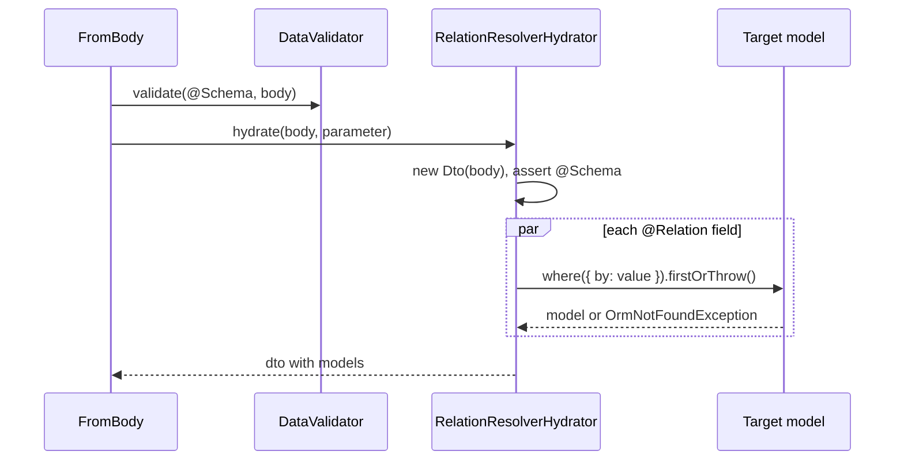

# DTO relations

`@Relation()` marks a DTO field as a reference to a database row. On an incoming request the field's value (an id, a uuid) is looked up and replaced with the model instance, so the handler receives real entities. A missing row answers `404` before the handler runs.

## How it works

1. At decoration time `@Relation(() => Target, { by })` stores `{ field, target, by }` in an `IDtoRelations` descriptor on the DTO prototype, under `RELATION_SYMBOL`. The descriptor is inherited by subclasses (`getInheritedDescriptor`).
2. It sets `custom:arg_hydrator` on the DTO class to `RelationResolverHydrator`, unless the class already has its own.
3. At request time `@Body()` (or any route argument that hydrates) validates the body against the DTO's `@Schema`, then resolves `DI.resolve(RelationResolverHydrator)` and calls `hydrate(input, parameter)`.
4. `RelationResolverHydrator.hydrate()` builds `new Dto(input)`. With no relation fields it returns the DTO.
5. It throws `InvalidOperation` if the DTO class has no `@Schema` (checked once per class, memoised in a `WeakSet`).
6. For each relation field, in parallel:
   1. `undefined` or `null`: skipped.
   2. A target with a composite primary key and no `by`: throws `InvalidOperation`.
   3. `Target.where({ [by ?? primaryKey]: value }).firstOrThrow(new OrmNotFoundException("<Target> referenced by '<field>' not found"))`.
   4. The field is overwritten with the model.
7. The handler receives the DTO with resolved models.



## Decorators

| Decorator | Target | Options | Effect |
| --- | --- | --- | --- |
| `@Relation(target, options?)` | DTO property | `target: () => typeof ModelBase` (a thunk, so no import cycle and no load-order issue); `options.by?: string`: lookup column, default the target's primary key | Replaces the incoming value with the matching row; `404` when absent. |

## Services and extension points

| Service | DI token and lifetime | Default implementation | Alternatives | How to replace or extend |
| --- | --- | --- | --- | --- |
| DTO relation resolver | `custom:arg_hydrator` metadata → class `RelationResolverHydrator`, resolved with `DI.resolve(RelationResolverHydrator)`, singleton | `RelationResolverHydrator` | none shipped | `@Injectable(RelationResolverHydrator)` on a subclass replaces it for every DTO; see [Custom route arguments and hydrators](08-custom-route-args-and-hydrators.md#relationresolverhydrator-reject-archived-references). |
| Relation metadata | `RELATION_SYMBOL` = `Symbol.for('orm-http:relations')` on the DTO prototype, value `IDtoRelations` | written by `@Relation` | none | Read it from your own tooling; it is a global symbol so `@spinajs/http-swagger` reads it without importing this package. |

## Important behaviour

- A DTO with `@Relation` must have a `@Schema`. Resolution skips absent fields, so only the schema can make a reference required.
- `@Hydrator(X)` on a DTO class that uses `@Relation` is ignored: property decorators run before class decorators, so `@Relation` has already set `RelationResolverHydrator` when `@Hydrator` checks for an existing one. Replace the resolver through DI instead.
- Lookups run in parallel, one query per relation field. The first miss rejects with `OrmNotFoundException` (`404`).
- A missing `@Schema` and a composite key without `by` throw `InvalidOperation`, which answers `500`: both are developer errors.
- The lookup is `Target.where(...)`, so query scopes and soft-delete rules of `Target` apply as for any query.

## Best practices

- Type the field as `string | User` (incoming id, delivered model) when other code reads the DTO before hydration; type it `User` when only the handler reads it.
- Use `by: 'Uuid'` for public identifiers instead of exposing numeric ids.
- Put `required` in the `@Schema`, not in code: a required reference is rejected with `400` before any query runs.

## Patterns and antipatterns

```ts
// Don't: look the author up by hand; duplicated 404 handling, and no schema-level `required`
@Post()
public async create(@Body() dto: { Name: string; author: string }) {
  const author = await User.where({ Uuid: dto.author }).firstOrFail();
  return new Ok({ AuthorId: author.Id });
}

// Do: the DTO resolves it and the schema decides whether it is required
@Post()
public async create(@Body() dto: CreateCampaign) {
  return new Ok({ AuthorId: dto.author.Id });
}
```

## Examples

### Create a campaign for an author identified by uuid

```ts sample
import { BaseController, BasePath, Post, Ok, Body } from '@spinajs/http';
import { Schema } from '@spinajs/validation';
import { Connection, Model, ModelBase, Primary } from '@spinajs/orm';
import { Relation } from '@spinajs/orm-http';

@Connection('default')
@Model('users')
export class User extends ModelBase<User> {
  @Primary()
  public Id: number;

  public Uuid: string;
}

@Schema({
  type: 'object',
  $id: 'app.CreateCampaign',
  properties: {
    Name: { type: 'string' },
    author: { type: 'string' },
  },
  required: ['Name', 'author'],
})
export class CreateCampaign {
  public Name: string;

  /** Incoming: a Uuid string. Delivered to the handler: a User row. */
  @Relation(() => User, { by: 'Uuid' })
  public author: User;

  constructor(data: Partial<CreateCampaign>) {
    Object.assign(this, data);
  }
}

@BasePath('campaigns')
export class CampaignController extends BaseController {
  /** POST /campaigns { "Name": "Spring", "author": "3f2a..." }; an unknown uuid answers 404. */
  @Post()
  public create(@Body() dto: CreateCampaign) {
    return new Ok({ Name: dto.Name, AuthorId: dto.author.Id });
  }
}
```

### Reuse relations with a stricter schema

```ts sample
import { Schema } from '@spinajs/validation';
import { Connection, Model, ModelBase, Primary } from '@spinajs/orm';
import { Relation } from '@spinajs/orm-http';

@Connection('default')
@Model('users')
export class User extends ModelBase<User> {
  @Primary()
  public Id: number;

  public Uuid: string;
}

@Schema({
  type: 'object',
  $id: 'app.CampaignBase',
  properties: {
    Name: { type: 'string' },
    author: { type: 'string' },
  },
})
export class CampaignDTO {
  public Name?: string;

  @Relation(() => User, { by: 'Uuid' })
  public author?: string | User;

  constructor(data: Partial<CampaignDTO>) {
    Object.assign(this, data);
  }
}

/** Inherits the `author` relation; only the schema changes. */
@Schema({
  type: 'object',
  $id: 'app.CampaignStrict',
  properties: {
    Name: { type: 'string' },
    author: { type: 'string' },
  },
  required: ['author'],
})
export class StrictCampaignDTO extends CampaignDTO {}
```

### Store a resolved relation on a model

The ORM's `DbPropertyHydrator` turns a `ModelBase` on a foreign-key column into its primary key, and a relation accepts a model with `attach()`.

```ts sample
import { Connection, Model, ModelBase, Primary, BelongsTo, SingleRelation } from '@spinajs/orm';

@Connection('default')
@Model('users')
export class User extends ModelBase<User> {
  @Primary()
  public Id: number;

  public Uuid: string;
}

@Connection('default')
@Model('campaigns')
export class Campaign extends ModelBase<Campaign> {
  @Primary()
  public Id: number;

  public author_id: number;

  public Name: string;

  @BelongsTo(User, 'author_id', 'Id')
  public Author: SingleRelation<User>;
}

export async function persist(name: string, author: User) {
  const campaign = new Campaign({ Name: name });

  // Either the foreign-key column receives the model's key,
  campaign.hydrate({ author_id: author } as unknown as Partial<Campaign>);
  // or the relation receives the model itself.
  campaign.Author.attach(author);

  await campaign.insert();
  return campaign;
}
```

### Read the relation metadata of a DTO

```ts sample
import 'reflect-metadata';
import { RELATION_SYMBOL, IDtoRelations, IDtoRelationDescriptor } from '@spinajs/orm-http';

/** Lists `{ field, target, by }` for every @Relation field, inherited ones included. */
export function relationsOf(ctor: { prototype: object }): IDtoRelationDescriptor[] {
  const descriptor = Reflect.getMetadata(RELATION_SYMBOL, ctor.prototype) as IDtoRelations | undefined;
  return descriptor ? [...descriptor.Relations.values()] : [];
}
```

## Related

- [Route arguments](02-route-args.md): `@FromModel()` for an id in the url rather than in the body.
- [Custom route arguments and hydrators](08-custom-route-args-and-hydrators.md): replace `RelationResolverHydrator`.
- [Not-found response](09-not-found-response.md): the `404` a missing reference produces.
- [Converters and hydration](../orm/04-converters-and-hydration.md): how a model on a foreign-key column is stored.
- [Parameters and request bodies](../http-swagger/03-parameters-and-request-bodies.md): `@Relation` fields in the OpenAPI document.
