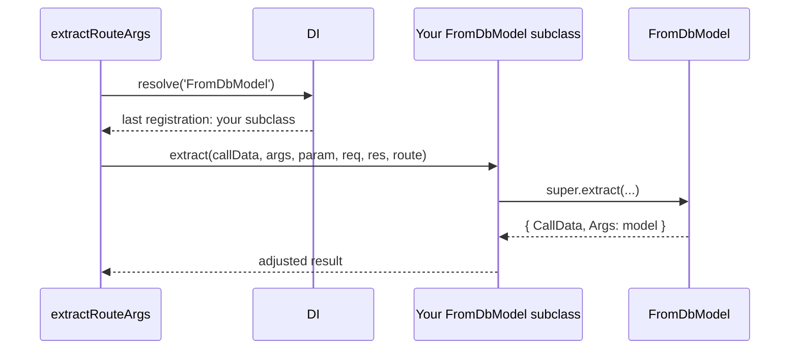

# Custom route arguments and hydrators

Every request-facing class in this package is a DI registration: the three route argument extractors and the two hydrators. Replace one with a subclass to change its behaviour on every route, or build a new route argument on top of one.

## How it works

Route arguments:

1. A decorator records a route parameter with a type name: `@FromModel()` → `'FromDbModel'`, `@AsModel()` → `'AsDbModel'`, `@Filter()` → `'FilterModelRouteArg'`.
2. `@Injectable()` on each class registers it under its own class name at import.
3. Per request, `extractRouteArgs()` (http) calls `DI.resolve(<type name>)`. DI returns the **last** class registered under that name, as a singleton.
4. `@Injectable(FromDbModel)` on your subclass registers it under `'FromDbModel'` too, after the original, so it wins.

Hydrators:

1. `OrmHttpBootstrapper` sets `{ hydrator: DbModelHydrator }` on every model; `@Relation` sets `{ hydrator: RelationResolverHydrator }` on its DTO.
2. `RouteArgs.tryHydrateObject()` calls `DI.resolve(<that class>)`. Neither class is registered, so DI returns the class itself, unless something is registered under its name.
3. `@Injectable(DbModelHydrator)` on your subclass registers it under `'DbModelHydrator'`, so every model uses it without touching the metadata.



## Services and extension points

| Service | DI token and lifetime | Default implementation | Alternatives | How to replace or extend |
| --- | --- | --- | --- | --- |
| `@FromModel` extractor | `'FromDbModel'`, singleton | `FromDbModel` | none shipped | `@Injectable(FromDbModel)` on a subclass. Override `extract()` (wrap the whole lookup), `_extractValue()` (where the key comes from), `fromDbModelDefaultQueryFunction()` (the default query; returns the `firstOrThrow` promise). |
| `@AsModel` extractor | `'AsDbModel'`, singleton | `AsDbModel` | none shipped | `@Injectable(AsDbModel)` on a subclass; override `extract()` and call the protected `tryHydrateParam()`. |
| `@Filter` extractor | `'FilterModelRouteArg'`, singleton; constructor gets the `Container` (`@Inject(Container)`, inherited) | `FilterModelRouteArg` | none shipped | `@Injectable(FilterModelRouteArg)` on a subclass; override `extract()`. |
| Model hydrator | `'DbModelHydrator'`, singleton, resolved from model metadata | `DbModelHydrator` | none shipped | `@Injectable(DbModelHydrator)` on a subclass replaces it for every model; override `hydrate()`. Per model: see [Bootstrapping](01-bootstrapping.md#ormhttpbootstrapper-running-your-own-step-after-it). |
| DTO relation resolver | `'RelationResolverHydrator'`, singleton, resolved from DTO metadata | `RelationResolverHydrator` | none shipped | `@Injectable(RelationResolverHydrator)` on a subclass; override `hydrate()`. |
| New route argument | your own type name, singleton | none | built on `FromDbModel` or `RouteArgs` | `@Injectable()` on the class, plus a decorator `Route(Parameter('<type name>', null, options))`. |

Register a replacement by importing its module at startup. A single `DI.resolve()` takes the last registration under the name, so with two replacements the one imported last wins; subclass the first to combine them.

### FromDbModel: accept prefixed public ids

Public urls carry `art_42`; the table key is `42`. Overriding `_extractValue()` changes where and how the key is read, and keeps the default query, parent scoping and includes.

```ts sample
import { Injectable } from '@spinajs/di';
import { IRoute, IRouteParameter, Request } from '@spinajs/http';
import { ModelBase } from '@spinajs/orm';
import { FromDbModel, FromModelOptions } from '@spinajs/orm-http';

@Injectable(FromDbModel)
export class PrefixedIdFromDbModel extends FromDbModel {
  protected _extractValue(param: IRouteParameter<FromModelOptions<typeof ModelBase>>, req: Request, route?: IRoute) {
    const value = super._extractValue(param, req, route);

    // "art_42" -> "42"; a plain "42" passes through.
    return typeof value === 'string' && value.includes('_') ? value.slice(value.lastIndexOf('_') + 1) : value;
  }
}
```

### FromDbModel: hide rows of another tenant

Overriding `extract()` wraps every `@FromModel()` lookup, including those with a custom `query`. A row of another tenant answers `404`, the same as a missing one.

```ts sample
import { Injectable } from '@spinajs/di';
import { IRoute, IRouteCall, IRouteParameter, Request } from '@spinajs/http';
import { OrmNotFoundException } from '@spinajs/orm';
import { FromDbModel } from '@spinajs/orm-http';
import type { Response as ExpressResponse } from 'express';

@Injectable(FromDbModel)
export class TenantFromDbModel extends FromDbModel {
  public async extract(callData: IRouteCall, args: unknown[], param: IRouteParameter, req: Request, res?: ExpressResponse, route?: IRoute) {
    const result = await super.extract(callData, args, param, req, res, route);

    const tenant = req.headers['x-tenant-id'];
    const rowTenant = (result.Args as { TenantId?: number }).TenantId;

    if (rowTenant !== undefined && String(rowTenant) !== tenant) {
      throw new OrmNotFoundException('Resource not found');
    }

    return result;
  }
}
```

### FromDbModel: a new `@FromModelOrNull()` argument

A new type name leaves `@FromModel()` untouched. `@spinajs/http-swagger` documents only the `'FromDbModel'` type as a model lookup, so a new type is not described in the OpenAPI document as one.

```ts sample
import { Injectable } from '@spinajs/di';
import { BaseController, BasePath, Get, IRoute, IRouteCall, IRouteParameter, Ok, Parameter, Request, Route } from '@spinajs/http';
import { Connection, Model, ModelBase, OrmNotFoundException, Primary } from '@spinajs/orm';
import { FromDbModel, FromModelOptions } from '@spinajs/orm-http';
import type { Response as ExpressResponse } from 'express';

@Injectable()
export class OptionalFromDbModel extends FromDbModel {
  public get SupportedType(): string {
    return 'OptionalFromDbModel';
  }

  public async extract(callData: IRouteCall, args: unknown[], param: IRouteParameter, req: Request, res?: ExpressResponse, route?: IRoute) {
    try {
      return await super.extract(callData, args, param, req, res, route);
    } catch (err) {
      if (err instanceof OrmNotFoundException) {
        return { CallData: callData, Args: null };
      }
      throw err;
    }
  }
}

/** Like @FromModel(), but a missing row injects null instead of answering 404. */
export function FromModelOrNull<T extends typeof ModelBase>(options?: FromModelOptions<T>) {
  return Route(Parameter('OptionalFromDbModel', null, options));
}

@Connection('default')
@Model('drafts')
export class Draft extends ModelBase<Draft> {
  @Primary()
  public Id: number;

  public Body: string;
}

@BasePath('drafts')
export class DraftController extends BaseController {
  /** GET /drafts/:draft: an empty editor when the draft does not exist yet. */
  @Get(':draft')
  public open(@FromModelOrNull() draft: Draft | null) {
    return new Ok(draft ? draft.dehydrate() : { Body: '' });
  }
}
```

### AsDbModel: read the body field named in `@AsModel(field)`

`AsDbModel` ignores its `field` option and reads the body key named like the argument. This replacement honours `field` and falls back to the default otherwise.

```ts sample
import { Injectable } from '@spinajs/di';
import { IRoute, IRouteCall, IRouteParameter, Request } from '@spinajs/http';
import { BadRequest } from '@spinajs/exceptions';
import { AsDbModel } from '@spinajs/orm-http';
import type { Response as ExpressResponse } from 'express';

@Injectable(AsDbModel)
export class FieldAwareAsDbModel extends AsDbModel {
  public async extract(callData: IRouteCall, args: unknown[], param: IRouteParameter<{ field?: string }>, req: Request, res: ExpressResponse, route: IRoute) {
    const field = param.Options?.field;
    if (!field) {
      return super.extract(callData, args, param, req, res, route);
    }

    if (!req.body) {
      throw new BadRequest(`Request body empty, cannot hydrate model for parameter ${field}`);
    }

    const result = await this.tryHydrateParam(req.body[field] ?? null, param, route);
    return { CallData: callData, Args: result };
  }
}
```

### FilterModelRouteArg: cap the number of conditions

The schema does not limit the filter size, and `.filter()` answers `500` above 100 entries. This replacement answers `400` above 10 conditions, counting nested groups.

```ts sample
import { Injectable } from '@spinajs/di';
import { IRoute, IRouteCall, IRouteParameter } from '@spinajs/http';
import { InvalidArgument } from '@spinajs/exceptions';
import { ModelBase } from '@spinajs/orm';
import { Constructor } from '@spinajs/di';
import { FilterModelRouteArg, IColumnFilter, IFilterEntry, IFilterRequest, isFilterGroup } from '@spinajs/orm-http';
import type { Request as ExpressRequest, Response as ExpressResponse } from 'express';

const MAX_CONDITIONS = 10;

function countConditions(entries: IFilterEntry[]): number {
  return entries.reduce((sum, entry) => sum + (isFilterGroup(entry) ? countConditions(entry.filters) : 1), 0);
}

@Injectable(FilterModelRouteArg)
export class BoundedFilterRouteArg extends FilterModelRouteArg {
  public async extract(
    callData: IRouteCall,
    args: unknown[],
    param: IRouteParameter<Constructor<ModelBase> | IColumnFilter<unknown>[]>,
    req: ExpressRequest,
    res: ExpressResponse,
    route: IRoute,
  ) {
    const result = await super.extract(callData, args, param, req, res, route);
    const request = result.Args as IFilterRequest | undefined;

    if (countConditions(request?.filters ?? []) > MAX_CONDITIONS) {
      throw new InvalidArgument(`Filter '${param.Name}' has more than ${MAX_CONDITIONS} conditions`, param.Name);
    }

    return result;
  }
}
```

### DbModelHydrator: ignore client-supplied primary keys

Every `@Body()` and `@AsModel()` model goes through `DbModelHydrator`. This replacement drops primary key columns from the input, so a client cannot choose the id of a new row.

```ts sample
import { Injectable } from '@spinajs/di';
import { IRouteParameter } from '@spinajs/http';
import { ModelBase } from '@spinajs/orm';
import { DbModelHydrator } from '@spinajs/orm-http';

@Injectable(DbModelHydrator)
export class NoClientKeyHydrator extends DbModelHydrator {
  public async hydrate(input: any, parameter: IRouteParameter): Promise<any> {
    if (input === null || typeof input !== 'object') {
      return super.hydrate(input, parameter);
    }

    const primaryKey = (parameter.RuntimeType as typeof ModelBase).getModelDescriptor().PrimaryKey ?? [];
    const clean = { ...input };
    for (const column of primaryKey) {
      delete clean[column];
    }

    return super.hydrate(clean, parameter);
  }
}
```

### RelationResolverHydrator: reject archived references

The default resolver checks existence only. This replacement resolves as usual, then rejects a reference to a row with `ArchivedAt` set.

```ts sample
import 'reflect-metadata';
import { Injectable } from '@spinajs/di';
import { IRouteParameter } from '@spinajs/http';
import { InvalidArgument } from '@spinajs/exceptions';
import { ModelBase } from '@spinajs/orm';
import { IDtoRelations, RELATION_SYMBOL, RelationResolverHydrator } from '@spinajs/orm-http';

@Injectable(RelationResolverHydrator)
export class ActiveOnlyRelationResolver extends RelationResolverHydrator {
  public async hydrate(input: any, parameter: IRouteParameter): Promise<any> {
    const dto = await super.hydrate(input, parameter);

    const relations = Reflect.getMetadata(RELATION_SYMBOL, parameter.RuntimeType.prototype) as IDtoRelations | undefined;
    for (const { field } of relations?.Relations.values() ?? []) {
      const value = dto[field];
      if (value instanceof ModelBase && (value as unknown as { ArchivedAt?: unknown }).ArchivedAt) {
        throw new InvalidArgument(`'${field}' references an archived record`, field);
      }
    }

    return dto;
  }
}
```

## Important behaviour

- Keep the type name when you replace a built-in: `@spinajs/http-swagger` and `@spinajs/authz-http` recognise `'FromDbModel'`, `'AsDbModel'` and `'FilterModelRouteArg'` by name.
- Extractors and hydrators are singletons shared by all requests. Keep request state in locals, not on `this`.
- `fromDbModelDefaultQueryFunction()` returns the `firstOrThrow()` promise, not a builder. To change the query, override `extract()` and use `options.query`, or add the rule in `QueryMiddleware`.
- `@Hydrator()` on a model or on a `@Relation` DTO does not replace these hydrators; see [Bootstrapping](01-bootstrapping.md) and [DTO relations](04-dto-relations.md).

## Best practices

- Call `super` and adjust its result. You keep the error messages, composite-key checks and parent scoping.
- Prefer `QueryMiddleware` for rules that must hold for every query, and a route-argument replacement for rules about request input.

## Patterns and antipatterns

```ts
// Don't: a new decorator that reuses the built-in type name; it replaces nothing and confuses readers
export function FromModelOrNull() { return Route(Parameter('FromDbModel', null, { optional: true })); }

// Do: a new type name and its own registered class
export function FromModelOrNull() { return Route(Parameter('OptionalFromDbModel', null, {})); }
```

## Related

- [Route arguments](02-route-args.md): what the default `FromDbModel`, `AsDbModel` and `DbModelHydrator` do.
- [Filtering](03-filtering.md): what the default `FilterModelRouteArg` does.
- [DTO relations](04-dto-relations.md): what the default `RelationResolverHydrator` does.
- [Custom route arguments in http](../http/05-custom-route-arguments.md): the `RouteArgs` contract.
- [Argument hydrators](../http/06-argument-hydrators.md): the `ArgHydrator` contract and `@Hydrator`.
- [Registering services](../di/01-registering-services.md#which-registration-wins): why the last registration wins.
