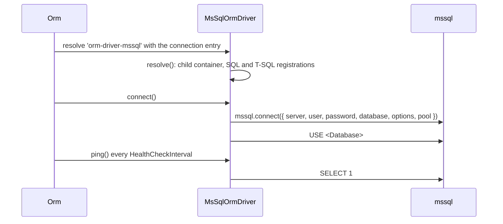

# Connection and configuration

`MsSqlOrmDriver` is the connection class for SQL Server. A `db.Connections` entry with `Driver: 'orm-driver-mssql'` gets one driver instance, which opens a connection pool from the `mssql` package and answers every query on that connection.

## How it works

1. **Registration.** Importing `@spinajs/orm-mssql` runs `@Injectable('orm-driver-mssql')` and `@NewInstance()` on `MsSqlOrmDriver`: the class is registered in the root container under the string `orm-driver-mssql`, one new instance per resolve. `DI.register(MsSqlOrmDriver).as('orm-driver-mssql')` makes the same registration explicitly.
2. **Resolve.** `Orm.createConnections()` reads `db.Connections` and resolves each entry's `Driver` string with the entry as the constructor argument. A string with no registration throws `OrmException('ORM connection driver <Driver> not registerd')`.
3. **Constructor.** `MsSqlOrmDriver` merges `{ AliasSeparator: '#' }` under the entry, so a configured `AliasSeparator` still wins. `OrmDriver` then merges the result over its defaults.
4. **`resolve()`.** `OrmDriver.resolve()` creates the `orm-driver-<Name>` logger and the driver's child container `this.Container`. `SqlDriver.resolve()` registers the shared SQL classes. `MsSqlOrmDriver.resolve()` registers the T-SQL classes listed in [Extending the driver](08-extending-the-driver.md#what-the-driver-registers).
5. **`connect()`.** Calls `mssql.connect()` with the object `connectionConfig()` builds: `Host`, `User`, `Password`, `Database`, the TLS options, `useUTC: true` and the pool settings. Then it runs `USE <Database>`. On failure it closes the pool, sets it to `null` and re-throws; `Orm` wraps the error in `OrmException('Failed to connect to database for connection <Name> ...')`.
6. **Health check.** `Orm` starts the health check, which calls `ping()`. `ping()` runs `SELECT 1` and returns `true`, or `false` on any error.
7. **`disconnect()`.** Closes the pool and clears it.



## Configuration

Keys of one `db.Connections[]` entry. Keys this driver does not read are listed as ignored, so a value you set there has no effect.

| Key | Type | Default | Allowed values | Meaning |
| --- | --- | --- | --- | --- |
| `db.Connections[].Driver` | `string` | none | `'orm-driver-mssql'`, or the string of a subclass | Selects `MsSqlOrmDriver`. |
| `db.Connections[].Name` | `string` | `'orm-driver'` | any | Connection name for `@Connection('...')` and `Orm.Connections.get()`; also names the logger `orm-driver-<Name>`. |
| `db.Connections[].Host` | `string` | none | host name or IP | Passed as `server`. |
| `db.Connections[].Port` | `number` | ignored | | **Not passed to `mssql`.** The `mssql` package connects to port `1433`. |
| `db.Connections[].User` | `string` | none | | SQL login. |
| `db.Connections[].Password` | `string` | none | | SQL login password. |
| `db.Connections[].Database` | `string` | none | | Database of the pool, and the target of the `USE` statement after connect. |
| `db.Connections[].AliasSeparator` | `string` | `'#'` | any | Wraps generated table aliases: `[#users#]`. `$` is the framework default; this driver replaces it. |
| `db.Connections[].Options.Schema` | `string` | none | schema name | Adds the schema to every table name: `[dbo].[users]`. |
| `db.Connections[].Options.TrustServerCertificate` | `boolean` | `true` | `true`, `false` | Passed as `options.trustServerCertificate`. `true` accepts any server certificate. |
| `db.Connections[].Options.CryptoCredentialsDetails` | `object` | `{}` | Node TLS secure-context options | Passed as `options.cryptoCredentialsDetails`, for example a CA bundle. |
| `db.Connections[].Pool.Min` | `number` | `0` | | Passed as `pool.min`. |
| `db.Connections[].Pool.Max` | `number` | `PoolLimit`, else `10` | | Passed as `pool.max`. |
| `db.Connections[].Pool.IdleTimeout` | `number` | `30000` | ms | Passed as `pool.idleTimeoutMillis`. |
| `db.Connections[].Pool.AcquireTimeout` | `number` | `10000` | ms | Passed as `pool.acquireTimeoutMillis`. |
| `db.Connections[].PoolLimit` | `number` | none | | Deprecated; used for `Pool.Max` when that is absent. |
| `db.Connections[].Resilience.HealthCheckInterval` | `number` | see [Connections](../orm/01-connections.md) | ms | How often `ping()` runs. |
| `db.Connections[].Migration.*` | | see [Migrations](../orm/10-migrations.md) | | `OnStartup`, `Table`, `Transaction.Mode`, `Lock`. |
| any other `Options.*` key | | ignored | | `encrypt`, `requestTimeout`, `instanceName` and other `mssql` options are **not** passed through. |

`mssql` fills the options the driver does not pass with its own defaults: `encrypt: true`, port `1433`, a 15 000 ms connect timeout and a 15 000 ms request timeout. To change them, override `connectionConfig()`, or `connect()` for a pool per connection (see [the example below](#connect-with-a-custom-port-encryption-and-a-pool-per-connection)).

```ts sample
import { FrameworkConfiguration } from '@spinajs/configuration';
import { MigrationTransactionMode } from '@spinajs/orm';
import _ from 'lodash';

export class AppConfiguration extends FrameworkConfiguration {
  public async resolve(): Promise<void> {
    await super.resolve();

    this.Config = _.merge(this.Config, {
      db: {
        DefaultConnection: 'mssql',
        Connections: [
          {
            Name: 'mssql',
            Driver: 'orm-driver-mssql',
            Host: 'sql.internal',
            User: 'app',
            Password: 'Str0ng!Passw0rd',
            Database: 'shop',
            Pool: { Min: 2, Max: 20, IdleTimeout: 30000, AcquireTimeout: 10000 },
            Resilience: { HealthCheckInterval: 30000 },
            Migration: {
              OnStartup: true,
              Transaction: { Mode: MigrationTransactionMode.PerMigration },
            },
            Options: {
              Schema: 'dbo',
              // Validate the server certificate in production.
              TrustServerCertificate: false,
            },
          },
        ],
      },
    });
  }
}
```

## Services and extension points

| Service | DI token and lifetime | Default implementation | Alternatives | How to replace or extend |
| --- | --- | --- | --- | --- |
| The driver | `'orm-driver-mssql'` in the root container, new instance per connection (`@Injectable`, `@NewInstance`) | `MsSqlOrmDriver` | none shipped | Subclass `MsSqlOrmDriver` with its own `@Injectable('<string>')`, and set that string as `Driver`. Or `DI.register(MySubclass).as('orm-driver-mssql')` before `Orm` resolves, to use it for every MSSQL connection. |
| Connection setup | `MsSqlOrmDriver.connect()`, `disconnect()`, `ping()`; `connectionConfig()` (protected) builds the `mssql.config` | `mssql.connect()` global pool | | Override `connectionConfig()` to change the options passed to `mssql`; override `connect()` to open a pool per connection. Assign the pool to `this._connectionPool`; `executeOnDb()`, transactions and `disconnect()` read it from there. |
| Table reflection | `MsSqlOrmDriver.tableInfo(name, schema?)` | `INFORMATION_SCHEMA` queries | | Override `tableInfo()` to fix the column descriptors; see [Important behaviour](#important-behaviour). |

### Connection setup: custom implementation

Override `connect()` when you need an option the driver does not pass: a port, `encrypt: false`, a request timeout, a named instance. A subclass also gives each connection its own `ConnectionPool` instead of the `mssql` global one. Register the subclass under its own driver string; it inherits every T-SQL registration from `MsSqlOrmDriver.resolve()`.

```ts sample
import { Injectable, NewInstance } from '@spinajs/di';
import { OrmDriver } from '@spinajs/orm';
import { MsSqlOrmDriver } from '@spinajs/orm-mssql';
import mssql from 'mssql';

/** Opens its own pool, with the port, encryption and timeouts taken from the connection entry. */
@Injectable('orm-driver-mssql-tls')
@NewInstance()
export class TlsMsSqlDriver extends MsSqlOrmDriver {
  public async connect(): Promise<OrmDriver> {
    const pool = this.resolvedPoolOptions();

    this._connectionPool = await new mssql.ConnectionPool({
      server: this.Options.Host!,
      port: this.Options.Port ?? 1433,
      user: this.Options.User,
      password: this.Options.Password,
      database: this.Options.Database,
      requestTimeout: this.Options.Options?.RequestTimeout ?? 30000,
      options: {
        encrypt: this.Options.Options?.Encrypt ?? true,
        trustServerCertificate: this.Options.Options?.TrustServerCertificate ?? false,
      },
      pool: { min: pool.Min, max: pool.Max, idleTimeoutMillis: pool.IdleTimeout, acquireTimeoutMillis: pool.AcquireTimeout },
    }).connect();

    return this;
  }
}
```

Then set `Driver: 'orm-driver-mssql-tls'` and, for example, `Port: 14330, Options: { Encrypt: true, RequestTimeout: 60000 }` on the connection.

## Important behaviour

- **One global pool per process.** `connect()` calls `mssql.connect()`, which creates the `mssql` package's global pool once and returns that same pool on later calls. A second MSSQL connection with a different host or database gets the first connection's pool, and `disconnect()` on either closes it for both. Use the `connect()` override above for more than one MSSQL connection.
- **`Port` is ignored.** Only `Host` is passed; the server must listen on `1433`.
- **`TrustServerCertificate` defaults to `true`.** The connection is encrypted (the `mssql` default) but the server certificate is not validated unless you set it to `false`.
- **`useUTC` is always `true`.** `connectionConfig()` sets it, so `mssql` binds a `Date` as UTC and reads `DATETIME` / `DATETIME2` columns as UTC. No connection option turns it off; override `connectionConfig()` in a subclass to change it.
- **The option keys are PascalCase.** `Options.TrustServerCertificate` is read; `Options.trustServerCertificate` is not.
- **`USE <Database>` is not quoted.** A database name with spaces or brackets fails at connect.
- **No statement retries.** `executeOnDb()` does not use `withReconnect()`. A dropped connection fails the statement; the health check marks the connection state. See [Executing statements](02-executing-statements.md#retry-statements-after-a-dropped-connection).
- **`tableInfo(name, schema?)` reflects loosely.** It filters `INFORMATION_SCHEMA.COLUMNS` by table name, and by `TABLE_CATALOG` (the database) when `schema` is given; `Options.Schema` is not applied, so same-named tables in two schemas are merged. `MaxLength` is always `-1`. `AutoIncrement` is `true` for every `int` primary key, not read from `IDENTITY`. `Nullable` holds the raw `IS_NULLABLE` text (`'YES'` / `'NO'`), so it is truthy for every column. It returns `null` for a table that does not exist.

## Best practices

- Set `Options.TrustServerCertificate: false` and, for a private CA, `Options.CryptoCredentialsDetails: { ca: ... }` outside local development.
- Set `Options.Schema` (usually `'dbo'`) so table names do not depend on the login's default schema.
- Keep one MSSQL connection per process with the stock driver; subclass `connect()` before adding a second.

## Patterns and antipatterns

```ts
// Don't: lowercase mssql keys are never read; Port is ignored, so this still connects to 1433
{ Driver: 'orm-driver-mssql', Host: 'sql', Port: 14330, Options: { trustServerCertificate: false, encrypt: false } }

// Do: the PascalCase keys the driver reads, and a subclass for anything else
{ Driver: 'orm-driver-mssql', Host: 'sql', Options: { TrustServerCertificate: false } }
```

## Examples

### Connect with a custom port, encryption and a pool per connection

The `TlsMsSqlDriver` sample above, used for two databases on the same server:

```ts sample
import { FrameworkConfiguration } from '@spinajs/configuration';
import _ from 'lodash';

export class TwoDatabasesConfiguration extends FrameworkConfiguration {
  public async resolve(): Promise<void> {
    await super.resolve();

    this.Config = _.merge(this.Config, {
      db: {
        DefaultConnection: 'shop',
        Connections: [
          { Name: 'shop', Driver: 'orm-driver-mssql-tls', Host: 'sql.internal', Port: 14330, User: 'app', Password: 'secret', Database: 'shop', Options: { Schema: 'dbo' } },
          { Name: 'audit', Driver: 'orm-driver-mssql-tls', Host: 'sql.internal', Port: 14330, User: 'app', Password: 'secret', Database: 'audit', Options: { Schema: 'dbo' } },
        ],
      },
    });
  }
}
```

### Check a connection from a readiness probe

```ts sample
import { DI } from '@spinajs/di';
import { Orm } from '@spinajs/orm';

export async function databaseReady(): Promise<boolean> {
  const connection = DI.get(Orm)?.Connections.get('mssql');
  return connection ? await connection.ping() : false;
}
```

## Related

- [Connections](../orm/01-connections.md): `db.Connections`, `Pool`, `Resilience` and the `OrmDriver` contract.
- [`SqlDriver`](../orm-sql/01-sql-driver.md): what the base class does before `executeOnDb()` runs.
- [Executing statements](02-executing-statements.md): how a statement reaches the pool.
- [Extending the driver](08-extending-the-driver.md): subclassing rules shared by every override.
