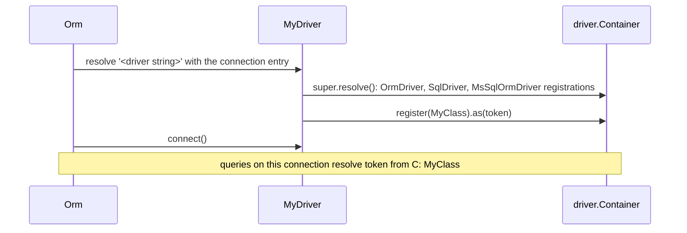

# Extending the driver

Every T-SQL behaviour of `@spinajs/orm-mssql` is a class registered in the connection's own DI container, or a method of `MsSqlOrmDriver`. Subclass the driver, override a method or register a different class after `super.resolve()`, and select the subclass per connection or for every MSSQL connection. Only `MsSqlOrmDriver`, `MsSqlServerResponseMapper`, `IMsSqlTransactionContext` and `toNamedParameters` are exported; a replacement extends the shared class from `@spinajs/orm-sql` or the abstract token from `@spinajs/orm`.

## How it works

1. **Subclass.** `class MyDriver extends MsSqlOrmDriver`, decorated `@Injectable('<driver string>')` and `@NewInstance()`. The parent's `@Injectable('orm-driver-mssql')` is not inherited.
2. **Override `resolve()`.** Call `super.resolve()` first. It runs `OrmDriver.resolve()` (child container, logger, standard converters), `SqlDriver.resolve()` (shared SQL classes) and `MsSqlOrmDriver.resolve()` (the T-SQL classes below), in that order.
3. **Register.** `this.Container.register(MyClass).as(<token>)`. The container returns the last registration of a token, so yours wins.
4. **Override methods.** `connect()`, `executeOnDb()`, `isRetryableError()`, `tableInfo()`, `supportedFeatures()` and the transaction primitives are plain methods; call `super` to keep the stock behaviour.
5. **Select.** A connection with `Driver: '<driver string>'` resolves your subclass. Or register it under the stock string with `DI.register(MyDriver).as('orm-driver-mssql')` before `Orm` resolves, and every MSSQL connection uses it.

Errors: a `Driver` string with no registration throws `OrmException('ORM connection driver <Driver> not registerd')` at boot. A registration made before `super.resolve()` is overwritten.



## Configuration

| Key | Type | Default | Allowed values | Meaning |
| --- | --- | --- | --- | --- |
| `db.Connections[].Driver` | `string` | none | any string a driver class is registered under | Selects the driver class for that connection. |

```ts
export default {
  db: {
    DefaultConnection: 'shop',
    Connections: [
      { Name: 'shop', Driver: 'orm-driver-mssql-shop', Host: 'sql.internal', User: 'app', Password: 'secret', Database: 'shop', Options: { Schema: 'dbo' } },
      { Name: 'legacy', Driver: 'orm-driver-mssql', Host: 'sql-old.internal', User: 'app', Password: 'secret', Database: 'erp' },
    ],
  },
};
```

## Services and extension points

### The driver

| Service | DI token and lifetime | Default implementation | Alternatives | How to replace or extend |
| --- | --- | --- | --- | --- |
| SQL Server driver | `'orm-driver-mssql'` in the root container; `@NewInstance()`, one per connection | `MsSqlOrmDriver` | none shipped | Subclass with its own `@Injectable('<string>')`, or `DI.register(Sub).as('orm-driver-mssql')` before `Orm` resolves. |

Methods a subclass overrides:

| Method | Visibility | Stock behaviour | Page |
| --- | --- | --- | --- |
| `connect()`, `disconnect()`, `ping()` | public | one `mssql.ConnectionPool` per connection; `SELECT 1` | [Connection and configuration](01-configuration.md) |
| `executeOnDb(stmt, params, context)` | public | backticks stripped, `@p<n>` parameters, result shaped by context | [Executing statements](02-executing-statements.md) |
| `isRetryableError(err)` | protected | not used: `executeOnDb()` does not retry | [Executing statements](02-executing-statements.md#retry-statements-after-a-dropped-connection) |
| `_begin`, `_commit`, `_rollback`, `_savepoint`, `_releaseSavepoint`, `_rollbackToSavepoint`, `_dispose` | protected | `mssql.Transaction`, `SAVE TRANSACTION` | [Transactions](03-transactions.md) |
| `SupportedIsolationLevels` | public property | all four | [Transactions](03-transactions.md) |
| `supportedFeatures()` | public | `{ events: false, insertReturning: false, insertIdIsFirstOfBatch: false, concurrentTransactions: true, nativeJson: false }` | [Inserts and upserts](04-inserts-and-upserts.md) |
| `lockTableShared(table)` | public | `SELECT COUNT(*) FROM <table> WITH (TABLOCK, HOLDLOCK)` inside the transaction | [Transactions](../orm/08-transactions.md#shared-table-lock) |
| `MaxBindings`, `MaxInsertRows` | public property | `2000` parameters per statement (the server allows 2100), `1000` rows per `VALUES` list | [SQL helpers](../orm/17-sql-helpers.md#batches) |
| `tableInfo(name, schema?)` | public | `INFORMATION_SCHEMA` queries | [Connection and configuration](01-configuration.md#important-behaviour) |
| `resolve()` | public | registers the tokens below | this page |

### What the driver registers

`MsSqlOrmDriver.resolve()` registers these in `this.Container`, on top of [what `SqlDriver.resolve()` registers](../orm-sql/01-sql-driver.md#what-sqldriverresolve-registers). Lifetime is new instance per resolve unless noted.

| Token (`@spinajs/orm`) | MSSQL implementation | Replaces | Page |
| --- | --- | --- | --- |
| `IdentifierQuoter` | `BracketIdentifierQuoter` | nothing (`SqlDriver` registers none) | [Query dialect](05-query-dialect.md) |
| `LiteralQuoter` | `MsSqlLiteralQuoter` | nothing | [Query dialect](05-query-dialect.md#literal-quoting-custom-implementation) |
| `TableAliasCompiler` | `MsSqlTableAliasCompiler` | `SqlTableAliasCompiler` | [Query dialect](05-query-dialect.md) |
| `LimitQueryCompiler` | `MsSqlLimitCompiler` | nothing | [Query dialect](05-query-dialect.md#paging-custom-implementation) |
| `OrderByQueryCompiler` | `MsSqlOrderByCompiler` | `SqlOrderByQueryCompiler` | [Query dialect](05-query-dialect.md) |
| `DeleteQueryCompiler` | `MsSqlDeleteQueryCompiler` | `SqlDeleteQueryCompiler` | [Query dialect](05-query-dialect.md) |
| `InSetStatement` | `MsSqlInSetStatement` | `SqlInSetStatement` | [Query dialect](05-query-dialect.md) |
| `InsertQueryCompiler` | `MsSqlInsertQueryCompiler` | `SqlInsertQueryCompiler` | [Inserts and upserts](04-inserts-and-upserts.md) |
| `OnDuplicateQueryCompiler` | `MsSqlOnDuplicateQueryCompiler` | nothing | [Inserts and upserts](04-inserts-and-upserts.md#upsert-compiler-custom-implementation) |
| `TableExistsCompiler` | `MsSqlTableExistsCompiler` | nothing | [Schema dialect](06-schema-dialect.md) |
| `TableQueryCompiler` | `MsSqlTableQueryCompiler` | `SqlTableQueryCompiler` | [Schema dialect](06-schema-dialect.md) |
| `ColumnQueryCompiler` | `MsSqlColumnQueryCompiler` | nothing | [Schema dialect](06-schema-dialect.md#column-definition-custom-implementation) |
| `AlterTableQueryCompiler` | `MsSqlAlterTableQueryCompiler` | nothing | [Schema dialect](06-schema-dialect.md#altering-tables) |
| `AlterColumnQueryCompiler` | `MsSqlAlterColumnQueryCompiler` | nothing | [Schema dialect](06-schema-dialect.md#altering-tables) |
| `SqlExpressions` | `MsSqlSqlExpressions` (exported) | the base `SqlExpressions`, which throws | [SQL helpers](../orm/17-sql-helpers.md#dialect-expressions) |
| `CreateDatabaseCompiler` | `MsSqlCreateDatabaseQueryCompiler` | `SqlCreateDatabaseQueryCompiler` | [Schema dialect](06-schema-dialect.md) |
| `DropDatabaseCompiler` | `MsSqlDropDatabaseQueryCompiler` | `SqlDropDatabaseQueryCompiler` | [Schema dialect](06-schema-dialect.md) |
| `CreateViewCompiler` | `MsSqlCreateViewCompiler` | nothing | [Schema dialect](06-schema-dialect.md) |
| `TruncateTableQueryCompiler` | `SqlTruncateTableQueryCompiler` (shared, claimed explicitly) | nothing | [Schema dialect](06-schema-dialect.md) |
| `EventQueryCompiler`, `DropEventQueryCompiler` | `UnsupportedEventQueryCompiler`, `UnsupportedDropEventQueryCompiler` | nothing | [Schema dialect](06-schema-dialect.md) |
| `DatetimeValueConverter` | `IsoDatetimeValueConverter` (`@spinajs/orm-sql`) | `SqlDatetimeValueConverter` | [Value conversion](07-value-conversion.md) |
| `ServerResponseMapper` | `MsSqlServerResponseMapper` | nothing | [Inserts and upserts](04-inserts-and-upserts.md#insert-response-mapper-custom-implementation) |
| `DefaultValueBuilder` | `MsSqlDefaultValueBuilder` | nothing | [Schema dialect](06-schema-dialect.md#column-defaults-custom-implementation) |
| `NowExpression` | `MsSqlNowExpression` (`SYSDATETIMEOFFSET()`) | nothing | [Value conversion](07-value-conversion.md) |

Tokens the driver leaves **unregistered**, each a place to add your own:

| Token | Effect while unregistered | Page |
| --- | --- | --- |
| `TableCloneQueryCompiler`, `RecursiveQueryCompiler` | the feature throws a `TypeError` on first use | [Schema dialect](06-schema-dialect.md) |
| `TableHistoryQueryCompiler` | `trackHistory()` throws `MethodNotImplemented` in `MsSqlTableQueryCompiler` before it is resolved | [Schema dialect](06-schema-dialect.md) |

### A driver for tests: custom implementation

Override the transport to compile T-SQL without a server. `executeOnDb()` returns no rows, and `connect()` does nothing, so `Orm` boots and builders compile with every MSSQL registration in place:

```ts sample
import { Injectable, NewInstance } from '@spinajs/di';
import { IColumnDescriptor, OrmDriver } from '@spinajs/orm';
import { MsSqlOrmDriver } from '@spinajs/orm-mssql';

/** The real MSSQL dialect with the database taken out. */
@Injectable('orm-driver-mssql-offline')
@NewInstance()
export class OfflineMsSqlDriver extends MsSqlOrmDriver {
  public readonly sent: Array<{ sql: string; bindings: unknown[] }> = [];

  public async executeOnDb(stmt: string, params: any[]): Promise<any> {
    this.sent.push({ sql: stmt, bindings: params });
    return [];
  }

  public async ping(): Promise<boolean> {
    return true;
  }

  public async connect(): Promise<OrmDriver> {
    return this;
  }

  public async disconnect(): Promise<OrmDriver> {
    return this;
  }

  public async tableInfo(): Promise<IColumnDescriptor[]> {
    return null as any;
  }
}
```

## Important behaviour

- **Registrations are per connection.** Each driver instance owns a child container, so a subclass's registrations affect only connections that use it.
- **Root registrations do not override driver tokens.** `DI.register(MyCompiler).as(OrderByQueryCompiler)` in the root container is shadowed by the registration in the driver's child container.
- **Register after `super.resolve()`.** A registration made before it is overwritten.
- **A subclass is not registered under the parent's string.** Give it its own `@Injectable('<string>')`, or register it explicitly.
- **Keep constructor signatures.** Compilers are resolved with fixed arguments (the builder, sometimes the container first); a replacement must accept the same.
- **A statement subclass must override `clone()`**, or a cloned query turns it back into the parent class. `MsSqlInSetStatement.clone()` copies its injected `Quoter` by hand, because a clone does not go through the container.
- **The MSSQL compilers are not exported.** Extend the shared `Sql*` class and re-implement the T-SQL part, as the examples do.

## Best practices

- Combine the fixes a deployment needs in one subclass and register it under `orm-driver-mssql`, so every connection gets them.
- Name a per-connection subclass after its change (`orm-driver-mssql-reporting`).
- Assert a registration in a test: `expect(driver.Container.resolve(OrderByQueryCompiler, [builder])).to.be.instanceOf(MyOrderByCompiler)`.

## Patterns and antipatterns

```ts
// Don't: super.resolve() runs MsSqlOrmDriver's registrations last and overwrites yours
public resolve() {
  this.Container.register(SqlOrderByQueryCompiler).as(OrderByQueryCompiler);
  super.resolve();
}

// Do
public resolve() {
  super.resolve();
  this.Container.register(SqlOrderByQueryCompiler).as(OrderByQueryCompiler);
}
```

## Examples

### One production driver with several changes

Unicode string columns and a strict insert mapper, for every MSSQL connection. It keeps the driver's own column defaults (`MsSqlDefaultValueBuilder`): a `SqlDefaultValueBuilder` in their place would write `CURRENT_TIMESTAMP`, the server's local time, into DATETIMEOFFSET columns:

```ts sample
import { DI, Injectable, NewInstance } from '@spinajs/di';
import { ColumnQueryBuilder, ColumnQueryCompiler, DbServerResponse, OrmException, ServerResponseMapper } from '@spinajs/orm';
import { SqlColumnQueryCompiler } from '@spinajs/orm-sql';
import { MsSqlOrmDriver, MsSqlServerResponseMapper } from '@spinajs/orm-mssql';

export class StrictResponseMapper extends MsSqlServerResponseMapper {
  public read(data: any): DbServerResponse {
    const response = super.read(data);

    if (!Array.isArray(data) && response.RowsAffected === 0) {
      throw new OrmException('insert wrote no row');
    }

    return response;
  }
}

@NewInstance()
export class UnicodeColumnCompiler extends SqlColumnQueryCompiler {
  constructor(builder: ColumnQueryBuilder) {
    super(builder);
    this._statementsMappings.autoincrement = () => 'IDENTITY(1,1)';
    this._statementsMappings.string = (column: ColumnQueryBuilder) => `NVARCHAR(${column.Args[0] ?? 255})`;
    this._statementsMappings.boolean = () => 'BIT';
    // as the driver's own column compiler: instants keep their offset
    this._statementsMappings.dateTime = () => 'DATETIMEOFFSET(3)';
    this._statementsMappings.timestamp = () => 'DATETIMEOFFSET(3)';
  }
}

@Injectable('orm-driver-mssql-production')
@NewInstance()
export class ProductionMsSqlDriver extends MsSqlOrmDriver {
  public resolve() {
    super.resolve();

    this.Container.register(StrictResponseMapper).as(ServerResponseMapper);
    this.Container.register(UnicodeColumnCompiler).as(ColumnQueryCompiler);
  }
}

DI.register(ProductionMsSqlDriver).as('orm-driver-mssql');
```

### Check the T-SQL a query compiles to, without a server

With `OfflineMsSqlDriver` above registered and a connection `{ Name: 'offline', Driver: 'orm-driver-mssql-offline', Database: 'shop' }`:

```ts sample
import { DI } from '@spinajs/di';
import { ICompilerOutput, Orm } from '@spinajs/orm';

export function compiledSearch(term: string): string {
  const driver = DI.get(Orm)!.Connections.get('offline')!;
  const query = driver.select().from('products').where('Name', 'like', `%${term}%`).orderBy('Name').take(10);

  // eg. SELECT ... FROM [products] as [#products#] WHERE ... ORDER BY [Name] ASC OFFSET ? ROWS FETCH NEXT ? ROWS ONLY
  return (query.toDB() as ICompilerOutput).expression!;
}
```

## Related

- [Extending an existing dialect](../orm-sql/08-extending-an-existing-dialect.md): the same pattern for every SQL driver.
- [Adding a new SQL dialect](../orm-sql/07-adding-a-sql-dialect.md#what-each-shipped-driver-registers): the token matrix across drivers.
- [`SqlDriver`](../orm-sql/01-sql-driver.md): the base contract and what it registers.
- [Architecture](../orm/12-architecture.md): where each token is resolved on the query path.
