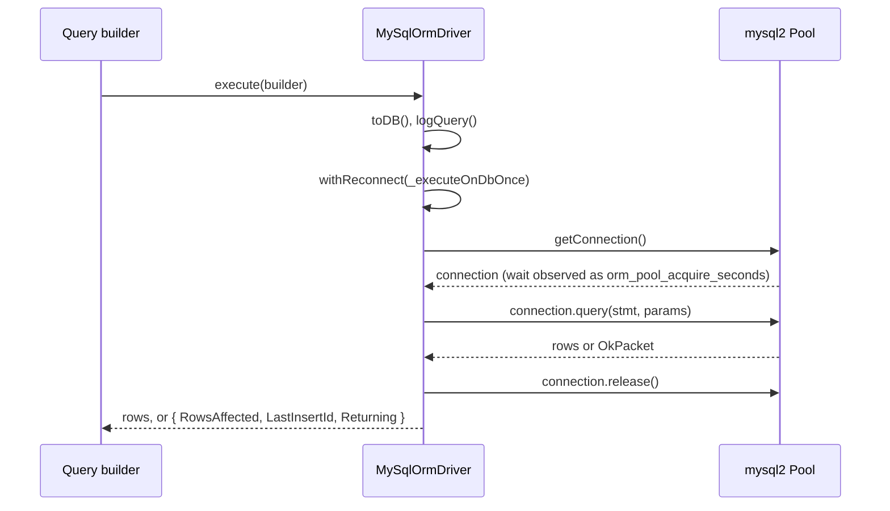

# MySQL driver

`MySqlOrmDriver` connects `@spinajs/orm` to MySQL or MariaDB through a `mysql2` connection pool. Select it with `Driver: 'orm-driver-mysql'` on a connection; subclass it to change how it connects, retries or reflects tables.

## How it works

1. **Registration.** Importing `@spinajs/orm-mysql` runs `@Injectable('orm-driver-mysql') @NewInstance()` on `MySqlOrmDriver`: the class is registered in the root container under the string `orm-driver-mysql` and under itself.
2. **Resolve.** `Orm.createConnections()` reads `db.Connections`, checks `Container.hasRegistered(c.Driver)`, and resolves `orm-driver-mysql` with the connection entry. `OrmDriver`'s constructor merges the entry into `Options`.
3. **Dialect.** The container calls `MySqlOrmDriver.resolve()`: `OrmDriver.resolve()` creates the `orm-driver-<Name>` logger and the child container `this.Container`, `SqlDriver.resolve()` registers the shared SQL classes, and `MySqlOrmDriver.resolve()` registers the MySQL dialect. See [Customizing the dialect](08-customizing-the-dialect.md#what-mysqlormdriverresolve-registers).
4. **Connect.** `Orm` calls `connect()`. It builds a `mysql2` pool from `Host`, `User`, `Password`, `Port`, `Database` and the resolved `Pool.*` values, takes one connection to prove the link, releases it, and sets `State` to `Connected`. A failed test connection ends the pool and rejects; `Orm` then calls `disconnect()` and throws `OrmException('Failed to connect to database for connection <Name> ...')`.
5. **Health probe.** `Orm` calls `startHealthCheck()`. Every `Resilience.HealthCheckInterval` ms, `ping()` runs `SELECT 1` once, outside the retry loop. A failed probe sets `Degraded` and calls `connect()` again.
6. **Execute.** An awaited builder calls `SqlDriver.execute()`, which compiles and calls `MySqlOrmDriver.executeOnDb(stmt, params, context)`:
   1. `withReconnect()` wraps the attempt.
   2. Inside a transaction, the statement runs on the transaction's own connection. See [Transactions](03-transactions.md).
   3. Otherwise `Pool.getConnection()` takes a connection. The wait is recorded in the `orm_pool_acquire_seconds` histogram through `observeAcquireSeconds()`.
   4. `connection.query(stmt, params)` runs with `?` placeholders; the connection is released exactly once, also when `query()` throws synchronously.
   5. The result is shaped by `QueryContext` (table below).
7. **Errors.** Any `mysql2` error is wrapped in `OrmException('Error executing orm command ', { Host, User, Name }, stmt, params, err)`. `withReconnect()` retries it only when `isRetryableError()` says the transport died. See [Retries](#retries).

| `QueryContext` | `executeOnDb()` resolves with |
| --- | --- |
| `Update`, `Delete` | `{ RowsAffected }` from `OkPacket.affectedRows` |
| `Insert`, `Upsert` | `{ RowsAffected, LastInsertId, Returning: [] }` from `OkPacket.affectedRows` and `OkPacket.insertId` |
| anything else (`Select`, `Schema`, `Transaction`, ...) | the raw `mysql2` result: the row array for a select |



### Retries

- `executeOnDb()` retries reads and writes. A retry happens only on a transport failure, where the statement never reached the server.
- `isRetryableError()` returns `false` inside a transaction: replaying one statement on a new connection would apply it outside the transaction.
- Outside a transaction it returns `true` for the shared codes of `isRetryableErrorCode()` from `@spinajs/orm`: `ECONNRESET`, `ECONNREFUSED`, `EPIPE`, `ETIMEDOUT`, `EHOSTUNREACH`, `ENETUNREACH`, `ENOTFOUND`, `PROTOCOL_CONNECTION_LOST`, `PROTOCOL_SEQUENCE_TIMEOUT`, `PROTOCOL_ENQUEUE_AFTER_FATAL_ERROR`, `PROTOCOL_ENQUEUE_AFTER_QUIT`, `ER_CON_COUNT_ERROR`, `ER_LOCK_WAIT_TIMEOUT`.
- It also returns `true` for any error whose `fatal` flag is `true`. `mysql2` marks connection-level failures fatal. The `inner` / `cause` chain is walked up to 5 levels.
- Between attempts `withReconnect()` waits `RetryDelay * 2^attempt` ms (capped at `MaxRetryDelay`) and calls `connect()`. See [Observability and resilience](../orm/13-observability-and-resilience.md).

## Configuration

Connection keys are listed in [Connections](../orm/01-connections.md#configuration). This table says what `MySqlOrmDriver` does with each.

| Key | Type | Default | Allowed values | Meaning |
| --- | --- | --- | --- | --- |
| `db.Connections[].Driver` | `string` | required | `orm-driver-mysql`, `orm-driver-mysql-ssh`, or your subclass's string | Selects this driver. |
| `db.Connections[].Name` | `string` | required | | Connection name; logger `orm-driver-<Name>`; `connection` label of the pool metrics. |
| `db.Connections[].Host` | `string` | `mysql2`: `localhost` | | `host` of the pool. |
| `db.Connections[].Port` | `number` | `mysql2`: `3306` | | `port` of the pool. |
| `db.Connections[].User`, `.Password` | `string` | | | Credentials. `Password` is not put on `OrmException` or the `Orm` log. |
| `db.Connections[].Database` | `string` | | | `database` of the pool; default schema of `tableInfo()`. |
| `db.Connections[].Pool.Max` | `number` | `10` (then `PoolLimit`) | `>= 1` | `connectionLimit`. |
| `db.Connections[].Pool.Min` | `number` | `0` | `>= 0` | `maxIdle` when above `0`; with `0`, `maxIdle` is `Pool.Max`. Connections are not pre-opened. |
| `db.Connections[].Pool.IdleTimeout` | `number` | `30000` | ms | `idleTimeout`. |
| `db.Connections[].Pool.AcquireTimeout` | `number` | `10000` | ms | **Not applied.** The pool queues without limit (`waitForConnections: true`, `queueLimit: 0`). |
| `db.Connections[].PoolLimit` | `number` | | | Deprecated. `Pool.Max` when `Pool.Max` is absent. |
| `db.Connections[].Resilience.*` | `IConnectionResilienceOptions` | `30000`, `5`, `200`, `5000` | | Health probe interval and retry policy. |
| `db.Connections[].Encoding` | `string` | | | **Not applied.** The connection uses `mysql2`'s default charset, `UTF8MB4_UNICODE_CI`. |
| `db.Connections[].Options` | `any` | | | **Not applied.** TLS, `timezone`, `decimalNumbers` and other `mysql2` options are not passed. Override `connect()` to set them: [example](#connection-setup-custom-implementation). |
| `db.Connections[].AliasSeparator` | `string` | `$` | | Wraps generated table aliases. |
| `db.Connections[].Migration.*` | | | | See [Migrations](../orm/10-migrations.md) and [DDL is not transactional](06-schema-views-and-events.md#ddl-is-not-transactional). |

```ts sample
import { FrameworkConfiguration } from '@spinajs/configuration';
import { MigrationTransactionMode } from '@spinajs/orm';
import _ from 'lodash';

export class ShopConfiguration extends FrameworkConfiguration {
  public async resolve(): Promise<void> {
    await super.resolve();

    this.Config = _.merge(this.Config, {
      db: {
        DefaultConnection: 'shop',
        Connections: [
          {
            Name: 'shop',
            Driver: 'orm-driver-mysql',
            Host: process.env.DB_HOST ?? '127.0.0.1',
            Port: Number(process.env.DB_PORT ?? 3306),
            User: process.env.DB_USER ?? 'shop',
            Password: process.env.DB_PASSWORD ?? '',
            Database: 'shop',
            Pool: { Min: 2, Max: 20, IdleTimeout: 30000 },
            Resilience: { HealthCheckInterval: 30000, MaxRetries: 5, RetryDelay: 200, MaxRetryDelay: 5000 },
            Migration: {
              OnStartup: true,
              Table: 'spinajs_migration',
              Transaction: { Mode: MigrationTransactionMode.PerMigration },
            },
          },
        ],
      },
    });
  }
}
```

## Services and extension points

| Service | DI token and lifetime | Default implementation | Alternatives | How to replace or extend |
| --- | --- | --- | --- | --- |
| MySQL driver | `'orm-driver-mysql'` and `MySqlOrmDriver`; `@NewInstance()`, one instance per connection entry, resolved by `Orm` at boot from `Driver` | `MySqlOrmDriver` | `MySqlSSHOrmDriver` (`'orm-driver-mysql-ssh'`, see [SSH tunnel](02-ssh-tunnel.md)) | Subclass with `@Injectable('<string>') @NewInstance()`. Use a new string for chosen connections, or `'orm-driver-mysql'` to replace it everywhere. Register before `Orm` resolves. |
| Connection setup | `connect()` (public) | `mysql2.createPool()` with the keys above | | Override to pass `ssl`, `timezone`, `charset` or any other `mysql2` option. Call `setState(ConnectionState.Connected)` when the link is proven. |
| Retry policy | `isRetryableError(err)` (protected) | shared codes, `fatal` errors, never inside a transaction | | Override, call `super.isRetryableError(err)` first so the transaction guard stays. |
| Pool gauges | `poolMetrics()` (public) | reads `mysql2`'s internal `_allConnections`, `_freeConnections`, `_connectionQueue`; zeros when they are absent | | Override when you swap the pool implementation. Must never throw. |
| Health probe | `ping()` (public) | `SELECT 1` once, no retry | | Override to probe something stronger, eg. a replica's lag. Must return `false`, not throw. |
| Response schema types | `ResponseSchemaTypes` (public, readonly) | `decimal`, `newdecimal`, `numeric` as `{ type: 'string' }` | | Redeclare in a subclass. See [Table reflection](05-table-reflection.md). |

`IPoolMetrics` values come from `mysql2` internals, so a `mysql2` upgrade that renames them reports zeros instead of failing the health check.

### Connection setup: custom implementation

Override `connect()` when a connection needs `mysql2` options the driver does not pass: TLS, a session timezone, a charset. Keep the shape of the stock method: build the pool from `resolvedPoolOptions()`, prove one connection, then set `Connected`. Register the class before `Orm` resolves.

```ts sample
import { readFileSync } from 'fs';
import { Injectable, NewInstance } from '@spinajs/di';
import { ConnectionState, OrmDriver } from '@spinajs/orm';
import { MySqlOrmDriver } from '@spinajs/orm-mysql';
import * as mysql from 'mysql2';

/**
 * Reads `Options.CaFile` and `Encoding` from the connection entry, which the stock driver ignores.
 */
@Injectable('orm-driver-mysql-tls')
@NewInstance()
export class TlsMySqlOrmDriver extends MySqlOrmDriver {
  public connect(): Promise<OrmDriver> {
    const pool = this.resolvedPoolOptions();
    const previous = this.Pool;

    this.Pool = mysql.createPool({
      host: this.Options.Host,
      user: this.Options.User,
      password: this.Options.Password,
      port: this.Options.Port,
      database: this.Options.Database,
      waitForConnections: true,
      connectionLimit: pool.Max,
      maxIdle: pool.Min > 0 ? pool.Min : pool.Max,
      idleTimeout: pool.IdleTimeout,
      queueLimit: 0,
      charset: this.Options.Encoding ?? 'UTF8MB4_UNICODE_CI',
      timezone: 'Z',
      ssl: { ca: readFileSync(this.Options.Options.CaFile, 'utf8'), rejectUnauthorized: true },
    });

    return new Promise((resolve, reject) => {
      this.Pool.getConnection((err, connection) => {
        if (err) {
          this.Pool.end(() => reject(err));
          return;
        }

        connection.release();
        // a reconnect replaces the pool, so the old one is closed here
        previous?.end(() => undefined);
        this.setState(ConnectionState.Connected);
        resolve(this);
      });
    });
  }
}
```

Use it from a connection entry:

```ts
{ Name: 'billing', Driver: 'orm-driver-mysql-tls', Host: 'db.internal', User: 'billing', Password: '...', Database: 'billing', Encoding: 'UTF8MB4_GENERAL_CI', Options: { CaFile: '/etc/ssl/rds-ca.pem' } }
```

### Retry policy: custom implementation

Override `isRetryableError()` to retry more error codes. Return `true` only when the server did not apply the statement; a retried write that did apply runs twice.

```ts sample
import { Injectable, NewInstance } from '@spinajs/di';
import { MySqlOrmDriver } from '@spinajs/orm-mysql';

/** After a writer failover the old writer turns read-only and rejects writes with code ER_OPTION_PREVENTS_STATEMENT. */
const FAILOVER_CODES = new Set(['ER_OPTION_PREVENTS_STATEMENT', 'ER_SERVER_SHUTDOWN']);

@Injectable('orm-driver-mysql')
@NewInstance()
export class FailoverAwareMySqlDriver extends MySqlOrmDriver {
  protected isRetryableError(err: unknown): boolean {
    if (super.isRetryableError(err)) {
      return true;
    }

    // super() already said no inside a transaction; keep that answer
    if (this.CurrentTransaction) {
      return false;
    }

    let current: any = err;
    for (let depth = 0; current && depth < 5; depth++) {
      if (FAILOVER_CODES.has(current.code)) {
        return true;
      }
      current = current.inner ?? current.cause;
    }

    return false;
  }
}
```

Registered under `'orm-driver-mysql'`, it replaces the stock driver for every connection that names that string. Import the module before `Orm` resolves.

## Important behaviour

- Importing the package registers both drivers. `DI.register(MySqlOrmDriver).as('orm-driver-mysql')` repeats what the decorator did; it is harmless.
- `Encoding`, `Options` and `Pool.AcquireTimeout` are read by no code in this driver. Without an override, the session timezone is `mysql2`'s `local` and there is no TLS.
- `decimalNumbers` stays off: `DECIMAL` and `NUMERIC` values come back as strings, so precision above 2^53 survives. `ResponseSchemaTypes` documents them as `string` for the generated response schema.
- `connect()` assigns a new pool without ending the previous one. A reconnect by `withReconnect()` or the health probe leaves the old pool's sockets open.
- A failed `connect()` ends the new pool but keeps it as `this.Pool`. The next retry attempt fails with `mysql2`'s `Pool is closed.`, which has no code and is not retryable, so `withReconnect()` stops early. The next health tick reconnects.
- `connect()` sets `Connected` itself, because it proves the link with a real connection.
- `ping()` bypasses `withReconnect()`, so a dead server does not turn every probe into a reconnect loop.
- `OrmException` from a failed statement carries the bindings (`params`). Log it with care when bindings hold personal data.
- Size `Pool.Max` against the server's `max_connections`: each process and each connection entry opens its own pool.
- `ER_DUP_ENTRY` (`1062`) throws `UniqueViolation`, with `constraint` (and on MySQL 8 `table`) read from the `for key '...'` part of the message. `1048` and `1364` throw `ConstraintViolation` of kind `not_null`, `1451` and `1452` `foreign_key`, `3819` `check`. Every other error stays `OrmException`. The `mysql2` error is `inner`.

## Best practices

- Keep `Options` out of connection entries unless a subclass reads it; the stock driver ignores it.
- When you subclass the driver, call `super.resolve()` first in `resolve()` and keep `@NewInstance()`: each connection needs its own driver and container.
- Put credentials in environment variables and read them in the configuration class, as in the sample above.
- Watch `orm_pool_waiting` and `orm_pool_acquire_seconds`: with an unbounded queue, a saturated pool shows up as latency, not as errors.

## Patterns and antipatterns

```ts
// Don't: the stock driver passes neither Options nor Encoding to mysql2; this connection runs without TLS
{ Name: 'billing', Driver: 'orm-driver-mysql', Encoding: 'latin1', Options: { ssl: { ca: '...' }, timezone: 'Z' } }

// Do: a driver subclass that reads them (see "Connection setup: custom implementation")
{ Name: 'billing', Driver: 'orm-driver-mysql-tls', Encoding: 'LATIN1_SWEDISH_CI', Options: { CaFile: '/etc/ssl/ca.pem' } }
```

```ts
// Don't: a subclass without its own registration string; no connection can select it
export class AuditedMySqlDriver extends MySqlOrmDriver {}

// Do
@Injectable('orm-driver-mysql-audited')
@NewInstance()
export class AuditedMySqlDriver extends MySqlOrmDriver {}
```

## Examples

### Boot the ORM on MySQL

```ts sample
import { DI } from '@spinajs/di';
import { Orm } from '@spinajs/orm';
import '@spinajs/orm-mysql';

export async function bootstrap(): Promise<Orm> {
  // importing @spinajs/orm-mysql registered 'orm-driver-mysql' and 'orm-driver-mysql-ssh'
  return await DI.resolve(Orm);
}
```

### Report the pool state of the shop connection

```ts sample
import { DI } from '@spinajs/di';
import { ConnectionState, Orm } from '@spinajs/orm';

export async function shopPoolReport() {
  const orm = await DI.resolve(Orm);
  const shop = orm.Connections.get('shop')!;
  const pool = shop.poolMetrics();

  return {
    healthy: shop.State === ConnectionState.Connected,
    open: pool.Size,
    busy: pool.InUse,
    queued: pool.Waiting,
  };
}
```

### Run a raw report query on the shop connection

```ts sample
import { DI } from '@spinajs/di';
import { OrmDriver } from '@spinajs/orm';

export async function unpaidOrderCount(): Promise<number> {
  const shop = DI.resolve<OrmDriver>('OrmConnection', ['shop'])!;
  const rows = (await shop.select().from('orders').where('Paid', false).count('Id', 'Total')) as unknown as Array<{ Total: number }>;

  return rows[0].Total;
}
```

## Related

- [SSH tunnel](02-ssh-tunnel.md): the `MySqlSSHOrmDriver` variant.
- [Transactions](03-transactions.md): how statements find the transaction's connection.
- [Customizing the dialect](08-customizing-the-dialect.md): every class the driver registers and how to swap one.
- [`SqlDriver`](../orm-sql/01-sql-driver.md): the base class, `execute()` and the driver contract.
- [Connections](../orm/01-connections.md): `db.Connections`, `Orm.Connections`, `@Connection`.
- [Observability and resilience](../orm/13-observability-and-resilience.md): health probe, retry loop, pool metrics.
