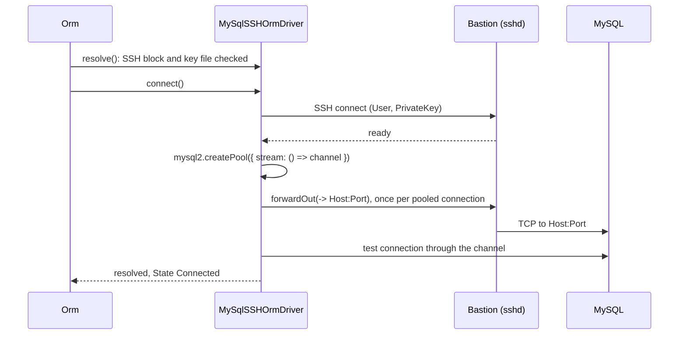

# SSH tunnel

`MySqlSSHOrmDriver` reaches a MySQL server that only a bastion host can see: it opens an SSH connection and runs every pooled `mysql2` connection over its own forwarded channel. Select it with `Driver: 'orm-driver-mysql-ssh'`. Everything else (dialect, transactions, retries) is inherited from `MySqlOrmDriver`.

## How it works

1. **Registration.** `@Injectable('orm-driver-mysql-ssh') @NewInstance()` registers the class when the package is imported.
2. **Resolve.** `MySqlSSHOrmDriver.resolve()` calls `MySqlOrmDriver.resolve()`, then validates the entry:
   - no `SSH` block: throws `OrmException('SSH options are not set for MySqlSSHOrmDriver')`;
   - `SSH.PrivateKey` is not an existing file (`fs.existsSync`): throws `OrmException('SSH private key file <path> does not exist')`.

   `Orm` reports either as `OrmException('Failed to resolve ORM driver orm-driver-mysql-ssh for connection <Name>')`.
3. **Connect.** `connect()` creates an `ssh2` `Client` and connects to `SSH.Host:SSH.Port` as `SSH.User` with the key read by `fs.readFileSync(SSH.PrivateKey)`.
4. **Pool.** On `ready`, a `mysql2` pool is built from the same `poolConfig()` as `MySqlOrmDriver`, with `stream` set to a function. `mysql2` calls it for every connection it opens, and each call runs `forwardOut('127.0.0.1', 0, Host, Port ?? 3306)`: one channel from the bastion to the database per pooled connection. `Host` and `Port` are the database address as the bastion sees it; no local port is opened.
5. **Prove.** One connection is taken and released, then the pool becomes `this.Pool`, the client becomes `SshClient`, and `State` is set to `Connected`. On a reconnect the replaced pool is ended once its borrowed connections are back, and the previous SSH client is ended after it.
6. **Errors.** An SSH `error` event before `ready`, or a failed test connection, rejects `connect()`; the new client is ended and the previous pool and client stay in use.
7. **Disconnect.** `disconnect()` stops the health probe, ends the pool, then ends the SSH client.



## Configuration

| Key | Type | Default | Allowed values | Meaning |
| --- | --- | --- | --- | --- |
| `db.Connections[].Driver` | `string` | required | `orm-driver-mysql-ssh` | Selects this driver. |
| `db.Connections[].Host` | `string` | required | | Database host as the bastion resolves it, usually a private address. |
| `db.Connections[].Port` | `number` | `3306` | | Database port on that host. |
| `db.Connections[].SSH.Host` | `string` | required | | Bastion host. |
| `db.Connections[].SSH.Port` | `number` | required | | Bastion SSH port, usually `22`. |
| `db.Connections[].SSH.User` | `string` | required | | SSH user. |
| `db.Connections[].SSH.PrivateKey` | `string` | required | path to an existing file | Unencrypted private key. No passphrase or agent option exists. |

`User`, `Password`, `Database`, `Pool.*` and `Resilience.*` behave as in [MySQL driver](01-mysql-driver.md#configuration).

```ts sample
import { FrameworkConfiguration } from '@spinajs/configuration';
import _ from 'lodash';

export class ReportingTunnelConfiguration extends FrameworkConfiguration {
  public async resolve(): Promise<void> {
    await super.resolve();

    this.Config = _.merge(this.Config, {
      db: {
        Connections: [
          {
            Name: 'reporting',
            Driver: 'orm-driver-mysql-ssh',
            Host: '10.0.0.5',
            Port: 3306,
            User: 'report',
            Password: process.env.REPORT_DB_PASSWORD ?? '',
            Database: 'warehouse',
            Pool: { Max: 5 },
            SSH: {
              Host: 'bastion.example.com',
              Port: 22,
              User: 'deploy',
              PrivateKey: '/home/deploy/.ssh/id_ed25519',
            },
          },
        ],
      },
    });
  }
}
```

## Services and extension points

| Service | DI token and lifetime | Default implementation | Alternatives | How to replace or extend |
| --- | --- | --- | --- | --- |
| Tunnelled MySQL driver | `'orm-driver-mysql-ssh'` and `MySqlSSHOrmDriver`; `@NewInstance()`, one per connection entry | `MySqlSSHOrmDriver` | `MySqlOrmDriver` for direct connections | Subclass and register under `'orm-driver-mysql-ssh'` (all tunnelled connections) or a new string. Override `connect()` to change how the tunnel or pool is built, `resolve()` to change validation. |
| SSH client | `SshClient` (protected `ssh2` `Client`) | created in `connect()`, replaced on every successful reconnect | | Read it in a subclass, eg. to listen for `close`. |

### Tunnelled MySQL driver: custom implementation

Override `connect()` to accept an encrypted key. Keep the shape of the stock method: a pool whose `stream` opens a channel per connection, proven with one connection, then `replacePool()` and `Connected`.

```ts sample
import { readFileSync } from 'fs';
import { Injectable, NewInstance } from '@spinajs/di';
import { ConnectionState, OrmDriver } from '@spinajs/orm';
import { MySqlSSHOrmDriver } from '@spinajs/orm-mysql';
import { PoolOptions } from 'mysql2';
import { Client as SSHClient } from 'ssh2';
import { Duplex, PassThrough } from 'stream';

/** The key passphrase comes from SSH_KEY_PASSPHRASE. */
@Injectable('orm-driver-mysql-ssh')
@NewInstance()
export class PassphraseSshMySqlDriver extends MySqlSSHOrmDriver {
  public async connect(): Promise<OrmDriver> {
    const ssh = this.Options.SSH!;
    const client = new SSHClient();

    await new Promise<void>((resolve, reject) => {
      client.on('ready', () => resolve());
      client.on('error', reject);
      client.connect({ host: ssh.Host, port: ssh.Port, username: ssh.User, privateKey: readFileSync(ssh.PrivateKey), passphrase: process.env.SSH_KEY_PASSPHRASE });
    });

    const pool = await this.openPool({ ...this.poolConfig(), stream: () => this.channel(client) } as PoolOptions);
    const previous = this.SshClient;

    this.SshClient = client;
    this.replacePool(pool, () => previous?.end());
    this.setState(ConnectionState.Connected);

    return this;
  }

  private channel(client: SSHClient): Duplex {
    // mysql2 wants the stream synchronously; the channel is piped into it once the forward is open
    const toServer = new PassThrough();
    const fromServer = new PassThrough();
    const proxy = Duplex.from({ writable: toServer, readable: fromServer });

    client.forwardOut('127.0.0.1', 0, this.Options.Host!, this.Options.Port ?? 3306, (err, channel) => {
      if (err) {
        proxy.destroy(err);
        return;
      }
      proxy.once('close', () => channel.close());
      toServer.pipe(channel).pipe(fromServer);
    });

    return proxy;
  }
}
```

## Important behaviour

- Every pooled connection has its own SSH channel, so `Pool.Max` works as on a direct connection.
- A reconnect (`withReconnect()` or the health probe) opens a new SSH client and pool; the previous client is ended once the previous pool has ended.
- `resolve()` checks the key file at boot. A missing key fails `Orm` startup, not the first query.
- Only key authentication is wired: no password, passphrase or SSH agent.
- `Password` is sent to MySQL inside the tunnel; the SSH key never reaches MySQL.

## Best practices

- Keep the key file readable by the service user only; `resolve()` reads it from disk on every boot.
- Give the tunnelled connection its own `Name` and point only the models that live there at it with `@Connection('reporting')`.
- Prefer a direct `orm-driver-mysql` connection over a VPN or private link for high-traffic connections; every statement also crosses the bastion.

## Patterns and antipatterns

```ts
// Don't: point Host at the bastion's own view of localhost when the database runs elsewhere
{ Name: 'reporting', Driver: 'orm-driver-mysql-ssh', Host: '127.0.0.1', SSH: { Host: 'bastion.example.com' /* ... */ } }

// Do: Host is the database address as the bastion resolves it
{ Name: 'reporting', Driver: 'orm-driver-mysql-ssh', Host: '10.0.0.5', Port: 3306, SSH: { Host: 'bastion.example.com' /* ... */ } }
```

## Examples

### Read last month's revenue from a warehouse behind a bastion

```ts sample
import { Connection, Model, ModelBase, Primary } from '@spinajs/orm';
import '@spinajs/orm-mysql';

@Connection('reporting')
@Model('monthly_revenue')
export class MonthlyRevenue extends ModelBase<MonthlyRevenue> {
  @Primary()
  public Id: number;

  public Month: string;

  public Total: string;
}

export async function lastMonthRevenue(month: string) {
  // DECIMAL arrives as a string; see the MySQL driver page
  return await MonthlyRevenue.where('Month', month).first();
}
```

## Related

- [MySQL driver](01-mysql-driver.md): everything this driver inherits.
- [Customizing the dialect](08-customizing-the-dialect.md): subclassing and registration strings.
- [Connections](../orm/01-connections.md): the `SSH.*` keys in `db.Connections`.
