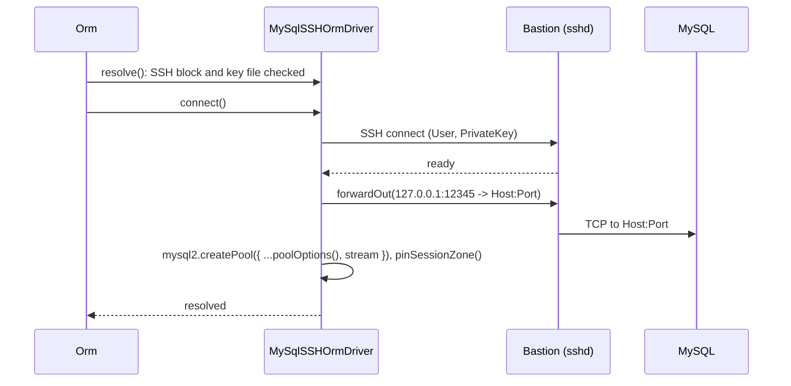

# SSH tunnel

`MySqlSSHOrmDriver` reaches a MySQL server that only a bastion host can see: it opens an SSH connection and runs the `mysql2` pool over a forwarded channel. Select it with `Driver: 'orm-driver-mysql-ssh'`. Everything else (dialect, transactions, retries) is inherited from `MySqlOrmDriver`.

## How it works

1. **Registration.** `@Injectable('orm-driver-mysql-ssh') @NewInstance()` registers the class when the package is imported.
2. **Resolve.** `MySqlSSHOrmDriver.resolve()` calls `MySqlOrmDriver.resolve()`, then validates the entry:
   - no `SSH` block: throws `OrmException('SSH options are not set for MySqlSSHOrmDriver')`;
   - `SSH.PrivateKey` is not an existing file (`fs.existsSync`): throws `OrmException('SSH private key file <path> does not exist')`.

   `Orm` reports either as `OrmException('Failed to resolve ORM driver orm-driver-mysql-ssh for connection <Name>')`.
3. **Connect.** `connect()` creates an `ssh2` `Client` and connects to `SSH.Host:SSH.Port` as `SSH.User` with the key read by `fs.readFileSync(SSH.PrivateKey)`.
4. **Forward.** On `ready`, `forwardOut('127.0.0.1', 12345, Host, Port)` opens one channel from the bastion to the database. `Host` and `Port` are the database address as the bastion sees it. `127.0.0.1:12345` is only the origin reported to the SSH server; no local port is opened.
5. **Pool.** A `mysql2` pool is built from `poolOptions()` (the same `Pool.*` mapping and `timezone: 'Z'` as `MySqlOrmDriver`), with `host: 'localhost'` and `stream` set to the forwarded channel. `pinSessionZone()` sets `time_zone = '+00:00'` on every connection the pool opens, and statements take connections through `acquire()`, as on the direct driver. `connect()` resolves without testing a connection.
6. **Errors.** An SSH `error` event or a failed forward rejects `connect()`.
7. **Disconnect.** `disconnect()` stops the health probe, ends the pool, then ends the SSH client.



## Configuration

| Key | Type | Default | Allowed values | Meaning |
| --- | --- | --- | --- | --- |
| `db.Connections[].Driver` | `string` | required | `orm-driver-mysql-ssh` | Selects this driver. |
| `db.Connections[].Host` | `string` | required | | Database host as the bastion resolves it, usually a private address. |
| `db.Connections[].Port` | `number` | required | | Database port on that host. |
| `db.Connections[].SSH.Host` | `string` | required | | Bastion host. |
| `db.Connections[].SSH.Port` | `number` | required | | Bastion SSH port, usually `22`. |
| `db.Connections[].SSH.User` | `string` | required | | SSH user. |
| `db.Connections[].SSH.PrivateKey` | `string` | required | path to an existing file | Unencrypted private key. No passphrase or agent option exists. |

`User`, `Password`, `Database`, `Pool.*` and `Resilience.*` behave as in [MySQL driver](01-mysql-driver.md#configuration).

```ts sample
import { FrameworkConfiguration } from '@spinajs/configuration';
import _ from 'lodash';

export class ReportingTunnelConfiguration extends FrameworkConfiguration {
  public async resolve(): Promise<void> {
    await super.resolve();

    this.Config = _.merge(this.Config, {
      db: {
        Connections: [
          {
            Name: 'reporting',
            Driver: 'orm-driver-mysql-ssh',
            Host: '10.0.0.5',
            Port: 3306,
            User: 'report',
            Password: process.env.REPORT_DB_PASSWORD ?? '',
            Database: 'warehouse',
            // one forwarded channel carries the whole pool, see "Important behaviour"
            Pool: { Max: 1 },
            SSH: {
              Host: 'bastion.example.com',
              Port: 22,
              User: 'deploy',
              PrivateKey: '/home/deploy/.ssh/id_ed25519',
            },
          },
        ],
      },
    });
  }
}
```

## Services and extension points

| Service | DI token and lifetime | Default implementation | Alternatives | How to replace or extend |
| --- | --- | --- | --- | --- |
| Tunnelled MySQL driver | `'orm-driver-mysql-ssh'` and `MySqlSSHOrmDriver`; `@NewInstance()`, one per connection entry | `MySqlSSHOrmDriver` | `MySqlOrmDriver` for direct connections | Subclass and register under `'orm-driver-mysql-ssh'` (all tunnelled connections) or a new string. Override `connect()` to change how the tunnel or pool is built, `resolve()` to change validation. |
| SSH client | `SshClient` (protected `ssh2` `Client`) | created in `connect()` | | Read it in a subclass, eg. to listen for `close`. |

### Tunnelled MySQL driver: custom implementation

Override `connect()` to give every pooled connection its own forwarded channel and to accept an encrypted key. `mysql2` takes `stream` as a function, called once per new connection.

```ts sample
import { readFileSync } from 'fs';
import { Injectable, NewInstance } from '@spinajs/di';
import { ConnectionState, OrmDriver } from '@spinajs/orm';
import { MySqlSSHOrmDriver } from '@spinajs/orm-mysql';
import * as mysql from 'mysql2';
import { Client as SSHClient } from 'ssh2';
import { Duplex, PassThrough } from 'stream';

/** One SSH channel per pooled connection; the key passphrase comes from SSH_KEY_PASSPHRASE. */
@Injectable('orm-driver-mysql-ssh')
@NewInstance()
export class MultiChannelSshMySqlDriver extends MySqlSSHOrmDriver {
  public connect(): Promise<OrmDriver> {
    const ssh = this.Options.SSH!;

    this.SshClient?.end();
    this.SshClient = new SSHClient();

    return new Promise((resolve, reject) => {
      this.SshClient.on('error', reject);

      this.SshClient.on('ready', () => {
        // poolOptions() carries the Pool.* mapping and timezone: 'Z'
        this.Pool = mysql.createPool({
          ...this.poolOptions(),
          host: 'localhost',
          stream: () => this.openChannel(),
        } as mysql.PoolOptions);
        this.pinSessionZone(this.Pool);

        this.acquire((err, connection) => {
          if (err) {
            reject(err);
            return;
          }
          connection!.release();
          this.setState(ConnectionState.Connected);
          resolve(this);
        });
      });

      this.SshClient.connect({
        host: ssh.Host,
        port: ssh.Port,
        username: ssh.User,
        privateKey: readFileSync(ssh.PrivateKey),
        passphrase: process.env.SSH_KEY_PASSPHRASE,
      });
    });
  }

  private openChannel(): Duplex {
    // mysql2 wants the stream synchronously; the channel is piped into it once the forward is open
    const toServer = new PassThrough();
    const fromServer = new PassThrough();
    const proxy = Duplex.from({ writable: toServer, readable: fromServer });

    this.SshClient.forwardOut('127.0.0.1', 0, this.Options.Host!, this.Options.Port!, (err, channel) => {
      if (err) {
        proxy.destroy(err);
        return;
      }
      toServer.pipe(channel).pipe(fromServer);
    });

    return proxy;
  }
}
```

## Important behaviour

- The stock `connect()` passes **one** forwarded channel as `stream`, and `mysql2` reuses that object for every connection the pool opens. A second concurrent connection writes into the same channel and corrupts the protocol. Keep `Pool.Max: 1`, or override `connect()` as above.
- The stock `connect()` does not take a test connection and does not set `State` to `Connected`; the first successful statement does.
- A reconnect (`withReconnect()` or the health probe) calls `connect()` again, which creates a new SSH client without ending the previous one.
- `resolve()` checks the key file at boot. A missing key fails `Orm` startup, not the first query.
- Only key authentication is wired: no password, passphrase or SSH agent.
- `Password` is sent to MySQL inside the tunnel; the SSH key never reaches MySQL.

## Best practices

- Keep the key file readable by the service user only; `resolve()` reads it from disk on every boot.
- Give the tunnelled connection its own `Name` and point only the models that live there at it with `@Connection('reporting')`.
- Prefer a direct `orm-driver-mysql` connection over a VPN or private link for high-traffic connections; the stock tunnel carries one connection.

## Patterns and antipatterns

```ts
// Don't: Pool.Max above 1 on the stock SSH driver; pooled connections share one channel
{ Name: 'reporting', Driver: 'orm-driver-mysql-ssh', Pool: { Max: 20 }, SSH: { /* ... */ } }

// Do: one connection, or a driver subclass that opens a channel per connection
{ Name: 'reporting', Driver: 'orm-driver-mysql-ssh', Pool: { Max: 1 }, SSH: { /* ... */ } }
```

## Examples

### Read last month's revenue from a warehouse behind a bastion

```ts sample
import { Connection, Model, ModelBase, Primary } from '@spinajs/orm';
import '@spinajs/orm-mysql';

@Connection('reporting')
@Model('monthly_revenue')
export class MonthlyRevenue extends ModelBase<MonthlyRevenue> {
  @Primary()
  public Id: number;

  public Month: string;

  public Total: string;
}

export async function lastMonthRevenue(month: string) {
  // DECIMAL arrives as a string; see the MySQL driver page
  return await MonthlyRevenue.where('Month', month).first();
}
```

## Related

- [MySQL driver](01-mysql-driver.md): everything this driver inherits.
- [Customizing the dialect](08-customizing-the-dialect.md): subclassing and registration strings.
- [Connections](../orm/01-connections.md): the `SSH.*` keys in `db.Connections`.
