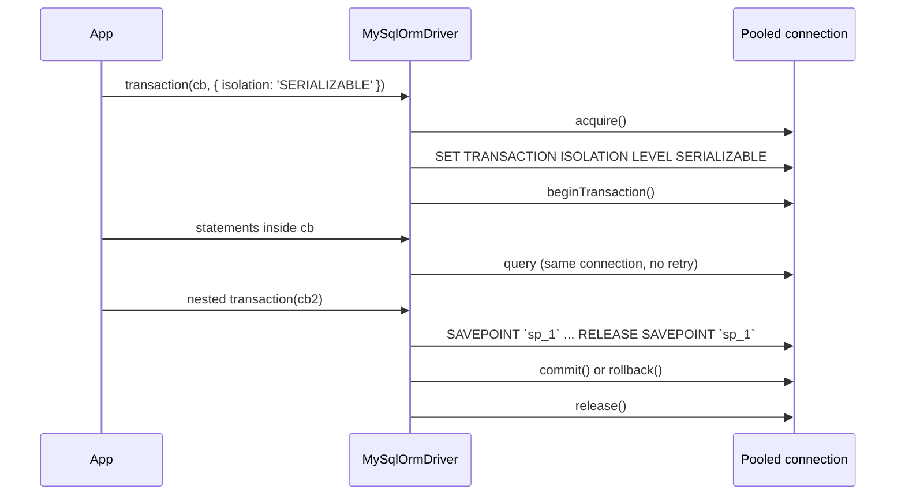

# Transactions

`MySqlOrmDriver` implements the transaction primitives of `OrmDriver` on one pooled connection per transaction. `driver.transaction(cb)` commits, rolls back, nests with savepoints and honours all four isolation levels. The API is in [Transactions](../orm/08-transactions.md); this page is what MySQL does underneath.

## How it works

1. **Validate.** `OrmDriver.transaction(cb, options)` checks `options.isolation` against `SupportedIsolationLevels`. MySQL declares `READ UNCOMMITTED`, `READ COMMITTED`, `REPEATABLE READ` and `SERIALIZABLE`. Any other value throws `OrmException('isolation level <x> not supported by driver orm-driver-mysql')` before a connection is taken.
2. **Begin.** `_begin(options)` takes a connection with `acquire()`, which waits for the connection's `SET time_zone = '+00:00'` and fails when it failed (see [Dates and time zone](01-mysql-driver.md#dates-and-time-zone)). With an isolation level it first runs `SET TRANSACTION ISOLATION LEVEL <level>` on that connection, then `connection.beginTransaction()`. It resolves an `IMySqlTransactionContext`: `{ connection, depth: 0 }`. A failure releases the connection and rejects.
3. **Run.** `transaction()` runs `cb` inside `TransactionStorage.run(ctx, ...)`, an `AsyncLocalStorage`. Every statement on this driver in that async path reaches `executeOnDb()`, finds the context, and runs on `ctx.connection`. The connection is not released after each statement.
4. **Nest.** A `transaction()` call inside the callback takes a savepoint instead: `_savepoint()` runs `` SAVEPOINT `sp_<n>` `` on the same connection. Success runs `` RELEASE SAVEPOINT `sp_<n>` ``; a throw runs `` ROLLBACK TO SAVEPOINT `sp_<n>` `` and re-throws.
5. **Finish.** The callback resolves: `_commit()` calls `connection.commit()`. It throws: `_rollback()` calls `connection.rollback()`; a rollback error is swallowed so the original error surfaces.
6. **Release.** `_dispose()` releases the connection to the pool, on every path, exactly once. Then `afterCommit` callbacks run.



## Configuration

No transaction keys of its own. `Migration.Transaction.Mode` wraps migrations in transactions; see [DDL is not transactional](06-schema-views-and-events.md#ddl-is-not-transactional).

## Services and extension points

| Service | DI token and lifetime | Default implementation | Alternatives | How to replace or extend |
| --- | --- | --- | --- | --- |
| Transaction primitives | `_begin`, `_commit`, `_rollback`, `_savepoint`, `_releaseSavepoint`, `_rollbackToSavepoint`, `_dispose` (protected, on the driver) | `MySqlOrmDriver` | | Override in a driver subclass; call `super` to keep the connection handling. |
| Transaction context | `IMySqlTransactionContext` (exported type): `ITransactionContext` plus `connection: PoolConnection` | built by `_begin()` | | Read it through `driver.CurrentTransaction` to reach the `mysql2` connection. |
| Isolation levels | `SupportedIsolationLevels` (public, readonly) | all four | | Redeclare in a subclass to forbid a level. |

### Transaction primitives: custom implementation

Override `_begin()` to set session state each transaction needs. This driver sets `innodb_lock_wait_timeout` per transaction, so a transaction that waits on a row lock fails fast instead of holding a pooled connection for the server default of 50 seconds.

```ts sample
import { Injectable, NewInstance } from '@spinajs/di';
import { ITransactionContext, ITransactionOptions } from '@spinajs/orm';
import { IMySqlTransactionContext, MySqlOrmDriver } from '@spinajs/orm-mysql';

@Injectable('orm-driver-mysql-checkout')
@NewInstance()
export class CheckoutMySqlDriver extends MySqlOrmDriver {
  protected async _begin(options?: ITransactionOptions): Promise<ITransactionContext> {
    const ctx = (await super._begin(options)) as IMySqlTransactionContext;

    await new Promise<void>((resolve, reject) => {
      // SET SESSION applies to the pooled connection, so later users of it inherit the value
      ctx.connection.query('SET SESSION innodb_lock_wait_timeout = 5', (err) => (err ? reject(err) : resolve()));
    });

    return ctx;
  }
}
```

## Important behaviour

- Inside a transaction a statement is never retried. A lost connection fails the transaction; `isRetryableError()` returns `false` while a context is in scope.
- `SET TRANSACTION ISOLATION LEVEL` applies to the next transaction on that connection only. The level does not leak to the next user of the pooled connection.
- `_begin()` calls `acquire()` without timing it: that wait is not in the `orm_pool_acquire_seconds` histogram, and it is not retried. A connection whose `SET time_zone` failed is destroyed and `transaction()` rejects before the callback runs.
- A table lock (`LockTableQueryBuilder`) inside the callback runs `SELECT COUNT(*) FROM <table> FOR UPDATE`, not `LOCK TABLES`, which would commit the open transaction. See [Schema, views and events](06-schema-views-and-events.md).
- A transaction holds one pooled connection from begin to release. Open `Pool.Max` transactions at once and every other statement queues.
- Savepoint names are written through `escapeIdentifier()` from `@spinajs/orm-sql`, because MySQL does not accept them as bound parameters.
- MySQL commits implicitly before DDL. A `CREATE TABLE` inside the callback commits everything before it and cannot be rolled back.
- The context follows the async path. Work started with `setTimeout` or an event emitter outside the callback's chain runs outside the transaction.

## Best practices

- Pass `{ isolation }` only when the default `REPEATABLE READ` is wrong for the task, eg. `SERIALIZABLE` for a check-then-insert.
- Keep remote calls out of the callback; queue them with `driver.afterCommit()`.
- Read a row you will change in the same transaction at `SERIALIZABLE`, so InnoDB locks it until commit (see the stock example below).

## Patterns and antipatterns

```ts
// Don't: Promise.all on one transaction's connection; mysql2 runs them one after another anyway,
// and a failure in one leaves the others running while the transaction rolls back
await driver.transaction(async () => {
  await Promise.all(orders.map((o) => o.update()));
});

// Do
await driver.transaction(async () => {
  for (const o of orders) {
    await o.update();
  }
});
```

## Examples

### Move stock between two warehouses at `SERIALIZABLE`

```ts sample
import { DI } from '@spinajs/di';
import { OrmDriver } from '@spinajs/orm';

type StockRow = { WarehouseId: number; Quantity: number };

export async function moveStock(productId: number, from: number, to: number, quantity: number) {
  const shop = DI.resolve<OrmDriver>('OrmConnection', ['shop'])!;

  await shop.transaction(
    async () => {
      // under SERIALIZABLE InnoDB turns these reads into shared locks until commit
      const rows = (await shop.select().from('stock').where('ProductId', productId).whereIn('WarehouseId', [from, to])) as StockRow[];
      const source = rows.find((r) => r.WarehouseId === from);
      const target = rows.find((r) => r.WarehouseId === to);

      if (!source || !target || source.Quantity < quantity) {
        throw new Error(`cannot move ${quantity} of product ${productId}`);
      }

      await shop.update().in('stock').update({ Quantity: source.Quantity - quantity }).where({ ProductId: productId, WarehouseId: from });
      await shop.update().in('stock').update({ Quantity: target.Quantity + quantity }).where({ ProductId: productId, WarehouseId: to });
    },
    { isolation: 'SERIALIZABLE' },
  );
}
```

### Log the MySQL thread id of the current transaction

```ts sample
import { DI } from '@spinajs/di';
import { OrmDriver } from '@spinajs/orm';
import { IMySqlTransactionContext } from '@spinajs/orm-mysql';

export async function auditedRefund(orderId: number) {
  const shop = DI.resolve<OrmDriver>('OrmConnection', ['shop'])!;

  await shop.transaction(async () => {
    const ctx = shop.CurrentTransaction as IMySqlTransactionContext;
    // matches the Id column of SHOW PROCESSLIST, for tracing a lock in the server
    console.log(`refund ${orderId} runs on MySQL thread ${ctx.connection.threadId}`);

    await shop.update().in('orders').update({ Status: 'refunded' }).where('Id', orderId);
  });
}
```

## Related

- [Transactions](../orm/08-transactions.md): `transaction()`, `afterCommit()`, nesting rules, who opens transactions for you.
- [MySQL driver](01-mysql-driver.md#retries): the retry rules this page suspends inside a transaction.
- [Schema, views and events](06-schema-views-and-events.md#ddl-is-not-transactional): implicit commits.
