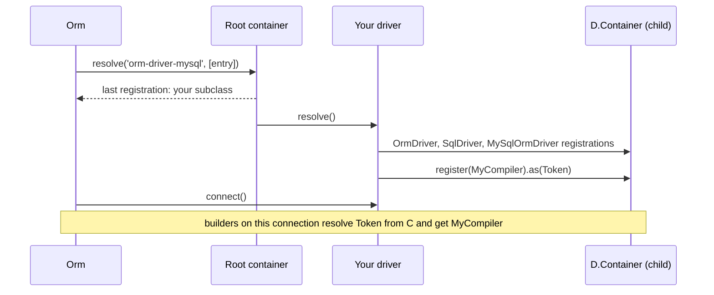

# Customizing the dialect

Every SQL fragment MySQL emits comes from a class registered in the driver's own child container. Subclass `MySqlOrmDriver`, register a replacement after `super.resolve()`, and select the subclass for one connection or for all of them. Nothing else about the driver changes.

## How it works

1. **Subclass.** `class MyDriver extends MySqlOrmDriver`, decorated `@Injectable('<driver string>') @NewInstance()`.
2. **Resolve chain.** `Orm` resolves the connection's `Driver` string. The container calls `resolve()`, which runs in this order:
   1. `OrmDriver.resolve()`: logger, `this.Container = RootContainer.child()`, the standard model and value converters;
   2. `SqlDriver.resolve()`: the shared statements and compilers of `@spinajs/orm-sql`;
   3. `MySqlOrmDriver.resolve()`: the MySQL set (table below);
   4. your code after `super.resolve()`.
3. **Last registration wins.** `this.Container.register(MyCompiler).as(Token)` adds a registration; the container resolves the last one, so yours replaces MySQL's.
4. **Per connection.** Builders on a connection resolve compilers and statements from that driver's container. A replacement affects only connections that use your subclass.
5. **Selection.** `Driver: '<your string>'` picks the subclass for one connection. `@Injectable('orm-driver-mysql')` on the subclass replaces the stock driver for every connection that names `orm-driver-mysql`, because the root container also returns the last registration.

Errors: a `Driver` string with no registration throws `OrmException('ORM connection driver <Driver> not registerd')` at boot. A registration made before `super.resolve()` is overwritten.



### What `MySqlOrmDriver.resolve()` registers

On top of [`SqlDriver.resolve()`](../orm-sql/01-sql-driver.md#what-sqldriverresolve-registers):

| Token | Implementation | Exported from `@spinajs/orm-mysql` | Page |
| --- | --- | --- | --- |
| `TableExistsCompiler` | `MySqlTableExistsCompiler` | yes | [Table reflection](05-table-reflection.md) |
| `ServerResponseMapper` | `MysqlServerResponseMapper` | yes | [Inserts](04-inserts-and-generated-keys.md) |
| `InSetStatement` | `MySqlInSetStatement` | yes | [Set membership](07-set-membership-and-literals.md) |
| `IdentifierQuoter` | `BacktickIdentifierQuoter` (`@spinajs/orm-sql`) | | [Set membership](07-set-membership-and-literals.md) |
| `LiteralQuoter` | `MySqlLiteralQuoter` | yes | [Set membership](07-set-membership-and-literals.md) |
| `InsertQueryCompiler` | `MySqlInsertQueryCompiler` | yes | [Inserts](04-inserts-and-generated-keys.md) |
| `OnDuplicateQueryCompiler` | `SqlOnDuplicateQueryCompiler` | | [Inserts](04-inserts-and-generated-keys.md) |
| `CreateViewCompiler` | `MySqlCreateViewCompiler` | yes | [Schema](06-schema-views-and-events.md) |
| `ColumnQueryCompiler`, `AlterColumnQueryCompiler`, `AlterTableQueryCompiler` | `SqlColumnQueryCompiler`, `SqlAlterColumnQueryCompiler`, `SqlAlterTableQueryCompiler` | | [Schema](06-schema-views-and-events.md) |
| `TableCloneQueryCompiler`, `TruncateTableQueryCompiler`, `TableHistoryQueryCompiler` | `SqlTableCloneQueryCompiler`, `SqlTruncateTableQueryCompiler`, `SqlTableHistoryQueryCompiler` | | [Schema](06-schema-views-and-events.md) |
| `EventQueryCompiler`, `DropEventQueryCompiler` | `SqlEventQueryCompiler`, `SqlDropEventQueryCompiler` | | [Schema](06-schema-views-and-events.md) |
| `DefaultValueBuilder` | `SqlDefaultValueBuilder` | | [Schema](06-schema-views-and-events.md) |
| `SqlExpressions` | `MySqlSqlExpressions` | yes | [SQL helpers](../orm/17-sql-helpers.md#dialect-expressions) |
| `NowExpression` | `MySqlNowExpression`: `UTC_TIMESTAMP(3)`, returned by `driver.now()` | yes | [MySQL driver](01-mysql-driver.md#dates-and-time-zone) |
| `TextWrapper` | `MySqlTextWrapper`: extends `SqlTextWrapper` and casts to `CHAR`, because `TEXT` is no `CAST` target in MySQL | yes | [Statements](../orm-sql/03-statements.md) |
| `LimitQueryCompiler`, `RecursiveQueryCompiler` | `SqlLimitQueryCompiler`, `SqlWithRecursiveCompiler` | | [Query compilers](../orm-sql/02-query-compilers.md) |

`Sql*` classes are exported from `@spinajs/orm-sql`, the `MySql*` classes from `@spinajs/orm-mysql`: to change one, extend it and override only the part that differs.

## Configuration

| Key | Type | Default | Allowed values | Meaning |
| --- | --- | --- | --- | --- |
| `db.Connections[].Driver` | `string` | required | any string a driver class is registered under | Selects the driver class, and with it the dialect classes, for that connection. |

```ts
db: {
  Connections: [
    { Name: 'shop', Driver: 'orm-driver-mysql', Host: 'db', Database: 'shop' },
    { Name: 'reporting', Driver: 'orm-driver-mysql-reporting', Host: 'replica', Database: 'shop' },
  ],
}
```

## Services and extension points

| Service | DI token and lifetime | Default implementation | Alternatives | How to replace or extend |
| --- | --- | --- | --- | --- |
| MySQL driver | `'orm-driver-mysql'`; `@NewInstance()` per connection | `MySqlOrmDriver` | `MySqlSSHOrmDriver` (`'orm-driver-mysql-ssh'`) | Subclass; `@Injectable('orm-driver-mysql')` for all connections, or a new string for some. |
| Dialect classes | the tokens above, in `driver.Container` | the table above | per-page alternatives | `this.Container.register(X).as(Token)` after `super.resolve()`. |
| Driver hooks | `connect()`, `poolConfig()`, `pinSessionZone()`, `acquire()`, `isRetryableError()`, `lockTableShared()`, `ping()`, `poolMetrics()`, `tableInfo()`, `supportedFeatures()`, `_begin()` and the other transaction primitives, `ResponseSchemaTypes`, `SupportedIsolationLevels`, `MaxBindings` | `MySqlOrmDriver` | | Override in the subclass. See [MySQL driver](01-mysql-driver.md), [Transactions](03-transactions.md), [Table reflection](05-table-reflection.md). |

### What other packages read from the driver

No shipped package checks the `Driver` string or the driver class. Packages that write raw SQL or migrations (`@spinajs/authz-orm`, `@spinajs/authz-rbac`, `@spinajs/authn-orm`, `@spinajs/users`, `@spinajs/authz-fs`, `@spinajs/session-provider-db`, `@spinajs/queue`) read what the driver provides, so a subclass under any string serves them as `MySqlOrmDriver` does:

| Driver member | MySQL | Read by |
| --- | --- | --- |
| `SqlExpressions` | `MySqlSqlExpressions`: `CAST(x AS CHAR[(n)])`, `LOCATE()`, `= CAST(? AS BINARY)` | raw SQL that renders lists, reads datetimes or compares bytes exactly; see [SQL helpers](../orm/17-sql-helpers.md#dialect-expressions) |
| `supportedFeatures().nativeJson` | `true` | migrations that choose between a JSON column and text |
| `lockTableShared(table)` | `SELECT COUNT(*) FROM <table> FOR UPDATE` | migrations that check rows before they change a table; see [Transactions](../orm/08-transactions.md#shared-table-lock) |
| `MaxBindings` | `65535` | `insertChunked()`, `deleteChunked()`, `whereInGroups()`; see [SQL helpers](../orm/17-sql-helpers.md#batches) |
| Error mapping (`mapMySqlError()`) | `errno` `1062` rejects with `UniqueViolation` | stores that treat a duplicate key as a lost race; see [Duplicate keys](../orm/17-sql-helpers.md#duplicate-keys) |
| `exact()` on a column | `CHARACTER SET 'utf8mb4' COLLATE 'utf8mb4_bin'` | binary key columns; see [Schema builder](../orm/09-schema-builder.md#exact-columns) |

Override one of these in a subclass to change it for every package on the connection.

### Dialect classes: custom implementation

A driver for a reporting replica whose server runs with `NO_BACKSLASH_ESCAPES`: views default to `SQL SECURITY INVOKER`, view bodies are quoted the ANSI way, and statements retry when a failover leaves the old writer read-only. It is registered under a new string and used by one connection.

```ts sample
import { Container, Inject, Injectable, NewInstance } from '@spinajs/di';
import { CreateViewCompiler, CreateViewQueryBuilder, LiteralQuoter } from '@spinajs/orm';
import { SqlCreateViewQueryCompiler, SqlLiteralQuoter } from '@spinajs/orm-sql';
import { MySqlOrmDriver } from '@spinajs/orm-mysql';

@NewInstance()
@Inject(Container)
export class ReportingViewCompiler extends SqlCreateViewQueryCompiler {
  protected Engine = 'mysql';

  constructor(container: Container, builder: CreateViewQueryBuilder) {
    super(container, builder);
  }

  protected _replace(): string {
    return this.builder.Replace ? 'OR REPLACE' : '';
  }

  protected _prefixOptions(): string {
    return [this.builder.Algorithm ? `ALGORITHM=${this.builder.Algorithm}` : '', `SQL SECURITY ${this.builder.Security ?? 'INVOKER'}`].filter((x) => x).join(' ');
  }

  protected _checkOption(): string {
    return this.checkOptionSql();
  }
}

@Injectable('orm-driver-mysql-reporting')
@NewInstance()
export class ReportingMySqlDriver extends MySqlOrmDriver {
  public resolve() {
    // registrations made before this line would be overwritten by the MySQL set
    super.resolve();

    this.Container.register(ReportingViewCompiler).as(CreateViewCompiler);
    this.Container.register(SqlLiteralQuoter).as(LiteralQuoter);
  }

  protected isRetryableError(err: unknown): boolean {
    return super.isRetryableError(err) || (!this.CurrentTransaction && (err as any)?.inner?.code === 'ER_OPTION_PREVENTS_STATEMENT');
  }
}
```

## Important behaviour

- `@Injectable('orm-driver-mysql')` decorates `MySqlOrmDriver` only. A subclass is not registered under its parent's string unless you register it.
- Registering in the root container (`DI.register(MyCompiler).as(CreateViewCompiler)`) has no effect on MySQL: the driver's child container registers the token itself and answers first.
- Register a driver subclass before `Orm` resolves. A module imported later changes no existing connection.
- The `@spinajs/electron` renderer process registers its `RendererOrmDriverBridge` as `'orm-driver-mysql'`: there, `MySqlOrmDriver` is replaced the same way.
- A statement subclass must implement `clone()`; a cloned query otherwise turns it back into the parent class.

## Best practices

- Extend the class that is registered today and change one hook, so the dialect's other fixes stay.
- Keep a replacement's constructor signature identical to the class it replaces; compilers resolve it with fixed arguments.
- Assert each registration in a unit test with no database, as the example below does.

## Patterns and antipatterns

```ts
// Don't: register before super.resolve(); MySqlOrmDriver.resolve() overwrites it
public resolve() {
  this.Container.register(SqlLiteralQuoter).as(LiteralQuoter);
  super.resolve();
}

// Do
public resolve() {
  super.resolve();
  this.Container.register(SqlLiteralQuoter).as(LiteralQuoter);
}
```

## Examples

### Check the reporting dialect without a server

`DI.resolve()` builds the driver and runs `resolve()`; nothing connects until `connect()`.

```ts sample
import { Container, Inject, Injectable, NewInstance } from '@spinajs/di';
import { DI } from '@spinajs/di';
import { CreateViewCompiler, CreateViewQueryBuilder, RawQuery } from '@spinajs/orm';
import { SqlCreateViewQueryCompiler } from '@spinajs/orm-sql';
import { MySqlOrmDriver } from '@spinajs/orm-mysql';

@NewInstance()
@Inject(Container)
export class InvokerViewCompiler extends SqlCreateViewQueryCompiler {
  protected Engine = 'mysql';

  constructor(container: Container, builder: CreateViewQueryBuilder) {
    super(container, builder);
  }

  protected _prefixOptions(): string {
    return `SQL SECURITY ${this.builder.Security ?? 'INVOKER'}`;
  }
}

@Injectable('orm-driver-mysql-invoker')
@NewInstance()
export class InvokerMySqlDriver extends MySqlOrmDriver {
  public resolve() {
    super.resolve();
    this.Container.register(InvokerViewCompiler).as(CreateViewCompiler);
  }
}

export async function reportingViewSql(): Promise<string> {
  const driver = await DI.resolve(InvokerMySqlDriver, [{ Name: 'dialect-check', Driver: 'orm-driver-mysql-invoker' }]);
  const view = driver.schema().createView('paid_orders', (v) => v.as(new RawQuery('SELECT * FROM orders WHERE Paid = 1')));

  // 'CREATE SQL SECURITY INVOKER VIEW `paid_orders` AS SELECT * FROM orders WHERE Paid = 1'
  return (view.toDB() as { expression: string }).expression;
}
```

## Related

- [Extending an existing dialect](../orm-sql/08-extending-an-existing-dialect.md): the same mechanism for every shipped driver.
- [Adding a new SQL dialect](../orm-sql/07-adding-a-sql-dialect.md#what-each-shipped-driver-registers): MySQL's registrations next to the other drivers'.
- [Connections](../orm/01-connections.md): driver strings in `db.Connections`.
- [MySQL driver](01-mysql-driver.md): the driver hooks.
