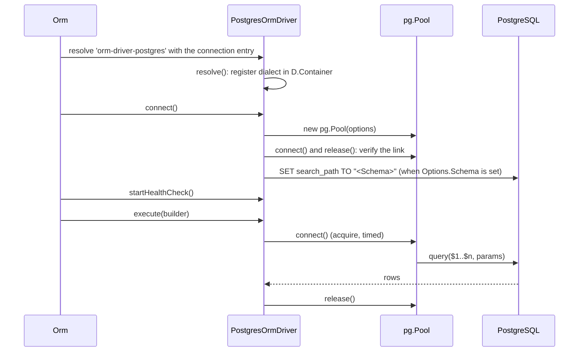

# Connection and pooling

`PostgresOrmDriver` opens one `pg.Pool` per configured connection, pins the connection's schema on every pooled client, and retries statements that failed on a dead transport. Use this page to configure a PostgreSQL connection and to read its health and pool state.

## How it works

1. **Resolve.** `Orm.createConnections()` resolves the class registered under the entry's `Driver` string, `orm-driver-postgres`, with the entry as the constructor argument. The DI container then calls `PostgresOrmDriver.resolve()`, which runs `OrmDriver.resolve()` and `SqlDriver.resolve()` and registers the PostgreSQL dialect in the driver's own child container (see [Extending the driver](06-extending-the-driver.md#what-the-driver-registers)).
2. **Connect.** `Orm` calls `PostgresOrmDriver.connect()`:
   1. `resolvedPoolOptions()` merges `Pool.*` over the defaults, and `connect()` creates `new pg.Pool({ host, user, password, port, database, max, min, idleTimeoutMillis, connectionTimeoutMillis })`.
   2. It adds an `error` listener to the pool that logs `postgres pool connection error for <Name>` at `warn`. Without it, an idle client dying between checkouts would crash the process.
   3. It takes one client and releases it, which verifies the server address and credentials.
   4. When `Options.Schema` is set, it adds a `connect` listener that runs `SET search_path TO "<Schema>"` on every new pooled client, and runs the same statement once through `executeOnDb()` for the client that already exists.
   5. It sets the state to `Connected`. On any error it ends the pool, sets `Pool` to `null` and re-throws; `Orm` wraps the error in `OrmException('Failed to connect to database for connection <Name> ...')`.
3. **Execute.** Every statement goes through `PostgresOrmDriver.executeOnDb(stmt, params, context)`:
   1. `withReconnect()` wraps the attempt; see [Retries](#retries).
   2. `_executeOnDbOnce()` rewrites `?` placeholders to `$1..$n` with `toDriverStatement()` (see [Quoting and parameters](05-quoting-and-parameters.md)).
   3. Inside a transaction it runs on the transaction's client. Outside, it takes a client with `Pool.connect()`, records the wait in the `orm_pool_acquire_seconds` histogram, runs the query and releases the client.
   4. It shapes the result by `QueryContext`: `{ RowsAffected }` for `Update` and `Delete`; `{ RowsAffected, LastInsertId: 0, Returning: rows }` for `Insert`, `Upsert` and `InsertReturning`; the row array for everything else.
   5. A failure is thrown as `OrmException('Error executing orm command ', { Host, User, Name }, stmt, params, err)`. The `pg` error, with its SQLSTATE `code`, is the inner error.
4. **Probe.** `Orm` starts the health check after connecting. Each tick calls `ping()`, which runs `SELECT 1` once, without `withReconnect()`, and resolves `true` or `false`.
5. **Disconnect.** `disconnect()` stops the health check, sets the state to `Disconnected`, ends the pool and sets `Pool` to `null`.



## Configuration

| Key | Type | Default | Allowed values | Meaning |
| --- | --- | --- | --- | --- |
| `db.Connections[].Driver` | `string` | required | `orm-driver-postgres`, or the string of a [driver subclass](06-extending-the-driver.md) | Selects `PostgresOrmDriver`. |
| `db.Connections[].Name` | `string` | required | unique name | Connection name for `@Connection(...)`, `Orm.Connections` and log fields. |
| `db.Connections[].Host` | `string` | `pg` default | | Server host, passed as `host`. |
| `db.Connections[].Port` | `number` | `pg` default | | Server port, passed as `port`. |
| `db.Connections[].User` | `string` | `pg` default | | Role name, passed as `user`. |
| `db.Connections[].Password` | `string` | `pg` default | | Password, passed as `password`. |
| `db.Connections[].Database` | `string` | `pg` default | | Database the pool connects to. Not used to qualify table names; see [Table references](03-queries-and-inserts.md#table-references). |
| `db.Connections[].Options.Schema` | `string` | unset | a schema name | Sets `search_path` on every pooled client, and is the schema `tableInfo()` reads when no schema is passed. Unset: `search_path` is the server default and `tableInfo()` reads `public`. |
| `db.Connections[].Pool.Max` | `number` | `10` | `>= 1` | Passed as `max`. |
| `db.Connections[].Pool.Min` | `number` | `0` | `>= 0` | Passed as `min`. |
| `db.Connections[].Pool.IdleTimeout` | `number` | `30000` | ms | Passed as `idleTimeoutMillis`. |
| `db.Connections[].Pool.AcquireTimeout` | `number` | `10000` | ms | Passed as `connectionTimeoutMillis`: how long a query waits for a client. |
| `db.Connections[].PoolLimit` | `number` | | | Deprecated. Used as `Pool.Max` when `Pool.Max` is absent. |
| `db.Connections[].Resilience.*` | object | see [Observability and resilience](../orm/13-observability-and-resilience.md#configuration) | | Health-check interval and retry backoff. |
| `db.Connections[].Migration.*` | object | see [Connections](../orm/01-connections.md#configuration) | | Boot migrations, migration table and transaction mode. |

`pg` default: a key that is not set reaches `pg` as `undefined`, and `pg` falls back to its own default (the matching `PG*` environment variable, then its built-in value).

Not read by this driver: `Encoding`, `SSH`, and every key of `Options` other than `Schema`.

```ts
this.Config = _.merge(this.Config, {
  db: {
    DefaultConnection: 'main',
    Connections: [
      {
        Name: 'main',
        Driver: 'orm-driver-postgres',
        Host: 'db.internal',
        Port: 5432,
        User: 'shop',
        Password: process.env.DB_PASSWORD,
        Database: 'shop',
        Options: { Schema: 'sales' },
        Pool: { Min: 2, Max: 20, IdleTimeout: 30000, AcquireTimeout: 5000 },
        Resilience: { HealthCheckInterval: 15000, MaxRetries: 3 },
        Migration: { OnStartup: true },
      },
    ],
  },
});
```

## Services and extension points

| Service | DI token and lifetime | Default implementation | Alternatives | How to replace or extend |
| --- | --- | --- | --- | --- |
| Connection driver | `'orm-driver-postgres'`, `@NewInstance()`: one instance per connection entry, resolved by `Orm` at boot | `PostgresOrmDriver` | none shipped | Subclass and register under `orm-driver-postgres` (every connection) or a new string (one connection). See [Extending the driver](06-extending-the-driver.md). |
| `connect()` | method of the driver | builds `pg.Pool` from the keys above | | Override in a subclass to pass more `pg.Pool` options, e.g. TLS. See [Connect over TLS](06-extending-the-driver.md#connect-over-tls-with-a-private-ca). |
| `isRetryableError(err)` | protected method of the driver | base transport codes plus PostgreSQL connection SQLSTATEs | | Override to retry more codes; keep the in-transaction guard. See [Retry when the server is out of connections](06-extending-the-driver.md#retry-when-the-server-is-out-of-connections). |
| `poolMetrics()` | method of the driver | `pg.Pool` counters | | Override only for a pool that is not `pg.Pool`. |

## Retries

`executeOnDb()` runs every statement, reads and writes alike, through `withReconnect()`. It re-runs a statement only when `isRetryableError()` says the transport died before the statement reached the server.

`PostgresOrmDriver.isRetryableError(err)`:

1. Returns `false` inside a transaction. The connection carried uncommitted state; replaying the statement on a new connection would apply it outside the transaction.
2. Returns `true` for the base transport codes (`ECONNRESET`, `ECONNREFUSED`, ...; see [Observability and resilience](../orm/13-observability-and-resilience.md#retry-on-transport-failure)).
3. Returns `true` when the error, or one of up to 5 wrapped `inner` / `cause` errors, carries one of these SQLSTATE codes:

| Code | Meaning |
| --- | --- |
| `08000`, `08001`, `08003`, `08004`, `08006`, `08007` | Connection exception class. |
| `57P01` | Administrator shutdown. |
| `57P02` | Crash shutdown. |
| `57P03` | Cannot connect now (server starting or shutting down). |

Between attempts `withReconnect()` waits with exponential backoff and calls `connect()`.

## Pool metrics

`poolMetrics()` reads `pg.Pool`'s own counters:

| Field | Source |
| --- | --- |
| `Size` | `Pool.totalCount` |
| `InUse` | `Pool.totalCount - Pool.idleCount`, at least `0` |
| `Waiting` | `Pool.waitingCount` |

All three are `0` before `connect()` and after `disconnect()`. The health check publishes them as gauges; see [Observability and resilience](../orm/13-observability-and-resilience.md#published-metrics).

## Important behaviour

- `search_path` is a session setting. The driver sets it per pooled client through the pool's `connect` event. The `SET` is not awaited there; `pg` queues it ahead of the first query on that client.
- A failed `SET search_path` on a new client is logged at `warn` (`could not set search_path to <Schema> for <Name>`) and the client is still used, with the server's default `search_path`.
- `Options.Schema` is quoted as an identifier: `Schema: 'Sales'` sets `search_path` to the case-sensitive schema `"Sales"`, not `sales`.
- `ping()` takes a client from the pool. With every client checked out, a probe waits up to `Pool.AcquireTimeout` and then reports the connection unhealthy.
- Every reconnect, from `withReconnect()` or from a failed health probe, calls `connect()`, which first ends the previous pool and then creates a new `pg.Pool`. When the new pool cannot connect, `Pool` is `null` until the next successful reconnect; statements in that window fail with a retryable error (code `08003`), so `withReconnect()` keeps trying.
- `pg` returns `NUMERIC`, `DECIMAL` and `BIGINT` values, `COUNT(*)` included, as strings. `ResponseSchemaTypes` declares this for JSON Schema generation; see [Queries and inserts](03-queries-and-inserts.md#response-types).
- `pg` parses `TIMESTAMP` (without time zone) values in the Node process's local time zone.
- Database errors reach the caller as `OrmException` with the `pg` error as inner error. Read the SQLSTATE from the inner error's `code`, e.g. `23505` for a unique violation.

## Best practices

- Size `Pool.Max` against the server's `max_connections`; every process opens its own pool per connection entry.
- Set `Options.Schema` when the tables live outside `public`. Unqualified table names, `tableExists()` and `tableInfo()` then all look in the same schema.
- Configure TLS and session options through `PGSSLMODE` and `PGOPTIONS`, which `pg` reads when it opens a connection, or through a [driver subclass](06-extending-the-driver.md#connect-over-tls-with-a-private-ca) when you need certificates.
- Route query logs by the logger `orm-driver-<Name>`; see [`SqlDriver`](../orm-sql/01-sql-driver.md#configuration).

## Patterns and antipatterns

```ts
// Don't: Options is not passed to pg.Pool; `ssl` and `statement_timeout` are silently ignored
{ Name: 'main', Driver: 'orm-driver-postgres', Host: 'db', Database: 'shop', Options: { ssl: true, statement_timeout: 5000 } }

// Do: pg reads these environment variables when it opens each connection
process.env.PGSSLMODE = 'require';
process.env.PGOPTIONS = '-c statement_timeout=5000';
```

```ts
// Don't: reads the SQLSTATE from the wrapper; OrmException has no code
catch (err) { if ((err as any).code === '23505') { /* ... */ } }

// Do: the pg error is the inner error
catch (err) { if ((err as OrmException).inner?.code === '23505') { /* ... */ } }
```

## Examples

### Run every connection of a multi-tenant service in its own schema

```ts sample
import '@spinajs/orm-postgres';
import { FrameworkConfiguration } from '@spinajs/configuration';
import _ from 'lodash';

const TENANTS = ['acme', 'globex'];

export class TenantConfiguration extends FrameworkConfiguration {
  public async resolve(): Promise<void> {
    await super.resolve();

    this.Config = _.merge(this.Config, {
      db: {
        Connections: TENANTS.map((tenant) => ({
          Name: `tenant-${tenant}`,
          Driver: 'orm-driver-postgres',
          Host: process.env.DB_HOST ?? '127.0.0.1',
          Port: Number(process.env.DB_PORT ?? 5432),
          User: process.env.DB_USER ?? 'app',
          Password: process.env.DB_PASSWORD ?? '',
          Database: 'saas',
          // every client of this pool resolves unqualified tables in the tenant's schema
          Options: { Schema: tenant },
          Pool: { Max: 5 },
        })),
      },
    });
  }
}
```

### Report pool saturation for a readiness endpoint

```ts sample
import { DI } from '@spinajs/di';
import { ConnectionState, Orm } from '@spinajs/orm';

export async function postgresReadiness(): Promise<{ ready: boolean; waiting: number; inUse: number; size: number }> {
  const orm = await DI.resolve(Orm);
  const driver = orm.Connections.get('main')!;
  const pool = driver.poolMetrics();

  return {
    ready: driver.State === ConnectionState.Connected && pool.Waiting === 0,
    waiting: pool.Waiting,
    inUse: pool.InUse,
    size: pool.Size,
  };
}
```

### Detect a unique violation on insert

```ts sample
import { DI } from '@spinajs/di';
import { Orm, OrmException } from '@spinajs/orm';

export async function registerEmail(email: string): Promise<'created' | 'taken'> {
  const orm = await DI.resolve(Orm);
  const driver = orm.Connections.get('main')!;

  try {
    await driver.insert().into('subscribers').values({ email });
    return 'created';
  } catch (err) {
    // pg puts the SQLSTATE on its own error, which OrmException carries as `inner`
    if (err instanceof OrmException && (err.inner as { code?: string } | undefined)?.code === '23505') {
      return 'taken';
    }
    throw err;
  }
}
```

## Related

- [Connections](../orm/01-connections.md): every connection key and how `Orm` opens connections.
- [Observability and resilience](../orm/13-observability-and-resilience.md): health probe, retry backoff, connection states and pool gauges.
- [`SqlDriver`](../orm-sql/01-sql-driver.md): the execute pipeline and query logging this driver inherits.
- [Transactions](02-transactions.md): how a transaction pins one pooled client.
- [Extending the driver](06-extending-the-driver.md): override `connect()`, `isRetryableError()` or `executeOnDb()`.
