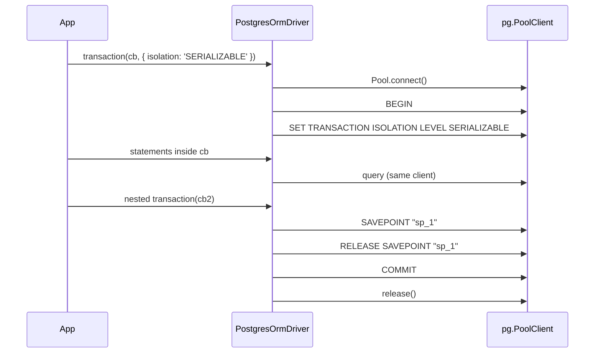

# Transactions

`PostgresOrmDriver` runs a transaction on one dedicated client taken from its pool, so every statement inside `driver.transaction()` reaches the same server session. All four SQL isolation levels are accepted, and nested `transaction()` calls become savepoints.

## How it works

1. **Entry.** `driver.transaction(cb, options?)` (from `OrmDriver`) checks `options.isolation` against `SupportedIsolationLevels` and throws `OrmException('isolation level <level> not supported by driver <Driver>')` for any other value.
2. **Begin.** `PostgresOrmDriver._begin(options)` takes a client with `Pool.connect()`, runs `BEGIN`, then `SET TRANSACTION ISOLATION LEVEL <level>` when a level is given. It returns `{ connection: client, depth: 0 }`, an `IPostgresTransactionContext`. If `BEGIN` or `SET` fails, the client is released and the error is re-thrown.
3. **Run.** `OrmDriver` stores the context in `TransactionStorage` (an `AsyncLocalStorage`) and calls `cb(driver)`. `_executeOnDbOnce()` reads the store and sends every statement through `context.connection`, never through another pooled client.
4. **Nest.** A `transaction()` call inside the callback does not open a second transaction. It calls `_savepoint(ctx, 'sp_<n>')`, which runs `SAVEPOINT "sp_<n>"`. On success it runs `RELEASE SAVEPOINT "sp_<n>"`; on a throw it runs `ROLLBACK TO SAVEPOINT "sp_<n>"` and re-throws.
5. **Finish.** `_commit(ctx)` runs `COMMIT`. If the callback or the commit throws, `_rollback(ctx)` runs `ROLLBACK`; a rollback failure is swallowed so the original error surfaces.
6. **Release.** `_dispose(ctx)` releases the client to the pool, in every case. `afterCommit()` callbacks then run.



## Configuration

`transaction()` takes options per call; there are no configuration keys.

| Option | Type | Default | Allowed values | Meaning |
| --- | --- | --- | --- | --- |
| `ITransactionOptions.isolation` | `IsolationLevel` | server default (`READ COMMITTED` unless changed) | `'READ UNCOMMITTED'`, `'READ COMMITTED'`, `'REPEATABLE READ'`, `'SERIALIZABLE'` | Level of the outermost transaction. Ignored by nested calls. |

`READ UNCOMMITTED` is accepted and behaves as `READ COMMITTED`, the upgrade the SQL standard permits and PostgreSQL applies.

## Services and extension points

| Service | DI token and lifetime | Default implementation | Alternatives | How to replace or extend |
| --- | --- | --- | --- | --- |
| Transaction primitives | protected methods `_begin`, `_commit`, `_rollback`, `_savepoint`, `_releaseSavepoint`, `_rollbackToSavepoint`, `_dispose` of the driver | `PostgresOrmDriver` | | Override in a [driver subclass](06-extending-the-driver.md); call `super` to keep the client handling. |
| `IPostgresTransactionContext` | exported interface: `ITransactionContext` plus `connection: pg.PoolClient` | | | Read `connection` in a subclass to send statements on the transaction's client. |
| `SupportedIsolationLevels` | public readonly field of the driver | all four levels | | Redeclare in a subclass to forbid a level. |

### Transaction primitives: custom implementation

Override `_begin()` to apply per-transaction settings that PostgreSQL scopes to a transaction with `SET LOCAL`. Call `super._begin()` first so the client is taken and `BEGIN` has run; the settings end with the transaction.

```ts sample
import { Injectable, NewInstance } from '@spinajs/di';
import { ITransactionContext, ITransactionOptions } from '@spinajs/orm';
import { IPostgresTransactionContext, PostgresOrmDriver } from '@spinajs/orm-postgres';

/** Bounds every statement and lock wait inside a transaction on this connection. */
@Injectable('orm-driver-postgres-bounded')
@NewInstance()
export class BoundedTransactionsPostgresDriver extends PostgresOrmDriver {
  protected async _begin(options?: ITransactionOptions): Promise<ITransactionContext> {
    const ctx = (await super._begin(options)) as IPostgresTransactionContext;

    try {
      await ctx.connection.query(`SET LOCAL statement_timeout = '5s'`);
      await ctx.connection.query(`SET LOCAL lock_timeout = '2s'`);
    } catch (err) {
      await ctx.connection.query('ROLLBACK').catch(() => undefined);
      ctx.connection.release();
      throw err;
    }

    return ctx;
  }
}
```

Select it with `Driver: 'orm-driver-postgres-bounded'` on the connections that need it.

## Important behaviour

- A transaction holds one pool client from `_begin()` to `_dispose()`. A pool of `Pool.Max` clients runs at most `Pool.Max` transactions at once; further `transaction()` calls wait up to `Pool.AcquireTimeout`.
- Statements inside a transaction are never retried: `isRetryableError()` returns `false` while `TransactionStorage` holds a context. A transport failure inside a transaction rejects the transaction.
- After any failed statement PostgreSQL rejects every further statement of that transaction with `current transaction is aborted` (SQLSTATE `25P02`) until it rolls back. Catching the error inside the callback does not make the transaction usable again; a nested `transaction()` around the risky statement does, because it rolls back to its savepoint.
- The isolation level is set inside the transaction, right after `BEGIN`. It must be the first statement, so the driver sends it before your callback runs.
- Savepoint names are generated (`sp_1`, `sp_2`, ...) and quoted with `pgEscapeIdentifier()`; nothing caller-supplied reaches them.
- `transaction()` itself does not go through `withReconnect()`. A pool that cannot hand out a client fails `_begin()` with the `pg` error.
- DDL is transactional in PostgreSQL. With `Migration.Transaction.Mode` set to `PerMigration` or `PerRun`, a failing migration rolls back its `CREATE TABLE` and `ALTER TABLE` statements too. `CREATE DATABASE` and `DROP DATABASE` cannot run inside a transaction.

## Best practices

- Wrap a statement that may fail and be recovered from (an insert that can hit a unique key) in a nested `driver.transaction()`, so its failure rolls back to a savepoint instead of aborting the outer transaction.
- Retry the whole `transaction()` call on SQLSTATE `40001` (serialization failure) when you use `SERIALIZABLE` or `REPEATABLE READ`; the driver does not.
- Keep slow work (HTTP calls, file I/O) outside the callback: the client stays checked out until commit.
- Use `driver.afterCommit()` for side effects that must only happen once the data is committed.

## Patterns and antipatterns

```ts
// Don't: the failed insert aborts the transaction; the update then fails with 25P02
await driver.transaction(async () => {
  try { await driver.insert().into('coupons').values({ code }); } catch { /* duplicate, ignore */ }
  await driver.update().in('orders').update({ coupon: code }).where('id', orderId);
});

// Do: the nested call rolls back to its savepoint and the outer transaction continues
await driver.transaction(async () => {
  try { await driver.transaction(async () => driver.insert().into('coupons').values({ code })); } catch { /* duplicate, ignore */ }
  await driver.update().in('orders').update({ coupon: code }).where('id', orderId);
});
```

## Examples

### Book a seat under SERIALIZABLE, retrying on serialization failures

```ts sample
import { DI } from '@spinajs/di';
import { Orm, OrmException } from '@spinajs/orm';

function isSerializationFailure(err: unknown): boolean {
  return err instanceof OrmException && (err.inner as { code?: string } | undefined)?.code === '40001';
}

export async function bookSeat(flightId: number, passengerId: number): Promise<boolean> {
  const orm = await DI.resolve(Orm);
  const driver = orm.Connections.get('main')!;

  for (let attempt = 0; attempt < 3; attempt++) {
    try {
      return await driver.transaction(
        async () => {
          const free = Number(await driver.select().from('seats').where('flight_id', flightId).whereNull('passenger_id').selectCount());
          if (free === 0) {
            return false;
          }

          const seat = (await driver.select().from('seats').where('flight_id', flightId).whereNull('passenger_id').take(1)) as Array<{ id: number }>;
          await driver.update().in('seats').update({ passenger_id: passengerId }).where('id', seat[0].id);
          return true;
        },
        { isolation: 'SERIALIZABLE' },
      );
    } catch (err) {
      if (!isSerializationFailure(err) || attempt === 2) {
        throw err;
      }
    }
  }

  return false;
}
```

### Record an audit row even when the optional loyalty step fails

```ts sample
import { DI } from '@spinajs/di';
import { Orm } from '@spinajs/orm';

export async function payInvoice(invoiceId: number, customerId: number): Promise<void> {
  const orm = await DI.resolve(Orm);
  const driver = orm.Connections.get('main')!;

  await driver.transaction(async () => {
    await driver.update().in('invoices').update({ status: 'paid' }).where('id', invoiceId);

    try {
      // SAVEPOINT "sp_1": a failure here rolls back only the loyalty insert
      await driver.transaction(async () => driver.insert().into('loyalty_points').values({ customer_id: customerId, points: 10 }));
    } catch {
      // the outer transaction is still usable
    }

    await driver.insert().into('audit_log').values({ action: 'invoice.paid', invoice_id: invoiceId });
  });
}
```

## Related

- [Transactions in `@spinajs/orm`](../orm/08-transactions.md): the `transaction()` API, `afterCommit()` and who opens transactions for you.
- [Connection and pooling](01-connection-and-pooling.md): pool size and acquire timeout, which bound concurrent transactions.
- [Migrations](../orm/10-migrations.md): migration transaction modes, which benefit from transactional DDL here.
