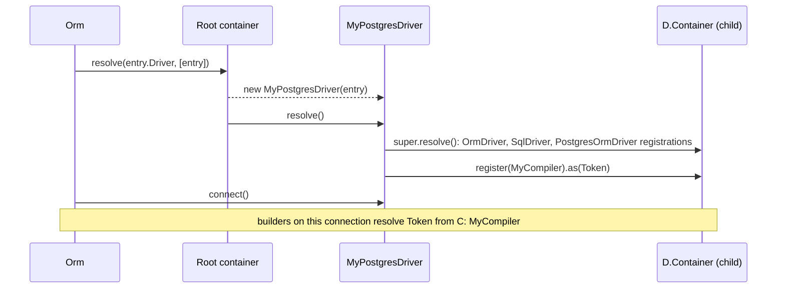

# Extending the driver

Change how PostgreSQL connections behave without forking the package: subclass `PostgresOrmDriver`, override a method or register a different dialect class in its `resolve()`, and point one connection, or all of them, at the subclass. Everything you do not override keeps working.

## How it works

1. **Subclass.** `class MyDriver extends PostgresOrmDriver`, decorated `@Injectable('<driver string>')` and `@NewInstance()`. `@Injectable` registers the class in the root container under that string when the module is imported.
2. **Override `resolve()`.** Call `super.resolve()` first. It runs, in order, `OrmDriver.resolve()` (logger, child container `this.Container`, model converters), `SqlDriver.resolve()` (shared `Sql*` classes) and `PostgresOrmDriver.resolve()` (PostgreSQL classes). Then register your classes: `this.Container.register(MyCompiler).as(<token>)`. The container returns the last registration of a token, so yours wins.
3. **Override methods.** `poolConfig()`, `connect()`, `executeOnDb()`, `isRetryableError()`, `tableInfo()`, `supportedFeatures()`, the transaction primitives and `ResponseSchemaTypes` are all overridable.
4. **Select it.** `Orm.createConnections()` resolves each entry's `Driver` string:
   - a new string (`'orm-driver-postgres-tls'`) applies the subclass only to entries that name it;
   - the stock string (`@Injectable('orm-driver-postgres')` on the subclass, or `DI.register(MyDriver).as('orm-driver-postgres')` before `Orm` resolves) applies it to every PostgreSQL connection.
5. **Errors.** A `Driver` string with no registration throws `OrmException('ORM connection driver <Driver> not registerd')` at boot. A registration made before `super.resolve()` is overwritten by it and has no effect.



## Configuration

| Key | Type | Default | Allowed values | Meaning |
| --- | --- | --- | --- | --- |
| `db.Connections[].Driver` | `string` | required | `orm-driver-postgres` or any string a subclass is registered under | Selects the driver class for that connection. |
| `db.Connections[].Options.*` | `any` | | | Free-form; `PostgresOrmDriver` reads only `Schema`. A subclass can read its own keys from `this.Options.Options`. |

```ts
export default {
  db: {
    DefaultConnection: 'main',
    Connections: [
      { Driver: 'orm-driver-postgres', Name: 'main', Host: 'db', Database: 'shop' },
      { Driver: 'orm-driver-postgres-tls', Name: 'reporting', Host: 'reports.example.com', Database: 'dwh', Options: { CaFile: '/etc/ssl/dwh-ca.pem' } },
    ],
  },
};
```

## Services and extension points

### The driver

| Service | DI token and lifetime | Default implementation | Alternatives | How to replace or extend |
| --- | --- | --- | --- | --- |
| PostgreSQL driver | `'orm-driver-postgres'` in the root container, `@NewInstance()`: one instance per connection entry, resolved by `Orm` at boot with `[entry]` | `PostgresOrmDriver` | none shipped | Subclass. Register under a new string for some connections, or under `orm-driver-postgres` for all. |

Overridable members:

| Member | Visibility | Default behaviour | Override to |
| --- | --- | --- | --- |
| `resolve()` | public | registers the PostgreSQL dialect | register different compilers, statements, quoters or mappers |
| `poolConfig()` | protected | the `pg.PoolConfig`: connection keys, pool sizes, `options: '<PGOPTIONS> -c TimeZone=UTC'`, UTC `timestamp` parser | pass more `pg.Pool` options (TLS, `application_name`); spread `super.poolConfig()` to keep the UTC session |
| `connect()` | public | creates `pg.Pool` from `poolConfig()`, verifies it, pins `search_path` | change the connect sequence itself |
| `disconnect()` | public | ends the pool | release extra resources |
| `executeOnDb(stmt, params, context)` | public | `withReconnect()` around `_executeOnDbOnce()` | add tracing, routing or statement rewriting |
| `_executeOnDbOnce(stmt, params, context)` | protected | one attempt on the transaction client or a pooled client | change how one attempt runs |
| `isRetryableError(err)` | protected | `false` in a transaction; transport codes; PostgreSQL connection SQLSTATEs | retry more codes |
| `ping()` | public | `SELECT 1` without retry | probe something else (a replica lag check) |
| `tableInfo(name, schema?)` | public | reads `information_schema` | fill more descriptor fields |
| `supportedFeatures()` | public | `{ events: false, insertReturning: true, insertIdIsFirstOfBatch: false, concurrentTransactions: true, nativeJson: true }` | declare `events: true` after registering event compilers |
| `lockTableShared(table)` | public | `LOCK TABLE <table> IN SHARE MODE` inside the transaction | take another lock mode |
| `MaxBindings` | public readonly field | `65535` parameters per statement | lower it for a proxy with a smaller limit |
| `poolMetrics()` | public | `pg.Pool` counters | report a different pool |
| `_begin`, `_commit`, `_rollback`, `_savepoint`, `_releaseSavepoint`, `_rollbackToSavepoint`, `_dispose` | protected | see [Transactions](02-transactions.md) | add per-transaction settings |
| `SupportedIsolationLevels` | public readonly field | all four levels | restrict levels |
| `ResponseSchemaTypes` | public readonly field | `decimal`, `numeric`, `bigint` → `string` | declare more string-typed columns |

### What the driver registers

`PostgresOrmDriver.resolve()` registers these in the connection's child container, after `SqlDriver.resolve()`. Every class here is `@NewInstance()` unless noted: a fresh instance per resolve, constructed with the builder that asks for it.

| Token | Registered class | Origin | Page |
| --- | --- | --- | --- |
| `IdentifierQuoter` | `DoubleQuoteIdentifierQuoter` | this package | [Quoting and parameters](05-quoting-and-parameters.md) |
| `LiteralQuoter` | `PostgresLiteralQuoter` | this package | [Quoting and parameters](05-quoting-and-parameters.md) |
| `ServerResponseMapper` | `PostgresServerResponseMapper` (no lifetime decorator: singleton) | this package | [Queries and inserts](03-queries-and-inserts.md#postgresserverresponsemapper-custom-implementation) |
| `TableExistsCompiler` | `PostgresTableExistsCompiler` | this package | [Schema DDL](04-schema-ddl-and-reflection.md) |
| `LimitQueryCompiler` | `PostgresLimitQueryCompiler` | this package | [Queries and inserts](03-queries-and-inserts.md) |
| `InsertQueryCompiler` | `PostgresInsertQueryCompiler` | this package | [Queries and inserts](03-queries-and-inserts.md) |
| `OnDuplicateQueryCompiler` | `PostgresOnDuplicateQueryCompiler` | this package | [Queries and inserts](03-queries-and-inserts.md#upsert) |
| `ColumnQueryCompiler` | `PostgresColumnQueryCompiler` | this package | [Schema DDL](04-schema-ddl-and-reflection.md#column-types) |
| `AlterColumnQueryCompiler` | `PostgresAlterColumnQueryCompiler` | this package | [Schema DDL](04-schema-ddl-and-reflection.md#altering-a-table) |
| `CreateDatabaseCompiler` | `PostgresCreateDatabaseQueryCompiler` | this package | [Schema DDL](04-schema-ddl-and-reflection.md) |
| `DefaultValueBuilder` | `PostgresDefaultValueBuilder` | this package | [Schema DDL](04-schema-ddl-and-reflection.md#column-modifiers) |
| `TableAliasCompiler` | `PostgresTableAliasCompiler` | this package | [Queries and inserts](03-queries-and-inserts.md#table-references) |
| `CreateViewCompiler` | `PostgresCreateViewCompiler` | this package | [Schema DDL](04-schema-ddl-and-reflection.md) |
| `JoinStatement` | `PostgresJoinStatement` (schema or no prefix) | this package | [Queries and inserts](03-queries-and-inserts.md#services-and-extension-points) |
| `DateTimeWrapper` | `PostgresDateTimeWrapper` (`CAST(col AS TIMESTAMP)`) | this package | [Queries and inserts](03-queries-and-inserts.md#compare-with-a-time-zone-aware-datetime-wrapper) |
| `InStatement` | `PostgresInStatement` | this package | [Queries and inserts](03-queries-and-inserts.md#select) |
| `NowExpression` | `PostgresNowExpression` (no lifetime decorator) | this package | [Queries and inserts](03-queries-and-inserts.md#select) |
| `DatetimeValueConverter` | `PostgresDatetimeValueConverter` | this package | [Queries and inserts](03-queries-and-inserts.md#datetime-values) |
| `JsonValueConverter` | `PostgresJsonValueConverter` | this package | [Queries and inserts](03-queries-and-inserts.md#datetime-values) |
| `DropDatabaseCompiler` | `SqlDropDatabaseQueryCompiler` | shared, claimed | |
| `TruncateTableQueryCompiler` | `SqlTruncateTableQueryCompiler` | shared, claimed | |
| `RecursiveQueryCompiler` | `SqlWithRecursiveCompiler` | shared, claimed | |
| `AlterTableQueryCompiler` | `SqlAlterTableQueryCompiler` | shared, claimed | |
| `IndexQueryCompiler` | `PostgresIndexQueryCompiler` (`DROP INDEX` without a table) | this package | [Schema DDL](04-schema-ddl-and-reflection.md#altering-a-table) |
| `SqlExpressions` | `PostgresSqlExpressions` | this package | [SQL helpers](../orm/17-sql-helpers.md#dialect-expressions) |
| `EventQueryCompiler` | `UnsupportedEventQueryCompiler` (throws) | shared | [Customizing dialect compilers](07-customizing-dialect-compilers.md#schedule-jobs-with-pg_cron) |
| `DropEventQueryCompiler` | `UnsupportedDropEventQueryCompiler` (throws) | shared | |
| `TableCloneQueryCompiler`, `TableHistoryQueryCompiler` | not registered | | |

Everything else (the other statements, select, update and delete compilers, foreign-key compilers, the other value converters, `DateWrapper` and `TextWrapper`) comes from `SqlDriver.resolve()` unchanged; see [What `SqlDriver.resolve()` registers](../orm-sql/01-sql-driver.md#what-sqldriverresolve-registers).

### Driver: custom implementation

Extend the driver when a connection needs something the configuration keys do not cover. Keep `super` calls wherever the base behaviour still applies, and register the class before `Orm` resolves, which an import of its module does through `@Injectable`. `Schema` statements (`SET search_path`, DDL) and `Select` statements pass through the guard below, so `connect()` and `tableInfo()` keep working.

```ts sample
import { Injectable, NewInstance } from '@spinajs/di';
import { OrmException, QueryContext } from '@spinajs/orm';
import { PostgresOrmDriver } from '@spinajs/orm-postgres';

const WRITES = new Set([QueryContext.Insert, QueryContext.InsertReturning, QueryContext.Upsert, QueryContext.Update, QueryContext.Delete]);

/**
 * A connection to a read replica: refuses DML before it reaches the server and keeps
 * idle connections longer. Selected with Driver: 'orm-driver-postgres-replica'.
 */
@Injectable('orm-driver-postgres-replica')
@NewInstance()
export class ReplicaPostgresDriver extends PostgresOrmDriver {
  public executeOnDb(stmt: string, params: any[], context: QueryContext): Promise<any> {
    if (WRITES.has(context)) {
      return Promise.reject(new OrmException(`connection ${this.Options.Name} is a read replica and refuses ${QueryContext[context]} statements`));
    }

    return super.executeOnDb(stmt, params, context);
  }

  protected resolvedPoolOptions() {
    const pool = super.resolvedPoolOptions();
    return { ...pool, IdleTimeout: Math.max(pool.IdleTimeout, 300000) };
  }
}
```

## Important behaviour

- A subclass is not registered under its parent's string: `@Injectable('orm-driver-postgres')` decorates `PostgresOrmDriver` only. Give the subclass its own `@Injectable(...)`.
- Registrations go to the subclass's own child container, so they affect only connections that use the subclass. Registering a dialect token in the root container (`DI.register(MyCompiler).as(LimitQueryCompiler)`) does not work: the driver's child container answers first.
- A registration made before `super.resolve()` is overwritten. Register after it.
- A replacement compiler is resolved with the same constructor arguments as the class it replaces. Keep its constructor signature, and its `@Inject(Container)` decorator when the original has one.
- `PostgresAlterColumnQueryCompiler._modify()` resolves `ColumnQueryCompiler` and calls `typeExpression()` and `defaultExpression()` on it. A `ColumnQueryCompiler` replacement must extend `PostgresColumnQueryCompiler`, or `modify()` fails.
- `connect()` is called again by every reconnect (`withReconnect()` and failed health probes). The base `connect()` ends the previous `Pool` first; an override that builds its own pool must do the same.
- Other packages detect the PostgreSQL dialect on their own. `@spinajs/authz-orm` matches the exact driver string `orm-driver-postgres`, so a subclass under a new string is rejected there; `@spinajs/authn-orm` walks the class chain for `PostgresOrmDriver`, so a subclass is recognised. Register the subclass under `orm-driver-postgres` when those packages use the connection.

## Best practices

- Name a per-connection subclass's string after the change (`orm-driver-postgres-tls`), and keep `orm-driver-postgres` for the stock behaviour.
- Replace one token per concern, extending the class registered today, so the dialect's other fixes stay.
- Assert the registration in a test: `expect(driver.Container.resolve(LiteralQuoter)).to.be.instanceOf(MyQuoter)`.
- Keep the in-transaction guard in any `isRetryableError()` override: a replayed statement would run outside the transaction.

## Patterns and antipatterns

```ts
// Don't: super.resolve() runs afterwards and re-registers the stock quoter
public resolve() {
  this.Container.register(UtcTimestampLiteralQuoter).as(LiteralQuoter);
  super.resolve();
}

// Do
public resolve() {
  super.resolve();
  this.Container.register(UtcTimestampLiteralQuoter).as(LiteralQuoter);
}
```

```ts
// Don't: retries inside a transaction replay the statement outside it
protected isRetryableError(err: unknown) {
  return (err as any)?.inner?.code === '53300' || super.isRetryableError(err);
}

// Do: the base check returns false inside a transaction; keep that guard for your codes too
protected isRetryableError(err: unknown) {
  if (super.isRetryableError(err)) return true;
  return !this.TransactionStorage.getStore() && (err as any)?.inner?.code === '53300';
}
```

## Examples

### Connect over TLS with a private CA

`PostgresOrmDriver` does not pass `ssl` to `pg.Pool`. Override `poolConfig()` and spread `super.poolConfig()`: `connect()`, the `search_path` pinning, the UTC session and the UTC `timestamp` parser all stay.

```ts sample
import { readFileSync } from 'node:fs';
import { Injectable, NewInstance } from '@spinajs/di';
import { PostgresOrmDriver } from '@spinajs/orm-postgres';
import pg from 'pg';

@Injectable('orm-driver-postgres-tls')
@NewInstance()
export class TlsPostgresOrmDriver extends PostgresOrmDriver {
  protected poolConfig(): pg.PoolConfig {
    const caFile = this.Options.Options?.CaFile as string | undefined;

    return {
      ...super.poolConfig(),
      application_name: `spinajs-${this.Options.Name}`,
      ssl: { ca: caFile ? readFileSync(caFile, 'utf8') : undefined, rejectUnauthorized: true },
    };
  }
}
```

### Retry when the server is out of connections

SQLSTATE `53300` (`too_many_connections`) is raised while a client connects, before any statement is sent, so retrying it outside a transaction is safe.

```ts sample
import { Injectable, NewInstance } from '@spinajs/di';
import { PostgresOrmDriver } from '@spinajs/orm-postgres';

const EXTRA_RETRYABLE = new Set(['53300']);

@Injectable('orm-driver-postgres')
@NewInstance()
export class PatientPostgresOrmDriver extends PostgresOrmDriver {
  protected isRetryableError(err: unknown): boolean {
    if (super.isRetryableError(err)) {
      return true;
    }

    // the base check already said no inside a transaction; keep that answer
    if (this.TransactionStorage.getStore()) {
      return false;
    }

    let current = err as { code?: unknown; inner?: unknown; cause?: unknown } | undefined;
    for (let depth = 0; current && depth < 5; depth++) {
      if (typeof current.code === 'string' && EXTRA_RETRYABLE.has(current.code)) {
        return true;
      }
      current = (current.inner ?? current.cause) as typeof current;
    }

    return false;
  }
}
```

### Test a dialect change without a server

Subclass the driver, record statements in `executeOnDb()` instead of sending them, and resolve it directly with a connection entry. `resolve()` still registers the full dialect, so every statement compiles exactly as in production.

```ts sample
import { DI } from '@spinajs/di';
import { IColumnDescriptor, IDriverOptions, OrmDriver, QueryContext } from '@spinajs/orm';
import { PostgresOrmDriver } from '@spinajs/orm-postgres';

export class RecordingPostgresDriver extends PostgresOrmDriver {
  public executed: Array<{ stmt: string; params: unknown[] }> = [];

  public async executeOnDb(stmt: string, params: any[], _context: QueryContext): Promise<any> {
    this.executed.push({ stmt, params });
    return [];
  }

  public async ping(): Promise<boolean> {
    return true;
  }

  public async connect(): Promise<OrmDriver> {
    return this;
  }

  public async disconnect(): Promise<OrmDriver> {
    return this;
  }

  public async tableInfo(_name: string, _schema?: string): Promise<IColumnDescriptor[]> {
    return null as unknown as IColumnDescriptor[];
  }
}

export async function upsertSql(): Promise<string> {
  const driver = await DI.resolve(RecordingPostgresDriver, [{ Name: 'dialect-test', Driver: 'orm-driver-postgres' } as IDriverOptions]);

  await driver.insert().into('users').values({ id: 1, email: 'ana@example.com' }).onDuplicate('id').update(['email']);

  // INSERT INTO "users" ("id","email") VALUES (?,?) ON CONFLICT ("id") DO UPDATE SET "email" = EXCLUDED."email" RETURNING *
  const sql = driver.executed[0].stmt;
  DI.clearCache();
  return sql;
}
```

To run model queries against it, register it under a test string (`DI.register(RecordingPostgresDriver).as('postgres-test')`) and configure a connection with that `Driver`, as `packages/orm-postgres/test/fixture.ts` does.

## Related

- [Extending an existing dialect](../orm-sql/08-extending-an-existing-dialect.md): the same mechanism across all SQL dialects.
- [Adding a new SQL dialect](../orm-sql/07-adding-a-sql-dialect.md): the full driver contract, for comparison.
- [Customizing dialect compilers](07-customizing-dialect-compilers.md): the compilers you register from `resolve()`.
- [Connection and pooling](01-connection-and-pooling.md): what the stock `connect()` and retry logic do.
