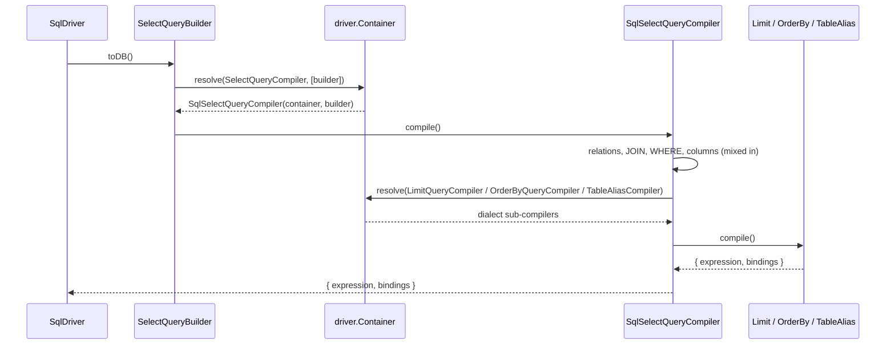

# Query compilers

A compiler turns one builder into SQL text plus its bindings. `@spinajs/orm` declares every compiler as an abstract token; this package ships the generic `Sql*` implementations, and each dialect driver binds the ones it uses into its own container. Read this page to see how a builder becomes SQL, what each compiler emits, and how to write and register your own.

## How it works

1. **Execution starts.** `await builder` reaches `SqlDriver.execute(builder)`, which calls `builder.toDB()`. Tests and tools call `toDB()` directly to get SQL without a database.
2. **Token lookup.** `toDB()` resolves the builder's compiler token from `builder.Container` (the connection's child container) with the builder as the argument, eg. `SelectQueryBuilder.toDB()` runs `validateSorts()` then `container.resolve(SelectQueryCompiler, [this]).compile()`. Which class comes back is decided by the driver's `resolve()`.
3. **Constructor arguments.** A compiler decorated `@Inject(Container)` receives the container first and the builder second: `constructor(container, builder)`. Without `@Inject` it receives only the builder. Every shipped compiler is `@NewInstance()`, so each `toDB()` gets a fresh instance.
4. **Clause assembly.** The compiler builds each statement the builder collected (`statement.build()` returns `{ Statements, Bindings }`), resolves sub-compilers from the container (`LimitQueryCompiler`, `OrderByQueryCompiler`, `OnDuplicateQueryCompiler`, `ColumnQueryCompiler`, `TableAliasCompiler`, ...) and quotes identifiers through its injected `IdentifierQuoter`.
5. **Result.** `compile()` returns an `ICompilerOutput` (`{ expression, bindings }`) with `?` placeholders, or an array of them for multi-statement DDL. `SqlDriver.execute()` sends each output with `executeOnDb()`. See [`SqlDriver`](01-sql-driver.md).

Errors on the way: a compiler throws `InvalidArgument` or `InvalidOperation` for a builder it cannot render (no `VALUES`, no event schedule, a bad charset name). An unregistered token fails on first use; see [Architecture](../orm/12-architecture.md#how-it-works).



### How `SqlSelectQueryCompiler` builds a SELECT

1. `Relations.forEach((r) => r.compile())`: populated relations add their joins and middlewares.
2. A builder with a recursive CTE returns `recursive()` (`SqlWithRecursiveCompiler`) here.
3. **JOIN** is built first, then **WHERE**: both can change the table alias (an `EXISTS` sub-query, a join that assigns `$table$`), so they run before the column list.
4. Columns, `FROM`, `LIMIT`, `ORDER BY`, `HAVING`, `GROUP BY` follow.

Assembled text:

```
SELECT [DISTINCT] <columns | *> FROM <table [as alias]> [joins] [WHERE ...] [GROUP BY ...] [HAVING ...] [ORDER BY ...] [LIMIT ? [OFFSET ?]]
```

Bindings are concatenated in the order columns, join, where, group, having, sort, limit, which matches the `?` placeholders in the text.

Two kinds of sub-compiler take part, and they are replaced differently:

| Part | How the select compiler gets it | How to replace it |
| --- | --- | --- |
| `LIMIT` / `OFFSET` | `container.resolve(LimitQueryCompiler, [builder])` | Register a class `.as(LimitQueryCompiler)` |
| `ORDER BY` | `container.resolve(OrderByQueryCompiler, [builder])` | Register a class `.as(OrderByQueryCompiler)` |
| `FROM` table reference | `container.resolve(TableAliasCompiler).compile(builder)` | Register a class `.as(TableAliasCompiler)` |
| `WHERE`, `HAVING`, columns, joins, `GROUP BY`, recursive CTE | Mixed in with `@use(SqlWhereCompiler, SqlHavingCompiler, SqlColumnsCompiler, SqlJoinCompiler, SqlWithRecursiveCompiler, SqlGroupByCompiler)` | Subclass `SqlSelectQueryCompiler` and override the method, or change the statements those methods build |

## Compiler tokens

Every token below is an abstract class from `@spinajs/orm`. "SqlDriver" means `SqlDriver.resolve()` binds it for every dialect; "driver" means each dialect driver must bind it itself.

| Token | Resolved by | `@spinajs/orm-sql` class | Bound by | Output |
| --- | --- | --- | --- | --- |
| `SelectQueryCompiler` | `SelectQueryBuilder.toDB()` | `SqlSelectQueryCompiler` | SqlDriver | one |
| `InsertQueryCompiler` | `InsertQueryBuilder.toDB()` | `SqlInsertQueryCompiler` | SqlDriver; every shipped driver overrides | one |
| `UpdateQueryCompiler` | `UpdateQueryBuilder.toDB()` | `SqlUpdateQueryCompiler` | SqlDriver | one |
| `DeleteQueryCompiler` | `DeleteQueryBuilder.toDB()` | `SqlDeleteQueryCompiler` | SqlDriver; MSSQL overrides | one |
| `OnDuplicateQueryCompiler` | the insert compiler, for `onDuplicate()` | `SqlOnDuplicateQueryCompiler` | driver | one |
| `LimitQueryCompiler` | the select and delete compilers | `SqlLimitQueryCompiler` | driver | one |
| `OrderByQueryCompiler` | the select compiler | `SqlOrderByQueryCompiler` | SqlDriver; SQLite, MSSQL override | one |
| `GroupByQueryCompiler` | nothing in the shipped compilers (the select compiler mixes in `SqlGroupByCompiler`) | `SqlGroupByCompiler` | SqlDriver | one |
| `RecursiveQueryCompiler` | nothing in the shipped compilers (the select compiler mixes in `SqlWithRecursiveCompiler`) | `SqlWithRecursiveCompiler` | SQLite, MySQL, PostgreSQL | one |
| `TableAliasCompiler` | every compiler that names a table | `SqlTableAliasCompiler` | SqlDriver; MSSQL, PostgreSQL override | string |
| `TableQueryCompiler` | `TableQueryBuilder.toDB()` (`createTable`) | `SqlTableQueryCompiler` | SqlDriver; SQLite, MSSQL override | array |
| `ColumnQueryCompiler` | the table and alter-column compilers | `SqlColumnQueryCompiler` | driver | one |
| `ForeignKeyQueryCompiler` | the table compiler | `SqlForeignKeyQueryCompiler` | SqlDriver | one |
| `TableHistoryQueryCompiler` | the table compiler, for `trackHistory()` | `SqlTableHistoryQueryCompiler` | MySQL | array |
| `AlterTableQueryCompiler` | `AlterTableQueryBuilder.toDB()` | `SqlAlterTableQueryCompiler` | SQLite, MySQL, PostgreSQL | array |
| `AlterColumnQueryCompiler` | the alter-table compiler | `SqlAlterColumnQueryCompiler` | driver | one |
| `TableCloneQueryCompiler` | `CloneTableQueryBuilder.toDB()` | `SqlTableCloneQueryCompiler` | MySQL | array |
| `TruncateTableQueryCompiler` | `TruncateTableQueryBuilder.toDB()` | `SqlTruncateTableQueryCompiler` | driver | one |
| `IndexQueryCompiler` | `IndexQueryBuilder.toDB()` | `SqlIndexQueryCompiler` | SqlDriver | one |
| `DropTableCompiler` | `DropTableQueryBuilder.toDB()` | `SqlDropTableQueryCompiler` | SqlDriver | one |
| `DropViewCompiler` | `DropViewQueryBuilder.toDB()` | `SqlDropViewQueryCompiler` | SqlDriver | one |
| `CreateViewCompiler` | `CreateViewQueryBuilder.toDB()` | `SqlCreateViewQueryCompiler` (base only) | driver, always a subclass; see [View compiler hooks](06-view-compiler-hooks.md) | one |
| `CreateDatabaseCompiler` | `CreateDatabaseQueryBuilder.toDB()` | `SqlCreateDatabaseQueryCompiler` | SqlDriver; SQLite, MSSQL, PostgreSQL override | one |
| `DropDatabaseCompiler` | `DropDatabaseQueryBuilder.toDB()` | `SqlDropDatabaseQueryCompiler` | SqlDriver; SQLite, MSSQL override | one |
| `EventQueryCompiler` | `EventQueryBuilder.toDB()` | `SqlEventQueryCompiler`, `UnsupportedEventQueryCompiler` | driver | one |
| `DropEventQueryCompiler` | `DropEventQueryBuilder.toDB()` | `SqlDropEventQueryCompiler`, `UnsupportedDropEventQueryCompiler` | driver | one |
| `RawSchemaQueryCompiler` | `RawSchemaQueryBuilder.toDB()` (`schema().raw()`) | `SqlRawSchemaQueryCompiler` | SqlDriver | one |
| `TableExistsCompiler` | `TableExistsQueryBuilder.toDB()` | none | driver, always its own class | one |

Which dialect binds which class: [Adding a new SQL dialect](07-adding-a-sql-dialect.md#what-each-shipped-driver-registers).

## What each compiler emits

### DML

| Class | SQL | Notes |
| --- | --- | --- |
| `SqlSelectQueryCompiler` | see [above](#how-sqlselectquerycompiler-builds-a-select) | An empty column list compiles to `*`. |
| `SqlInsertQueryCompiler` | `INSERT [IGNORE] INTO <table> (<cols>) VALUES (?,?),(?,?) [upsert]` | See [insert rules](#insert-rules). |
| `SqlOnDuplicateQueryCompiler` | `ON DUPLICATE KEY UPDATE `c` = VALUES(`c`),...` | MySQL syntax. A `RawQuery` update column is emitted verbatim with its bindings. |
| `SqlUpdateQueryCompiler` | ``UPDATE <table alias> SET `a` = ?,`b` = ?,`n` = `n` + ? WHERE <where>`` | `increment(column, by)` adds `` `n` = `n` + ? `` after the `update()` values. Bindings: `SET` values, increments, then where bindings. An update with no condition throws `InvalidArgument('update of <t> has no where clause; add .where(true) to update every row')`; a column both set and incremented throws `InvalidArgument`. |
| `SqlDeleteQueryCompiler` | `DELETE FROM <table alias> [WHERE ...] [LIMIT ...]` | No conditions means no `WHERE`: every row is deleted. |
| `SqlLimitQueryCompiler` | ` LIMIT ?`, ` OFFSET ?` | An offset without a limit emits `LIMIT 18446744073709551615` (`2^64 - 1`), because MySQL has no bare `OFFSET`. Throws `InvalidOperation('builder cannot be null or undefined')`. |
| `SqlOrderByQueryCompiler` | ` ORDER BY `alias`.`a` ASC, `b` DESC` | Every sort from `getSorts()`; empty when there are none. |
| `SqlGroupByCompiler` | ` GROUP BY <expr>,<expr>` | Empty when there are no group statements. |
| `SqlWithRecursiveCompiler` | `WITH RECURSIVE recursive_cte(<cols>) AS ( <anchor> UNION ALL <recursive> ) SELECT * FROM recursive_cte` | The members come from `SqlWithRecursiveStatement`; see [Statements](03-statements.md). |
| `SqlTableAliasCompiler` | `` `db`.`table` as `alias` `` | Database prefix only when `builder.Database` is set; alias only when `builder.TableAlias` is set. |

### Insert rules

- `keptColumnIndices()` decides once which columns take part. An auto-increment primary key column is dropped **only when no row supplies a value**. If one row does, the column stays and the other rows emit `autoIncrementPlaceholder()` (`NULL`; PostgreSQL overrides it to `DEFAULT`).
- `columns()` and `values()` both derive their shape from that decision, so every tuple matches the column list.
- Per value: `undefined` emits `DEFAULT`, `null` emits `NULL`, anything else is bound as `?` after `tryConvertValue()` (a converter registered for the value's constructor name in `__orm_db_value_converters__`).
- A non-nullable, non-auto-increment column with `null` or `undefined` throws `InvalidArgument('value column <name> cannot be null')`.
- No rows throws `InvalidArgument('values count invalid')`; no columns throws `InvalidArgument('invalid column count')`.
- `orIgnore()` adds `IGNORE`. `orReplace()` sets `Replace`, which this class does **not** render (MySQL and SQLite override `into()`); it only suppresses the upsert clause.
- `onDuplicate()` sets `Update`; the upsert tail comes from `OnDuplicateQueryCompiler` unless `Replace` is also set.
- A `RawQuery` column is wrapped in literal backticks, not through the quoter.

### DDL

| Class | SQL | Notes |
| --- | --- | --- |
| `SqlTableQueryCompiler` | `CREATE [TEMPORARY] TABLE [IF NOT EXISTS] <t> (<cols> ,PRIMARY KEY (...) ,<fks>)` | Columns via `ColumnQueryCompiler`, keys via `ForeignKeyQueryCompiler`. Returns an array; `trackHistory()` appends the `TableHistoryQueryCompiler` outputs. |
| `SqlColumnQueryCompiler` | `` `name` TYPE [UNSIGNED] [CHARACTER SET '...'] [COLLATE '...'] [NOT NULL] [DEFAULT ...] [AUTO_INCREMENT] [COMMENT '...'] [UNIQUE] `` | See the type table below. String literals go through `escapeStringLiteral()`. `caseSensitive()` without `collation()` emits `CHARACTER SET 'utf8mb4' COLLATE 'utf8mb4_bin'`, or `COLLATE '<charset>_bin'` when `charset()` is set; an explicit `collation()` wins. Dialects override `charsetName()` and `collationName()`. |
| `SqlForeignKeyQueryCompiler` | `FOREIGN KEY (`c`) REFERENCES `schema`.`t`(`pk`) ON DELETE <a> ON UPDATE <a>` | The referenced table goes through `quoteQualified()`, so `schema.table` works. Throws `Error('foreign key query builder cannot be null')`. |
| `SqlIndexQueryCompiler` | `` CREATE [UNIQUE] INDEX `name` ON `t` (`a`,`b`); `` | Ends with `;`. |
| `SqlAlterTableQueryCompiler` | one `ALTER TABLE <t> ...` per change | `DROP COLUMN <c>` (quoted with `IdentifierQuoter`), `RENAME TO <t>`, then each column via `AlterColumnQueryCompiler`. A column that compiles to an empty string is skipped; one whose compiler reports `IsStandaloneStatement` is emitted without the `ALTER TABLE` prefix. |
| `SqlAlterColumnQueryCompiler` | `ADD <def> [AFTER `c`]`, `MODIFY <def>`, `` RENAME COLUMN `old` TO `new` `` | Hooks `_add()`, `_modify()`, `_rename()` return `null` to emit nothing. `_columnDefinition()` resolves `ColumnQueryCompiler`, so the dialect's column syntax is used. |
| `SqlTableCloneQueryCompiler` | `CREATE [TEMPORARY] TABLE <t> LIKE <src>`, then `INSERT INTO <t> <filter or SELECT * FROM src>` | A shallow clone emits only the first statement. |
| `SqlTableHistoryQueryCompiler` | `CREATE TABLE <t>__history LIKE <t>`, key and column changes, `DELIMITER $$` triggers | MySQL only. Adds `__action__`, `__revision__`, `__start__`, `__end__`. The trigger bodies compare a column literally named `Id`. |
| `SqlTruncateTableQueryCompiler` | `TRUNCATE TABLE <t>` | |
| `SqlDropTableQueryCompiler`, `SqlDropViewQueryCompiler` | `DROP TABLE|VIEW [IF EXISTS] <t>` | Name through `TableAliasCompiler`, so a schema prefix applies. |
| `SqlCreateDatabaseQueryCompiler` | `` CREATE DATABASE [IF NOT EXISTS] `db` [CHARACTER SET cs] [COLLATE col] `` | `assertCharsetName()` refuses any name outside `[A-Za-z0-9_]`. |
| `SqlDropDatabaseQueryCompiler` | `` DROP DATABASE [IF EXISTS] `db` `` | |
| `SqlEventQueryCompiler` | `CREATE EVENT [IF NOT EXISTS] <n>` / `ON SCHEDULE ...` / `ON COMPLETION [NOT] PRESERVE` / `ENABLE|DISABLE` / `[COMMENT '...']` / `DO <body>` | Body statements are compiled and their bindings inlined with `inlineBindings()`; several statements are wrapped in `BEGIN ... END`. Throws `InvalidOperation` for no schedule, no body, or `starts()`/`ends()` without `every()`. |
| `SqlDropEventQueryCompiler` | `DROP EVENT [IF EXISTS] <n>` | |
| `UnsupportedEventQueryCompiler`, `UnsupportedDropEventQueryCompiler` | none | `compile()` throws `MethodNotImplemented('<Driver> has no native scheduled events')`. |
| `SqlRawSchemaQueryCompiler` | the raw query | Passes `Query` and `Bindings` through. |

`SqlColumnQueryCompiler` type mapping (`_statementsMappings`):

| Builder type | SQL |
| --- | --- |
| `string` | `VARCHAR(n)`, default `255` |
| `float`, `double`, `decimal` | `TYPE(precision,scale)`, defaults `8`, `2` |
| `enum`, `set` | `ENUM('a','b')`, `SET('a','b')` |
| `binary` | `BINARY(n)`, default `255` |
| `boolean` | `BOOLEAN` |
| `dateTime`, `timestamp` | `DATETIME(3)`, `TIMESTAMP(3)`: millisecond precision, the precision of a JS `Date` |
| `smallint`, `tinyint`, `mediumint`, `int`, `bigint`, `tinytext`, `mediumtext`, `longtext`, `text`, `bit`, `date`, `time`, `json`, `tinyblob`, `mediumblob`, `longblob` | the type name uppercased |

The instant type each dialect writes for `dateTime()`: `DATETIME(3)` (MySQL, this class), `TEXT` (SQLite), `DATETIMEOFFSET(3)` (MSSQL), `TIMESTAMPTZ(3)` (PostgreSQL). See each driver's schema page.

## Services and extension points

| Service | Role | Default implementation | How to override |
| --- | --- | --- | --- |
| Any compiler token above | Renders one builder | The `Sql*` class, or the dialect's subclass | Subclass the `Sql*` class (or the dialect's), register `.as(<token>)` in a driver subclass's `resolve()` after `super.resolve()` |
| `SqlQueryCompiler<T>` | Base of the select, insert, update and delete compilers: holds `_builder`, `_container`, `tryConvertValue()` | | Extend it for a DML compiler written from scratch |
| `SqlSelectQueryCompiler` methods `limit()`, `sort()`, `select()`, `from()` | Protected steps of the SELECT | | Override in a subclass |
| `SqlInsertQueryCompiler` methods `into()`, `columns()`, `values()`, `upsort()`, `keptColumnIndices()`, `autoIncrementPlaceholder()` | Protected steps of the INSERT | | Override in a subclass, as every shipped driver does |
| `SqlColumnQueryCompiler._statementsMappings` | Type and modifier spelling | MySQL spelling | Reassign one entry in a subclass constructor (MSSQL: `autoincrement = () => 'IDENTITY(1,1)'`) |
| `SqlAlterColumnQueryCompiler` hooks `_add()`, `_modify()`, `_rename()`, `IsStandaloneStatement` | ALTER COLUMN spelling | MySQL spelling | Override in a subclass |

```ts sample
import { Container, Inject, Injectable, NewInstance } from '@spinajs/di';
import { InvalidOperation } from '@spinajs/exceptions';
import { DeleteQueryCompiler } from '@spinajs/orm';
import { SqlDeleteQueryCompiler } from '@spinajs/orm-sql';
import { SqliteOrmDriver } from '@spinajs/orm-sqlite';

/** Refuses a DELETE that would empty the whole table. */
@NewInstance()
@Inject(Container)
export class GuardedDeleteQueryCompiler extends SqlDeleteQueryCompiler {
  public compile() {
    if (this.where(this._builder).expression === '') {
      throw new InvalidOperation(`refusing DELETE without WHERE on table ${this._builder.Table}`);
    }

    return super.compile();
  }
}

@Injectable('orm-driver-sqlite-guarded')
@NewInstance()
export class GuardedSqliteDriver extends SqliteOrmDriver {
  public resolve() {
    super.resolve();
    this.Container.register(GuardedDeleteQueryCompiler).as(DeleteQueryCompiler);
  }
}
```

Point a connection at it with `Driver: 'orm-driver-sqlite-guarded'`.

## Important behaviour

- Registrations are per connection: they live in `driver.Container`. A registration in the root `DI` container is shadowed by the driver's own and never reaches a query.
- The container returns the last registration of a token, so a registration made after `super.resolve()` wins.
- `WHERE`, `HAVING`, column, join, group and recursive rendering are mixed into the DML compilers at class definition time. `SqlJoinStatement` and `SqlWhereQueryStatement` also call `new SqlWhereCompiler()` directly. There is no token to replace them through DI.
- A multi-statement result (`ICompilerOutput[]`) is sent by `SqlDriver.execute()` with `Promise.all`, one `executeOnDb()` per entry, without waiting for the previous one.
- `toDB()` compiles without a database and without query middlewares. The output is what the compiler sees after `afterQueryCreation` hooks.
- Every compiler quotes through `@Autoinject(IdentifierQuoter)`. `SqlDriver` registers no quoter: a driver that forgets one fails on its first query.
- `SqlUpdateQueryCompiler` refuses an update without a condition at compile time. Write `.where(true)` to update every row: it compiles to `WHERE 1 = 1` on every dialect (`where(false)` is `1 = 0`), since T-SQL has no `TRUE` / `FALSE`.
- `SqlDeleteQueryCompiler` omits `WHERE` when there are no conditions, so `driver.del().from('t')` deletes every row. Unlike the update compiler, it does not refuse.
- Values in DML are always bound. DDL and event or view bodies have no placeholders, so their literals are escaped (`escapeStringLiteral()`) or inlined (`inlineBindings()` with the driver's `LiteralQuoter`). See [Identifier and literal quoting](04-identifier-and-literal-quoting.md).

## Best practices

- Replace the narrowest token: `LimitQueryCompiler` or `OrderByQueryCompiler`, not `SelectQueryCompiler`.
- Extend the dialect's own compiler when it has one (`SqliteInsertQueryCompiler`, not `SqlInsertQueryCompiler`), so its fixes stay.
- Override a protected step (`into()`, `values()`, `autoIncrementPlaceholder()`) instead of copying `compile()`.
- Keep placeholders and bindings in step: push one binding per `?`, in text order.
- Assert on `builder.toDB()` in unit tests: `expression` and `bindings`.

## Patterns and antipatterns

```ts
// Don't: hard-coded backticks are MySQL / SQLite only; MSSQL and PostgreSQL reject them
return { expression: ` ORDER BY \`${s.column}\` ${s.order}`, bindings: [] };

// Do: quote through the connection's own quoter
@Autoinject(IdentifierQuoter)
public Quoter: IdentifierQuoter;

return { expression: ` ORDER BY ${this.Quoter.quote(s.column)} ${s.order}`, bindings: [] };
```

```ts
// Don't: interpolating a value into the SQL text opens it to injection and skips converters
expression: `LIMIT ${limits.limit}`

// Do: emit a placeholder and push the value
expression: ' LIMIT ?',
bindings: [limits.limit],
```

```ts
// Don't: registered before super.resolve(), the shared class registered afterwards wins
public resolve() {
  this.Container.register(MyLimitCompiler).as(LimitQueryCompiler);
  super.resolve();
}

// Do
public resolve() {
  super.resolve();
  this.Container.register(MyLimitCompiler).as(LimitQueryCompiler);
}
```

## Examples

### Page with `LIMIT -1 OFFSET ?` on SQLite

SQLite accepts `LIMIT -1` as "no limit", so the `2^64 - 1` stand-in is not needed.

```ts sample
import { Injectable, NewInstance } from '@spinajs/di';
import { ICompilerOutput, LimitQueryCompiler } from '@spinajs/orm';
import { SqlLimitQueryCompiler } from '@spinajs/orm-sql';
import { SqliteOrmDriver } from '@spinajs/orm-sqlite';

@NewInstance()
export class SqliteOffsetLimitCompiler extends SqlLimitQueryCompiler {
  public compile(): ICompilerOutput {
    const { limit, offset } = this._builder.getLimits();
    const bindings: unknown[] = [];
    let expression = '';

    if ((limit ?? 0) > 0) {
      expression += ' LIMIT ?';
      bindings.push(limit);
    } else if ((offset ?? 0) > 0) {
      expression += ' LIMIT -1';
    }

    if ((offset ?? 0) > 0) {
      expression += ' OFFSET ?';
      bindings.push(offset);
    }

    return { expression, bindings };
  }
}

@Injectable('orm-driver-sqlite-offset')
@NewInstance()
export class OffsetSqliteDriver extends SqliteOrmDriver {
  public resolve() {
    super.resolve();
    this.Container.register(SqliteOffsetLimitCompiler).as(LimitQueryCompiler);
  }
}
```

### Check the SQL a builder compiles to

```ts sample
import { ICompilerOutput, OrmDriver } from '@spinajs/orm';

export function unpaidInvoicesPage(driver: OrmDriver, page: number): ICompilerOutput {
  return driver
    .select()
    .from('invoices')
    .where('Status', 'unpaid')
    .orderByDescending('DueAt')
    .skip(page * 50)
    .take(50)
    .toDB();
  // page 2 on SQLite: { expression: 'SELECT * FROM `invoices` WHERE `Status` = ? ORDER BY `DueAt` DESC LIMIT ? OFFSET ?', bindings: ['unpaid', 50, 100] }
}
```

## Related

- [Statements](03-statements.md): the fragments compilers join.
- [View compiler hooks](06-view-compiler-hooks.md): the `CREATE VIEW` compiler and its per-clause hooks.
- [Extending an existing dialect](08-extending-an-existing-dialect.md): swapping one compiler under one connection.
- [Architecture](../orm/12-architecture.md): the core side of the same flow.
- [Schema builder](../orm/09-schema-builder.md): the DDL builders the schema compilers render.
