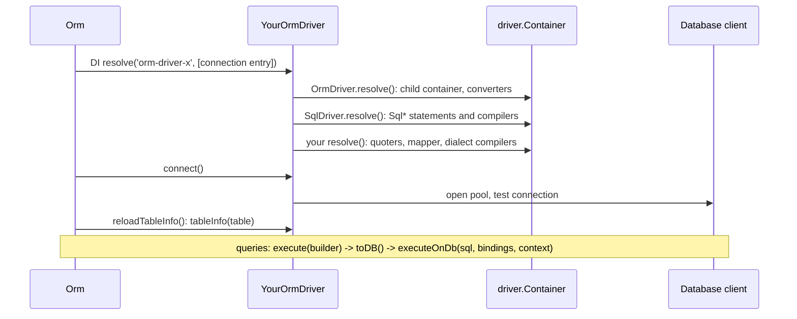

# Adding a new SQL dialect

A new database gets its own driver package: a class that extends `SqlDriver`, sends statements through the database's Node client, and registers the compilers, statements and services that spell SQL the engine's way. This page walks from an empty class to a working connection, using `@spinajs/orm-sqlite`, `@spinajs/orm-mysql`, `@spinajs/orm-mssql` and `@spinajs/orm-postgres` as the reference.

## How it works

1. **Package.** Create `packages/orm-<dialect>/` depending on `@spinajs/orm`, `@spinajs/orm-sql`, `@spinajs/di`, `@spinajs/exceptions` and the database client. `src/index.ts` exports the driver and, as `orm-sqlite` and `orm-postgres` do, its compilers and statements (`export * from './compilers.js'`), so users can extend them.
2. **Empty class.** Declare `@Injectable('orm-driver-<dialect>') @NewInstance() export class <Dialect>OrmDriver extends SqlDriver`. The string is what `db.Connections[].Driver` names; `@NewInstance()` gives each connection its own driver.
3. **Connection.** Implement `connect()` (open the pool or handle, test it, `setState(ConnectionState.Connected)`), `disconnect()` (`stopHealthCheck()`, `setState(ConnectionState.Disconnected)`, close) and `ping()`. Read connection keys from `this.Options` and pool sizes from `this.resolvedPoolOptions()`.
4. **Sending.** Implement `executeOnDb(stmt, params, context)`:
   1. Translate the `?` placeholders if the client needs another form (`$1` for `pg`, `@p0` for `mssql`).
   2. Use the transaction's connection when `this.TransactionStorage.getStore()` holds one, otherwise acquire from the pool and report the wait with `observeAcquireSeconds()`.
   3. Shape the result by `QueryContext` (see [`SqlDriver`](01-sql-driver.md#what-executeondb-returns)).
   4. Wrap errors in `OrmException(message, this.Options, stmt, params, err)`.
   5. Run the whole send through `this.withReconnect(...)` so transport failures retry.
5. **Dialect registrations.** In `resolve()`, call `super.resolve()`, then register every token `SqlDriver` leaves out and every shared class the engine cannot run. See [What to register](#what-to-register).
6. **Feature flags.** Implement `supportedFeatures()` and set `SupportedIsolationLevels`. They switch core behaviour; see [Feature flags](#feature-flags).
7. **Transactions.** Implement the seven primitives. `OrmDriver.transaction()` calls them, keeps nesting depth, names savepoints `sp_1`, `sp_2`, ... and runs the callback inside `TransactionStorage`.
8. **Schema reflection.** Implement `tableInfo(name, schema?)`. `Orm.reloadTableInfo()` calls it for every model at boot to fill columns that have no decorator.
9. **Use.** Import the package once so the decorator registers the class, and point a connection at it: `{ Driver: 'orm-driver-<dialect>', Name: 'main', Host: ..., Database: ... }`. `Orm` resolves the driver with that entry, `resolve()` runs, then `connect()`.

Errors on the way: `Orm` throws `OrmException('ORM connection driver <Driver> not registerd')` when nothing is registered under the string, and wraps a failed resolve or connect in `OrmException`. A token you forgot to register fails when the feature is first used.



## What to implement

| Member | Contract | Reference |
| --- | --- | --- |
| `executeOnDb(stmt, params, context)` | Send one statement; return by `QueryContext`. | `PostgresOrmDriver._executeOnDbOnce()`: placeholders, pool or transaction connection, `OrmException` |
| `connect()`, `disconnect()` | Open, test, set state; stop health check, close. | `PostgresOrmDriver`, `MySqlOrmDriver` |
| `ping()` | `true` when a trivial query succeeds. Bypass `withReconnect()`. | `MySqlOrmDriver.ping()`: `SELECT 1` through `_executeOnDbOnce()` |
| `supportedFeatures()` | `{ events, insertReturning, insertIdIsFirstOfBatch? }` | all four drivers |
| `SupportedIsolationLevels` | Levels the engine honours. | SQLite `['SERIALIZABLE']`, the others all four |
| `tableInfo(name, schema?)` | `IColumnDescriptor[]`, or `null` for a missing table. | SQLite `PRAGMA table_info`, MySQL / MSSQL / PostgreSQL `information_schema` |
| `_begin`, `_commit`, `_rollback`, `_dispose` | Open, end and release a transaction. | MySQL / PostgreSQL carry a pooled connection on the context |
| `_savepoint`, `_releaseSavepoint`, `_rollbackToSavepoint` | Savepoints by name. | MSSQL: `SAVE TRANSACTION`, no-op release |
| `poolMetrics()` | `{ Size, InUse, Waiting }`; must not throw. | `PostgresOrmDriver.poolMetrics()` |
| `isRetryableError(err)` | Which errors `withReconnect()` retries; `false` inside a transaction. | `MySqlOrmDriver`, `PostgresOrmDriver` |
| `resolve()` | `super.resolve()`, then the dialect registrations. | all four |

## What to register

Mandatory, because `SqlDriver` has no portable implementation:

| Token | Why | Shipped choices |
| --- | --- | --- |
| `IdentifierQuoter` | Every compiler and statement quotes through it. | `BacktickIdentifierQuoter` (`@spinajs/orm-sql`), `BracketIdentifierQuoter`, `DoubleQuoteIdentifierQuoter` |
| `LiteralQuoter` | View and event bodies. | `SqlLiteralQuoter` or a subclass |
| `ServerResponseMapper` | Turns your insert result into `DbServerResponse`. The base `read()` throws `MethodNotImplemented`. | one per driver |
| `TableExistsCompiler` | Migrations and `createTableIfAbsent` ask it. | one per driver |
| `LimitQueryCompiler` | The select and delete compilers resolve it. | `SqlLimitQueryCompiler` or your own |
| `CreateViewCompiler` | `SqlCreateViewQueryCompiler` refuses every optional clause. | a subclass per driver; see [View compiler hooks](06-view-compiler-hooks.md) |
| `EventQueryCompiler`, `DropEventQueryCompiler` | Scheduled events. | `SqlEventQueryCompiler` (MySQL) or `UnsupportedEventQueryCompiler` / `UnsupportedDropEventQueryCompiler` |

Register when the engine supports the feature; leave out otherwise, so the feature fails instead of sending MySQL syntax:

| Token | Shared class | Note |
| --- | --- | --- |
| `OnDuplicateQueryCompiler` | `SqlOnDuplicateQueryCompiler` (`ON DUPLICATE KEY UPDATE`) | Write your own for `ON CONFLICT` or `MERGE`. |
| `ColumnQueryCompiler` | `SqlColumnQueryCompiler` | Needed by `createTable` and `alterTable`. Subclass for identity and type names. |
| `AlterTableQueryCompiler`, `AlterColumnQueryCompiler` | `SqlAlterTableQueryCompiler`, `SqlAlterColumnQueryCompiler` | Override `_modify()` / `_rename()` / `IsStandaloneStatement` as needed. |
| `TruncateTableQueryCompiler` | `SqlTruncateTableQueryCompiler` | SQLite uses `DELETE FROM`. |
| `RecursiveQueryCompiler` | `SqlWithRecursiveCompiler` | |
| `DefaultValueBuilder` | `SqlDefaultValueBuilder` | `CURRENT_DATE()` is MySQL. |
| `TableCloneQueryCompiler`, `TableHistoryQueryCompiler` | `SqlTableCloneQueryCompiler`, `SqlTableHistoryQueryCompiler` | MySQL syntax (`CREATE TABLE ... LIKE`, triggers with `DELIMITER`). |

Override shared registrations the engine cannot run: `InsertQueryCompiler` (`RETURNING`, `OUTPUT`, `INSERT IGNORE`), `OrderByQueryCompiler`, `TableAliasCompiler` (schema prefix), `CreateDatabaseCompiler` / `DropDatabaseCompiler`, `InSetStatement`, `JoinStatement`, `DatetimeValueConverter`.

### What each shipped driver registers

On top of `SqlDriver.resolve()`. "shared" means the `@spinajs/orm-sql` class, claimed explicitly; "—" means not registered.

| Token | SQLite | MySQL | MSSQL | PostgreSQL |
| --- | --- | --- | --- | --- |
| `IdentifierQuoter` | `BacktickIdentifierQuoter` | `BacktickIdentifierQuoter` | `BracketIdentifierQuoter` | `DoubleQuoteIdentifierQuoter` |
| `LiteralQuoter` | `SqlLiteralQuoter` | `MySqlLiteralQuoter` | `MsSqlLiteralQuoter` | `PostgresLiteralQuoter` |
| `ServerResponseMapper` | `SqliteServerResponseMapper` | `MysqlServerResponseMapper` | — (inserts that read a response throw) | `PostgresServerResponseMapper` |
| `TableExistsCompiler` | `SqliteTableExistsCompiler` | `MySqlTableExistsCompiler` | `MsSqlTableExistsCompiler` | `PostgresTableExistsCompiler` |
| `LimitQueryCompiler` | shared | shared | `MsSqlLimitCompiler` (`OFFSET ? ROWS FETCH NEXT ? ROWS ONLY`) | `PostgresLimitQueryCompiler` |
| `InsertQueryCompiler` | `SqliteInsertQueryCompiler` | `MySqlInsertQueryCompiler` | `MsSqlInsertQueryCompiler` | `PostgresInsertQueryCompiler` |
| `OnDuplicateQueryCompiler` | `SqliteOnDuplicateQueryCompiler` | shared | `MsSqlOnDuplicateQueryCompiler` (`MERGE`) | `PostgresOnDuplicateQueryCompiler` |
| `ColumnQueryCompiler` | `SqliteColumnCompiler` | shared | `MsSqlColumnQueryCompiler` | `PostgresColumnQueryCompiler` |
| `AlterColumnQueryCompiler` | `SqliteAlterColumnQueryCompiler` | shared | — | `PostgresAlterColumnQueryCompiler` |
| `AlterTableQueryCompiler` | shared | shared | — | shared |
| `TableQueryCompiler` | `SqliteTableQueryCompiler` | (SqlDriver) | `MsSqlTableQueryCompiler` | (SqlDriver) |
| `OrderByQueryCompiler` | `SqliteOrderByCompiler` | (SqlDriver) | `MsSqlOrderByCompiler` | (SqlDriver) |
| `DeleteQueryCompiler` | (SqlDriver) | (SqlDriver) | `MsSqlDeleteQueryCompiler` | (SqlDriver) |
| `TableAliasCompiler` | (SqlDriver) | (SqlDriver) | `MsSqlTableAliasCompiler` | `PostgresTableAliasCompiler` |
| `TruncateTableQueryCompiler` | `SqliteTruncateTableQueryCompiler` | shared | shared | shared |
| `RecursiveQueryCompiler` | shared | shared | — | shared |
| `TableCloneQueryCompiler`, `TableHistoryQueryCompiler` | — | shared | — | — |
| `EventQueryCompiler`, `DropEventQueryCompiler` | `Unsupported*` | shared | `Unsupported*` | `Unsupported*` |
| `CreateViewCompiler` | `SqliteCreateViewCompiler` | `MySqlCreateViewCompiler` | `MsSqlCreateViewCompiler` | `PostgresCreateViewCompiler` |
| `CreateDatabaseCompiler` | `SqliteCreateDatabaseQueryCompiler` (throws) | (SqlDriver) | `MsSqlCreateDatabaseQueryCompiler` | `PostgresCreateDatabaseQueryCompiler` |
| `DropDatabaseCompiler` | `SqliteDropDatabaseQueryCompiler` (throws) | (SqlDriver) | `MsSqlDropDatabaseQueryCompiler` | shared |
| `DefaultValueBuilder` | `SqlLiteDefaultValueBuilder` | `SqlDefaultValueBuilder` | `MsSqlDefaultValueBuilder` | `PostgresDefaultValueBuilder` |
| `DatetimeValueConverter` | `IsoDatetimeValueConverter` | (SqlDriver) | `IsoDatetimeValueConverter` | `IsoDatetimeValueConverter` |
| `NowExpression` | `SqliteNowExpression` | `MySqlNowExpression` | `MsSqlNowExpression` | `PostgresNowExpression` |
| `InSetStatement` | `SqliteInSetStatement` | `MySqlInSetStatement` | `MsSqlInSetStatement` | (SqlDriver, portable `LIKE`) |
| `JoinStatement` | `SqlLiteJoinStatement` (no `RIGHT JOIN`) | (SqlDriver) | (SqlDriver) | (SqlDriver) |
| Other | `SqliteModelToSqlConverter` as `ModelToSqlConverter` | | `MssqlModelDehydrator` | |

## Feature flags

| Member | Effect in the core | SQLite | MySQL | MSSQL | PostgreSQL |
| --- | --- | --- | --- | --- | --- |
| `insertReturning` | `true`: the ORM asks for primary keys with `RETURNING` and assigns them. `false`: `InsertQueryBuilder.returning()` throws `NotSupported`. | `true` | `false` | `false` | `true` |
| `insertIdIsFirstOfBatch` | `true`: after a multi-row `INSERT ... VALUES`, `LastInsertId` is the first row's key and the rest follow contiguously, so keys are backfilled. Optional, defaults to `false`. | `false` | `true` | `false` | `false` |
| `events` | Whether `EventQueryBuilder` is supported. | `false` | `true` | `false` | `false` |
| `SupportedIsolationLevels` | `transaction(cb, { isolation })` rejects a level not listed. Empty rejects every explicit level. | `['SERIALIZABLE']` | all four | all four | all four |

Declare only what the engine guarantees: a wrong `insertIdIsFirstOfBatch` assigns wrong keys to models.

## Important behaviour

- Register after `super.resolve()`: the container returns the last registration of a token.
- Registrations live in `this.Container`, the driver's child container; other connections are unaffected.
- `executeOnDb()` must read `this.TransactionStorage.getStore()`: inside `driver.transaction()` every statement, including those `OrmDriver` itself sends for nested savepoints, must use the transaction's connection.
- `withReconnect()` reconnects with `this.connect()` between attempts and backs off per `Resilience` options. Return `false` from `isRetryableError()` inside a transaction: the statement would be replayed outside it.
- `ITransactionContext.depth` is owned by the base class. A single-handle driver (SQLite) returns `{ depth: 0 }` from `_begin()` and does nothing in `_dispose()`.
- `tableInfo()` must fill `NativeType`: the orphan-policy resolver treats an empty `NativeType` as unknown and refuses to act on that column.
- Returning `null` from `tableInfo()` for a missing table lets migrations create it. `MySqlOrmDriver.tableInfo()` throws instead, which is why its tests set `Migration.OnStartup: true`.
- Placeholder translation sees the whole statement text, quoted literals included. `PostgresOrmDriver` and `MsSqlOrmDriver` rewrite only as many `?` as there are bindings; a `?` beyond that count stays as text.
- A multi-statement result is sent with `Promise.all`. If the engine needs DDL in order, serialize inside `executeOnDb()`.

## Best practices

- Copy the shape of `PostgresOrmDriver`: it uses `withReconnect()`, `isRetryableError()`, `poolMetrics()`, `observeAcquireSeconds()`, `setState()` and wraps every error in `OrmException`.
- Claim a shared class explicitly (`register(SqlTruncateTableQueryCompiler).as(TruncateTableQueryCompiler)`) when its SQL is valid for your engine, and say so in a comment. Nothing is inherited by accident.
- Export your compilers and statements from the package entry so users can extend them; `@spinajs/orm-mysql` and `@spinajs/orm-mssql` do not, and their classes cannot be subclassed from outside.
- Assert `driver.Container.hasRegistered(...)` in a dialect test, for the tokens you register and the ones you leave out on purpose.

## Patterns and antipatterns

```ts
// Don't: forgetting the response mapper breaks every insert that reads its key
public resolve() {
  super.resolve();
  this.Container.register(AnsiIdentifierQuoter).as(IdentifierQuoter);
}

// Do: register the mapper with the rest of the mandatory set
public resolve() {
  super.resolve();
  this.Container.register(AnsiIdentifierQuoter).as(IdentifierQuoter);
  this.Container.register(AnsiServerResponseMapper).as(ServerResponseMapper);
  this.Container.register(AnsiTableExistsCompiler).as(TableExistsCompiler);
}
```

```ts
// Don't: always using the pool runs transaction statements outside the transaction
const connection = await this.Pool.acquire();

// Do
const tx = this.TransactionStorage.getStore() as IAnsiTransactionContext | undefined;
const connection = tx?.connection ?? (await this.Pool.acquire());
```

## Examples

### A complete driver

`AnsiDb` stands for your engine: double-quoted identifiers, `$1` placeholders, `ON CONFLICT` upserts, `RETURNING`, identity columns. `createPool()` stands for your database's Node client.

```ts sample
import { Container, Inject, Injectable, NewInstance } from '@spinajs/di';
import {
  ColumnQueryBuilder,
  ColumnQueryCompiler,
  ConnectionState,
  CreateViewCompiler,
  DbServerResponse,
  DropEventQueryCompiler,
  EventQueryCompiler,
  IColumnDescriptor,
  ICompilerOutput,
  IdentifierQuoter,
  InsertQueryCompiler,
  IPoolMetrics,
  ISupportedFeature,
  IsolationLevel,
  ITransactionContext,
  ITransactionOptions,
  LimitBuilder,
  LimitQueryCompiler,
  LiteralQuoter,
  OnDuplicateQueryCompiler,
  OrmDriver,
  OrmException,
  QueryContext,
  RawQuery,
  ServerResponseMapper,
  TableExistsCompiler,
  TableExistsQueryBuilder,
  TruncateTableQueryCompiler,
} from '@spinajs/orm';
import {
  SqlColumnQueryCompiler,
  SqlCreateViewQueryCompiler,
  SqlDriver,
  SqlInsertQueryCompiler,
  SqlLiteralQuoter,
  SqlOnDuplicateQueryCompiler,
  SqlTruncateTableQueryCompiler,
  UnsupportedDropEventQueryCompiler,
  UnsupportedEventQueryCompiler,
} from '@spinajs/orm-sql';

// ---- stand-in for the database's Node client ----------------------------------------------
interface AnsiResult {
  rows: Record<string, unknown>[];
  rowCount: number;
}
interface AnsiConnection {
  query(sql: string, params: unknown[]): Promise<AnsiResult>;
  release(): void;
}
interface AnsiPool {
  acquire(): Promise<AnsiConnection>;
  end(): Promise<void>;
  readonly total: number;
  readonly idle: number;
  readonly waiting: number;
}
declare function createPool(config: { host?: string; port?: number; user?: string; password?: string; database?: string; min: number; max: number; idleTimeoutMillis: number; acquireTimeoutMillis: number }): AnsiPool;

// ---- dialect services -----------------------------------------------------------------------
@NewInstance()
export class AnsiIdentifierQuoter extends IdentifierQuoter {
  public quote(name: string): string {
    return '"' + String(name).replace(/"/g, '""') + '"';
  }
}

@NewInstance()
@Inject(Container)
export class AnsiLiteralQuoter extends SqlLiteralQuoter {
  protected quoteBoolean(value: boolean): string {
    return value ? 'TRUE' : 'FALSE';
  }
}

export class AnsiServerResponseMapper extends ServerResponseMapper {
  public read(data: any, pkNames?: string[]): DbServerResponse {
    const rows: Record<string, unknown>[] = Array.isArray(data) ? data : Array.isArray(data?.Returning) ? data.Returning : [];
    const last = rows[rows.length - 1];
    const key = pkNames?.length === 1 && last ? Number(last[pkNames[0]]) : NaN;

    return {
      RowsAffected: Array.isArray(data) ? data.length : data?.RowsAffected ?? 0,
      LastInsertId: Number.isFinite(key) ? key : 0,
      Returning: rows,
    };
  }
}

@NewInstance()
export class AnsiTableExistsCompiler extends TableExistsCompiler {
  constructor(protected builder: TableExistsQueryBuilder) {
    super();
  }

  public compile(): ICompilerOutput {
    return {
      expression: 'SELECT table_name FROM information_schema.tables WHERE table_name = ? AND table_schema = current_schema() LIMIT 1',
      bindings: [this.builder.Table],
    };
  }
}

/** Bare OFFSET is valid here, so no stand-in LIMIT is needed. */
@NewInstance()
export class AnsiLimitQueryCompiler extends LimitQueryCompiler {
  constructor(protected builder: LimitBuilder<unknown>) {
    super();
  }

  public compile(): ICompilerOutput {
    const { limit, offset } = this.builder.getLimits();
    const bindings: unknown[] = [];
    let expression = '';

    if ((limit ?? 0) > 0) {
      expression += ' LIMIT ?';
      bindings.push(limit);
    }
    if ((offset ?? 0) > 0) {
      expression += ' OFFSET ?';
      bindings.push(offset);
    }

    return { expression, bindings };
  }
}

@NewInstance()
export class AnsiOnDuplicateQueryCompiler extends SqlOnDuplicateQueryCompiler {
  public compile() {
    const target = this._builder.getColumn().map((c: string) => this.Quoter.quote(c)).join(',');
    const updates = this._builder.getColumnsToUpdate();

    return {
      expression: `ON CONFLICT (${target}) DO UPDATE SET ${updates.map((c: string | RawQuery) => (typeof c === 'string' ? `${this.Quoter.quote(c)} = EXCLUDED.${this.Quoter.quote(c)}` : c.Query)).join(',')}`,
      bindings: updates.flatMap((c: string | RawQuery) => (typeof c === 'string' ? [] : c.Bindings ?? [])),
    };
  }
}

@NewInstance()
@Inject(Container)
export class AnsiInsertQueryCompiler extends SqlInsertQueryCompiler {
  public compile() {
    const values = this.values();
    const upsert = this.upsort();
    const returning = this._builder.Returning.length > 0 && !this._builder.Update ? ` RETURNING ${this._builder.Returning.map((c: string) => (c === '*' ? '*' : this.Quoter.quote(c))).join(',')}` : '';

    return {
      expression: `${this.into()} ${this.columns()} ${values.data} ${upsert.expression}${returning}`.trim(),
      bindings: values.bindings.concat(upsert.bindings),
    };
  }

  /** An identity column takes DEFAULT, not NULL. */
  protected autoIncrementPlaceholder(): string {
    return 'DEFAULT';
  }
}

@NewInstance()
export class AnsiColumnQueryCompiler extends SqlColumnQueryCompiler {
  constructor(builder: ColumnQueryBuilder) {
    super(builder);
    this._statementsMappings.autoincrement = () => 'GENERATED BY DEFAULT AS IDENTITY';
  }
}

@NewInstance()
@Inject(Container)
export class AnsiCreateViewCompiler extends SqlCreateViewQueryCompiler {
  protected Engine = 'ansidb';

  protected _replace(): string {
    return this.builder.Replace ? 'OR REPLACE' : '';
  }
}

// ---- the driver -----------------------------------------------------------------------------
export interface IAnsiTransactionContext extends ITransactionContext {
  connection: AnsiConnection;
}

/** `?` to `$1..$n`, rewriting only as many placeholders as there are bindings. */
export function toPositional(stmt: string, params: unknown[]): string {
  let i = 0;
  return stmt.replace(/\?/g, (match) => (i < params.length ? `$${++i}` : match));
}

@Injectable('orm-driver-ansidb')
@NewInstance()
export class AnsiDbOrmDriver extends SqlDriver {
  protected Pool: AnsiPool | null = null;

  public readonly SupportedIsolationLevels: IsolationLevel[] = ['READ COMMITTED', 'REPEATABLE READ', 'SERIALIZABLE'];

  public executeOnDb(stmt: string, params: unknown[], context: QueryContext): Promise<unknown> {
    return this.withReconnect(() => this.send(stmt, params ?? [], context));
  }

  protected async send(stmt: string, params: unknown[], context: QueryContext): Promise<unknown> {
    const tx = this.TransactionStorage.getStore() as IAnsiTransactionContext | undefined;
    let connection = tx?.connection;
    let release = false;

    try {
      if (!connection) {
        const started = process.hrtime.bigint();
        connection = await this.Pool!.acquire();
        this.observeAcquireSeconds(Number(process.hrtime.bigint() - started) / 1e9);
        release = true;
      }

      const result = await connection.query(toPositional(stmt, params), params);

      switch (context) {
        case QueryContext.Update:
        case QueryContext.Delete:
          return { RowsAffected: result.rowCount };
        case QueryContext.Insert:
        case QueryContext.Upsert:
        case QueryContext.InsertReturning:
          return { RowsAffected: result.rowCount, LastInsertId: 0, Returning: result.rows };
        default:
          return result.rows;
      }
    } catch (err) {
      throw new OrmException('Error executing orm command', this.Options, stmt, params, err);
    } finally {
      if (release) {
        connection?.release();
      }
    }
  }

  protected isRetryableError(err: unknown): boolean {
    return this.TransactionStorage.getStore() ? false : super.isRetryableError(err);
  }

  public async connect(): Promise<OrmDriver> {
    const pool = this.resolvedPoolOptions();
    this.Pool = createPool({
      host: this.Options.Host,
      port: this.Options.Port,
      user: this.Options.User,
      password: this.Options.Password,
      database: this.Options.Database,
      min: pool.Min,
      max: pool.Max,
      idleTimeoutMillis: pool.IdleTimeout,
      acquireTimeoutMillis: pool.AcquireTimeout,
    });

    try {
      (await this.Pool.acquire()).release();
    } catch (err) {
      await this.Pool.end().catch(() => undefined);
      this.Pool = null;
      throw err;
    }

    this.setState(ConnectionState.Connected);
    return this;
  }

  public async disconnect(): Promise<OrmDriver> {
    this.stopHealthCheck();
    this.setState(ConnectionState.Disconnected);
    await this.Pool?.end();
    this.Pool = null;
    return this;
  }

  public async ping(): Promise<boolean> {
    try {
      await this.send('SELECT 1', [], QueryContext.Select);
      return true;
    } catch {
      return false;
    }
  }

  public poolMetrics(): IPoolMetrics {
    const total = this.Pool?.total ?? 0;
    return { Size: total, InUse: Math.max(total - (this.Pool?.idle ?? 0), 0), Waiting: this.Pool?.waiting ?? 0 };
  }

  public supportedFeatures(): ISupportedFeature {
    return { events: false, insertReturning: true, insertIdIsFirstOfBatch: false };
  }

  public async tableInfo(name: string, schema?: string): Promise<IColumnDescriptor[]> {
    const rows = (await this.executeOnDb(
      'SELECT column_name, data_type, is_nullable, column_default, is_identity FROM information_schema.columns WHERE table_name = ? AND table_schema = ? ORDER BY ordinal_position',
      [name, schema ?? 'public'],
      QueryContext.Select,
    )) as Record<string, string>[];

    if (rows.length === 0) {
      return null as unknown as IColumnDescriptor[];
    }

    return rows.map((r) => ({
      Name: r.column_name,
      Type: r.data_type,
      NativeType: r.data_type,
      MaxLength: -1,
      Comment: '',
      DefaultValue: r.column_default,
      Unsigned: false,
      Nullable: r.is_nullable === 'YES',
      PrimaryKey: false,
      AutoIncrement: r.is_identity === 'YES',
      Converter: null,
      Schema: schema ?? 'public',
      Unique: false,
      Uuid: false,
      Ignore: false,
      Aggregate: false,
      Virtual: false,
      IsForeignKey: false,
      ForeignKeyDescription: null,
    }) as IColumnDescriptor);
  }

  public resolve() {
    super.resolve();

    // mandatory: no portable implementation exists
    this.Container.register(AnsiIdentifierQuoter).as(IdentifierQuoter);
    this.Container.register(AnsiLiteralQuoter).as(LiteralQuoter);
    this.Container.register(AnsiServerResponseMapper).as(ServerResponseMapper);
    this.Container.register(AnsiTableExistsCompiler).as(TableExistsCompiler);
    this.Container.register(AnsiLimitQueryCompiler).as(LimitQueryCompiler);
    this.Container.register(AnsiCreateViewCompiler).as(CreateViewCompiler);

    // dialect spelling
    this.Container.register(AnsiInsertQueryCompiler).as(InsertQueryCompiler);
    this.Container.register(AnsiOnDuplicateQueryCompiler).as(OnDuplicateQueryCompiler);
    this.Container.register(AnsiColumnQueryCompiler).as(ColumnQueryCompiler);

    // shared SQL that is valid here, claimed explicitly
    this.Container.register(SqlTruncateTableQueryCompiler).as(TruncateTableQueryCompiler);

    // no scheduler in this engine
    this.Container.register(UnsupportedEventQueryCompiler).as(EventQueryCompiler);
    this.Container.register(UnsupportedDropEventQueryCompiler).as(DropEventQueryCompiler);
  }

  protected async _begin(options?: ITransactionOptions): Promise<ITransactionContext> {
    const connection = await this.Pool!.acquire();
    try {
      await connection.query('BEGIN', []);
      if (options?.isolation) {
        await connection.query(`SET TRANSACTION ISOLATION LEVEL ${options.isolation}`, []);
      }
      const ctx: IAnsiTransactionContext = { connection, depth: 0 };
      return ctx;
    } catch (err) {
      connection.release();
      throw err;
    }
  }

  protected async _commit(ctx: ITransactionContext): Promise<void> {
    await (ctx as IAnsiTransactionContext).connection.query('COMMIT', []);
  }

  protected async _rollback(ctx: ITransactionContext): Promise<void> {
    await (ctx as IAnsiTransactionContext).connection.query('ROLLBACK', []);
  }

  protected async _savepoint(ctx: ITransactionContext, name: string): Promise<void> {
    await (ctx as IAnsiTransactionContext).connection.query(`SAVEPOINT ${new AnsiIdentifierQuoter().quote(name)}`, []);
  }

  protected async _releaseSavepoint(ctx: ITransactionContext, name: string): Promise<void> {
    await (ctx as IAnsiTransactionContext).connection.query(`RELEASE SAVEPOINT ${new AnsiIdentifierQuoter().quote(name)}`, []);
  }

  protected async _rollbackToSavepoint(ctx: ITransactionContext, name: string): Promise<void> {
    await (ctx as IAnsiTransactionContext).connection.query(`ROLLBACK TO SAVEPOINT ${new AnsiIdentifierQuoter().quote(name)}`, []);
  }

  protected async _dispose(ctx: ITransactionContext): Promise<void> {
    (ctx as IAnsiTransactionContext).connection.release();
  }
}
```

Point a connection at it:

```ts
export default {
  db: {
    DefaultConnection: 'main',
    Connections: [
      {
        Driver: 'orm-driver-ansidb',
        Name: 'main',
        Host: 'localhost',
        Port: 5433,
        User: 'app',
        Password: 'secret',
        Database: 'shop',
        Pool: { Min: 1, Max: 10 },
      },
    ],
  },
};
```

### Test the dialect without a server

Resolve the driver directly with a connection entry and assert on `toDB()`; no `Orm`, no database. This is how the MySQL, MSSQL and PostgreSQL dialect suites run.

```ts sample
import { DI } from '@spinajs/di';
import { IDriverOptions, OrmDriver } from '@spinajs/orm';
import { PostgresOrmDriver } from '@spinajs/orm-postgres';

export async function dialectChecks(): Promise<string[]> {
  const driver = await DI.resolve<OrmDriver>(PostgresOrmDriver, [{ Name: 'dialect-test', Driver: 'orm-driver-postgres' } as IDriverOptions]);
  const failures: string[] = [];

  const compiled = driver.select().from('users').where('id', 1).toDB();
  if (compiled.expression !== 'SELECT * FROM "users" WHERE "id" = ?') {
    failures.push(`select: ${compiled.expression}`);
  }

  // deliberately unregistered: MySQL's CREATE TABLE ... LIKE is not valid here
  if (driver.Container.hasRegistered('TableCloneQueryCompiler')) {
    failures.push('TableCloneQueryCompiler should not be registered');
  }

  DI.clearCache();
  return failures;
}
```

For tests that run whole model queries, subclass your driver, override `executeOnDb()` to record `{ stmt, params }` and return canned rows, register it under a test string (`DI.register(FakeAnsiDriver).as('ansidb')`), and resolve `Orm` with a configuration whose connection uses that string, as `orm-postgres/test/fixture.ts` does. Keep server tests in `test/integration/` behind a separate `npm run test:integration` script, so `npm test` needs no database.

## Related

- [`SqlDriver`](01-sql-driver.md): the base class, its `execute()` and its registrations.
- [Query compilers](02-query-compilers.md), [Statements](03-statements.md): what you register.
- [Identifier and literal quoting](04-identifier-and-literal-quoting.md): the two quoters every driver supplies.
- [View compiler hooks](06-view-compiler-hooks.md): the view compiler every driver supplies.
- [Connections](../orm/01-connections.md): connection options, `ISupportedFeature`.
- [Transactions](../orm/08-transactions.md): how the primitives are orchestrated.
- [Observability and resilience](../orm/13-observability-and-resilience.md): `withReconnect()`, health check, pool metrics.
- [`@spinajs/orm-sqlite`](../orm-sqlite/README.md), [`@spinajs/orm-mysql`](../orm-mysql/README.md), [`@spinajs/orm-mssql`](../orm-mssql/README.md): the reference drivers.
