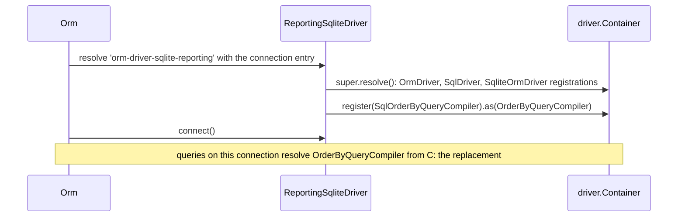

# Extending an existing dialect

Change how one shipped dialect writes SQL without writing a driver: subclass the driver (for example `SqliteOrmDriver`), register a different compiler or statement in its `resolve()`, and point one connection, or all of them, at the subclass. Everything else the dialect does stays.

## How it works

1. **Subclass the driver.** `class ReportingSqliteDriver extends SqliteOrmDriver`, decorated `@Injectable('<driver string>') @NewInstance()`.
2. **Override `resolve()`.** Call `super.resolve()` first. That runs `OrmDriver.resolve()` (child container), `SqlDriver.resolve()` (shared `Sql*` classes) and `SqliteOrmDriver.resolve()` (SQLite classes), in that order.
3. **Register the replacement.** `this.Container.register(MyCompiler).as(<token>)`. The container returns the last registration of a token, so yours wins.
4. **Select it per connection.** `Orm` resolves each connection's `Driver` string. A connection with `Driver: 'orm-driver-sqlite-reporting'` gets your subclass; connections with `Driver: 'orm-driver-sqlite'` keep the stock driver.
5. **Or replace the dialect everywhere.** `DI.register(ReportingSqliteDriver).as('orm-driver-sqlite')` before `Orm` boots makes every SQLite connection use the subclass.

Errors on the way: a `Driver` string with no registration throws `OrmException('ORM connection driver <Driver> not registerd')` at boot. A replacement registered before `super.resolve()` is overwritten and has no effect.



## Configuration

| Key | Type | Default | Allowed values | Meaning |
| --- | --- | --- | --- | --- |
| `db.Connections[].Driver` | `string` | none | any string a driver class is registered under | Selects the driver class for that connection. |

```ts
export default {
  db: {
    DefaultConnection: 'main',
    Connections: [
      { Driver: 'orm-driver-sqlite', Name: 'main', Filename: './data/app.sqlite' },
      { Driver: 'orm-driver-sqlite-reporting', Name: 'reporting', Filename: './data/reporting.sqlite' },
    ],
  },
};
```

## Services and extension points

What each driver package exports for subclassing:

| Package | Driver class | Driver string | Also exported |
| --- | --- | --- | --- |
| `@spinajs/orm-sqlite` | `SqliteOrmDriver` | `orm-driver-sqlite` | `SqliteServerResponseMapper`, `mapSqliteError`, every compiler (`SqliteInsertQueryCompiler`, `SqliteColumnCompiler`, `SqliteOrderByCompiler`, `SqliteCreateViewCompiler`, ...). Statements are not exported. |
| `@spinajs/orm-mysql` | `MySqlOrmDriver`, `MySqlSSHOrmDriver` | `orm-driver-mysql`, `orm-driver-mysql-ssh` | `MysqlServerResponseMapper`, `mapMySqlError`, `parseColumnDefault`, `IMySqlTransactionContext`. Compilers and statements are not exported. |
| `@spinajs/orm-mssql` | `MsSqlOrmDriver` | `orm-driver-mssql` | `mapMsSqlError`, `toNamedParameters`, `IMsSqlTransactionContext`. Compilers and statements are not exported. |
| `@spinajs/orm-postgres` | `PostgresOrmDriver` | `orm-driver-postgres` | every compiler and statement, `PostgresServerResponseMapper`, `mapPostgresError`, `parseUtcTimestamp`, `pgEscapeIdentifier`, `toPositionalParameters`, `toDriverStatement` |

What to extend for a replacement:

| You change | Extend | Register as |
| --- | --- | --- |
| A clause the dialect overrides | the dialect's exported class (`SqliteInsertQueryCompiler`) | its token |
| A clause the dialect takes from the shared layer | the `Sql*` class from `@spinajs/orm-sql` | its token |
| A dialect class that is not exported | the `Sql*` class it extends, re-implementing the dialect part | its token |
| How statements are sent | the driver class: override `executeOnDb()`, `isRetryableError()`, `logQuery()` | (the driver itself) |
| How the connection is opened | the driver class: override `poolConfig()` (PostgreSQL), `poolOptions()` (MySQL) or `connectionConfig()` (MSSQL) and spread `super`'s result, so the UTC session settings stay | (the driver itself) |

## Important behaviour

- A driver subclass is not registered under its parent's string: `@Injectable('orm-driver-sqlite')` decorates `SqliteOrmDriver` only. Give the subclass its own `@Injectable(...)` or register it with `DI.register(...).as(...)`.
- Registrations go to the subclass's own child container, so they affect only connections that use the subclass.
- Registering in the root container (`DI.register(MyCompiler).as(OrderByQueryCompiler)`) does not work for a token the dialect registers: the driver's child container answers first.
- A statement subclass must override `clone()`; otherwise a cloned query turns it back into the parent class. `SqlLiteJoinStatement` itself has no `clone()`, so a cloned SQLite join is a plain `SqlJoinStatement`. Subclasses of `SqlInStatement` and `SqlStartsWithStatement` that keep the parent's constructor are the exception: those `clone()` methods build `this.constructor`.
- `SqliteOrderByCompiler` renders a single sort (`getSort()`) with literal backticks. `orderBy('a').orderBy('b')` on SQLite orders by one column only; the shared `SqlOrderByQueryCompiler` renders every sort.
- `SqlLiteJoinStatement` throws `NotSupported` for `RIGHT` and `RIGHT OUTER` joins in its constructor.

## Best practices

- Give the subclass a driver string that names the change (`orm-driver-sqlite-reporting`), and use it only on the connections that need it.
- Replace one token per concern, and extend the class that is registered today, so the dialect's other fixes stay.
- Assert the registration in a test: `expect(driver.Container.resolve(OrderByQueryCompiler, [builder])).to.be.instanceOf(SqlOrderByQueryCompiler)`.
- Keep the replacement's constructor signature identical to the class it replaces; the compilers that resolve it pass fixed arguments.

## Patterns and antipatterns

```ts
// Don't: the stock driver's registration happens in super.resolve() and overwrites yours
public resolve() {
  this.Container.register(SqlOrderByQueryCompiler).as(OrderByQueryCompiler);
  super.resolve();
}

// Do
public resolve() {
  super.resolve();
  this.Container.register(SqlOrderByQueryCompiler).as(OrderByQueryCompiler);
}
```

```ts
// Don't: no @Injectable string; no connection can select this driver
export class ReportingSqliteDriver extends SqliteOrmDriver { /* ... */ }

// Do
@Injectable('orm-driver-sqlite-reporting')
@NewInstance()
export class ReportingSqliteDriver extends SqliteOrmDriver { /* ... */ }
```

## Examples

### Order by several columns on a SQLite reporting connection

```ts sample
import { Injectable, NewInstance } from '@spinajs/di';
import { OrderByQueryCompiler } from '@spinajs/orm';
import { SqlOrderByQueryCompiler } from '@spinajs/orm-sql';
import { SqliteOrmDriver } from '@spinajs/orm-sqlite';

@Injectable('orm-driver-sqlite-reporting')
@NewInstance()
export class ReportingSqliteDriver extends SqliteOrmDriver {
  public resolve() {
    super.resolve();

    // SqliteOrderByCompiler renders one sort; the shared compiler renders all of them, quoted
    this.Container.register(SqlOrderByQueryCompiler).as(OrderByQueryCompiler);
  }
}
```

### Allow `RIGHT JOIN` on SQLite 3.39 and later

SQLite supports `RIGHT JOIN` since 3.39.0. Register the shared join statement back in place of the SQLite one.

```ts sample
import { Injectable, NewInstance } from '@spinajs/di';
import { JoinStatement } from '@spinajs/orm';
import { SqlJoinStatement } from '@spinajs/orm-sql';
import { SqliteOrmDriver } from '@spinajs/orm-sqlite';

@Injectable('orm-driver-sqlite-339')
@NewInstance()
export class ModernSqliteDriver extends SqliteOrmDriver {
  public resolve() {
    super.resolve();
    this.Container.register(SqlJoinStatement).as(JoinStatement);
  }
}
```

### Match e-mail addresses case-insensitively in `whereIn()` on every SQLite connection

The stock `SqliteInStatement` binds a list longer than 1000 values as one `json_each(?)` parameter. This subclass of the shared `SqlInStatement` expands every list, so it suits short lists such as a handful of addresses.

```ts sample
import { DI, Injectable, NewInstance } from '@spinajs/di';
import { InStatement, IQueryStatementResult } from '@spinajs/orm';
import { SqlInStatement, _columnWrap } from '@spinajs/orm-sql';
import { SqliteOrmDriver } from '@spinajs/orm-sqlite';

@NewInstance()
export class NoCaseInStatement extends SqlInStatement {
  public build(): IQueryStatementResult {
    // a Wrapper.Text() column and the empty list keep the shared rendering
    if (typeof this._column !== 'string' || this._val.length === 0) {
      return super.build();
    }

    const column = _columnWrap(this.Quoter, this._column, this._builder.TableAlias);
    const convert = this.valueConverter();
    const values = this._val.map((v) => convert(v));

    return {
      Statements: [`${column} COLLATE NOCASE ${this._not ? 'NOT IN' : 'IN'} (${values.map(() => '?').join(',')})`],
      Bindings: values,
    };
  }

  // no clone() override: SqlInStatement.clone() builds this.constructor, so a clone stays a NoCaseInStatement
}

@Injectable('orm-driver-sqlite-nocase')
@NewInstance()
export class NoCaseSqliteDriver extends SqliteOrmDriver {
  public resolve() {
    super.resolve();
    this.Container.register(NoCaseInStatement).as(InStatement);
  }
}

// every connection configured with Driver: 'orm-driver-sqlite' now gets the subclass
DI.register(NoCaseSqliteDriver).as('orm-driver-sqlite');
```

## Related

- [Query compilers](02-query-compilers.md): the compiler tokens and what the shared classes emit.
- [Statements](03-statements.md): statement tokens and the `clone()` contract.
- [Adding a new SQL dialect](07-adding-a-sql-dialect.md#what-each-shipped-driver-registers): which class each driver registers for each token.
- [Connections](../orm/01-connections.md): `db.Connections` and driver strings.
- [`@spinajs/orm-sqlite`](../orm-sqlite/README.md), [`@spinajs/orm-mysql`](../orm-mysql/README.md), [`@spinajs/orm-mssql`](../orm-mssql/README.md): each dialect's own notes.
