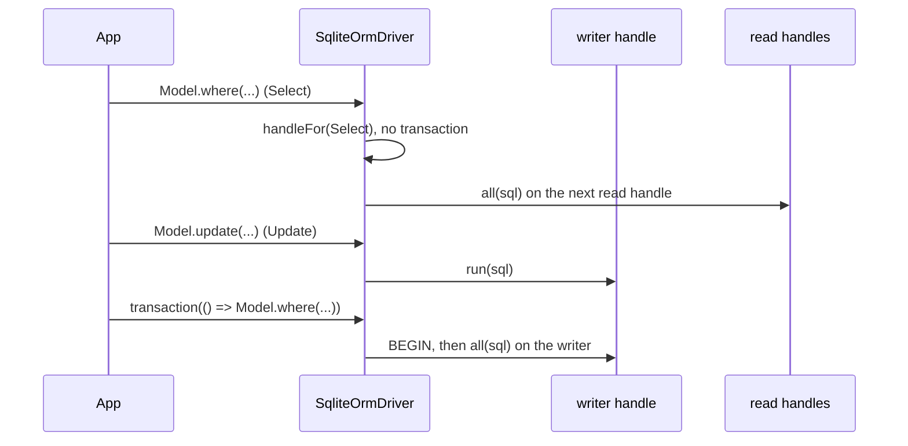

# Read handle pool

SQLite serializes writers at the file level, so a second writer handle buys nothing and invites `SQLITE_BUSY`. `SqliteOrmDriver` keeps one writer and uses `Pool.Max` to open `Max - 1` **read-only** handles, so concurrent `SELECT`s stop queueing behind each other and behind writes.

## How it works

1. **Open.** `connect()` calls `openReadPool(filename)` after the writer opened:
   1. Reads `Max` from `resolvedPoolOptions()`: `Pool.Max`, else the deprecated `PoolLimit`, else `10`.
   2. Closes any read handles still open.
   3. Stops when `Max <= 1`, or the trimmed filename is `:memory:` or `''`. Each handle on those would open its own private database.
   4. Opens `Max - 1` handles in parallel with `new sqlite3.Database(filename, sqlite3.OPEN_READONLY)`.
   5. Drops a handle that fails to open, with a `warn` log on `orm-driver-<Name>` (`could not open a read-only sqlite handle for <Name>`). The connection still works on the writer.
2. **Route.** `executeOnDb()` asks `handleFor(queryContext)` for a handle:
   1. No read handles, or a `QueryContext` other than `Select`: the writer.
   2. A transaction in scope (`TransactionStorage.getStore()` is set): the writer.
   3. Otherwise the next read handle, round-robin.
3. **Report.** `poolMetrics()` returns `{ Size: 1 + read handles, InUse: 0, Waiting: 0 }`, or `Size: 0` when disconnected. `sqlite3` queues per handle internally, so there is nothing to count in `InUse` or `Waiting`.
4. **Close.** `disconnect()` calls `closeReadPool()` before closing the writer.



## Configuration

| Key | Type | Default | Allowed values | Meaning |
| --- | --- | --- | --- | --- |
| `db.Connections[].Pool.Max` | `number` | `10` | `>= 1` | Writer plus read handles. `1` disables the read pool. |
| `db.Connections[].PoolLimit` | `number` | | | Deprecated; used when `Pool.Max` is absent. |

`Pool.Min`, `Pool.IdleTimeout` and `Pool.AcquireTimeout` are not read: every read handle opens at `connect()` and stays open until `disconnect()`.

```ts sample
import { FrameworkConfiguration } from '@spinajs/configuration';
import _ from 'lodash';

export class ReportingConfiguration extends FrameworkConfiguration {
  public async resolve(): Promise<void> {
    await super.resolve();

    this.Config = _.merge(this.Config, {
      db: {
        Connections: [
          // 1 writer + 7 read-only handles for a read-heavy dashboard
          { Name: 'main', Driver: 'orm-driver-sqlite', Filename: './data/app.sqlite', Pool: { Max: 8 } },
          // writer only
          { Name: 'jobs', Driver: 'orm-driver-sqlite', Filename: './data/jobs.sqlite', Pool: { Max: 1 } },
        ],
      },
    });
  }
}
```

## Services and extension points

| Service | DI token and lifetime | Default implementation | Alternatives | How to replace or extend |
| --- | --- | --- | --- | --- |
| Handle routing | `SqliteOrmDriver.handleFor(queryContext)`, protected method, per driver instance | writer for non-`Select` and transactions, round-robin read handles otherwise | none shipped | Override in a driver subclass; return `this.Db` or one of `this.ReadPool`. |
| Read pool lifecycle | `openReadPool(filename)`, `closeReadPool()`, protected methods | opens `Max - 1` `OPEN_READONLY` handles / closes them all | none shipped | Override in a driver subclass; call `super` and then adjust `this.ReadPool`. |
| Pool gauges | `poolMetrics()`, public method | `Size` = writer + read handles | | Override to report a different size. |

### Handle routing: custom implementation

Override `handleFor()` when some reads must see the writer's state: tables `ATTACH`ed on the writer, `TEMP` tables, or data a bulk job writes in many small autocommit steps. Call `super.handleFor()` for every other case, so transactions keep their guarantee.

```ts sample
import { Injectable, NewInstance } from '@spinajs/di';
import { QueryContext } from '@spinajs/orm';
import { SqliteOrmDriver } from '@spinajs/orm-sqlite';
import sqlite3 from 'sqlite3';

/** Sends every read to the writer while a nightly import runs, so readers never see a half-imported batch from another handle. */
@Injectable('orm-driver-sqlite-import-aware')
@NewInstance()
export class ImportAwareSqliteDriver extends SqliteOrmDriver {
  public ImportRunning = false;

  protected handleFor(queryContext: QueryContext): sqlite3.Database {
    if (this.ImportRunning) {
      return this.Db;
    }

    return super.handleFor(queryContext);
  }
}

export async function nightlyImport(driver: ImportAwareSqliteDriver, rows: Array<{ Sku: string; Qty: number }>) {
  driver.ImportRunning = true;
  try {
    for (const row of rows) {
      await driver.insert().into('stock').values(row);
    }
  } finally {
    driver.ImportRunning = false;
  }
}
```

### Read pool lifecycle: custom implementation

Override `openReadPool()` to configure each read handle as it opens, eg. to let reads wait longer than `sqlite3`'s default 1000 ms busy timeout before failing with `SQLITE_BUSY`.

```ts sample
import { Injectable, NewInstance } from '@spinajs/di';
import { SqliteOrmDriver } from '@spinajs/orm-sqlite';

@Injectable('orm-driver-sqlite-waiting-readers')
@NewInstance()
export class WaitingReadersSqliteDriver extends SqliteOrmDriver {
  protected async openReadPool(filename: string): Promise<void> {
    await super.openReadPool(filename);

    // wait up to 5 s for the writer's commit to finish instead of failing the SELECT
    this.ReadPool.forEach((handle) => handle.configure('busyTimeout', 5000));
  }
}
```

## Important behaviour

- Only `QueryContext.Select` goes to a read handle. `Upsert` and `InsertReturning`, which also read rows, stay on the writer.
- `tableInfo()` runs its `PRAGMA` queries as `Select`, so outside a transaction they use read handles too.
- Read handles see only committed data. A write made on the writer outside a transaction autocommits before it resolves, so a later read sees it.
- Read handles do not share the writer's connection state: `ATTACH DATABASE`, `TEMP` tables and per-connection `PRAGMA`s set through `schema().raw()` apply to the writer only.
- Handles open with `OPEN_READONLY` and no `OPEN_CREATE`. The writer opens first and creates the file.
- A handle that fails to open is skipped silently apart from the `warn` log. `poolMetrics().Size` shows how many opened.
- `connect()` reopens the pool on every call, closing the old read handles first.
- `sqlite3` gives every handle a 1000 ms busy timeout. A read blocked by the writer's commit for longer fails with `SQLITE_BUSY`; the driver does not retry it.

## Best practices

- Size `Pool.Max` for concurrent reads; writes do not benefit from it.
- Leave `Pool.Max` unset or `1` for `:memory:` databases. The driver ignores it there anyway.
- Run statements that change connection state (`ATTACH`, `PRAGMA`, `TEMP` tables) and the reads that depend on them inside one `driver.transaction()`, so both run on the writer.
- Watch `poolMetrics().Size` after start-up; a value below `Pool.Max` means some read handles failed to open.

## Patterns and antipatterns

```ts
// Don't: the SELECT may go to a read handle that never saw the TEMP table
await driver.schema().raw('CREATE TEMP TABLE report_ids (Id INTEGER)');
await driver.select().from('report_ids');

// Do: one transaction keeps both on the writer
await driver.transaction(async () => {
  await driver.schema().raw('CREATE TEMP TABLE report_ids (Id INTEGER)');
  return await driver.select().from('report_ids');
});
```

## Examples

### Check the pool after boot

```ts sample
import { DI } from '@spinajs/di';
import { Orm } from '@spinajs/orm';

export async function assertReadPool(expected: number) {
  const orm = await DI.resolve(Orm);
  const { Size } = orm.Connections.get('main')!.poolMetrics();

  if (Size < expected) {
    throw new Error(`sqlite read pool opened ${Size - 1} of ${expected - 1} read handles`);
  }
}
```

## Related

- [Connection and driver](01-connection.md): `connect()`, `executeOnDb()` and the other overridable members.
- [Transactions](03-transactions.md): why everything inside a transaction stays on the writer.
- [Observability and resilience](../orm/13-observability-and-resilience.md): the `orm_pool_size` gauge fed by `poolMetrics()`.
