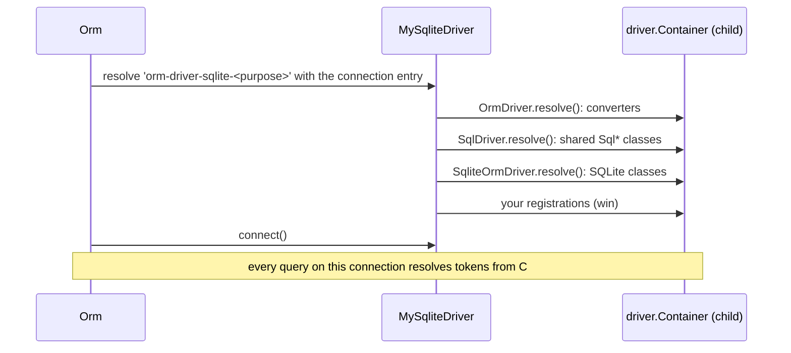

# Extending the driver

Every piece of SQL the SQLite driver writes comes from a class registered under a DI token in the connection's own child container. Subclass `SqliteOrmDriver`, register a replacement for any token after `super.resolve()`, and point one connection, or every SQLite connection, at the subclass. The other feature pages show one replacement each; this page is the full map.

## How it works

1. **Driver string.** `Orm` resolves each connection's `Driver` string from the root container. `@Injectable('orm-driver-sqlite')` maps that string to `SqliteOrmDriver`; `@NewInstance()` gives every connection its own instance.
2. **Child container.** `OrmDriver.resolve()` sets `this.Container = RootContainer.child()`. Every builder, compiler and statement of the connection resolves from it.
3. **Registration order.** `resolve()` runs `OrmDriver.resolve()`, then `SqlDriver.resolve()` (shared `Sql*` classes), then `SqliteOrmDriver.resolve()` (SQLite classes), then whatever your subclass adds after `super.resolve()`. The last registration of a token wins.
4. **Selecting the subclass.**
   - Per connection: decorate the subclass `@Injectable('orm-driver-sqlite-<purpose>')` and set that string in `Driver`.
   - Every SQLite connection: `DI.register(MySubclass).as('orm-driver-sqlite')` before `DI.resolve(Orm)`.
5. **Use.** Builders created on that connection resolve your class for the token. Other connections keep theirs.

A registration made **before** `super.resolve()` is overwritten. A token registered in the root container (`DI.register(X).as(OrderByQueryCompiler)`) loses to the driver's own registration in its child container.



### What `SqliteOrmDriver.resolve()` registers

| Token (from `@spinajs/orm`) | Implementation | Exported from `@spinajs/orm-sqlite` | Page |
| --- | --- | --- | --- |
| `ColumnQueryCompiler` | `SqliteColumnCompiler` | yes | [Schema and DDL](04-schema-and-ddl.md) |
| `AlterColumnQueryCompiler` | `SqliteAlterColumnQueryCompiler` (resolves `SqliteAddColumnCompiler` by class) | yes, both | [Schema and DDL](04-schema-and-ddl.md#alter-table-limitations) |
| `TableQueryCompiler` | `SqliteTableQueryCompiler` | yes | [Schema and DDL](04-schema-and-ddl.md) |
| `TruncateTableQueryCompiler` | `SqliteTruncateTableQueryCompiler` | yes | [Schema and DDL](04-schema-and-ddl.md#other-ddl) |
| `TableExistsCompiler` | `SqliteTableExistsCompiler` | yes | [Schema and DDL](04-schema-and-ddl.md#other-ddl) |
| `DefaultValueBuilder` | `SqlLiteDefaultValueBuilder` | yes | [Schema and DDL](04-schema-and-ddl.md#default-values) |
| `CreateDatabaseCompiler` | `SqliteCreateDatabaseQueryCompiler` (throws) | yes | [Schema and DDL](04-schema-and-ddl.md#other-ddl) |
| `DropDatabaseCompiler` | `SqliteDropDatabaseQueryCompiler` (throws) | yes | [Schema and DDL](04-schema-and-ddl.md#other-ddl) |
| `CreateViewCompiler` | `SqliteCreateViewCompiler` | yes | [Schema and DDL](04-schema-and-ddl.md#other-ddl) |
| `AlterTableQueryCompiler` | `SqlAlterTableQueryCompiler` (`@spinajs/orm-sql`) | | [Schema and DDL](04-schema-and-ddl.md) |
| `IndexQueryCompiler` | `SqliteIndexQueryCompiler` | yes | [Schema and DDL](04-schema-and-ddl.md#other-ddl) |
| `SqlExpressions` | `SqliteSqlExpressions` | yes | [SQL helpers](../orm/17-sql-helpers.md#dialect-expressions) |
| `EventQueryCompiler`, `DropEventQueryCompiler` | `UnsupportedEventQueryCompiler`, `UnsupportedDropEventQueryCompiler` (`@spinajs/orm-sql`, throw) | | [Schema and DDL](04-schema-and-ddl.md#other-ddl) |
| `InsertQueryCompiler` | `SqliteInsertQueryCompiler` | yes | [Inserts and upserts](05-inserts-and-upserts.md) |
| `OnDuplicateQueryCompiler` | `SqliteOnDuplicateQueryCompiler` | yes | [Inserts and upserts](05-inserts-and-upserts.md) |
| `ServerResponseMapper` | `SqliteServerResponseMapper` | yes | [Inserts and upserts](05-inserts-and-upserts.md) |
| `ModelToSqlConverter` | `SqliteModelToSqlConverter` | yes | [Inserts and upserts](05-inserts-and-upserts.md#model-serialization) |
| `OrderByQueryCompiler` | `SqliteOrderByCompiler` | yes | [Query dialect](06-query-dialect.md) |
| `JoinStatement` | `SqlLiteJoinStatement` | yes | [Query dialect](06-query-dialect.md) |
| `InSetStatement` | `SqliteInSetStatement` | yes | [Query dialect](06-query-dialect.md) |
| `LimitQueryCompiler` | `SqliteLimitQueryCompiler` | yes | [Query dialect](06-query-dialect.md) |
| `RecursiveQueryCompiler` | `SqlWithRecursiveCompiler` (`@spinajs/orm-sql`) | | [Query dialect](06-query-dialect.md) |
| `IdentifierQuoter` | `BacktickIdentifierQuoter` (`@spinajs/orm-sql`) | | [Query dialect](06-query-dialect.md) |
| `LiteralQuoter` | `SqlLiteralQuoter` (`@spinajs/orm-sql`) | | [Query dialect](06-query-dialect.md) |

Every other token (`SelectQueryCompiler`, `WhereStatement`, `DatetimeValueConverter`, ...) keeps the shared class `SqlDriver.resolve()` registered; see [What `SqlDriver.resolve()` registers](../orm-sql/01-sql-driver.md#what-sqldriverresolve-registers). `OrmDriver.resolve()` adds `StandardObjectToSqlConverter`, `JsonValueConverter`, `UuidConverter` and `UniversalValueConverter`.

Not registered at all: `TableCloneQueryCompiler` (no `CREATE TABLE ... LIKE`) and `TableHistoryQueryCompiler` (`SqliteTableQueryCompiler` refuses `trackHistory()` before it would be resolved).

## Configuration

| Key | Type | Default | Allowed values | Meaning |
| --- | --- | --- | --- | --- |
| `db.Connections[].Driver` | `string` | required | `orm-driver-sqlite` or any string a subclass is registered under | Selects the driver class for that connection. |

```ts
export default {
  db: {
    DefaultConnection: 'main',
    Connections: [
      { Name: 'main', Driver: 'orm-driver-sqlite', Filename: './data/app.sqlite' },
      { Name: 'reports', Driver: 'orm-driver-sqlite-reporting', Filename: './data/reports.sqlite', Pool: { Max: 8 } },
    ],
  },
};
```

## Services and extension points

| Service | DI token and lifetime | Default implementation | Alternatives | How to replace or extend |
| --- | --- | --- | --- | --- |
| Driver class | `'orm-driver-sqlite'` and `SqliteOrmDriver`, new instance per connection | `SqliteOrmDriver` | your subclasses | Own `@Injectable('<string>')` per subclass, or `DI.register(Sub).as('orm-driver-sqlite')` before `Orm` resolves. |
| Any dialect token | the token in the table above, in `driver.Container`, new instance per resolve | the table above | the `Sql*` class from `@spinajs/orm-sql`, or your subclass | `this.Container.register(Mine).as(<token>)` after `super.resolve()`. |
| Driver behaviour | protected / public members of `SqliteOrmDriver` | see [Connection and driver](01-connection.md#services-and-extension-points) | | Override in the subclass. |

What to extend for a replacement:

| You change | Extend | Register as |
| --- | --- | --- |
| A clause the SQLite driver overrides | that class, eg. `SqliteInsertQueryCompiler` | its token |
| A clause SQLite takes from the shared layer | the `Sql*` class from `@spinajs/orm-sql` | its token |
| How statements are sent, routed, opened | `SqliteOrmDriver` itself | (the driver string) |

### Driver class: custom implementation

A reporting connection that enforces foreign keys and waits longer for locks; registered under its own string and checked in a test.

```ts sample
import { DI, Injectable, NewInstance } from '@spinajs/di';
import { OrmDriver, QueryContext } from '@spinajs/orm';
import { SqliteOrmDriver } from '@spinajs/orm-sqlite';

@Injectable('orm-driver-sqlite-reporting')
@NewInstance()
export class ReportingSqliteDriver extends SqliteOrmDriver {
  public async connect(): Promise<OrmDriver> {
    await super.connect();

    await this.executeOnDb('PRAGMA foreign_keys = ON', [], QueryContext.Schema);
    this.Db.configure('busyTimeout', 5000);
    this.ReadPool.forEach((handle) => handle.configure('busyTimeout', 5000));

    return this;
  }
}

/** Fails fast at boot when a refactor drops a registration. */
export function assertReportingDialect(driver: OrmDriver) {
  if (!(driver instanceof ReportingSqliteDriver)) {
    throw new Error(`connection ${driver.Options.Name} uses ${driver.constructor.name}, expected ReportingSqliteDriver`);
  }

  if (!(DI.resolve<OrmDriver>('OrmConnection', ['reports']) instanceof ReportingSqliteDriver)) {
    throw new Error('the reports connection is not configured with Driver: orm-driver-sqlite-reporting');
  }
}
```

### Every SQLite connection: custom implementation

Replace the driver for every connection whose `Driver` is `orm-driver-sqlite`, eg. to enforce foreign keys application-wide.

```ts sample
import { DI, Injectable, NewInstance } from '@spinajs/di';
import { Orm, OrmDriver, QueryContext } from '@spinajs/orm';
import { SqliteOrmDriver } from '@spinajs/orm-sqlite';

@Injectable()
@NewInstance()
export class ForeignKeysEverywhereDriver extends SqliteOrmDriver {
  public async connect(): Promise<OrmDriver> {
    await super.connect();
    await this.executeOnDb('PRAGMA foreign_keys = ON', [], QueryContext.Schema);
    return this;
  }
}

export async function boot() {
  // must run before Orm resolves: Orm reads the registration when it creates connections
  DI.register(ForeignKeysEverywhereDriver).as('orm-driver-sqlite');
  return await DI.resolve(Orm);
}
```

## Important behaviour

- A subclass is not registered under its parent's string. Without its own `@Injectable('<string>')` or a `DI.register(...).as(...)`, no connection can select it.
- Registrations go to the subclass's child container, so they affect only connections that use the subclass.
- `SqlJoinStatement.build()` refuses to join models whose drivers have different class names (`Cannot join models with different drivers`). Models on a subclass connection cannot be joined with models on a stock `orm-driver-sqlite` connection.
- The replacement keeps the constructor signature of the class it replaces; builders pass fixed constructor arguments (see each page's services table).
- A statement subclass must override `clone()`, or a cloned query turns it back into the parent class.
- `@Injectable(...)` also registers the class under itself, so `DI.resolve(MySubclass)` works in tests.

## Best practices

- Name the driver string after the change (`orm-driver-sqlite-reporting`), and use it only where needed.
- Extend the class that is registered today, so the SQLite fixes it carries stay.
- Assert the replacement in a test: `expect(driver.Container.resolve(OrderByQueryCompiler, [builder])).to.be.instanceOf(SqlOrderByQueryCompiler)`.
- Register a global replacement in the same module that resolves `Orm`, before the resolve.

## Patterns and antipatterns

```ts
// Don't: super.resolve() runs SqliteOrmDriver.resolve(), which overwrites your registration
public resolve() {
  this.Container.register(SqlOrderByQueryCompiler).as(OrderByQueryCompiler);
  super.resolve();
}

// Do
public resolve() {
  super.resolve();
  this.Container.register(SqlOrderByQueryCompiler).as(OrderByQueryCompiler);
}
```

```ts
// Don't: the root registration never reaches a SQLite connection; its child container answers first
DI.register(SqlOrderByQueryCompiler).as(OrderByQueryCompiler);

// Do: register inside a driver subclass
this.Container.register(SqlOrderByQueryCompiler).as(OrderByQueryCompiler);
```

## Examples

### Turn a SQLite-specific limitation into a loud error

`truncate()` on SQLite keeps the `AUTOINCREMENT` counter. A test database that must restart keys can refuse `truncate()` and point to the fix.

```ts sample
import { Injectable, NewInstance } from '@spinajs/di';
import { InvalidOperation } from '@spinajs/exceptions';
import { ICompilerOutput, TruncateTableQueryCompiler } from '@spinajs/orm';
import { SqliteOrmDriver, SqliteTruncateTableQueryCompiler } from '@spinajs/orm-sqlite';

@NewInstance()
export class RefusingTruncateCompiler extends SqliteTruncateTableQueryCompiler {
  public compile(): ICompilerOutput {
    throw new InvalidOperation(`truncate of ${this.builder.Table} keeps its AUTOINCREMENT counter on sqlite; drop and recreate the table instead`);
  }
}

@Injectable('orm-driver-sqlite-test')
@NewInstance()
export class TestSqliteDriver extends SqliteOrmDriver {
  public resolve() {
    super.resolve();
    this.Container.register(RefusingTruncateCompiler).as(TruncateTableQueryCompiler);
  }
}
```

## Related

- [Extending an existing dialect](../orm-sql/08-extending-an-existing-dialect.md): the same mechanism across all dialects.
- [Adding a new SQL dialect](../orm-sql/07-adding-a-sql-dialect.md#what-each-shipped-driver-registers): what each shipped driver registers per token.
- [Injecting your own builders](../orm-sql/09-injecting-your-own-builders.md): replace `SelectQueryBuilder` and other builders per connection.
- [Connections](../orm/01-connections.md): driver strings and `db.Connections`.
