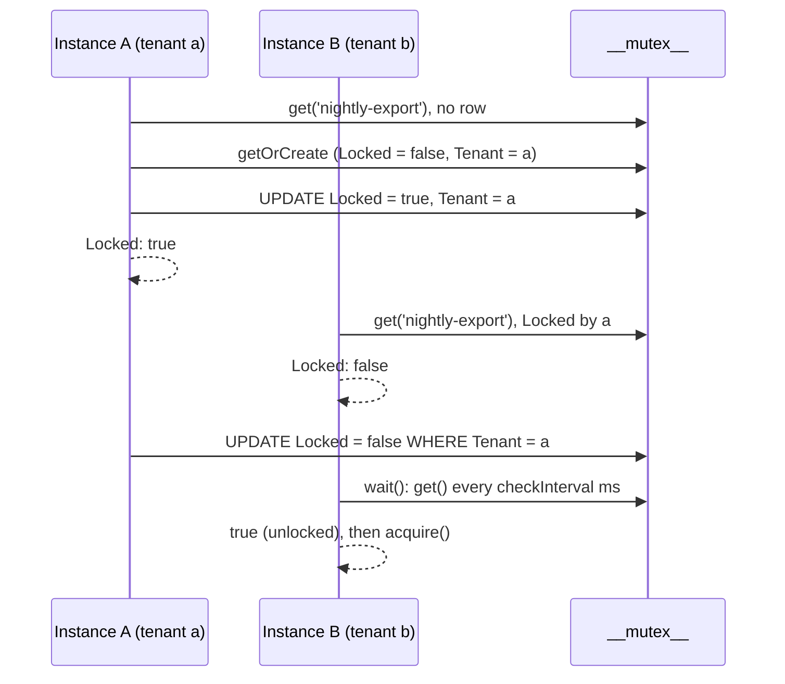

# Database mutex

`OrmMutex` implements the abstract `Mutex` from `@spinajs/threading` on top of the `__mutex__` table. Use it to let one process at a time run a job, such as a scheduled task or an import, when several app instances share one database.

A lock is a row: its `Name`, the `Tenant` that owns it, and a `Locked` flag. The tenant is the identity of the holder; only the same tenant can release or delete the lock.

## How it works

### Setup

1. Your startup code calls `DI.register(OrmMutex).as(Mutex)`. The package registers nothing in DI by itself.
2. Importing `@spinajs/orm-threading` registers the `__mutex__` model under `__models__` (`@Model`) and the `Mutex_2024_12_03_11_41_00` migration under `__migrations__` (`@Migration`).
3. `Orm.resolve()` runs the migration on the `default` connection when that connection has `Migration.OnStartup: true`, which creates the `__mutex__` table.
4. The first `mutex_*` helper call, or `DI.resolve(Mutex)`, builds one `OrmMutex` (singleton, the DI default).

Every method trims `Name` and throws `InvalidArgument` for an empty name. An empty or missing `Tenant` becomes `app.name`.

### `acquire(options)`

1. `OrmMutex.acquire()` reads the row with `this.get(options.Name)`.
2. When there is no row, it calls `this.create(options)`, which inserts an unlocked row owned by the tenant.
3. When the row is locked by another tenant, it returns `{ Locked: false, Mutex: null }` without writing.
4. Otherwise it runs `UPDATE __mutex__ SET Locked = true, Tenant = <tenant>, Updated_at = <now>` as a compare-and-set on the state read in step 1: `WHERE Name = <name> AND Locked = false` for a free row, `WHERE Name = <name> AND Tenant = <tenant>` for a row the tenant already holds.
5. It returns `Locked: true` when that update changed exactly one row, with `Mutex` set to the lock as it is now (`Locked: true`, the new `Tenant` and `Updated_at`). When another tenant got there first, the update changes nothing and it returns `{ Locked: false, Mutex: null }`.

The same tenant acquiring a lock it already holds gets `Locked: true` again. The lock is not counted: one `release()` frees it.

### `release(options, deleteOnClose?)`

1. Without `deleteOnClose`: `UPDATE __mutex__ SET Locked = false, Updated_at = <now> WHERE Name = <name> AND Tenant = <tenant>`.
2. With `deleteOnClose: true`: `DELETE FROM __mutex__ WHERE Name = <name> AND Tenant = <tenant>`.
3. It returns `true` when exactly one row changed. Another tenant's release changes nothing and returns `false`.

### `wait(name, timeout?)`

1. `OrmMutex.wait()` starts a `setInterval` with `threading.mutex.checkInterval` ms.
2. On each tick it reads the row with `this.get(name)`.
3. It resolves `true` when the row is unlocked, and `false` when `timeout` ms have passed.
4. A name with no row, or one deleted while waiting, counts as free: it resolves `true`.
5. It rejects when the read throws.

`wait()` does not take the lock. Call `acquire()` after it resolves.

### `create`, `delete`, `get`

| Method | SQL | Returns |
| --- | --- | --- |
| `create(options)` | `__mutex__.getOrCreate(name, { Name, Tenant })` | The row as a plain object (`dehydrate()`). An existing row is returned as is, owner unchanged. |
| `delete(options)` | `DELETE ... WHERE Name = <name> AND Tenant = <tenant> AND Locked = false` | `true` when one row was deleted. A locked row is kept and the call returns `false`. |
| `get(name)` | `__mutex__.get(name)` | The `__mutex__` model instance, or `undefined` when there is no row. |



## Configuration

| Key | Type | Default | Allowed values | Meaning |
| --- | --- | --- | --- | --- |
| `app.name` | `string` | `'spina-js'` when the key is unset | any string up to 32 characters | Tenant used when `options.Tenant` is empty. `@spinajs/configuration` ships `app.name: 'spinajs'`, so that is the usual value. |
| `threading.mutex.checkInterval` | `number` | `500` | ms, greater than `0` | Poll interval of `wait()`. Read once per `wait()` call. |

Both are read through `@Config` getters on every access, so a config reload applies to the next call. See [Injecting config values](../configuration/07-injecting-config-values.md).

```ts
this.Config = _.merge(this.Config, {
  app: { name: 'billing' },
  threading: {
    mutex: { checkInterval: 250 },
  },
});
```

## Schema

`OrmMutex` reads and writes the `__mutex__` table; see [Mutex table and migration](03-mutex-table-and-migration.md#schema).

## Services and extension points

| Service | DI token and lifetime | Default implementation | Alternatives | How to replace or extend |
| --- | --- | --- | --- | --- |
| `Mutex` | `Mutex` class from `@spinajs/threading`; singleton (the DI default) | none: resolving it unregistered builds the abstract class | `OrmMutex` (this package) | `DI.register(OrmMutex).as(Mutex)`, or a subclass or your own class. See [Custom mutex backends](02-custom-mutex-backends.md). |
| `__mutex__` model | `__models__` list, registered by `@Model` on import | `__mutex__` | none | See [Mutex table and migration](03-mutex-table-and-migration.md). |

## Important behaviour

- **No expiry.** A lock stays held until its tenant releases it. A process that crashes while holding a lock leaves it locked forever; clean it up by hand or with a job, see [Release stale locks](03-mutex-table-and-migration.md#release-stale-locks).
- **`acquire()` is a compare-and-set.** Of two tenants that read a free row at the same moment, only the one whose `UPDATE ... WHERE Locked = false` changes the row gets `Locked: true`.
- **The default tenant is shared.** Every process of one app has the same `app.name`, so without an explicit `Tenant` they all count as the same owner: a second process acquires a lock the first one holds. Pass a per-process `Tenant`.
- An unlocked row owned by another tenant is taken over: `acquire()` writes the new `Tenant`.
- `LockResult.Mutex` is a plain `MutexLock` with the state after the update. It is `null` when the lock was not granted.
- `release()` of an unlocked row by its owner returns `true`.
- `delete()` refuses a locked row, even the caller's own; release it first, or use `release(..., true)`, which deletes the owner's row whether it is locked or not.
- `wait()` polls the database; the first check runs after one interval, not immediately. Without `timeout`, or with `0`, it waits forever.
- `wait()` on a name with no row, or one deleted while waiting, resolves `true`.
- `Name` and `Tenant` are `VARCHAR(32)` columns. Longer values are truncated or rejected, depending on the database.
- `get()` returns `undefined`, not `null`, for a missing lock, and a model instance rather than a plain `MutexLock`.
- `acquire()` and `release()` set `Updated_at`, so a lock's age is the time since it was last taken or released.

## Best practices

- Always pass `Tenant`, and make it unique per process: `` `${hostname()}:${process.pid}` ``. Keep it under 32 characters.
- Release in a `finally` block, with the same `Name` and `Tenant` you acquired with.
- Treat `wait()` as a hint and follow it with `acquire()`; another process can take the lock between the two.
- Register `OrmMutex` (or your subclass) before anything resolves `Mutex`.
- For short critical sections inside one process, use `criticalSection()` from `@spinajs/threading` instead: it needs no database.

## Patterns and antipatterns

```ts
// Don't: no Tenant, so every instance of the app is the same owner and all of them get the lock
const lock = await mutex_acquire({ Name: 'nightly-export' });

// Do: one tenant per process
const tenant = `${hostname()}:${process.pid}`.slice(0, 32);
const lock = await mutex_acquire({ Name: 'nightly-export', Tenant: tenant });
```

```ts
// Don't: release with a different options object; the tenant falls back to app.name and nothing is released
await mutex_acquire({ Name: 'nightly-export', Tenant: tenant });
await mutex_release({ Name: 'nightly-export' });

// Do: keep one options object for both calls
const options = { Name: 'nightly-export', Tenant: tenant };
await mutex_acquire(options);
await mutex_release(options);
```

## Examples

### Run the nightly invoice export on one instance only

Each app instance runs the same scheduler; only the one that gets the lock exports.

```ts sample
import { hostname } from 'node:os';
import { DI } from '@spinajs/di';
import { Mutex, mutex_acquire, mutex_release } from '@spinajs/threading';
import { OrmMutex } from '@spinajs/orm-threading';

DI.register(OrmMutex).as(Mutex);

const tenant = `${hostname()}:${process.pid}`.slice(0, 32);

export async function nightlyInvoiceExport(exportInvoices: () => Promise<number>): Promise<number | null> {
  const options = { Name: 'nightly-invoice-export', Tenant: tenant };

  const lock = await mutex_acquire(options);
  if (!lock.Locked) {
    return null;
  }

  try {
    return await exportInvoices();
  } finally {
    await mutex_release(options);
  }
}
```

### Wait for a running price import before reading prices

A report waits up to 30 seconds for the importer to finish, then reads.

```ts sample
import { mutex_get, mutex_wait } from '@spinajs/threading';

export async function readPricesAfterImport(readPrices: () => Promise<number[]>): Promise<number[]> {
  const importLock = await mutex_get('price-import');

  if (importLock && importLock.Locked) {
    const released = await mutex_wait('price-import', 30_000);
    if (!released) {
      throw new Error('Price import still running after 30 s');
    }
  }

  return readPrices();
}
```

### Inject the mutex into a service

```ts sample
import { hostname } from 'node:os';
import { AsyncService, Autoinject, DI } from '@spinajs/di';
import { Mutex } from '@spinajs/threading';
import { OrmMutex } from '@spinajs/orm-threading';

DI.register(OrmMutex).as(Mutex);

export class StockRecalculation extends AsyncService {
  @Autoinject(Mutex)
  protected Locks: Mutex;

  protected readonly tenant = `stock:${hostname()}`.slice(0, 32);

  public async recalculate(warehouse: string, run: () => Promise<void>): Promise<boolean> {
    const options = { Name: `stock-${warehouse}`, Tenant: this.tenant };
    const lock = await this.Locks.acquire(options);

    if (!lock.Locked) {
      return false;
    }

    try {
      await run();
    } finally {
      await this.Locks.release(options);
    }

    return true;
  }
}
```

## Related

- [Custom mutex backends](02-custom-mutex-backends.md): set a per-process tenant, or swap the backend.
- [Mutex table and migration](03-mutex-table-and-migration.md): the table behind every lock.
- [`@spinajs/threading`](../threading/README.md): the `Mutex` contract, the `mutex_*` helpers and `criticalSection()`.
- [Connections](../orm/01-connections.md): `db.DefaultConnection`, the connection the table lives on.
