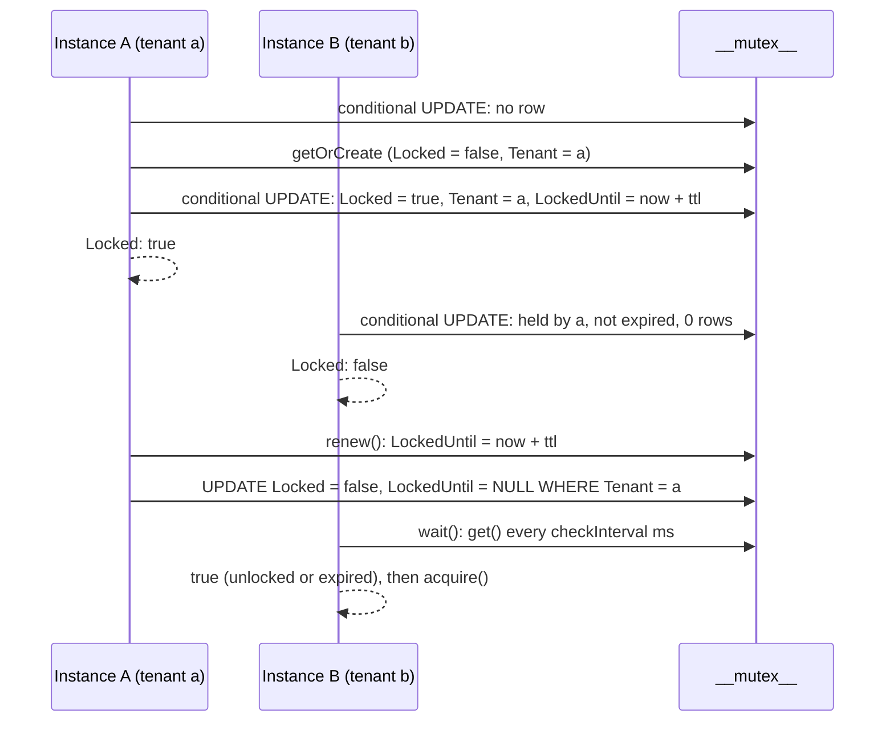

# Database mutex

`OrmMutex` implements the abstract `Mutex` from `@spinajs/threading` on top of the `__mutex__` table. Use it to let one process at a time run a job, such as a scheduled task or an import, when several app instances share one database.

A lock is a row: its `Name`, the `Tenant` that owns it, a `Locked` flag and an optional expiry, `LockedUntil`. The tenant is the identity of the holder; only the same tenant can release, renew or delete the lock. By default the tenant is the identity of the current process, so replicas of one app exclude each other without any setup.

## How it works

### Setup

1. Your startup code calls `DI.register(OrmMutex).as(Mutex)`. The package registers nothing in DI by itself.
2. Importing `@spinajs/orm-threading` registers the `__mutex__` model under `__models__` (`@Model`) and the `Mutex_2024_12_03_11_41_00` migration under `__migrations__` (`@Migration`).
3. `Orm.resolve()` runs the migration on the `default` connection when that connection has `Migration.OnStartup: true`, which creates the `__mutex__` table.
4. The first `mutex_*` helper call, or `DI.resolve(Mutex)`, builds one `OrmMutex` (singleton, the DI default).

Every method trims `Name` and throws `InvalidArgument` for an empty name. An empty or missing `Tenant` becomes `threading.mutex.tenant`, or, when that is empty, `processIdentity()` from `@spinajs/threading`: `<host>:<pid>:<random>`, at most 32 characters, generated once per process. A missing `ttl` becomes `threading.mutex.ttl`; a negative or non-finite `ttl` throws `InvalidArgument`.

### `acquire(options)`

1. `OrmMutex.acquire()` reads "now" from the database clock (see [Clock](#clock)).
2. It runs one conditional update: `UPDATE __mutex__ SET Locked = true, Tenant = <tenant>, LockedUntil = <now + ttl, or NULL for ttl 0>, Updated_at = <now> WHERE Name = <name> AND (Locked = false OR Tenant = <tenant> OR LockedUntil < <now>)`.
3. When that changed no row and the row does not exist, it inserts an unlocked row with `this.create()` and runs the update again. When a concurrent `acquire()` inserted the row first, the insert error is swallowed and the second update decides.
4. It returns `Locked: true` when the update changed exactly one row, `Locked: false` otherwise. `Mutex` is a plain `MutexLock` with the row as it is after the update; when the lock was not granted it shows the holder's `Tenant` and `LockedUntil`.

The update is atomic per row on every driver, so of many tenants racing for a free or expired lock exactly one wins. The same tenant acquiring a lock it already holds gets `Locked: true` again and moves `LockedUntil` forward. The lock is not counted: one `release()` frees it.

### `renew(options)`

`UPDATE __mutex__ SET LockedUntil = <now + ttl> WHERE Name = <name> AND Tenant = <tenant> AND Locked = true`. It returns `true` when the tenant still holds the lock, and `false` when the lock was released, or taken over by another tenant after it expired. It never takes a lock. Call it every `ttl / 3` or so while long work runs.

### `release(options, deleteOnClose?)`

1. Without `deleteOnClose`: `UPDATE __mutex__ SET Locked = false, LockedUntil = NULL, Updated_at = <now> WHERE Name = <name> AND Tenant = <tenant>`.
2. With `deleteOnClose: true`: `DELETE FROM __mutex__ WHERE Name = <name> AND Tenant = <tenant>`.
3. It returns `true` when exactly one row changed. Another tenant's release changes nothing and returns `false`.

### `wait(name, timeout?)`

1. `OrmMutex.wait()` starts a `setInterval` with `threading.mutex.checkInterval` ms.
2. On each tick it reads the row with `this.get(name)`.
3. It resolves `true` when the row is unlocked or its `LockedUntil` has passed on the database clock, and `false` when `timeout` ms have passed.
4. A name with no row, or one deleted while waiting, counts as free: it resolves `true`.
5. It rejects when the read throws.

### Clock

Expiry is compared against the database clock, so replicas whose clocks drift apart still agree on when a lock expired. `dbNowMs(driver)`, exported by the package, reads epoch milliseconds with one `SELECT` on SQLite, MySQL and PostgreSQL. Other drivers, such as MSSQL, fall back to the app clock (`Date.now()`). `LockedUntil` is stored as epoch milliseconds in a `BIGINT`, not as a datetime, so no time zone conversion is involved.

`wait()` does not take the lock. Call `acquire()` after it resolves.

### `create`, `delete`, `get`

| Method | SQL | Returns |
| --- | --- | --- |
| `create(options)` | `__mutex__.getOrCreate(name, { Name, Tenant })` | The row as a plain object (`dehydrate()`). An existing row is returned as is, owner unchanged. |
| `delete(options)` | `DELETE ... WHERE Name = <name> AND Tenant = <tenant> AND Locked = false` | `true` when one row was deleted. A locked row is kept and the call returns `false`. |
| `get(name)` | `__mutex__.get(name)` | The `__mutex__` model instance, or `undefined` when there is no row. `LockedUntil` is converted to a `number`; PostgreSQL returns `BIGINT` as a string. |



## Configuration

| Key | Type | Default | Allowed values | Meaning |
| --- | --- | --- | --- | --- |
| `threading.mutex.tenant` | `string` | `''` | any string up to 32 characters | Tenant used when `options.Tenant` is empty. Empty means `processIdentity()`, one per process. Setting one value on every replica makes them share the tenant, so they no longer exclude each other. |
| `threading.mutex.ttl` | `number` | `0` | ms, `0` or greater | Lock lifetime when `options.ttl` is not passed. `0` means the lock never expires. |
| `threading.mutex.checkInterval` | `number` | `500` | ms, greater than `0` | Poll interval of `wait()`. Read once per `wait()` call. |

All three are read through `@Config` getters on every access, so a config reload applies to the next call. See [Injecting config values](../configuration/07-injecting-config-values.md).

```ts
this.Config = _.merge(this.Config, {
  threading: {
    mutex: { ttl: 5 * 60 * 1000, checkInterval: 250 },
  },
});
```

## Schema

`OrmMutex` reads and writes the `__mutex__` table; see [Mutex table and migration](03-mutex-table-and-migration.md#schema).

## Services and extension points

| Service | DI token and lifetime | Default implementation | Alternatives | How to replace or extend |
| --- | --- | --- | --- | --- |
| `Mutex` | `Mutex` class from `@spinajs/threading`; singleton (the DI default) | none: resolving it unregistered builds the abstract class | `OrmMutex` (this package) | `DI.register(OrmMutex).as(Mutex)`, or a subclass or your own class. See [Custom mutex backends](02-custom-mutex-backends.md). |
| `__mutex__` model | `__models__` list, registered by `@Model` on import | `__mutex__` | none | See [Mutex table and migration](03-mutex-table-and-migration.md). |

## Important behaviour

- **Expiry is opt-in.** With `ttl: 0`, the default, a lock stays held until its tenant releases it, and a process that crashes while holding it leaves it locked; see [Release stale locks](03-mutex-table-and-migration.md#release-stale-locks). With a `ttl`, another tenant may take the lock once `LockedUntil` has passed. Keep long work alive with `renew()`.
- **`acquire()` is one conditional `UPDATE`.** Whoever changes the row owns the lock, so racing tenants cannot both win.
- **The default tenant is per process.** Replicas exclude each other without passing `Tenant`. Concurrent callers inside one process share that tenant and do **not** exclude each other; give them distinct tenants, or use `criticalSection()`.
- An unlocked or expired row owned by another tenant is taken over: `acquire()` writes the new `Tenant`.
- `LockResult.Mutex` is a plain `MutexLock` with the row as it is after the update, also when the lock was not granted.
- `renew()` with `ttl: 0` sets `LockedUntil = NULL`: the lock stops expiring.
- `release()` of an unlocked row by its owner returns `true`.
- `delete()` refuses a locked row, even the caller's own; release it first, or use `release(..., true)`, which deletes the owner's row whether it is locked or not.
- `wait()` polls the database; the first check runs after one interval, not immediately. Without `timeout`, or with `0`, it waits forever.
- `wait()` on a name with no row, or one deleted while waiting, resolves `true`.
- `Name` and `Tenant` are `VARCHAR(32)` columns. Longer values are truncated or rejected, depending on the database.
- `get()` returns `undefined`, not `null`, for a missing lock, and a model instance rather than a plain `MutexLock`.
- `acquire()` and `release()` set `Updated_at`, so a lock's age is the time since it was last taken or released.

## Best practices

- Leave `Tenant` out unless several callers in one process must exclude each other; then pass a distinct tenant per caller, under 32 characters.
- Pass a `ttl` longer than a normal run, and `renew()` every `ttl / 3` while the work runs, so a crashed process frees the lock within one `ttl`.
- Release in a `finally` block, with the same `Name` and `Tenant` you acquired with.
- Treat `wait()` as a hint and follow it with `acquire()`; another process can take the lock between the two.
- Register `OrmMutex` (or your subclass) before anything resolves `Mutex`.
- For short critical sections inside one process, use `criticalSection()` from `@spinajs/threading` instead: it needs no database.

## Patterns and antipatterns

```ts
// Don't: one fixed tenant on every replica; they all count as the same owner and all of them get the lock
config.set('threading.mutex.tenant', 'billing');

// Do: leave threading.mutex.tenant empty, so every process is its own tenant
const lock = await mutex_acquire({ Name: 'nightly-export' });
```

```ts
// Don't: release with a different options object; the tenant falls back to the process identity and nothing is released
await mutex_acquire({ Name: 'nightly-export', Tenant: tenant });
await mutex_release({ Name: 'nightly-export' });

// Do: keep one options object for both calls
const options = { Name: 'nightly-export', Tenant: tenant };
await mutex_acquire(options);
await mutex_release(options);
```

## Examples

### Run the nightly invoice export on one instance only

Each app instance runs the same scheduler; only the one that gets the lock exports. The lock expires a minute after its last renew, so an instance that dies mid-export blocks the next run for at most a minute.

```ts sample
import { DI } from '@spinajs/di';
import { Mutex, mutex_acquire, mutex_release, mutex_renew } from '@spinajs/threading';
import { OrmMutex } from '@spinajs/orm-threading';

DI.register(OrmMutex).as(Mutex);

export async function nightlyInvoiceExport(exportInvoices: () => Promise<number>): Promise<number | null> {
  const options = { Name: 'nightly-invoice-export', ttl: 60_000 };

  const lock = await mutex_acquire(options);
  if (!lock.Locked) {
    return null;
  }

  const heartbeat = setInterval(() => void mutex_renew(options), 20_000);
  try {
    return await exportInvoices();
  } finally {
    clearInterval(heartbeat);
    await mutex_release(options);
  }
}
```

### Wait for a running price import before reading prices

A report waits up to 30 seconds for the importer to finish, then reads.

```ts sample
import { mutex_get, mutex_wait } from '@spinajs/threading';

export async function readPricesAfterImport(readPrices: () => Promise<number[]>): Promise<number[]> {
  const importLock = await mutex_get('price-import');

  if (importLock && importLock.Locked) {
    const released = await mutex_wait('price-import', 30_000);
    if (!released) {
      throw new Error('Price import still running after 30 s');
    }
  }

  return readPrices();
}
```

### Inject the mutex into a service

Two recalculations of one warehouse can be requested at once inside one process, so each call passes its own tenant.

```ts sample
import { randomUUID } from 'node:crypto';
import { AsyncService, Autoinject, DI } from '@spinajs/di';
import { Mutex } from '@spinajs/threading';
import { OrmMutex } from '@spinajs/orm-threading';

DI.register(OrmMutex).as(Mutex);

export class StockRecalculation extends AsyncService {
  @Autoinject(Mutex)
  protected Locks: Mutex;

  public async recalculate(warehouse: string, run: () => Promise<void>): Promise<boolean> {
    // 32 hex characters, the size of the Tenant column
    const options = { Name: `stock-${warehouse}`, Tenant: randomUUID().replace(/-/g, '') };
    const lock = await this.Locks.acquire(options);

    if (!lock.Locked) {
      return false;
    }

    try {
      await run();
    } finally {
      await this.Locks.release(options);
    }

    return true;
  }
}
```

## Related

- [Custom mutex backends](02-custom-mutex-backends.md): extend `OrmMutex`, or swap the backend.
- [Mutex table and migration](03-mutex-table-and-migration.md): the table behind every lock.
- [`@spinajs/threading`](../threading/README.md): the `Mutex` contract, the `mutex_*` helpers and `criticalSection()`.
- [Connections](../orm/01-connections.md): `db.DefaultConnection`, the connection the table lives on.
