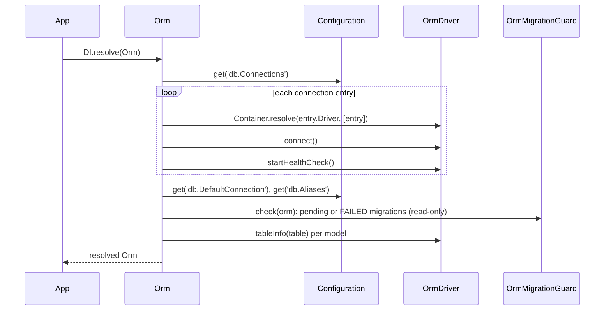

# Connections

`Orm` is the async service that boots the ORM: it opens every connection listed in `db.Connections`, binds each model to its connection and makes model static methods usable. It never migrates: through [`OrmMigrationGuard`](10-migrations.md#boot-check-diresolveorm) it checks that no migration is pending or failed, and refuses to boot while one is. Migrations run from `npx spinajs migrate-up`, a deploy step. Each connection is an `OrmDriver` instance supplied by a dialect package. Resolve `Orm` once at boot, before any model is queried.

## How it works

1. `DI.resolve(Orm)` constructs the `Orm` singleton and calls `Orm.resolve()`.
2. `Orm.resolve()` reads `db.Connections` from `Configuration`. For each entry, in order:
   1. It checks that a class is registered in DI under the token in `Driver`. If not, it throws `OrmException` (`ORM connection driver <Driver> not registerd`).
   2. It resolves the driver with the entry as constructor argument. The `OrmDriver` constructor merges the entry over its defaults, and `OrmDriver.resolve()` creates the driver's own child DI container and logger (`orm-driver-<Name>`). A resolve failure throws `OrmException` with the original error as `inner`.
   3. It calls `driver.connect()`. On failure it calls `driver.disconnect()` to release resources, then throws `OrmException` (`Failed to connect to database for connection <Name> ...`) with the original error as `inner`.
   4. It stores the driver in `Orm.Connections` under `Name` and calls `driver.startHealthCheck()` (see [Observability and resilience](13-observability-and-resilience.md)).
3. If `db.DefaultConnection` is set, the named driver is also stored under `default`. An unknown name throws `InvalidOperation`.
4. Every entry of `db.Aliases` stores an existing driver under an extra name. An alias whose target is not in `Orm.Connections` is skipped with a warning; its models then behave as models on an unknown connection (step 9), and its migrations are skipped.
5. `Orm` registers the `OrmConnection` factory in DI: `DI.resolve<OrmDriver>('OrmConnection', [name])` returns the driver stored under `name`, or `null`.
6. `Orm` discovers migrations (see [Migrations](10-migrations.md)) and registers every class decorated with `@Model` into `Orm.Models`.
7. `Orm` registers the default value converters.
8. `Orm` resolves `OrmMigrationGuard` from its container. Unless the guard was resolved disabled first (`resolveMigrationTool()`), it runs `check(orm)`: a configuration that still sets `Migration.OnStartup` fails with `OrmException`, and a pending or failed migration on a connection whose check mode is `'fail'` fails with `PendingMigrationsException`; `'warn'` only logs it (see [Boot check](10-migrations.md#boot-check-diresolveorm)). A failure makes `Orm.resolve()` dispose its connections and rethrow. Nothing is applied.
9. `Orm` reads the table info of every model, once: it binds each model to the driver named by its `@Connection`, reads the table's columns with `driver.tableInfo()` and sets the model's columns to its decorator columns merged with what the table holds. A model whose connection is not in `Orm.Connections` is skipped with a warning. A model whose table is missing (`tableInfo()` answers `null`) keeps only its decorator columns and is recorded as missing. On any connection, `db.StrictTableCheck` on makes `Orm.resolve()` dispose its connections and throw one `OrmException` naming every such model; off, each is logged as a warning. With the guard disabled (`resolveMigrationTool()`), the check is skipped and each missing table is logged: a migration tool boots before the tables exist.
10. `Orm` wires relation targets (an unknown target model throws `OrmException`) and installs the model static methods.
11. The `Orm` is cached.



## Decorators

| Decorator | Target | Options | Effect |
| --- | --- | --- | --- |
| `@Connection(name)` | Model class | `name: string`: a connection `Name`, an alias from `db.Aliases`, or `default` | Sets the model descriptor's `Connection`. `Orm` binds the model to the driver stored under that name. |

`@Connection` and `@Model` write to the same descriptor, so their order on the class does not matter. See [Models](02-models.md) for `@Model` and the column decorators.

## Configuration

| Key | Type | Default | Allowed values | Meaning |
| --- | --- | --- | --- | --- |
| `db.Connections` | `IDriverOptions[]` | `[]` | | Connections opened by `Orm`, in array order. |
| `db.Connections[].Name` | `string` | required | unique name | Key in `Orm.Connections`, target of `@Connection`, `connection` label of the pool metrics. |
| `db.Connections[].Driver` | `string` | required | DI token of a driver: `orm-driver-sqlite`, `orm-driver-mysql`, `orm-driver-mysql-ssh`, `orm-driver-mssql`, `orm-driver-postgres` | Driver class resolved for this connection. |
| `db.Connections[].Host` | `string` | | | Database host. |
| `db.Connections[].Port` | `number` | | | Database port. |
| `db.Connections[].User` | `string` | | | Database user. |
| `db.Connections[].Password` | `string` | | | Database password. Never written to the `Orm` log. |
| `db.Connections[].Database` | `string` | | | Database name. Also passed as schema to `tableInfo()`. |
| `db.Connections[].Filename` | `string` | | | Database file, for SQLite. |
| `db.Connections[].Encoding` | `string` | | | Connection encoding, eg. `utf8mb4`. |
| `db.Connections[].Options` | `any` | | | Driver-specific options. See the driver's configuration page. |
| `db.Connections[].SSH.Host` | `string` | | | SSH tunnel host. Read by `orm-driver-mysql-ssh`. |
| `db.Connections[].SSH.Port` | `number` | | | SSH tunnel port. |
| `db.Connections[].SSH.User` | `string` | | | SSH user. |
| `db.Connections[].SSH.PrivateKey` | `string` | | file path | Path to the SSH private key. |
| `db.Connections[].AliasSeparator` | `string` | `$` (`#` for MSSQL) | | Character that wraps auto-generated table aliases, eg. `` `$users$` ``. |
| `db.Connections[].DefaultConnection` | `boolean` | `false` | | Not read by `Orm`. Use `db.DefaultConnection`. |
| `db.Connections[].Pool.Min` | `number` | `0` | `>= 0` | Connections kept open when idle. |
| `db.Connections[].Pool.Max` | `number` | `10` | `>= 1` | Maximum concurrent connections. For SQLite it sizes the read-only handle pool. |
| `db.Connections[].Pool.IdleTimeout` | `number` | `30000` | ms | Idle time before a pooled connection is closed. |
| `db.Connections[].Pool.AcquireTimeout` | `number` | `10000` | ms | Wait for a free connection before failing. |
| `db.Connections[].PoolLimit` | `number` | | | Deprecated. Used as `Pool.Max` when `Pool.Max` is absent. |
| `db.Connections[].Resilience.*` | `IConnectionResilienceOptions` | see [Observability and resilience](13-observability-and-resilience.md#configuration) | | Health probe and reconnect settings. |
| `db.Connections[].Migration.Check` | `'fail' \| 'warn' \| 'off'` | unset (`db.MigrationCheck`) | `'fail'`, `'warn'`, `'off'` | What the boot check does with a pending or failed migration on this connection. |
| `db.Connections[].Migration.Table` | `string` | `spinajs_migration` | | Migration tracking table. |
| `db.Connections[].Migration.Service` | `string` | `DefaultMigrationService` | DI token | `OrmMigrationService` implementation for this connection. |
| `db.Connections[].Migration.Transaction.Mode` | `MigrationTransactionMode` | `None` | `None`, `PerMigration`, `PerRun` | Transaction wrapping of a migration run. |
| `db.Connections[].Migration.Lock.Enabled` | `boolean` | `true` | | Concurrency guard for migration runs. |
| `db.Connections[].Migration.Lock.Timeout` | `number` | `30000` | ms | Wait for the migration lock before failing. A session lock waits up to 10.5 s longer for a lock-table row it found unrefreshed; against a live holder that lost its session but still refreshes the row, it fails at that holder's next refresh, up to 5 s past the timeout. |
| `db.Connections[].Migration.Lock.StaleAfter` | `number` | `600000` | ms | Age after which a held lock-table row is stolen. Applies to rows not written under this run's own session lock; such a row is taken over once it goes 10 s unrefreshed instead, whatever its age. Also sets a session lock's row refresh (`StaleAfter / 3`, at most 5 s) and session keep-alive (`StaleAfter / 3`, at most 30 s). |
| `db.DefaultConnection` | `string` | unset | a connection `Name` | Stores that driver under the extra name `default`. |
| `db.Aliases` | `Record<string, string>` | `{}` | alias → connection `Name` | Stores an existing driver under extra names. |
| `db.MigrationCheck` | `'fail' \| 'warn' \| 'off'` | `'fail'` | `'fail'`, `'warn'`, `'off'` | `'fail'` rejects `Orm.resolve()` with `PendingMigrationsException` while a migration is pending or failed, `'warn'` logs it and boots, `'off'` reads nothing. See [Migrations: configuration](10-migrations.md#configuration). |
| `db.StrictTableCheck` | `boolean` | `true` | `true`, `false` | Fail `Orm.resolve()`, after the boot check, when a registered model on a configured connection has no table, under every `MigrationCheck` mode. Not checked by a migration tool's boot (`resolveMigrationTool()`). |
| `system.dirs.migrations` | `string[]` | `[]` | directory paths | Directories scanned for migration files. See [Migrations](10-migrations.md). |

How each driver applies `Pool.*` and `Options` is driver-specific: see [`@spinajs/orm-sqlite`](../orm-sqlite/README.md), [`@spinajs/orm-mysql`](../orm-mysql/README.md) and [`@spinajs/orm-mssql`](../orm-mssql/README.md).

```ts
this.Config = _.merge(this.Config, {
  db: {
    DefaultConnection: 'main',
    Aliases: { 'user-sessions': 'main' },
    Connections: [
      {
        Name: 'main',
        Driver: 'orm-driver-mysql',
        Host: '127.0.0.1',
        Port: 3306,
        User: 'app',
        Password: 'secret',
        Database: 'shop',
        Pool: { Min: 2, Max: 20, AcquireTimeout: 5000 },
      },
    ],
  },
});
```

## Services and extension points

| Service | Role | Default implementation | How to override |
| --- | --- | --- | --- |
| `Orm` | Opens connections, registers models and migrations, runs the boot check, reads table info, wires relations. Exposes `Connections`, `Models`, `Migrations`, `StrictTableCheck`, `reloadTableInfo(options?)`, `dispose()`. | `Orm` | Not overridden. |
| `OrmMigrationGuard` | The boot check `Orm.resolve()` runs. One per DI container. See [Migrations: boot check](10-migrations.md#boot-check-diresolveorm). | `OrmMigrationGuard` | Not overridden. `resolveMigrationTool()` resolves it disabled before the `Orm`. |
| `OrmMigrator` | Applies the migrations and their `data()` seeds over one `Orm`; the `Orm` never resolves it. See [Migrations](10-migrations.md#ormmigrator). | `OrmMigrator` | Not overridden. Get it from `resolveMigrationTool()`. |
| `OrmDriver` | One database connection: executes builders, opens transactions, creates query builders, probes health. | Dialect drivers: `SqliteOrmDriver`, `MySqlOrmDriver`, `MySqlSSHOrmDriver`, `MsSqlOrmDriver`, `PostgresOrmDriver` | Register a driver class under the token named in `db.Connections[].Driver`. |
| `OrmConnection` | DI factory returning the driver stored under a name, or `null`. | Registered by `Orm.resolve()` | Not overridden. |

### `OrmDriver` public members

| Member | Meaning |
| --- | --- |
| `Options` | The connection entry merged over the defaults. |
| `Container` | Child DI container of this connection. Compilers, statements, converters and the `ServerResponseMapper` are resolved from it. |
| `State` | Current `ConnectionState`. See [Observability and resilience](13-observability-and-resilience.md). |
| `SupportedIsolationLevels` | Isolation levels `transaction()` accepts. Empty by default. |
| `ResponseSchemaTypes` | Driver-specific JSON-schema shapes for response schemas. See [JSON schema](11-json-schema.md). |
| `CurrentTransaction` | The `ITransactionContext` in scope on this async path, or `undefined`. |
| `execute(builder)` | Abstract. Executes a builder on the database. |
| `ping()` | Abstract. Resolves `false` when the database is unreachable. |
| `connect()` / `disconnect()` | Abstract. Open and close the connection. |
| `supportedFeatures()` | Abstract. Returns `ISupportedFeature`. |
| `tableInfo(name, schema?)` | Abstract. Returns the table's `IColumnDescriptor[]`. `findColumn(columns, name)` from `@spinajs/orm` picks one: the exact name, else the only one equal ignoring case, with `Name` spelled as the table spells it. |
| `select<T>()`, `insert()`, `update<T>()`, `del<T>()`, `truncate(table)` | Query builders bound to this connection. See [Query builder](05-query-builder.md). |
| `now()` | A `RawQuery` holding the database's current instant, from the dialect's `NowExpression`: `where('ExpiresAt', '>', driver.now())`. See [Query builder](05-query-builder.md#filtering). |
| `schema()`, `index()` | Schema and index builders. See [Schema builder](09-schema-builder.md). |
| `transaction(cb, options?)`, `afterCommit(cb)` | Transactions; `cb` is a `TransactionCallback<R>`: `(driver: OrmDriver) => Promise<R>`. See [Transactions](08-transactions.md). |
| `lockTableShared(table)` | Keeps other writers off `table` until the transaction in scope ends; readers go on. Throws `InvalidOperation` outside a transaction, `NotSupported` on a driver that does not implement it. See [Transactions](08-transactions.md#shared-table-lock). |
| `MaxBindings`, `MaxInsertRows` | The server's parameters per statement and rows per `VALUES` list. `Infinity` unless the driver declares them: `MaxBindings` is `32766` on SQLite, `65535` on MySQL and PostgreSQL, `2000` on MSSQL; `MaxInsertRows` is `1000` on MSSQL. `InsertQueryBuilder` splits a multi-row insert to stay within both. See [SQL helpers](17-sql-helpers.md#batches). |
| `startHealthCheck()`, `stopHealthCheck()`, `poolMetrics()`, `publishPoolMetrics()`, `observeAcquireSeconds(s)` | Health probe and metrics. See [Observability and resilience](13-observability-and-resilience.md). |

`ISupportedFeature` tells the ORM what the dialect can do:

| Field | Type | Meaning |
| --- | --- | --- |
| `events` | `boolean` | The database supports scheduled events. |
| `insertReturning` | `boolean` | A plain `INSERT` can echo inserted rows with `RETURNING` / `OUTPUT`. |
| `insertIdIsFirstOfBatch` | `boolean` (optional, default `false`) | The identity reported after a multi-row insert is the key of the first row, with the others contiguous. |
| `concurrentTransactions` | `boolean` (optional, default `true`) | Two outermost transactions can be open at once. `false` (SQLite) makes `transaction()` queue outermost calls. |
| `nativeJson` | `boolean` (optional, default `false`) | The database has a JSON column type of its own. Without it, `json()` columns are stored as text. `true` on MySQL and PostgreSQL. |

Insert and update responses are normalized to `DbServerResponse` (`RowsAffected`, `LastInsertId`, `Returning`) by the connection's `ServerResponseMapper`. See [Architecture](12-architecture.md). To write a new driver, see [Adding a new SQL dialect](../orm-sql/07-adding-a-sql-dialect.md).

```ts sample
import { DI } from '@spinajs/di';
import { Orm } from '@spinajs/orm';
import { SqliteOrmDriver } from '@spinajs/orm-sqlite';

export async function bootstrapDatabase(): Promise<Orm> {
  // @Injectable already registers it on import; the explicit call keeps the token next to the config.
  DI.register(SqliteOrmDriver).as('orm-driver-sqlite');
  return await DI.resolve(Orm);
}
```

## Important behaviour

- Connections open one after another, in `db.Connections` order. The first failure aborts `Orm.resolve()`; connections opened before it stay open.
- `Orm.resolve()` applies no migration and runs no `data()` seed. With `db.MigrationCheck` at `'fail'` (the default) it rejects with `PendingMigrationsException` until `npx spinajs migrate-up` has applied everything; the message names the migrations, their connections and the command.
- A configuration that still sets `db.Connections[].Migration.OnStartup`, with any value, fails the boot with an `OrmException` naming the key and `npx spinajs migrate-up`.
- `OrmMigrationGuard` is cached per container and keeps the options it was first resolved with. After `DI.uncache(Orm)`, uncache `OrmMigrationGuard` (and `OrmMigrator`) as well, or the next resolve reuses the old guard.
- `Orm` logs only `Database`, `User`, `Host`, `Port`, `Filename`, `Driver` and `Name` of a connection. `Password` never reaches the log.
- `default` and every alias point to the same driver instance as the connection they name. They share one pool and one health probe.
- `Orm.dispose()` stops the health probe and calls `disconnect()` once per `Orm.Connections` entry. A driver stored under `default` or an alias is disconnected more than once, so `disconnect()` must be idempotent.
- `db.Connections[].DefaultConnection: true` has no effect. Only `db.DefaultConnection` creates the `default` entry.
- An unknown target in `db.Aliases` logs `Connection alias <alias> points at <name>, which does not exist; models and migrations on <alias> are skipped`, and boot continues. A package can therefore default an alias (`db.Aliases.authz: 'default'`) without breaking an app that has no `default` connection.
- Model static methods (`where`, `get`, `query`, ...) throw `Not implemented` until `Orm.resolve()` completes. `Orm` installs them in step 10.
- A model with no `@Connection`, or with a name missing from `Orm.Connections`, is left without a driver. `Orm` logs `Cannot find connection ... in connection list` and continues.
- Every model a package registers by import is checked, used or not. An app importing `@spinajs/authz-abac` registers `PolicyRecord`, so with `db.StrictTableCheck` on it needs the `authz_policy` table on the connection `db.Aliases.authz` names, or `db.StrictTableCheck: false`. The same holds for the record models of `@spinajs/authz-rbac` and `@spinajs/authz-orm` on the same alias.
- `orm.reloadTableInfo(options?: IReloadTableInfoOptions)` only warns unless passed `{ strict: true }`. `models` limits the read to those model classes; `strict` then still covers every registered model: one an earlier read recorded missing is read again, so a table created since counts as present. `OrmMigrator.migrate()` calls it with the models its migrations touched.
- Each driver has its own child container. A registration in `driver.Container` affects only that connection.
- A failed boot check or a failed `db.StrictTableCheck` check rejects `DI.resolve(Orm)`: the `Orm` disposes the connections it opened and is not cached.

## Best practices

- Resolve `Orm` once in the application bootstrap and `await` it before any model or repository code runs.
- Services backed by the ORM inject the `Orm` (`@Autoinject(Orm)`). A migration uses them in `data()`, which runs after the models its run touched were re-read.
- In a reusable package, bind models to a package-specific name (`@Connection('user-sessions')`) and let the application map it with `db.Aliases`.
- Set `db.DefaultConnection` and use `@Connection('default')` for application models, so switching databases is a config change.
- Boot tools that inspect or repair migrations with `resolveMigrationTool()`, as `@spinajs/orm-cli` does.
- Apply migrations before the app starts: `npx spinajs migrate-up` in the deploy step. The boot check names whatever is still pending; with `db.StrictTableCheck` on, `Orm.resolve()` then names any table still missing.
- Use `orm.Connections.get(name)` or `DI.resolve('OrmConnection', [name])` for raw queries; check the result for `undefined` / `null`.

## Patterns and antipatterns

```ts
// Don't: model statics are installed by Orm.resolve(); this throws "Not implemented"
const unpaid = await Invoice.where('Status', 'unpaid');
await DI.resolve(Orm);

// Do
await DI.resolve(Orm);
const unpaid = await Invoice.where('Status', 'unpaid');
```

```ts
// Don't: migrate from a server's own start-up; every replica waits for the migration lock before it serves,
// and the Orm it caches was booted without the boot check
const migrator = await resolveMigrationTool();
await migrator.migrate();
await startHttpServer();

// Do: migrate in the deploy step (npx spinajs migrate-up), then boot; the boot check verifies it
const orm = await DI.resolve(Orm);
await startHttpServer();
```

```ts
// Don't: Orm never reads the per-connection flag, so no `default` entry exists
db: { Connections: [{ Name: 'main', Driver: 'orm-driver-mysql', DefaultConnection: true }] }

// Do
db: { DefaultConnection: 'main', Connections: [{ Name: 'main', Driver: 'orm-driver-mysql' }] }
```

## Examples

### Split a shop database from a read-only reporting replica

```ts sample
import { FrameworkConfiguration } from '@spinajs/configuration';
import _ from 'lodash';

export class ShopConfiguration extends FrameworkConfiguration {
  public async resolve(): Promise<void> {
    await super.resolve();

    this.Config = _.merge(this.Config, {
      db: {
        DefaultConnection: 'shop',
        Aliases: { reporting: 'shop-replica' },
        Connections: [
          {
            Name: 'shop',
            Driver: 'orm-driver-mysql',
            Host: 'db-primary.internal',
            Port: 3306,
            User: 'shop',
            Password: 'secret',
            Database: 'shop',
            Pool: { Min: 2, Max: 20 },
          },
          {
            Name: 'shop-replica',
            Driver: 'orm-driver-mysql',
            Host: 'db-replica.internal',
            Port: 3306,
            User: 'reporting',
            Password: 'secret',
            Database: 'shop',
            Pool: { Max: 5 },
          },
        ],
      },
    });
  }
}
```

```ts sample
import { Connection, Model, ModelBase, Primary } from '@spinajs/orm';

@Connection('default')
@Model('orders')
export class Order extends ModelBase<Order> {
  @Primary()
  public Id: number;

  public CustomerId: number;

  public Status: string;
}

@Connection('reporting')
@Model('order_totals')
export class OrderTotal extends ModelBase<OrderTotal> {
  @Primary()
  public CustomerId: number;

  public Total: number;
}
```

### Run a raw report query on a named connection

```ts sample
import { DI } from '@spinajs/di';
import { Orm } from '@spinajs/orm';

interface PaidTotalRow {
  CustomerId: number;
  Total: number;
}

export async function paidTotals(): Promise<PaidTotalRow[]> {
  const orm = await DI.resolve(Orm);
  const reporting = orm.Connections.get('reporting');

  if (!reporting) {
    throw new Error('connection "reporting" is not configured');
  }

  return await reporting.select<PaidTotalRow[]>().from('order_totals').where('Status', 'paid');
}
```

### Report migration status without migrating

```ts sample
import { DI } from '@spinajs/di';
import { IMigrationStatusEntry, Orm, resolveMigrationTool } from '@spinajs/orm';

export async function pendingMigrations(): Promise<IMigrationStatusEntry[]> {
  const migrator = await resolveMigrationTool();

  try {
    const status = await migrator.Runner.status();
    return status.filter((entry) => entry.pending);
  } finally {
    await (await DI.resolve(Orm)).dispose();
  }
}
```

## Migration

### 3.1.0: `Orm.resolve()` checks the migrations and never applies them

`Orm.resolve()` runs the boot check instead of migrating; `Migration.OnStartup`, `Orm.Migrator` and `orm.Migrator.ready()` are removed. Run `npx spinajs migrate-up` as a deploy step and remove `Migration.OnStartup` from `db.Connections`. The upgrade steps are in [Migrations: 3.1.0](10-migrations.md#310-the-application-never-migrates).

```ts
// Before (3.0.x)
db: { Connections: [{ Name: 'main', Driver: 'orm-driver-mysql', Migration: { OnStartup: true } }] }
const orm = await DI.resolve(Orm);
await orm.Migrator.ready();

// After: npx spinajs migrate-up ran in the deploy step
db: { Connections: [{ Name: 'main', Driver: 'orm-driver-mysql' }] }
const orm = await DI.resolve(Orm);
```

### `Orm.resolve()` no longer migrates (3.0.x, history)

Superseded twice: an earlier 3.0.x release had `Orm.resolve()` apply the startup migrations again, and 3.1.0 removed them for good (above). The code below no longer works as written.

The boot migration pass and its `data()` phase moved to `OrmMigrator`, and so did the `db.StrictTableCheck` check of the `Migration.OnStartup` connections; `Orm.resolve()` still checks the others. `IOrmOptions` and `Orm.Migration` are removed.

```ts
// Before
await DI.resolve(Orm);
const status = await (await DI.resolve(Orm, [{ MigrateOnStartup: false }])).Migration.status();

// After: OrmMigrator resolves the Orm, then migrates
await DI.resolve(OrmMigrator);
const status = await (await DI.resolve(OrmMigrator, [{ MigrateOnStartup: false }])).Runner.status();
```

An app that only resolves `Orm` on a `Migration.OnStartup` connection fails at its first model query with `connection <Name> migrates on startup; resolve OrmMigrator before using it`.

### `db.StrictTableCheck` defaults to `true`

`Orm.resolve()` fails when a registered model has no table. Apply the migrations before the app starts, or turn the check off where tables are created after the boot.

```ts
// Keep the strict check and migrate first (`npx spinajs migrate-up`)
db: { Connections: [{ Name: 'main', Driver: 'orm-driver-mysql' }] }

// Or opt out, and check once the tables exist
db: { StrictTableCheck: false, Connections: [{ Name: 'main', Driver: 'orm-driver-mysql' }] }
await migrator.migrate();
await orm.reloadTableInfo({ strict: true });
```

## Related

- [Models](02-models.md): `@Model` and column decorators on the classes `@Connection` binds.
- [Transactions](08-transactions.md): `OrmDriver.transaction()` and `afterCommit()`.
- [Migrations](10-migrations.md): `OrmMigrator`, the boot check and the `Migration.*` keys.
- [Architecture](12-architecture.md): what a driver registers in its container.
- [Observability and resilience](13-observability-and-resilience.md): connection state, health probe, retries and pool metrics.
- [`@spinajs/orm-sql`](../orm-sql/README.md): `SqlDriver`, the base of every dialect driver.
- [`@spinajs/orm-sqlite`](../orm-sqlite/README.md), [`@spinajs/orm-mysql`](../orm-mysql/README.md), [`@spinajs/orm-mssql`](../orm-mssql/README.md): driver tokens, pool and driver-specific options.
