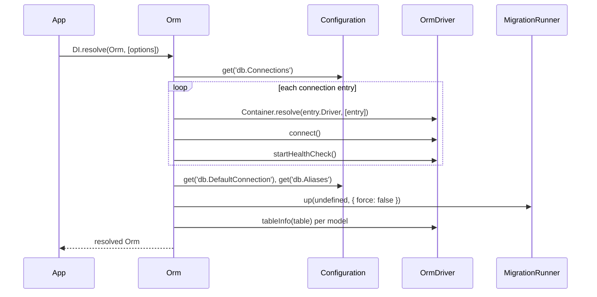

# Connections

`Orm` is the async service that boots the ORM: it opens every connection listed in `db.Connections`, binds each model to its connection, runs the boot migration pass and makes model static methods usable. Each connection is an `OrmDriver` instance supplied by a dialect package. Resolve `Orm` once at startup, before any model is queried.

## How it works

1. `DI.resolve(Orm)` constructs the `Orm` singleton and calls `Orm.resolve()`. An optional `IOrmOptions` object is the first constructor argument: `DI.resolve(Orm, [{ MigrateOnStartup: false }])`.
2. `Orm.resolve()` reads `db.Connections` from `Configuration`. For each entry, in order:
   1. It checks that a class is registered in DI under the token in `Driver`. If not, it throws `OrmException` (`ORM connection driver <Driver> not registerd`).
   2. It resolves the driver with the entry as constructor argument. The `OrmDriver` constructor merges the entry over its defaults, and `OrmDriver.resolve()` creates the driver's own child DI container and logger (`orm-driver-<Name>`). A resolve failure throws `OrmException` with the original error as `inner`.
   3. It calls `driver.connect()`. On failure it calls `driver.disconnect()` to release resources, then throws `OrmException` (`Failed to connect to database for connection <Name> ...`) with the original error as `inner`.
   4. It stores the driver in `Orm.Connections` under `Name` and calls `driver.startHealthCheck()` (see [Observability and resilience](13-observability-and-resilience.md)).
3. If `db.DefaultConnection` is set, the named driver is also stored under `default`. An unknown name throws `InvalidOperation`.
4. Every entry of `db.Aliases` stores an existing driver under an extra name. An unknown target throws `InvalidOperation`.
5. `Orm` registers the `OrmConnection` factory in DI: `DI.resolve<OrmDriver>('OrmConnection', [name])` returns the driver stored under `name`, or `null`.
6. `Orm` discovers migrations (see [Migrations](10-migrations.md)) and registers every class decorated with `@Model` into `Orm.Models`.
7. `Orm` assigns `Orm.Migration` (a `MigrationRunner`), registers the default value converters, and runs the boot migration pass unless `MigrateOnStartup` is `false`.
8. `Orm.reloadTableInfo()` binds each model to the driver named by its `@Connection`, reads the table's columns with `driver.tableInfo()` and merges them into the model descriptor. A model whose connection is not in `Orm.Connections` is skipped with a warning.
9. `Orm` wires relation targets (an unknown target model throws `OrmException`), installs the model static methods, and runs the `data()` phase of the migrations applied in step 7.



## Decorators

| Decorator | Target | Options | Effect |
| --- | --- | --- | --- |
| `@Connection(name)` | Model class | `name: string`: a connection `Name`, an alias from `db.Aliases`, or `default` | Sets the model descriptor's `Connection`. `Orm` binds the model to the driver stored under that name. |

`@Connection` and `@Model` write to the same descriptor, so their order on the class does not matter. See [Models](02-models.md) for `@Model` and the column decorators.

## Configuration

| Key | Type | Default | Allowed values | Meaning |
| --- | --- | --- | --- | --- |
| `db.Connections` | `IDriverOptions[]` | `[]` | | Connections opened by `Orm`, in array order. |
| `db.Connections[].Name` | `string` | required | unique name | Key in `Orm.Connections`, target of `@Connection`, `connection` label of the pool metrics. |
| `db.Connections[].Driver` | `string` | required | DI token of a driver: `orm-driver-sqlite`, `orm-driver-mysql`, `orm-driver-mysql-ssh`, `orm-driver-mssql`, `orm-driver-postgres` | Driver class resolved for this connection. |
| `db.Connections[].Host` | `string` | | | Database host. |
| `db.Connections[].Port` | `number` | | | Database port. |
| `db.Connections[].User` | `string` | | | Database user. |
| `db.Connections[].Password` | `string` | | | Database password. Never written to the `Orm` log. |
| `db.Connections[].Database` | `string` | | | Database name. Also passed as schema to `tableInfo()`. |
| `db.Connections[].Filename` | `string` | | | Database file, for SQLite. |
| `db.Connections[].Encoding` | `string` | | | Connection encoding, eg. `utf8mb4`. |
| `db.Connections[].Options` | `any` | | | Driver-specific options. See the driver's configuration page. |
| `db.Connections[].SSH.Host` | `string` | | | SSH tunnel host. Read by `orm-driver-mysql-ssh`. |
| `db.Connections[].SSH.Port` | `number` | | | SSH tunnel port. |
| `db.Connections[].SSH.User` | `string` | | | SSH user. |
| `db.Connections[].SSH.PrivateKey` | `string` | | file path | Path to the SSH private key. |
| `db.Connections[].AliasSeparator` | `string` | `$` (`#` for MSSQL) | | Character that wraps auto-generated table aliases, eg. `` `$users$` ``. |
| `db.Connections[].DefaultConnection` | `boolean` | `false` | | Not read by `Orm`. Use `db.DefaultConnection`. |
| `db.Connections[].Pool.Min` | `number` | `0` | `>= 0` | Connections kept open when idle. |
| `db.Connections[].Pool.Max` | `number` | `10` | `>= 1` | Maximum concurrent connections. For SQLite it sizes the read-only handle pool. |
| `db.Connections[].Pool.IdleTimeout` | `number` | `30000` | ms | Idle time before a pooled connection is closed. |
| `db.Connections[].Pool.AcquireTimeout` | `number` | `10000` | ms | Wait for a free connection before failing. |
| `db.Connections[].PoolLimit` | `number` | | | Deprecated. Used as `Pool.Max` when `Pool.Max` is absent. |
| `db.Connections[].Resilience.*` | `IConnectionResilienceOptions` | see [Observability and resilience](13-observability-and-resilience.md#configuration) | | Health probe and reconnect settings. |
| `db.Connections[].Migration.OnStartup` | `boolean` | unset (off) | | Run pending migrations of this connection in the boot pass. |
| `db.Connections[].Migration.Table` | `string` | `spinajs_migration` | | Migration tracking table. |
| `db.Connections[].Migration.Service` | `string` | `DefaultMigrationService` | DI token | `OrmMigrationService` implementation for this connection. |
| `db.Connections[].Migration.Transaction.Mode` | `MigrationTransactionMode` | `None` | `None`, `PerMigration`, `PerRun` | Transaction wrapping of a migration run. |
| `db.Connections[].Migration.Lock.Enabled` | `boolean` | `true` | | Concurrency guard for migration runs. |
| `db.Connections[].Migration.Lock.Timeout` | `number` | `30000` | ms | Wait for the migration lock before failing. |
| `db.Connections[].Migration.Lock.StaleAfter` | `number` | `600000` | ms | Age after which a held lock is stolen. |
| `db.DefaultConnection` | `string` | unset | a connection `Name` | Stores that driver under the extra name `default`. |
| `db.Aliases` | `Record<string, string>` | `{}` | alias → connection `Name` | Stores an existing driver under extra names. |
| `system.dirs.migrations` | `string[]` | `[]` | directory paths | Directories scanned for migration files. See [Migrations](10-migrations.md). |

How each driver applies `Pool.*` and `Options` is driver-specific: see [`@spinajs/orm-sqlite`](../orm-sqlite/README.md), [`@spinajs/orm-mysql`](../orm-mysql/README.md) and [`@spinajs/orm-mssql`](../orm-mssql/README.md).

```ts
this.Config = _.merge(this.Config, {
  db: {
    DefaultConnection: 'main',
    Aliases: { 'user-sessions': 'main' },
    Connections: [
      {
        Name: 'main',
        Driver: 'orm-driver-mysql',
        Host: '127.0.0.1',
        Port: 3306,
        User: 'app',
        Password: 'secret',
        Database: 'shop',
        Pool: { Min: 2, Max: 20, AcquireTimeout: 5000 },
        Migration: { OnStartup: true },
      },
    ],
  },
});
```

### `IOrmOptions`

Constructor options of `Orm`, passed through DI rather than read from configuration.

| Key | Type | Default | Allowed values | Meaning |
| --- | --- | --- | --- | --- |
| `IOrmOptions.MigrateOnStartup` | `boolean` | `true` | | `false` skips the boot migration pass and its `data()` phase. `Orm.Migration` is still assigned and usable. |

`Orm` is a DI singleton: options apply only to the resolve that constructs it. A later `DI.resolve(Orm, [options])` returns the existing instance and ignores the options.

## Services and extension points

| Service | Role | Default implementation | How to override |
| --- | --- | --- | --- |
| `Orm` | Opens connections, registers models and migrations, runs the boot migration pass. Exposes `Connections`, `Models`, `Migrations`, `Migration`, `reloadTableInfo()`, `dispose()`. | `Orm` | Not overridden. Pass `IOrmOptions` on first resolve. |
| `OrmDriver` | One database connection: executes builders, opens transactions, creates query builders, probes health. | Dialect drivers: `SqliteOrmDriver`, `MySqlOrmDriver`, `MySqlSSHOrmDriver`, `MsSqlOrmDriver`, `PostgresOrmDriver` | Register a driver class under the token named in `db.Connections[].Driver`. |
| `OrmConnection` | DI factory returning the driver stored under a name, or `null`. | Registered by `Orm.resolve()` | Not overridden. |

### `OrmDriver` public members

| Member | Meaning |
| --- | --- |
| `Options` | The connection entry merged over the defaults. |
| `Container` | Child DI container of this connection. Compilers, statements, converters and the `ServerResponseMapper` are resolved from it. |
| `State` | Current `ConnectionState`. See [Observability and resilience](13-observability-and-resilience.md). |
| `SupportedIsolationLevels` | Isolation levels `transaction()` accepts. Empty by default. |
| `ResponseSchemaTypes` | Driver-specific JSON-schema shapes for response schemas. See [JSON schema](11-json-schema.md). |
| `CurrentTransaction` | The `ITransactionContext` in scope on this async path, or `undefined`. |
| `execute(builder)` | Abstract. Executes a builder on the database. |
| `ping()` | Abstract. Resolves `false` when the database is unreachable. |
| `connect()` / `disconnect()` | Abstract. Open and close the connection. |
| `supportedFeatures()` | Abstract. Returns `ISupportedFeature`. |
| `tableInfo(name, schema?)` | Abstract. Returns the table's `IColumnDescriptor[]`. |
| `select<T>()`, `insert()`, `update<T>()`, `del<T>()`, `truncate(table)` | Query builders bound to this connection. See [Query builder](05-query-builder.md). |
| `schema()`, `index()` | Schema and index builders. See [Schema builder](09-schema-builder.md). |
| `transaction(cb, options?)`, `afterCommit(cb)` | Transactions; `cb` is a `TransactionCallback<R>`: `(driver: OrmDriver) => Promise<R>`. See [Transactions](08-transactions.md). |
| `startHealthCheck()`, `stopHealthCheck()`, `poolMetrics()`, `publishPoolMetrics()`, `observeAcquireSeconds(s)` | Health probe and metrics. See [Observability and resilience](13-observability-and-resilience.md). |

`ISupportedFeature` tells the ORM what the dialect can do:

| Field | Type | Meaning |
| --- | --- | --- |
| `events` | `boolean` | The database supports scheduled events. |
| `insertReturning` | `boolean` | A plain `INSERT` can echo inserted rows with `RETURNING` / `OUTPUT`. |
| `insertIdIsFirstOfBatch` | `boolean` (optional, default `false`) | The identity reported after a multi-row insert is the key of the first row, with the others contiguous. |

Insert and update responses are normalized to `DbServerResponse` (`RowsAffected`, `LastInsertId`, `Returning`) by the connection's `ServerResponseMapper`. See [Architecture](12-architecture.md). To write a new driver, see [Adding a new SQL dialect](../orm-sql/07-adding-a-sql-dialect.md).

```ts sample
import { DI } from '@spinajs/di';
import { Orm } from '@spinajs/orm';
import { SqliteOrmDriver } from '@spinajs/orm-sqlite';

export async function bootstrapDatabase(): Promise<Orm> {
  // @Injectable already registers it on import; the explicit call keeps the token next to the config.
  DI.register(SqliteOrmDriver).as('orm-driver-sqlite');
  return await DI.resolve(Orm);
}
```

## Important behaviour

- Connections open one after another, in `db.Connections` order. The first failure aborts `Orm.resolve()`; connections opened before it stay open.
- `Orm` logs only `Database`, `User`, `Host`, `Port`, `Filename`, `Driver` and `Name` of a connection. `Password` never reaches the log.
- `default` and every alias point to the same driver instance as the connection they name. They share one pool and one health probe.
- `Orm.dispose()` stops the health probe and calls `disconnect()` once per `Orm.Connections` entry. A driver stored under `default` or an alias is disconnected more than once, so `disconnect()` must be idempotent.
- `db.Connections[].DefaultConnection: true` has no effect. Only `db.DefaultConnection` creates the `default` entry.
- An unknown target in `db.Aliases` throws `InvalidOperation` with the message `default connection <name> not exists`, even though the failing key is an alias.
- Model static methods (`where`, `get`, `query`, ...) throw `Not implemented` until `Orm.resolve()` completes. `Orm` installs them in step 9.
- A model with no `@Connection`, or with a name missing from `Orm.Connections`, is left without a driver. `Orm` logs `Cannot find connection ... in connection list` and continues.
- `Orm.Migration` is assigned inside `resolve()`. It is `undefined` on an unresolved `Orm`.
- Each driver has its own child container. A registration in `driver.Container` affects only that connection.

## Best practices

- Resolve `Orm` once in the application bootstrap and `await` it before any model or repository code runs.
- In a reusable package, bind models to a package-specific name (`@Connection('user-sessions')`) and let the application map it with `db.Aliases`.
- Set `db.DefaultConnection` and use `@Connection('default')` for application models, so switching databases is a config change.
- Resolve `Orm` with `MigrateOnStartup: false` in tools that inspect or repair migrations, as `@spinajs/orm-cli` does.
- Use `orm.Connections.get(name)` or `DI.resolve('OrmConnection', [name])` for raw queries; check the result for `undefined` / `null`.

## Patterns and antipatterns

```ts
// Don't: model statics are installed by Orm.resolve(); this throws "Not implemented"
const unpaid = await Invoice.where('Status', 'unpaid');
await DI.resolve(Orm);

// Do
await DI.resolve(Orm);
const unpaid = await Invoice.where('Status', 'unpaid');
```

```ts
// Don't: Orm never reads the per-connection flag, so no `default` entry exists
db: { Connections: [{ Name: 'main', Driver: 'orm-driver-mysql', DefaultConnection: true }] }

// Do
db: { DefaultConnection: 'main', Connections: [{ Name: 'main', Driver: 'orm-driver-mysql' }] }
```

## Examples

### Split a shop database from a read-only reporting replica

```ts sample
import { FrameworkConfiguration } from '@spinajs/configuration';
import _ from 'lodash';

export class ShopConfiguration extends FrameworkConfiguration {
  public async resolve(): Promise<void> {
    await super.resolve();

    this.Config = _.merge(this.Config, {
      db: {
        DefaultConnection: 'shop',
        Aliases: { reporting: 'shop-replica' },
        Connections: [
          {
            Name: 'shop',
            Driver: 'orm-driver-mysql',
            Host: 'db-primary.internal',
            Port: 3306,
            User: 'shop',
            Password: 'secret',
            Database: 'shop',
            Pool: { Min: 2, Max: 20 },
            Migration: { OnStartup: true },
          },
          {
            Name: 'shop-replica',
            Driver: 'orm-driver-mysql',
            Host: 'db-replica.internal',
            Port: 3306,
            User: 'reporting',
            Password: 'secret',
            Database: 'shop',
            Pool: { Max: 5 },
          },
        ],
      },
    });
  }
}
```

```ts sample
import { Connection, Model, ModelBase, Primary } from '@spinajs/orm';

@Connection('default')
@Model('orders')
export class Order extends ModelBase<Order> {
  @Primary()
  public Id: number;

  public CustomerId: number;

  public Status: string;
}

@Connection('reporting')
@Model('order_totals')
export class OrderTotal extends ModelBase<OrderTotal> {
  @Primary()
  public CustomerId: number;

  public Total: number;
}
```

### Run a raw report query on a named connection

```ts sample
import { DI } from '@spinajs/di';
import { Orm } from '@spinajs/orm';

interface PaidTotalRow {
  CustomerId: number;
  Total: number;
}

export async function paidTotals(): Promise<PaidTotalRow[]> {
  const orm = await DI.resolve(Orm);
  const reporting = orm.Connections.get('reporting');

  if (!reporting) {
    throw new Error('connection "reporting" is not configured');
  }

  return await reporting.select<PaidTotalRow[]>().from('order_totals').where('Status', 'paid');
}
```

### Report migration status without migrating

```ts sample
import { DI } from '@spinajs/di';
import { IMigrationStatusEntry, Orm } from '@spinajs/orm';

export async function pendingMigrations(): Promise<IMigrationStatusEntry[]> {
  const orm = await DI.resolve(Orm, [{ MigrateOnStartup: false }]);

  try {
    const status = await orm.Migration.status();
    return status.filter((entry) => entry.pending);
  } finally {
    await orm.dispose();
  }
}
```

## Related

- [Models](02-models.md): `@Model` and column decorators on the classes `@Connection` binds.
- [Transactions](08-transactions.md): `OrmDriver.transaction()` and `afterCommit()`.
- [Migrations](10-migrations.md): the boot migration pass and the `Migration.*` keys.
- [Architecture](12-architecture.md): what a driver registers in its container.
- [Observability and resilience](13-observability-and-resilience.md): connection state, health probe, retries and pool metrics.
- [`@spinajs/orm-sql`](../orm-sql/README.md): `SqlDriver`, the base of every dialect driver.
- [`@spinajs/orm-sqlite`](../orm-sqlite/README.md), [`@spinajs/orm-mysql`](../orm-mysql/README.md), [`@spinajs/orm-mssql`](../orm-mssql/README.md): driver tokens, pool and driver-specific options.
