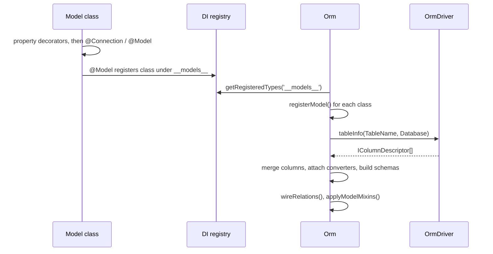

# Models

A model is a class that extends `ModelBase` and maps one database table. Decorators describe the
table, the primary key and the ORM-managed columns. The ORM reads the remaining columns from the
table itself when it starts.

## How it works

1. TypeScript evaluates the class. Property decorators (`@Primary()`, `@CreatedAt()`, `@Hidden()`, ...)
   run in declaration order, then class decorators (`@Connection()`, `@Model()`) run bottom-up.
2. Every decorator writes into the class's own `IModelDescriptor`, stored with `Reflect` metadata
   under `MODEL_DESCTRIPTION_SYMBOL`. The first decorator on a subclass seeds that descriptor from
   the parent's (see [Descriptor inheritance](#descriptor-inheritance)).
3. `@Model(tableName)` sets `TableName` and registers the class in DI under `__models__`.
4. `Orm.resolve()` calls `registerModel()` for every `__models__` class, then reads the table info of
   every model as below, once the [boot check](10-migrations.md#boot-check-diresolveorm) passed. `OrmMigrator.migrate()` calls `Orm.reloadTableInfo()` again, for the models its migrations touched only.
5. Each read handles every registered model, or only those in `options.models`:
   - looks up the connection named by `descriptor.Connection`; when none exists it logs a warning
     and skips the model, which then has no `Driver` and no table columns;
   - sets `descriptor.Driver` and calls `OrmDriver.tableInfo(TableName, Database)`;
   - rebuilds `descriptor.Columns` from the decorator-declared columns plus the reflected ones: a
     declared column receives every defined table property, a table column no decorator declares
     is appended. Nothing an earlier read added survives, so a column a migration dropped or renamed
     leaves the model, and a converter mapped from a column's old type goes with it;
   - resolves each `descriptor.Converters` entry from the connection container and sets it as the
     column's `Converter`, when the converter class is registered there;
   - flags `IsForeignKey` on every column a relation names as its `ForeignKey`;
   - gives a column with no converter the one registered in `__orm_db_value_converters__` under
     its lower-cased `NativeType`;
   - builds `descriptor.Schema` and `descriptor.ResponseSchema` (see
     [JSON schema](11-json-schema.md));
   - when `tableInfo()` answers `null` (no such table), resets the descriptor's columns to the decorator-declared ones and records the model as missing; at the end, called strict (`migrate-up` does, under `db.StrictTableCheck`), it reads again every other model an earlier read recorded missing, then throws one `OrmException` for every registered model whose table is still missing; otherwise it logs a warning per model read. See [Connections](01-connections.md).
6. `Orm.wireRelations()` resolves relation targets, and `applyModelMixins()` binds the static query
   API (`get`, `where`, `select`, ...) onto every registered model.



### What counts as a column

- A column is an entry in `descriptor.Columns`. Columns come from the table, not from class
  properties.
- A table column is hydrated and written even when the class does not declare it as a property.
- A class property with no table column is not a column. `hydrate()` copies it through
  `NonDbPropertyHydrator`, and `toSql()` never writes it.
- `@Ignore()` and `@Uuid()` create a column entry at decoration time, before any table info exists.

### The model descriptor

`IModelDescriptor` is the full description of a model. Read it with `Model.getModelDescriptor()`,
`model.ModelDescriptor` or `extractModelDescriptor(Model)`.

| Field | Type | Set by | Meaning |
| --- | --- | --- | --- |
| `Name` | `string` | every decorator | The class name. Always the class's own, never inherited. |
| `TableName` | `string` | `@Model()` | Table this model maps. |
| `Connection` | `string \| null` | `@Connection()` | Connection name from `db.Connections`. |
| `Driver` | `OrmDriver \| null` | `Orm.reloadTableInfo()` | The resolved connection. |
| `PrimaryKey` | `string[]` | `@Primary()` | Key columns in declaration order. Empty when the model has no `@Primary()`. |
| `PrimaryKeyGeneration` | `Map<string, PrimaryKeyGeneration>` | `@Primary()` | Generation strategy per key column. A missing entry means `auto`. |
| `Timestamps` | `IModelTimestampDescriptor` | `@CreatedAt()`, `@UpdatedAt()` | `CreatedAt` and `UpdatedAt` property names, `''` when unset. |
| `SoftDelete` | `IModelSoftDeleteDescriptor` | `@SoftDelete()` | `DeletedAt` property name, `''` when unset. |
| `Archived` | `IModelArchivedDescriptor` | `@Archived()` | `ArchivedAt` property name, `''` when unset. |
| `Columns` | `IColumnDescriptor[]` | `Orm.reloadTableInfo()`, `@Ignore()`, `@Uuid()` | Table columns. |
| `Converters` | `Map<string, IValueConverterDescriptor>` | converter decorators | Converter class and options per property. See [Converters and hydration](04-converters-and-hydration.md). |
| `Relations` | `Map<string, IRelationDescriptor>` | relation decorators | See [Relations](06-relations.md). |
| `JunctionModelProperties` | `IJunctionProperty[]` | `@JunctionTable()` | Properties that receive the junction row of a many-to-many relation. |
| `DiscriminationMap` | `IDiscriminationMap` | `@DiscriminationMap()` | See [Discrimination maps](14-discrimination-maps.md). |
| `Hidden` | `string[]` | `@Hidden()` | Properties `dehydrate()` never emits. |
| `Schema` | `any` | `Orm.reloadTableInfo()` | JSON schema of what a client may send. |
| `ResponseSchema` | `any` (optional) | `Orm.reloadTableInfo()` | JSON schema of what a read returns. |

### Column descriptor

`IColumnDescriptor` describes one column. Drivers fill it from table reflection.

| Field | Type | Meaning |
| --- | --- | --- |
| `Name` | `string` | Column name. |
| `Type` | `string` | Column type, eg. `int`, `varchar`. |
| `NativeType` | `string` | Full database type. The converter type-map matches on it. |
| `MaxLength` | `number` | Maximum character length. |
| `Comment` | `string` | Column comment. |
| `DefaultValue` | `any` | Database default. The `ModelBase` constructor copies it onto the instance. |
| `Unsigned` | `boolean` | Numeric sign. |
| `Nullable` | `boolean` | `false` on a non-key column makes `toSql()` and `dehydrate()` throw `Field <name> cannot be null` on an empty value. |
| `PrimaryKey` | `boolean` | Reflected key flag. It does **not** feed `descriptor.PrimaryKey`. |
| `AutoIncrement` | `boolean` | Reflected identity flag. |
| `Unique` | `boolean` | Unique constraint. `fresh()` falls back to unique columns when the model has no key; `getOrCreate()` and `getOrNew()` match on them. |
| `Uuid` | `boolean \| undefined` | Set by `@Uuid()`. Table info resets it to `false`; a manifest descriptor keeps it. |
| `Ignore` | `boolean` | Set by `@Ignore()`: the property is not persisted. Table info never changes it. |
| `Converter` | `IValueConverter \| null \| undefined` | Resolved converter instance. |
| `Schema` | `any` | Column JSON schema. |
| `Aggregate` | `boolean` | Generated column, eg. `sum` or `group by`. |
| `Virtual` | `boolean` | No database column behind it. Never written or snapshotted. |
| `IsForeignKey` | `boolean` | Foreign key column. |
| `ForeignKeyDescription` | `{ From, To, Table } \| null \| undefined` | Reflected foreign key. |

### Column kinds

`columnKind(column)` names what a column holds, whatever spelling its driver reports in `Type`
(SQLite's declared type, Postgres' `udt_name`, MySQL's and MSSQL's `DATA_TYPE`): `'integer'`
(`int`, `int4`, `bigint`, `serial`, `INTEGER`, ...), `'decimal'` (`numeric`, `decimal`, `real`,
`float8`, `money`, ...), `'uuid'` (`uuid`, `uniqueidentifier`), `'text'` (`varchar`, `text`,
`nvarchar`, `bpchar`, ...) or `'other'`. A size, `unsigned` or `zerofill` in the type is ignored;
an empty `Type` falls back to `NativeType`.

`lookupValue(column, text)` is the value to compare `column` with when a key arrives as text (a URL
segment, an authz resource id). An integer column takes an integer literal, as a number while it is
a safe integer and as text beyond `Number.MAX_SAFE_INTEGER`, within the range of its type; a decimal
column takes a decimal literal, as text; a uuid column takes a uuid. For any other text it returns
`undefined`: leave that key out of the `where`/`whereIn`. Bound anyway, Postgres and MSSQL fail the
query on the cast, Postgres fails it on a value out of the column's range, and MySQL converts `'abc'` to
`0` and matches that row. Text and other columns take the text as it is.

The range comes from the reported type name. `int2`/`smallint` hold 16 bits, `mediumint` 24, `int4` 32
and `int8`/`bigint` 64; `tinyint` holds -128 to 255 (signed on MySQL, unsigned on MSSQL). `int` and
`integer` are 32 bits on MySQL and MSSQL but 64 on SQLite, so they, and every other integer spelling,
are capped at 64 bits. An `unsigned` type raises the upper bound to the unsigned maximum of its width.

## Decorators

| Decorator | Target | Options | Effect |
| --- | --- | --- | --- |
| `@Model(tableName)` | class | `tableName: string` | Sets `TableName`, registers the class under `__models__`. Required for the static query API and for table columns. |
| `@Connection(name)` | class | `name: string` | Sets `Connection`. See [Connections](01-connections.md). |
| `@Primary(options?)` | property | `generated?: 'auto' \| 'uuid' \| 'assigned'`, default `'auto'` | Adds the property to `PrimaryKey`. Repeat on several properties for a composite key. |
| `@CreatedAt()` | property | none | Sets `Timestamps.CreatedAt` and a `DatetimeValueConverter`. The constructor stamps it with `DateTime.utc()`. |
| `@UpdatedAt()` | property | none | Sets `Timestamps.UpdatedAt` and a `DatetimeValueConverter`. `update()` and `save()` stamp it when another column changed. |
| `@SoftDelete()` | property | none | Sets `SoftDelete.DeletedAt` and a `DatetimeValueConverter`. `destroy()` becomes an `UPDATE` of this column, and selects filter deleted rows out. |
| `@Archived()` | property | none | Sets `Archived.ArchivedAt` and a `DatetimeValueConverter`. Selects filter archived rows out. `model.archive()` stamps it. |
| `@Hidden()` | property or relation | none | Adds the name to `Hidden`. `dehydrate()` and `dehydrateWithRelations()` always omit it, and `ResponseSchema` drops it. `Schema` keeps it. |
| `@Ignore()` | property | none | Sets `Ignore: true` on the column: the property is not persisted. No insert, update, upsert, bulk insert or `save()` writes it, `dehydrate()` omits it, relation queries do not select it, and it is absent from `Schema` and `ResponseSchema`. Throws `InvalidArgument` on a `@Primary()` property. |
| `@Uuid()` | property | none | Sets `Uuid: true` on the column and a `UuidConverter`. The converter stores 16-byte binary. When the model's columns come from the manifest (`db.Models.Source: 'manifest'`, and the manifest has the model) the flag is kept and the constructor fills the column with a v4 UUID. With columns read from the database (the default source) the table info replaces the column entry, `Uuid` included, and the constructor leaves the column empty. A client-generated UUID key on every source is `@Primary({ generated: 'uuid' })`. |
| `@JunctionTable()` | property | none | Records the property in `JunctionModelProperties`. See [Relations](06-relations.md). |
| `@DiscriminationMap(field, entries)` | class | see [Discrimination maps](14-discrimination-maps.md) | Picks the class per row from a column value. |

Relation decorators are covered in [Relations](06-relations.md). Converter decorators (`@DateTime()`,
`@Bool()`, `@Json()`, `@Int64()`, `@Set()`, `@UniversalConverter()`) are covered in
[Converters and hydration](04-converters-and-hydration.md).

### Primary key strategies

`@Primary()` takes `IPrimaryKeyOptions`. `generated` is a `PrimaryKeyGeneration`.

| `generated` | Who supplies the value | Insert behaviour |
| --- | --- | --- |
| `'auto'` (default) | The database (identity, auto-increment or a column default). | A key without a value (`null`, `undefined` or `''`) is left out of the insert row; SQLite's serializer leaves out only `undefined`. On a column with neither a default nor auto-increment the insert then fails in the database with `ConstraintViolation` (kind `not_null`), where it used to fail before the statement with `InvalidArgument: value column <name> cannot be null`: on PostgreSQL the failed statement aborts the caller's transaction, and MySQL without a strict `sql_mode` writes the column's implicit default instead. The insert asks for `RETURNING` when `supportedFeatures().insertReturning` is `true` and takes the key the connection's `ServerResponseMapper.insertedKeys()` reports. |
| `'uuid'` | The ORM, client-side. | `generateClientSideKeys()` fills an empty key with a v4 UUID at construction and again before insert. A supplied value is never overwritten. |
| `'assigned'` | The caller. | `assertAssignedKeys()` throws `OrmException` before any SQL runs when the key is `null`, `undefined` or `''`. |

An `auto` key whose column converter would write `NULL` for a missing value, such as `@Uuid()` or `@Int64()`, is
left out of the row too, so the column default applies. A binary UUID key the database generates
(`"Id" bytea PRIMARY KEY DEFAULT uuid_send(gen_random_uuid())` on PostgreSQL), with columns read from the database:

```ts
@Model('tags')
export class Tag extends ModelBase<Tag> {
  @Primary() @Uuid() public Id: string; // no `generated` option: the database generates the key
  public Name: string;
}
```

The key is empty after construction because the table info replaces the `@Uuid()` flag. When the model's
columns come from the manifest the constructor gives the model a client v4 UUID and the column default never
applies. Measured on the other servers: SQL Server inserts the row with its default (`binary(16) DEFAULT
CAST(NEWID() AS binary(16))`) but reports no key, so the model stays without one and `save()` of a parent with
new children throws `OrmException` (`... returned no generated key ...`). MySQL reads an expression default
(`DEFAULT (UUID_TO_BIN(UUID()))`) as text, the constructor copies that text onto the key, and the row is written
with 16 zero bytes.

`model.insert()`, `Model.insert(...)` and the unit of work take generated keys from the
connection's `ServerResponseMapper.insertedKeys(response, insert)`: one key per inserted row, in
insert order, or none at all. A key the caller supplied is never overwritten. A generated key goes
onto the model through each key column's converter (`fromDB`), so it holds what a read of the row
gives: the dashed text of a `@Uuid()` key, the declared JS type of an `@Int64()` key. A connection package
may override `insertedKeys` with its own rule. The default takes the `RETURNING` rows, when there is
one per inserted row and each carries the whole key, in insert order; otherwise no key is
assigned. A dialect without `RETURNING` reports keys only by its connection package's rule: see
[MySQL](../orm-mysql/04-inserts-and-generated-keys.md), [MSSQL](../orm-mssql/04-inserts-and-upserts.md)
and [SQLite](../orm-sqlite/05-inserts-and-upserts.md). Where no key is reported, re-select the rows
or insert them one at a time.

`InsertBehaviour` selects the conflict handling of `model.insert()` and `Model.insert()`:

| Value | Effect |
| --- | --- |
| `InsertBehaviour.None` | Plain insert. The default. |
| `InsertBehaviour.InsertOrIgnore` | Skips the row when the key exists (`orIgnore()`). |
| `InsertBehaviour.InsertOrUpdate` | Updates every non-key, non-virtual column when the key exists (`onDuplicate()`). |
| `InsertBehaviour.InsertOrReplace` | Replaces the row when the key exists (`orReplace()`). |

`Model.insert()` with an array accepts only `InsertBehaviour.None` and throws
`insert behaviour is not supported with arrays` otherwise.

### Descriptor inheritance

- Each class owns its descriptor. A subclass inherits by copy, never by reference.
- The first decorator on a subclass collapses the ancestor chain into a fresh descriptor
  (`getInheritedDescriptor` from `@spinajs/di`). It then gives the subclass its own copies of
  `Columns`, `Relations`, `Timestamps`, `SoftDelete`, `Archived` and `DiscriminationMap`.
  `@Ignore()` or `@Recursive()` on an inherited member does not change the parent.
- `PrimaryKey` and `Hidden` are additive. A subclass extends the parent's lists and never
  duplicates an entry, at any inheritance depth.
- A subclass cannot replace an inherited primary key, only add columns to it.
- A subclass with no decorator of its own has no own descriptor. `extractModelDescriptor()` returns
  `null` for it, `hydrate()` throws `cannot hydrate model <name>, no model descriptor found`, and
  building a query throws `model <name> does not have model descriptor`.

## Services and extension points

The descriptor and key helpers are plain exported functions.

| Function | Role |
| --- | --- |
| `extractModelDescriptor(target)` | Returns the class's own descriptor, or `null`. Accepts a class or a forward-ref function. |
| `extractModelDescriptorInherited(target)` | Returns a fresh descriptor collapsed from the whole chain. A read-only view: changes to it are not stored. |
| `createDefaultModelDescriptor()` | Returns an empty descriptor with every field at its default. |
| `updateModelDescriptor(target, callback)` | Hands the class's own descriptor to `callback` for changes. Never writes into an ancestor. |
| `extractDecoratorDescriptor(callback)` | Builds a class decorator that receives the class's own descriptor. |
| `extractDecoratorPropertyDescriptor(callback)` | Builds a property decorator that receives the class's own descriptor and the property name. |
| `pkColumns(descriptor)` | Key columns in declaration order. |
| `hasPk(descriptor)`, `isCompositePk(descriptor)` | Key presence, and key with more than one column. |
| `pkGeneration(descriptor, column)` | Strategy of one key column, `'auto'` when unrecorded. |
| `normalizePkTuple(descriptor, value)` | Turns a scalar, an array in key order or an object keyed by column into a tuple. Throws `OrmException` on a wrong length or a missing column. |
| `pkValueOf(source, descriptor)` | Reads a key: a scalar for one column, a tuple for a composite key. |
| `setPkValue(target, descriptor, value)` | Writes a key. Mirror of `pkValueOf()`. |
| `pkKeyString(source, descriptor)`, `pkKeyStringFor(source, keys)` | Flattens key columns into one collision-free string for use as a `Map` key. |
| `wherePk(builder, descriptor, value)` | Adds a `WHERE` matching one key. |
| `whereAnyPk(builder, descriptor, values)` | Adds a `WHERE` matching any of `values`. An empty array matches nothing. |
| `whereNotAnyPk(builder, descriptor, values)` | Adds a `WHERE` excluding all of `values`. An empty array adds no condition. |
| `orderByPk(builder, descriptor, order)` | Orders by every key column. Returns `false` when the model has no key. |
| `generateClientSideKeys(target, descriptor)` | Fills empty `uuid` key columns. |
| `assertAssignedKeys(target, descriptor)` | Throws when an `assigned` key column is empty. |

Exported metadata symbols:

| Symbol | Meaning |
| --- | --- |
| `MODEL_DESCTRIPTION_SYMBOL` | `Symbol.for('MODEL_DESCRIPTOR')`. Key of the model descriptor in `Reflect` metadata. The misspelling is part of the name. |
| `MIGRATION_DESCRIPTION_SYMBOL` | `Symbol.for('MIGRATION_DESCRIPTOR')`. See [Migrations](10-migrations.md). |
| `MIGRATION_FILE_REGEXP` | Matches `Name_yyyy_MM_dd_HH_mm_ss` migration class names. See [Migrations](10-migrations.md). |
| `SCHEMA_SYMBOL` | `Symbol.for('ORM_SCHEMA_SYMBOL')`. The ORM core does not read it. |

A custom model decorator writes into the descriptor through `extractDecoratorPropertyDescriptor()`,
the same way the built-in ones do:

```ts
import { extractDecoratorPropertyDescriptor, IModelDescriptor } from '@spinajs/orm';

export function Secret() {
  return extractDecoratorPropertyDescriptor((model: IModelDescriptor, _target: any, propertyKey: string) => {
    if (!model.Hidden.includes(propertyKey)) {
      model.Hidden.push(propertyKey);
    }
  });
}
```

`updateModelDescriptor()` sets descriptor fields without the side effects of `@Model()`. The ORM's
own tests use it to wire a model to a table without registering it:

```ts
updateModelDescriptor(Invoice, (d) => {
  d.Connection = 'sqlite';
  d.TableName = 'invoices';
});
```

## Important behaviour

- `descriptor.PrimaryKey` comes only from `@Primary()`. A model without it has no key even when the
  table has one: `get()`, `find()`, `destroy()` and `wherePk()` throw `model <name> has no primary key`.
- A composite key value is a tuple in declaration order. `PrimaryKeyValue` returns an array, and
  accepts an array in key order or an object keyed by column name.
- A relation joins on one column. When the model a relation takes its default join column from has
  a composite key, `@HasMany`, `@BelongsTo` and `@HasManyToMany` throw
  `InvalidOperation` at class definition. Name the column explicitly.
- `hydrate()` never overwrites the primary key of a model that has a snapshot, that is one loaded
  from or written to the database.
- `@CreatedAt()`, `@UpdatedAt()`, `@SoftDelete()` and `@Archived()` throw at class definition when the
  property's reflected type is not Luxon's `DateTime`. A union such as `DateTime | null` reflects as
  `Object` and fails.
- Every select built for a `@SoftDelete()` model adds `WHERE DeletedAt IS NULL`. `get()`, `find()`,
  `first()` and `all()` therefore skip deleted rows. `withDeleted()` removes the filter.
- `@Archived()` adds `WHERE ArchivedAt IS NULL` to every select the same way. `withArchived()` removes
  it. Deletes and updates are not filtered.
- The two filters are ANDed with the query's own conditions as one group, so an `OR` the query writes
  cannot bring deleted or archived rows back: `Invoice.where('Status', 'open').orWhere('Status', 'paid')`
  reads `DeletedAt IS NULL AND ArchivedAt IS NULL AND ( Status = ? OR Status = ? )`. The group is added
  when the conditions may have a top-level `OR`. The check is conservative: raw text
  (`where(RawQuery.create('…'))`) is grouped whenever an `OR` cannot be ruled out, so a comment, a
  backslash or an unbalanced quote or parenthesis in it adds the group too. A query whose conditions
  have no `OR` compiles as before. Call `withDeleted()` / `withArchived()` to read deleted or archived rows.
- Update and delete builders carry neither filter: a bulk `update(...).where(...).orWhere(...)` or
  `destroy()` also changes soft-deleted and archived rows.- `withDeleted()` and `withArchived()` remove only the filter the model added. A
  `whereNull('DeletedAt')` the query writes itself is a condition of its own and stays.
- A relation's populate query does not add the filters: `populate()` returns soft-deleted and
  archived related rows.
- Both filters apply only when the column is in `descriptor.Columns`. A model whose table info did
  not load is not filtered.
- `@UpdatedAt()` is stamped only when at least one other column changed. A no-op `update()` writes
  nothing.
- `@Ignore()` stops writes, not reads: a query that returns a column with the property's name
  (`select *` on a table that has one) still hydrates it. Changing an `@Ignore()` property does not
  make the model dirty, so `update()` and `save()` write nothing for it alone. A new instance gets no
  table default for it, and `refresh()` keeps its value when the row has no such column.
- `model.archive()` does not check that `@Archived()` was declared. Call it only on models that
  declare it.
- A model that never got `@Model()` is not in `Orm.Models`. Its static methods (`get`, `where`,
  `select`, ...) throw `Not implemented`, and it receives no table columns.
- `@Connection('default')` targets the connection named by `db.DefaultConnection`, when that key is set.

## Best practices

- Declare `@Primary()` properties above any relation property. Relation decorators read the key
  when they run, and property decorators run in declaration order.
- Use `@Hidden()` for values a response must never carry (`Password`). Use `@Ignore()` only to keep
  a property out of the JSON schemas.
- For a binary UUID key, combine `@Primary({ generated: 'uuid' })` with `@Uuid()` and create the
  column with `table.uuid(name)`, a 16-byte binary column.
- Use `'assigned'` or `'uuid'` for a composite key. SQLite cannot auto-increment a column of a
  composite key; see [SQLite dialect notes](../orm-sqlite/04-schema-and-ddl.md#composite-primary-keys).
- Give every subclass that is queried or hydrated its own `@Connection()` and `@Model()`.
- Import Luxon's `DateTime` under an alias when the file also uses the ORM's `@DateTime()`
  decorator, eg. `import { DateTime as LuxonDateTime } from 'luxon'`.

## Patterns and antipatterns

```ts
// Don't: the union reflects as Object, so @SoftDelete() throws when the class loads
@SoftDelete()
public DeletedAt: DateTime | null;

// Do
@SoftDelete()
public DeletedAt: DateTime;
```

```ts
// Don't: @HasMany reads the key while Id is not declared yet, so its PrimaryKey is undefined
@HasMany(InvoiceLine)
public Lines: Relation<InvoiceLine, Invoice>;

@Primary()
public Id: number;

// Do
@Primary()
public Id: number;

@HasMany(InvoiceLine)
public Lines: Relation<InvoiceLine, Invoice>;
```

```ts
// Don't: @Ignore() only removes the field from the JSON schemas, dehydrate() still returns it
@Ignore()
public Password: string;

// Do
@Hidden()
public Password: string;
```

## Examples

### Invoice with timestamps, soft delete and a hidden column

```ts sample
import { Connection, CreatedAt, Hidden, Model, ModelBase, Primary, SoftDelete, UpdatedAt } from '@spinajs/orm';
import { DateTime } from 'luxon';

@Connection('default')
@Model('invoices')
export class Invoice extends ModelBase<Invoice> {
  @Primary()
  public Id: number;

  public CustomerId: number;

  public Total: number;

  @Hidden()
  public InternalNote: string;

  @CreatedAt()
  public CreatedAt: DateTime;

  @UpdatedAt()
  public UpdatedAt: DateTime;

  @SoftDelete()
  public DeletedAt: DateTime;
}

export async function cancelInvoice(id: number) {
  // An UPDATE of DeletedAt, not a DELETE.
  await Invoice.destroy(id);
}

export async function invoicesForAudit(customerId: number) {
  // Soft-deleted invoices are excluded unless the filter is removed.
  return await Invoice.select().withDeleted().where('CustomerId', customerId);
}
```

### Order lines with a composite, caller-assigned key

```ts sample
import { Connection, Model, ModelBase, Primary } from '@spinajs/orm';

@Connection('default')
@Model('order_lines')
export class OrderLine extends ModelBase<OrderLine> {
  @Primary({ generated: 'assigned' })
  public OrderId: number;

  @Primary({ generated: 'assigned' })
  public LineNo: number;

  public Sku: string;

  public Quantity: number;
}

export async function findLine(orderId: number, lineNo: number) {
  // Array in key order; { OrderId, LineNo } works as well.
  return await OrderLine.get([orderId, lineNo]);
}

export async function addLine(orderId: number, lineNo: number, sku: string) {
  const line = new OrderLine({ OrderId: orderId, LineNo: lineNo, Sku: sku, Quantity: 1 });
  await line.insert();
  return line;
}
```

### API tokens keyed by a client-generated UUID

```ts sample
import { Connection, Model, ModelBase, Primary } from '@spinajs/orm';

@Connection('default')
@Model('api_tokens')
export class ApiToken extends ModelBase<ApiToken> {
  @Primary({ generated: 'uuid' })
  public Id: string;

  public UserId: number;
}

export async function issueToken(userId: number) {
  const token = new ApiToken({ UserId: userId });

  // The key exists before the INSERT, so it can be returned without a round-trip.
  const id = token.Id;
  await token.insert();

  return id;
}
```

### Shared audit columns through inheritance

```ts sample
import { Auditable } from '@spinajs/audit-orm';
import type { AuditableModel, AuditableRow } from '@spinajs/audit-orm';
import { Connection, CreatedAt, Model, ModelBase, Primary, UpdatedAt } from '@spinajs/orm';
import { DateTime } from 'luxon';

@Auditable()
export abstract class AuditedModel<M> extends ModelBase<M> {
  declare static audit: AuditableModel['audit'];
  declare audit: AuditableRow['audit'];

  @CreatedAt()
  public CreatedAt: DateTime;

  @UpdatedAt()
  public UpdatedAt: DateTime;
}

@Connection('default')
@Model('customers')
export class Customer extends AuditedModel<Customer> {
  @Primary()
  public Id: number;

  public Name: string;
}

@Connection('default')
@Model('suppliers')
export class Supplier extends AuditedModel<Supplier> {
  @Primary()
  public Id: number;

  public TaxId: string;
}
```

`Customer` and `Supplier` each get their own descriptor with both timestamps and their own key.
Neither writes into `AuditedModel`'s descriptor. The `@Auditable()` mark of the abstract base covers both:
`Customer.audit()` and `Supplier.audit()` each read the events of their own table.

### History of a model

`@spinajs/orm` records no history of its own rows. A model opts into row history with `@History()`
from `@spinajs/orm-history`, which records every tracked insert, update and delete in the write's transaction.
The mark installs `Model.history()` and `row.history()` on the model at run time; their typing is the model's own, a
`declare static history` line for the class and an interface merged with the class for its rows, and a marked class
without them does not compile. `Model.history()` reads the entries of one row (`of(id)`) and its state at an instant (`asOf(id, at)`),
follows the changes of all rows (`since(seq)`, which also lists the entity's `lost` markers: `op: 'lost'`, `id: '*'`),
lists one principal's changes (`byActor(actor)`) and erases a row's payloads (`forget(id)`); `row.history()` does the same
for a loaded row (`entries()`, `asOf(at)`, `forget()`). A model tracked by an `audit.data.rules` entry or by `registerHistory()` has no such members in its type:
`historyOf(Model)` and `historyOf(row)` return the same objects. Every read goes to the model's audit trail. The `row`
of a `present` answer and `before` and `after` of an entry are the recorded columns by name, with JSON values
(a `Date` as ISO text, a `bigint` as text, bytes as `{ $bytes }` in base64), not a model instance.

```ts sample
import { Model, ModelBase, Primary } from '@spinajs/orm';
import { History } from '@spinajs/orm-history';
import type { TrackedModel, TrackedRow } from '@spinajs/orm-history';

export interface Invoice extends TrackedRow {}

@History()
@Model('invoices')
export class Invoice extends ModelBase<Invoice> {
  declare static history: TrackedModel['history'];

  @Primary()
  public Id: number;

  public Status: string;
}

export async function statusOn(id: number, day: Date): Promise<unknown> {
  const then = await Invoice.history().asOf(id, day);
  return then.state === 'present' ? then.row.Status : undefined;
}
```

`changed` narrows a list to the entries that changed one of the named columns, and `byActor` lists what one principal changed on the model:

```ts
// when the status of invoice 17 changed, from what to what, and who changed it
const steps = await Invoice.history().of(17, { changed: ['Status'] });
steps.map((e) => ({ at: e.at, by: e.actor, from: e.before?.Status, to: e.after?.Status }));

// what user 42 changed on invoices since Monday
await Invoice.history().byActor('user:42', { from: monday });
```

An insert or a delete lists no changed column, so `changed` never returns it; ask for it with `ops`. A redacted entry lists none either: after `forget(17)`, `of(17, { changed: ['Status'] })` returns nothing while `of(17)` lists the redacted entries. `limit` counts matching entries; the trail is read in pages of 1000 events until enough match, so a narrow filter over a long history reads all of it: bound it with `from` and `to`.

### Audit events of a model

`@spinajs/audit-orm` reads what the audit trail recorded about a model's rows (`of(id)`, `since(seq)`, `entries()`).
`auditOf(Model, trail?)` and `auditOf(row, trail?)` answer for any model. A model marked `@Auditable()` also has
`Model.audit(trail?)` and `row.audit(trail?)`; it declares their typing itself, with an interface merged with the class
for the rows and a `declare static` line for the class. A model that is neither marked nor registered has no `audit()`
member; a subclass of a marked model inherits it.

```ts sample
import { Auditable, auditOf } from '@spinajs/audit-orm';
import type { AuditableModel, AuditableRow } from '@spinajs/audit-orm';
import { Model, ModelBase, Primary } from '@spinajs/orm';

export interface Order extends AuditableRow {}

@Model('orders')
@Auditable()
export class Order extends ModelBase<Order> {
  declare static audit: AuditableModel['audit'];

  @Primary()
  public Id: number;
}

@Model('carts')
export class Cart extends ModelBase<Cart> {
  @Primary()
  public Id: number;
}

export async function audited(order: Order) {
  const ofOne = await Order.audit('billing').of(42);
  const ofOrder = await order.audit().entries();
  const ofCarts = await auditOf(Cart).since(0, { source: 'default' });
  return { ofOne, ofOrder, ofCarts };
}
```

`registerAuditable(Model)` gives `audit()` to a model of another package, whose class cannot carry the decorator. The
member is not typed then; typed code reads the model through `auditOf`.

`registerAuditable(Model, false)` takes the mark back and removes the `audit()` the mark installed on that class and its
rows; on a class that was never marked it does nothing. `@Auditable(false)` is its decorator form and needs neither
declaration. A subclass of a marked base keeps the member it inherits, and the inherited `Sub.audit()` keeps reading the
subclass's events, so the `false` form has no effect on a subclass of a marked base. `auditOf` keeps reading the model.

Without a trail name `auditOf` and `audit()` read the `default` trail. A trail keeps transactional events on the
connection of the audited write, which is the model's, and confirmed and deferred events on the trail's own connection. When the two differ, both
are read and merged by time; a connection that has no table of the trail adds nothing, and one that cannot be reached
fails the read. `query.source` reads one connection only, and `since(seq)` with a `seq` above 0 needs it, because `seq`
counts per connection: a history longer than `limit` (at most 1000) is paged per connection with `query.source`. These are
server-side reads with no authorization scoping of their own: an application that exposes them decides who may call them.
Retention applies per trail, and each trail owns its table.

### Members a package adds to a model

`extendModel(model, name, { onModel, onRow })` puts a member on one model class (`onModel`, called with the class as
`this`) and on its rows (`onRow`, called with the row as `this`). Subclasses inherit it; other models do not get it.
`model` is a `ModelBaseClass`, a model class whose constructor may take any parameters, abstract or not; a plain function
is refused at compile time. On an abstract class, its concrete subclasses and their rows then have the member.
The member is not enumerable, a second `extendModel` of the same name replaces it, and `unextendModel(model, name)`
removes it again. A name the model already has at run time, its own or inherited (`where`, `update`, a method of its
own), is refused with `ExtensionMethodCollision` and nothing is installed. A column or field of the same name is not
refused, but it shadows the row member: columns are own properties of a hydrated row, not on its prototype chain.

`extendModel` installs the member at run time only. Its typing is written on the model: an interface merged with the
class for the rows, and a `declare static` line for the class.

```ts sample
import { Model, ModelBase, Primary, extendModel } from '@spinajs/orm';

interface Labelled {
  label(): string;
}

@Model('tickets')
export class Ticket extends ModelBase<Ticket> {
  declare static label: Labelled['label'];

  @Primary()
  public Id: number;
}

export interface Ticket extends Labelled {}

extendModel(Ticket, 'label', {
  onModel: () => 'tickets',
  onRow(this: ModelBase): string {
    return `ticket ${String(this.PrimaryKeyValue)}`;
  },
});

export const both = `${Ticket.label()} / ${new Ticket().label()}`;
```

Applications rarely call it themselves; a package's decorator does, on the models marked with it:

- [`@spinajs/orm-history`](../orm-history/README.md): `@History()` adds `Model.history()` and `row.history()`.
- `@spinajs/audit-orm`: `@Auditable()` gives a model `Model.audit()` and `row.audit()` ([Reading the trail](../audit/02-reading-the-trail.md)).

## Column SQL specs, indexes and partial models

A plain class field is a column. `@Column(spec)` adds what the SQL type is, for the manifest and `migrate-diff`;
queries and hydration do not read it.

```ts
@Model('authors', { columns: 'exhaustive' })
@Index(['Email'], { unique: true, name: 'authors_email_unique' })
@Index(['LastName', 'FirstName'])
export class Author extends ModelBase<Author> {
  @Primary() public Id: number;                                   // integer, autoIncrement (inferred)
  @Column({ family: 'text', length: 320 }) public Email: string;  // exact spec
  public LastName: string | null;                                 // text (inferred)
}
```

A column whose `@Column` does not state `family` (or that has no `@Column` at all) gets a type family from its
TypeScript type and is marked `inferred`; the other members of the spec (`length`, `unique`, `default`, …) are
always what the decorator states. `number` → `integer`, `bigint` → `bigint`, `string` and string literal unions →
`text`, `boolean` → `boolean`, `Date`/`DateTime` → `datetime`, `Uint8Array`/`Buffer` → `binary`, and anything else →
`json`. Decorators override the type: `@Json` → `json`, `@Int64` → `bigint`, `@Uuid` or
`@Primary({ generated: 'uuid' })` → `uuid`, `@Bool` → `boolean`, and
`@DateTime`/`@CreatedAt`/`@UpdatedAt`/`@SoftDelete`/`@Archived` → `datetime`. An integer `@Primary()` with
generation `auto` is `autoIncrement`. Inference never produces `enum`; state it with
`@Column({ family: 'enum', enumValues: [...] })`. `migrate-diff` and `diffManifest` compare an inferred family
loosely: a change of an inferred family is never breaking on its own.

Models are partial by default: a table may have columns no model declares (D19). `@Model(table, { columns: 'exhaustive' })`
says the model declares every column, so `migrate-diff` may drop the others and the SQL doctor reports an undeclared
column as an error instead of a warning.

## Related

- [Connections](01-connections.md): `@Connection()`, the `db.Connections` names and the `default` alias.
- [Model API](03-model-api.md): the static and instance methods the descriptor drives.
- [Converters and hydration](04-converters-and-hydration.md): converter decorators and how columns are hydrated.
- [Relations](06-relations.md): relation decorators and `@JunctionTable()`.
- [Unit of work](07-unit-of-work.md): `save()`, snapshots and `@UpdatedAt()` stamping.
- [Schema builder](09-schema-builder.md): `table.uuid()`.
- [JSON schema](11-json-schema.md): how `Schema` and `ResponseSchema` use `Hidden` and `Ignore`.
- [Discrimination maps](14-discrimination-maps.md): one table, several classes.
- [`@spinajs/orm-sql`](../orm-sql/README.md): `tableInfo()` and the SQL drivers.
