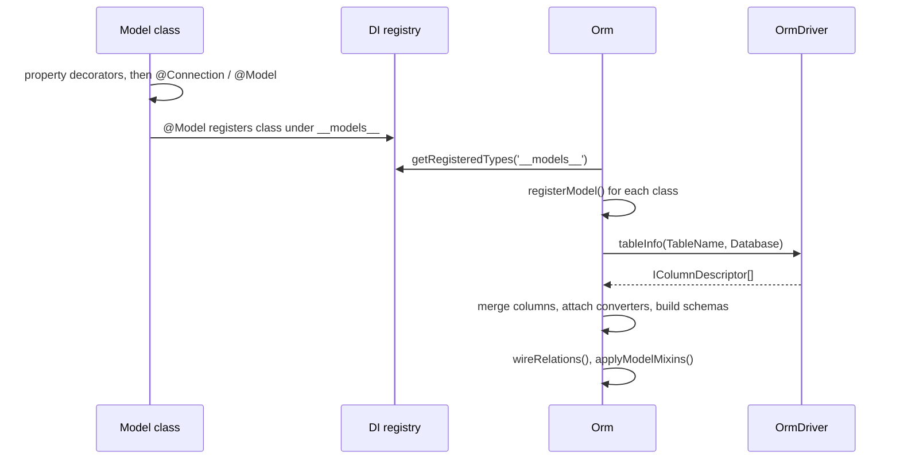

# Models

A model is a class that extends `ModelBase` and maps one database table. Decorators describe the
table, the primary key and the ORM-managed columns. The ORM reads the remaining columns from the
table itself when it starts.

## How it works

1. TypeScript evaluates the class. Property decorators (`@Primary()`, `@CreatedAt()`, `@Hidden()`, ...)
   run in declaration order, then class decorators (`@Connection()`, `@Model()`) run bottom-up.
2. Every decorator writes into the class's own `IModelDescriptor`, stored with `Reflect` metadata
   under `MODEL_DESCTRIPTION_SYMBOL`. The first decorator on a subclass seeds that descriptor from
   the parent's (see [Descriptor inheritance](#descriptor-inheritance)).
3. `@Model(tableName)` sets `TableName` and registers the class in DI under `__models__`.
4. `Orm.resolve()` calls `registerModel()` for every `__models__` class, runs the boot migrations,
   then calls `Orm.reloadTableInfo()`.
5. `reloadTableInfo()` handles each registered model:
   - looks up the connection named by `descriptor.Connection`; when none exists it logs a warning
     and skips the model, which then has no `Driver` and no table columns;
   - sets `descriptor.Driver` and calls `OrmDriver.tableInfo(TableName, Database)`;
   - merges the reflected columns into `descriptor.Columns`: a column a decorator already created
     keeps its object and receives every defined table property, a new column is appended;
   - resolves each `descriptor.Converters` entry from the connection container and sets it as the
     column's `Converter`, when the converter class is registered there;
   - flags `IsForeignKey` on every column a relation names as its `ForeignKey`;
   - gives a column with no converter the one registered in `__orm_db_value_converters__` under
     its lower-cased `NativeType`;
   - builds `descriptor.Schema` and `descriptor.ResponseSchema` (see
     [JSON schema](11-json-schema.md)).
6. `Orm.wireRelations()` resolves relation targets, and `applyModelMixins()` binds the static query
   API (`get`, `where`, `select`, ...) onto every registered model.



### What counts as a column

- A column is an entry in `descriptor.Columns`. Columns come from the table, not from class
  properties.
- A table column is hydrated and written even when the class does not declare it as a property.
- A class property with no table column is not a column. `hydrate()` copies it through
  `NonDbPropertyHydrator`, and `toSql()` never writes it.
- `@Ignore()` and `@Uuid()` create a column entry at decoration time, before any table info exists.

### The model descriptor

`IModelDescriptor` is the full description of a model. Read it with `Model.getModelDescriptor()`,
`model.ModelDescriptor` or `extractModelDescriptor(Model)`.

| Field | Type | Set by | Meaning |
| --- | --- | --- | --- |
| `Name` | `string` | every decorator | The class name. Always the class's own, never inherited. |
| `TableName` | `string` | `@Model()` | Table this model maps. |
| `Connection` | `string \| null` | `@Connection()` | Connection name from `db.Connections`. |
| `Driver` | `OrmDriver \| null` | `Orm.reloadTableInfo()` | The resolved connection. |
| `PrimaryKey` | `string[]` | `@Primary()` | Key columns in declaration order. Empty when the model has no `@Primary()`. |
| `PrimaryKeyGeneration` | `Map<string, PrimaryKeyGeneration>` | `@Primary()` | Generation strategy per key column. A missing entry means `auto`. |
| `Timestamps` | `IModelTimestampDescriptor` | `@CreatedAt()`, `@UpdatedAt()` | `CreatedAt` and `UpdatedAt` property names, `''` when unset. |
| `SoftDelete` | `IModelSoftDeleteDescriptor` | `@SoftDelete()` | `DeletedAt` property name, `''` when unset. |
| `Archived` | `IModelArchivedDescriptor` | `@Archived()` | `ArchivedAt` property name, `''` when unset. |
| `Columns` | `IColumnDescriptor[]` | `Orm.reloadTableInfo()`, `@Ignore()`, `@Uuid()` | Table columns. |
| `Converters` | `Map<string, IValueConverterDescriptor>` | converter decorators | Converter class and options per property. See [Converters and hydration](04-converters-and-hydration.md). |
| `Relations` | `Map<string, IRelationDescriptor>` | relation decorators | See [Relations](06-relations.md). |
| `JunctionModelProperties` | `IJunctionProperty[]` | `@JunctionTable()` | Properties that receive the junction row of a many-to-many relation. |
| `DiscriminationMap` | `IDiscriminationMap` | `@DiscriminationMap()` | See [Discrimination maps](14-discrimination-maps.md). |
| `Hidden` | `string[]` | `@Hidden()` | Properties `dehydrate()` never emits. |
| `Schema` | `any` | `Orm.reloadTableInfo()` | JSON schema of what a client may send. |
| `ResponseSchema` | `any` (optional) | `Orm.reloadTableInfo()` | JSON schema of what a read returns. |

### Column descriptor

`IColumnDescriptor` describes one column. Drivers fill it from table reflection.

| Field | Type | Meaning |
| --- | --- | --- |
| `Name` | `string` | Column name. |
| `Type` | `string` | Column type, eg. `int`, `varchar`. |
| `NativeType` | `string` | Full database type. The converter type-map matches on it. |
| `MaxLength` | `number` | Maximum character length. |
| `Comment` | `string` | Column comment. |
| `DefaultValue` | `any` | Database default. The `ModelBase` constructor copies it onto the instance. |
| `Unsigned` | `boolean` | Numeric sign. |
| `Nullable` | `boolean` | `false` on a non-key column makes `toSql()` and `dehydrate()` throw `Field <name> cannot be null` on an empty value. |
| `PrimaryKey` | `boolean` | Reflected key flag. It does **not** feed `descriptor.PrimaryKey`. |
| `AutoIncrement` | `boolean` | Reflected identity flag. |
| `Unique` | `boolean` | Unique constraint. `fresh()` falls back to unique columns when the model has no key; `getOrCreate()` and `getOrNew()` match on them. |
| `Uuid` | `boolean \| undefined` | Set by `@Uuid()`. |
| `Ignore` | `boolean` | Set by `@Ignore()`. |
| `Converter` | `IValueConverter \| null \| undefined` | Resolved converter instance. |
| `Schema` | `any` | Column JSON schema. |
| `Aggregate` | `boolean` | Generated column, eg. `sum` or `group by`. |
| `Virtual` | `boolean` | No database column behind it. Never written or snapshotted. |
| `IsForeignKey` | `boolean` | Foreign key column. |
| `ForeignKeyDescription` | `{ From, To, Table } \| null \| undefined` | Reflected foreign key. |

## Decorators

| Decorator | Target | Options | Effect |
| --- | --- | --- | --- |
| `@Model(tableName)` | class | `tableName: string` | Sets `TableName`, registers the class under `__models__`. Required for the static query API and for table columns. |
| `@Connection(name)` | class | `name: string` | Sets `Connection`. See [Connections](01-connections.md). |
| `@Primary(options?)` | property | `generated?: 'auto' \| 'uuid' \| 'assigned'`, default `'auto'` | Adds the property to `PrimaryKey`. Repeat on several properties for a composite key. |
| `@CreatedAt()` | property | none | Sets `Timestamps.CreatedAt` and a `DatetimeValueConverter`. The constructor stamps it with `DateTime.now()`. |
| `@UpdatedAt()` | property | none | Sets `Timestamps.UpdatedAt` and a `DatetimeValueConverter`. `update()` and `save()` stamp it when another column changed. |
| `@SoftDelete()` | property | none | Sets `SoftDelete.DeletedAt` and a `DatetimeValueConverter`. `destroy()` becomes an `UPDATE` of this column, and selects filter deleted rows out. |
| `@Archived()` | property | none | Sets `Archived.ArchivedAt` and a `DatetimeValueConverter`. Selects filter archived rows out. `model.archive()` stamps it. |
| `@Hidden()` | property or relation | none | Adds the name to `Hidden`. `dehydrate()` and `dehydrateWithRelations()` always omit it, and `ResponseSchema` drops it. `Schema` keeps it. |
| `@Ignore()` | property | none | Sets `Ignore: true` on the column. `buildModelJsonSchema()` skips it, so it is absent from `Schema` and `ResponseSchema`. |
| `@Uuid()` | property | none | Sets `Uuid: true` on the column and a `UuidConverter`. The constructor fills it with a v4 UUID. The converter stores 16-byte binary. |
| `@Historical(targetModel)` | property | `targetModel: Constructor<ModelBase>` | Adds a `Many` relation to `targetModel`, joined on the source model's primary key column. |
| `@JunctionTable()` | property | none | Records the property in `JunctionModelProperties`. See [Relations](06-relations.md). |
| `@DiscriminationMap(field, entries)` | class | see [Discrimination maps](14-discrimination-maps.md) | Picks the class per row from a column value. |

Relation decorators are covered in [Relations](06-relations.md). Converter decorators (`@DateTime()`,
`@Bool()`, `@Json()`, `@Set()`, `@UniversalConverter()`) are covered in
[Converters and hydration](04-converters-and-hydration.md).

### Primary key strategies

`@Primary()` takes `IPrimaryKeyOptions`. `generated` is a `PrimaryKeyGeneration`.

| `generated` | Who supplies the value | Insert behaviour |
| --- | --- | --- |
| `'auto'` (default) | The database (identity or auto-increment). | The insert asks for the key back: `RETURNING` when `supportedFeatures().insertReturning` is `true`, `LastInsertId` otherwise. |
| `'uuid'` | The ORM, client-side. | `generateClientSideKeys()` fills an empty key with a v4 UUID at construction and again before insert. A supplied value is never overwritten. |
| `'assigned'` | The caller. | `assertAssignedKeys()` throws `OrmException` before any SQL runs when the key is `null`, `undefined` or `''`. |

Multi-row `Model.insert([...])` backfills `auto` keys as follows:

- `RETURNING` rows, when the driver returns one per inserted row, are applied in insert order.
- A single row takes `LastInsertId`.
- Several rows take `LastInsertId + index` only when all of these hold: the driver reports
  `insertIdIsFirstOfBatch`, the model has one `auto` key column, the insert behaviour is
  `InsertBehaviour.None`, the batch ran as one statement (not split by `maxBindParameters` or
  `maxInsertRows`), `LastInsertId` is a positive number, `RowsAffected` equals the row count, and
  no row carried a key.
- Otherwise no key is assigned. Re-select the rows or insert them one at a time.

`InsertBehaviour` selects the conflict handling of `model.insert()` and `Model.insert()`:

| Value | Effect |
| --- | --- |
| `InsertBehaviour.None` | Plain insert. The default. |
| `InsertBehaviour.InsertOrIgnore` | Skips the row when the key exists (`orIgnore()`). |
| `InsertBehaviour.InsertOrUpdate` | Updates every non-key, non-virtual column when the key exists (`onDuplicate()`). |
| `InsertBehaviour.InsertOrReplace` | Replaces the row when the key exists (`orReplace()`). |

`Model.insert()` with an array accepts only `InsertBehaviour.None` and throws
`insert behaviour is not supported with arrays` otherwise.

### Descriptor inheritance

- Each class owns its descriptor. A subclass inherits by copy, never by reference.
- The first decorator on a subclass collapses the ancestor chain into a fresh descriptor
  (`getInheritedDescriptor` from `@spinajs/di`). It then gives the subclass its own copies of
  `Columns`, `Relations`, `Timestamps`, `SoftDelete`, `Archived` and `DiscriminationMap`.
  `@Ignore()` or `@Recursive()` on an inherited member does not change the parent.
- `PrimaryKey` and `Hidden` are additive. A subclass extends the parent's lists and never
  duplicates an entry, at any inheritance depth.
- A subclass cannot replace an inherited primary key, only add columns to it.
- A subclass with no decorator of its own has no own descriptor. `extractModelDescriptor()` returns
  `null` for it, `hydrate()` throws `cannot hydrate model <name>, no model descriptor found`, and
  building a query throws `model <name> does not have model descriptor`.

## Services and extension points

The descriptor and key helpers are plain exported functions.

| Function | Role |
| --- | --- |
| `extractModelDescriptor(target)` | Returns the class's own descriptor, or `null`. Accepts a class or a forward-ref function. |
| `extractModelDescriptorInherited(target)` | Returns a fresh descriptor collapsed from the whole chain. A read-only view: changes to it are not stored. |
| `createDefaultModelDescriptor()` | Returns an empty descriptor with every field at its default. |
| `updateModelDescriptor(target, callback)` | Hands the class's own descriptor to `callback` for changes. Never writes into an ancestor. |
| `extractDecoratorDescriptor(callback)` | Builds a class decorator that receives the class's own descriptor. |
| `extractDecoratorPropertyDescriptor(callback)` | Builds a property decorator that receives the class's own descriptor and the property name. |
| `pkColumns(descriptor)` | Key columns in declaration order. |
| `hasPk(descriptor)`, `isCompositePk(descriptor)` | Key presence, and key with more than one column. |
| `pkGeneration(descriptor, column)` | Strategy of one key column, `'auto'` when unrecorded. |
| `normalizePkTuple(descriptor, value)` | Turns a scalar, an array in key order or an object keyed by column into a tuple. Throws `OrmException` on a wrong length or a missing column. |
| `pkValueOf(source, descriptor)` | Reads a key: a scalar for one column, a tuple for a composite key. |
| `setPkValue(target, descriptor, value)` | Writes a key. Mirror of `pkValueOf()`. |
| `pkKeyString(source, descriptor)`, `pkKeyStringFor(source, keys)` | Flattens key columns into one collision-free string for use as a `Map` key. |
| `wherePk(builder, descriptor, value)` | Adds a `WHERE` matching one key. |
| `whereAnyPk(builder, descriptor, values)` | Adds a `WHERE` matching any of `values`. An empty array matches nothing. |
| `whereNotAnyPk(builder, descriptor, values)` | Adds a `WHERE` excluding all of `values`. An empty array adds no condition. |
| `orderByPk(builder, descriptor, order)` | Orders by every key column. Returns `false` when the model has no key. |
| `generateClientSideKeys(target, descriptor)` | Fills empty `uuid` key columns. |
| `assertAssignedKeys(target, descriptor)` | Throws when an `assigned` key column is empty. |

Exported metadata symbols:

| Symbol | Meaning |
| --- | --- |
| `MODEL_DESCTRIPTION_SYMBOL` | `Symbol.for('MODEL_DESCRIPTOR')`. Key of the model descriptor in `Reflect` metadata. The misspelling is part of the name. |
| `MIGRATION_DESCRIPTION_SYMBOL` | `Symbol.for('MIGRATION_DESCRIPTOR')`. See [Migrations](10-migrations.md). |
| `MIGRATION_FILE_REGEXP` | Matches `Name_yyyy_MM_dd_HH_mm_ss` migration class names. See [Migrations](10-migrations.md). |
| `SCHEMA_SYMBOL` | `Symbol.for('ORM_SCHEMA_SYMBOL')`. The ORM core does not read it. |

A custom model decorator writes into the descriptor through `extractDecoratorPropertyDescriptor()`,
the same way the built-in ones do:

```ts
import { extractDecoratorPropertyDescriptor, IModelDescriptor } from '@spinajs/orm';

export function Secret() {
  return extractDecoratorPropertyDescriptor((model: IModelDescriptor, _target: any, propertyKey: string) => {
    if (!model.Hidden.includes(propertyKey)) {
      model.Hidden.push(propertyKey);
    }
  });
}
```

`updateModelDescriptor()` sets descriptor fields without the side effects of `@Model()`. The ORM's
own tests use it to wire a model to a table without registering it:

```ts
updateModelDescriptor(Invoice, (d) => {
  d.Connection = 'sqlite';
  d.TableName = 'invoices';
});
```

## Important behaviour

- `descriptor.PrimaryKey` comes only from `@Primary()`. A model without it has no key even when the
  table has one: `get()`, `find()`, `destroy()` and `wherePk()` throw `model <name> has no primary key`.
- A composite key value is a tuple in declaration order. `PrimaryKeyValue` returns an array, and
  accepts an array in key order or an object keyed by column name.
- A relation joins on one column. When the model a relation takes its default join column from has
  a composite key, `@HasMany`, `@BelongsTo`, `@HasManyToMany` and `@Historical` throw
  `InvalidOperation` at class definition. Name the column explicitly.
- `hydrate()` never overwrites the primary key of a model that has a snapshot, that is one loaded
  from or written to the database.
- `@CreatedAt()`, `@UpdatedAt()`, `@SoftDelete()` and `@Archived()` throw at class definition when the
  property's reflected type is not Luxon's `DateTime`. A union such as `DateTime | null` reflects as
  `Object` and fails.
- Every select built for a `@SoftDelete()` model adds `WHERE DeletedAt IS NULL`. `get()`, `find()`,
  `first()` and `all()` therefore skip deleted rows. `withDeleted()` removes the filter.
- `@Archived()` adds `WHERE ArchivedAt IS NULL` to every select the same way. `withArchived()` removes
  it. Deletes and updates are not filtered.
- Both filters apply only when the column is in `descriptor.Columns`. A model whose table info did
  not load is not filtered.
- `@UpdatedAt()` is stamped only when at least one other column changed. A no-op `update()` writes
  nothing.
- `@Ignore()` is read only by `buildModelJsonSchema()`. It does **not** exclude the property from
  `hydrate()`, `dehydrate()` or `toSql()`. An `@Ignore()` property with no table column is still in
  `Columns` and is written on insert.
- `model.archive()` does not check that `@Archived()` was declared. Call it only on models that
  declare it.
- A model that never got `@Model()` is not in `Orm.Models`. Its static methods (`get`, `where`,
  `select`, ...) throw `Not implemented`, and it receives no table columns.
- `@Connection('default')` targets the connection named by `db.DefaultConnection`, when that key is set.

## Best practices

- Declare `@Primary()` properties above any relation property. Relation decorators read the key
  when they run, and property decorators run in declaration order.
- Use `@Hidden()` for values a response must never carry (`Password`). Use `@Ignore()` only to keep
  a property out of the JSON schemas.
- For a binary UUID key, combine `@Primary({ generated: 'uuid' })` with `@Uuid()` and create the
  column with `table.uuid(name)`, a 16-byte binary column.
- Use `'assigned'` or `'uuid'` for a composite key. SQLite cannot auto-increment a column of a
  composite key; see [SQLite dialect notes](../orm-sqlite/04-schema-and-ddl.md#composite-primary-keys).
- Give every subclass that is queried or hydrated its own `@Connection()` and `@Model()`.
- Import Luxon's `DateTime` under an alias when the file also uses the ORM's `@DateTime()`
  decorator, eg. `import { DateTime as LuxonDateTime } from 'luxon'`.

## Patterns and antipatterns

```ts
// Don't: the union reflects as Object, so @SoftDelete() throws when the class loads
@SoftDelete()
public DeletedAt: DateTime | null;

// Do
@SoftDelete()
public DeletedAt: DateTime;
```

```ts
// Don't: @HasMany reads the key while Id is not declared yet, so its PrimaryKey is undefined
@HasMany(InvoiceLine)
public Lines: Relation<InvoiceLine, Invoice>;

@Primary()
public Id: number;

// Do
@Primary()
public Id: number;

@HasMany(InvoiceLine)
public Lines: Relation<InvoiceLine, Invoice>;
```

```ts
// Don't: @Ignore() only removes the field from the JSON schemas, dehydrate() still returns it
@Ignore()
public Password: string;

// Do
@Hidden()
public Password: string;
```

## Examples

### Invoice with timestamps, soft delete and a hidden column

```ts sample
import { Connection, CreatedAt, Hidden, Model, ModelBase, Primary, SoftDelete, UpdatedAt } from '@spinajs/orm';
import { DateTime } from 'luxon';

@Connection('default')
@Model('invoices')
export class Invoice extends ModelBase<Invoice> {
  @Primary()
  public Id: number;

  public CustomerId: number;

  public Total: number;

  @Hidden()
  public InternalNote: string;

  @CreatedAt()
  public CreatedAt: DateTime;

  @UpdatedAt()
  public UpdatedAt: DateTime;

  @SoftDelete()
  public DeletedAt: DateTime;
}

export async function cancelInvoice(id: number) {
  // An UPDATE of DeletedAt, not a DELETE.
  await Invoice.destroy(id);
}

export async function invoicesForAudit(customerId: number) {
  // Soft-deleted invoices are excluded unless the filter is removed.
  return await Invoice.select().withDeleted().where('CustomerId', customerId);
}
```

### Order lines with a composite, caller-assigned key

```ts sample
import { Connection, Model, ModelBase, Primary } from '@spinajs/orm';

@Connection('default')
@Model('order_lines')
export class OrderLine extends ModelBase<OrderLine> {
  @Primary({ generated: 'assigned' })
  public OrderId: number;

  @Primary({ generated: 'assigned' })
  public LineNo: number;

  public Sku: string;

  public Quantity: number;
}

export async function findLine(orderId: number, lineNo: number) {
  // Array in key order; { OrderId, LineNo } works as well.
  return await OrderLine.get([orderId, lineNo]);
}

export async function addLine(orderId: number, lineNo: number, sku: string) {
  const line = new OrderLine({ OrderId: orderId, LineNo: lineNo, Sku: sku, Quantity: 1 });
  await line.insert();
  return line;
}
```

### API tokens keyed by a client-generated UUID

```ts sample
import { Connection, Model, ModelBase, Primary } from '@spinajs/orm';

@Connection('default')
@Model('api_tokens')
export class ApiToken extends ModelBase<ApiToken> {
  @Primary({ generated: 'uuid' })
  public Id: string;

  public UserId: number;
}

export async function issueToken(userId: number) {
  const token = new ApiToken({ UserId: userId });

  // The key exists before the INSERT, so it can be returned without a round-trip.
  const id = token.Id;
  await token.insert();

  return id;
}
```

### Shared audit columns through inheritance

```ts sample
import { Connection, CreatedAt, Model, ModelBase, Primary, UpdatedAt } from '@spinajs/orm';
import { DateTime } from 'luxon';

export abstract class AuditedModel<M> extends ModelBase<M> {
  @CreatedAt()
  public CreatedAt: DateTime;

  @UpdatedAt()
  public UpdatedAt: DateTime;
}

@Connection('default')
@Model('customers')
export class Customer extends AuditedModel<Customer> {
  @Primary()
  public Id: number;

  public Name: string;
}

@Connection('default')
@Model('suppliers')
export class Supplier extends AuditedModel<Supplier> {
  @Primary()
  public Id: number;

  public TaxId: string;
}
```

`Customer` and `Supplier` each get their own descriptor with both timestamps and their own key.
Neither writes into `AuditedModel`'s descriptor.

### History of a model

`@Historical()` declares the relation to a history model. `TableQueryBuilder.trackHistory()` creates
the `<table>__history` table and its triggers; see [Schema builder](09-schema-builder.md).
`IHistoricalModel` and the abstract `HistoricalModel` class declare the history columns
`__action__` (`'insert' | 'update' | 'delete'`), `__revision__`, `__start__` and `__end__`.

<!-- TODO(docs-hook): verify how a history model is declared and populated end to end; HistoricalModel does not extend ModelBase and @Historical sets no RelationClass. -->

## Related

- [Connections](01-connections.md): `@Connection()`, the `db.Connections` names and the `default` alias.
- [Model API](03-model-api.md): the static and instance methods the descriptor drives.
- [Converters and hydration](04-converters-and-hydration.md): converter decorators and how columns are hydrated.
- [Relations](06-relations.md): relation decorators and `@JunctionTable()`.
- [Unit of work](07-unit-of-work.md): `save()`, snapshots and `@UpdatedAt()` stamping.
- [Schema builder](09-schema-builder.md): `table.uuid()`, `trackHistory()`.
- [JSON schema](11-json-schema.md): how `Schema` and `ResponseSchema` use `Hidden` and `Ignore`.
- [Discrimination maps](14-discrimination-maps.md): one table, several classes.
- [`@spinajs/orm-sql`](../orm-sql/README.md): `tableInfo()` and the SQL drivers.
