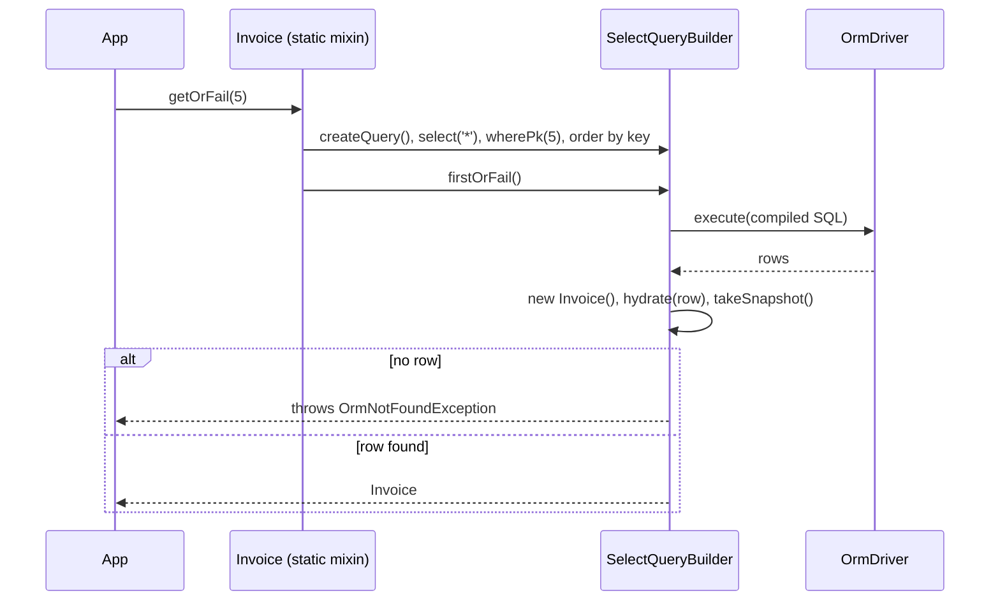

# Model API

`ModelBase` gives every model class static methods to read and write rows (`get`, `where`, `insert`, `update`, `destroy`, ...) and instance methods to persist one loaded model. Use the static side for queries and bulk writes, the instance side for a single row you hold in memory.

## How it works

1. `@Model()` registers the class under `__models__` (see [Models](02-models.md)).
2. `Orm.resolve()` runs the boot migrations, loads table info, wires relations, then calls `applyModelMixins()`. It binds every function of `MODEL_STATIC_MIXINS` onto each registered model class.
3. A static call such as `Invoice.getOrFail(5)` runs the mixin. It calls `createQuery()`, which resolves the model's connection (`OrmConnection`), builds the builder in the connection's container, binds the model's query scopes and adds the default soft-delete and archive filters.
4. The mixin adds its conditions (`wherePk()`, ordering) and awaits the builder. The driver executes the SQL.
5. The builder creates a model per row through `__orm_model_factory__`, calls `hydrate()` and `takeSnapshot()` (see [Converters and hydration](04-converters-and-hydration.md)).
6. The mixin returns the result. `getOrFail()` throws `OrmNotFoundException` when no row matched.



### Static methods

Every method below is bound by `Orm`. Before `Orm` resolves, or on a class without `@Model()`, the `ModelBase` stub throws `Not implemented`.

| Method | Returns | Behaviour |
| --- | --- | --- |
| `query()` | select builder | Builder over the model's table, no column list. |
| `select()` | select builder | Same, with `select('*')`. |
| `where(...)` | select builder | `select('*')` plus one `where()` call. Accepts `(column, value)`, `(column, operator, value)`, an object of column values, a `WhereFunction`, a `boolean` or a `Wrap`. |
| `all(page?, perPage?)` | select builder | All rows. With `page >= 0` and `perPage > 0` it adds `take(perPage).skip(page * perPage)`; `page` is zero-based. |
| `get(pk)` | `Promise<model>` | First row with this primary key. Resolves `undefined` when no row matches. |
| `getOrFail(pk)` | `Promise<model>` | As `get()`, throws `OrmNotFoundException` when no row matches. |
| `find(pks)` | `Promise<model[]>` | Rows matching any key in `pks`. An empty array matches nothing. |
| `findOrFail(pks)` | `Promise<model[]>` | As `find()`. Throws `Error` (`could not find all results for model <Name>`) when fewer rows than keys come back. |
| `first(callback?)` | `Promise<model>` | First row ordered by primary key ascending. Without a key it orders by `Unique` columns, then `@CreatedAt`, then `@UpdatedAt`. `callback` receives the builder. |
| `last(callback?)` | `Promise<model>` | As `first()`, descending. |
| `newest(callback?)` / `oldest(callback?)` | `Promise<model>` | First row by `@CreatedAt` descending / ascending. Throws `OrmException` when the model has no `@CreatedAt`. |
| `count(callback?)` | `Promise<number>` | `COUNT(*)`; `0` when nothing matches. |
| `exists(pk)` | `Promise<boolean>` | Selects only the key columns of the row with this key. With `pk === null` it checks whether the table has any row. |
| `insert(data, behaviour?)` | `Promise<IInsertResult>` | Inserts one model, one plain object or an array. See [Insert](#insert). |
| `update(data)` | update builder | `UPDATE ... SET data`. Chain a `where()`. Throws `OrmException` when `data` is a `ModelBase`. |
| `destroy(pk \| pk[])` | delete builder | `DELETE` by key, or `UPDATE ... SET DeletedAt = now` on a `@SoftDelete` model. Throws `OrmException` for `undefined`, `null` or `[]`. |
| `truncate()` | truncate builder | Clears the table. |
| `create(data)` | `Promise<model>` | `new Model(data)`, then `insert()`. |
| `getOrCreate(pk, data?)` | `Promise<model>` | Looks up by `pk` (skipped when `null`) and by every `Unique` column with its value from `data`. Inserts `new Model(data)` when nothing matches. |
| `getOrNew(data?)` | `Promise<model>` | Looks up by every `Unique` or primary-key column present in `data`. Returns `new Model(data)` without saving when nothing matches; an auto-increment key in `data` is dropped. |
| `populate(relation, owner)` | select builder | Rows of one relation of `owner`. See [Relations](06-relations.md). |
| `whereExists(relation \| query, callback?)` / `whereNotExists(...)` | select builder | Filters by a related row. See [Relations](06-relations.md). |
| `transaction(callback, options?)` | `Promise<R>` | Runs `callback` in a transaction on the model's connection. See [Transactions](08-transactions.md). |
| `getModelDescriptor()` | `IModelDescriptor` | The model's descriptor. Throws `OrmException` when the class has none. |
| `getRelationDescriptor(name)` | `IRelationDescriptor` | Relation descriptor, matched case-insensitively. Throws `OrmException` when missing. |

Every builder is lazy: awaiting it executes the query. See [Query builder](05-query-builder.md).

#### Insert

1. `insert()` runs `generateClientSideKeys()` (fills `uuid` keys) and `assertAssignedKeys()` (throws when an `assigned` key is missing) on every row, before any SQL is built.
2. A `ModelBase` row is converted with `toSql()`; a plain object with `ObjectToSqlConverter`, which skips `undefined` properties.
3. `behaviour` maps to `orIgnore()`, `onDuplicate().update(<every non-key column>)` or `orReplace()`. An array with any behaviour other than `InsertBehaviour.None` throws `OrmException`; an empty array resolves without a query.
4. When the key is database-generated and the driver supports `RETURNING`, the insert asks for the key columns.
5. After execution, generated keys are written back onto every `ModelBase` row: from `RETURNING`, from `LastInsertId` for a single row, or from `LastInsertId + index` when the driver reports `insertIdIsFirstOfBatch`. Every `ModelBase` row is then re-baselined with `takeSnapshot()`.
6. A batch larger than one statement can carry is split by `InsertQueryBuilder.splitByDriverLimits()` and runs in one transaction; generated keys come back from every statement's `RETURNING`, in insert order.

### Instance members

| Member | Behaviour |
| --- | --- |
| `constructor(data?)` | Sets defaults: column `DefaultValue`, a fresh uuid for `@Uuid()` columns and `uuid` keys, `@CreatedAt` = now, relation objects. Then calls `hydrate(data)`. |
| `ModelDescriptor` | The class descriptor. |
| `Container` | The DI container of the model's connection. |
| `PrimaryKeyName` | Key column names (`string[]`). |
| `PrimaryKeyValue` | A scalar for a one-column key, a tuple for a composite key. Setting it accepts a scalar, an array in key order or an object keyed by column. For a one-column key it also writes the new key into the foreign key of every loaded `@HasMany` child. |
| `valueOf()` | Returns `PrimaryKeyValue`, so `+a === +b` compares two models by key. |
| `hydrate(data)` / `dehydrate(options?)` / `dehydrateWithRelations(options?)` / `toJSON()` / `toSql(onlyDirty?)` | Fill the model from data and serialize it. See [Converters and hydration](04-converters-and-hydration.md). |
| `attach(model)` | Puts `model` into the matching relation. See [Relations](06-relations.md). |
| `insert(behaviour = InsertBehaviour.None)` | Inserts this model; back-fills a generated key; re-baselines the snapshot. |
| `update(data?)` | Hydrates `data`, then writes only the changed non-key columns plus `@UpdatedAt`. Resolves `{ RowsAffected: 0, LastInsertId: 0 }` without a query when nothing changed. |
| `insertOrUpdate()` | `update()` when `PrimaryKeyValue` is truthy, otherwise `insert()`. |
| `save(options?)` | Persists the model and everything reachable from it in one transaction. See [Unit of work](07-unit-of-work.md). |
| `destroy()` | Static `destroy()` with this model's key. Resolves `undefined` without a query when a key column is empty. |
| `archive()` | Sets `@Archived` to now and writes the whole model by key. Throws `OrmException` when the model has no `@Archived`. |
| `fresh()` | A new instance read by key, or by `Unique` columns when the model has no key. Throws `OrmNotFoundException` when missing, `OrmException` when there is neither key nor unique column. |
| `refresh()` | Copies every column from `fresh()` onto this instance and re-baselines the snapshot. |
| `driver()` | The connection's `OrmDriver`. |
| `getFlattenRelationModels(recursive?)` | Every loaded related model as one array. |
| `IsNew`, `IsDirty`, `Snapshot`, `changeSet()`, `takeSnapshot()`, `snapshotRelation()`, `clearSnapshot()` | Dirty tracking. See [Unit of work](07-unit-of-work.md). |

### Query scopes

A scope is a reusable set of conditions you call on a builder: `Invoice.query().overdue(now)`. See [Scopes and builder extensions](16-scopes-and-builder-extensions.md).

### Helpers and fp wrappers

| Function | Behaviour |
| --- | --- |
| `getEntity(idOrEntity, Model, fresh?)` | A number loads with `Model.get()`; a model is returned as-is, or through `fresh()` when `fresh` is true. |
| `insertModel(model \| model[], behaviour?)` | Inserts; throws `NoRowsAffected` when `RowsAffected <= 0`. An array goes through static `insert()`. |
| `updateModel(model, data?)` | `model.update(data)`; resolves the model, also when nothing changed. |
| `insertOrUpdateModel(model)` | `model.insertOrUpdate()`; resolves the model. |
| `deleteModel(model)` | `model.destroy()`; throws `NoRowsAffected` when `RowsAffected <= 0`. |
| `_getEntity(idOrEntity, Model, fresh?)` | Returns `() => getEntity(...)`. |
| `_insert(behaviour?)` / `_update(data?)` / `_insertOrUpdate()` / `_delete()` | Return `(model) => insertModel(...)` and so on, for composing pipelines. |

### Types and results

| Type | Meaning |
| --- | --- |
| `IUpdateResult` | `{ RowsAffected, LastInsertId }`. |
| `IInsertResult` | `IUpdateResult` plus `Returning`: rows the dialect echoed back, empty when unsupported. `LastInsertId` is `0` for `uuid` and `assigned` keys. |
| `InsertBehaviour` | `None`, `InsertOrIgnore`, `InsertOrUpdate`, `InsertOrReplace`. |
| `IModelStatic` | Constructor type of a model class with its static API; used for relation targets. |
| `IModelBase` | The instance contract `ModelBase` implements. |
| `QueryScope` | Marker base class for scope classes. |
| `ModelData<T>` | Data properties of `T`: no functions, no relations, no `PrimaryKeyValue`, `PrimaryKeyName`, `ModelDescriptor`, `Container`. The return type of `dehydrate()`. |
| `ModelDataWithRelationData<T>` | `ModelData<T>` plus each relation as its target's data. The return type of `dehydrateWithRelations()`. |
| `ModelDataWithRelationDataSearchable<T>` | As above, a single relation may also be a key number. Used by object-form `where()`. |
| `PartialModel<T>` | Every property optional; a `SingleRelation<X>` property typed as `X`. |
| `PartialArray<T>` | Every property as a value or an array of values. |
| `PickRelations<T>` | Only the relation properties, each unboxed to its target type. |
| `WhereFunction<T>` | `(this: IWhereBuilder<T>) => void`, a grouped condition. |

### Exceptions

| Exception | Thrown by |
| --- | --- |
| `OrmException` | Invalid use: a missing descriptor or relation, `destroy()` without keys, `newest()` without `@CreatedAt`, `archive()` without `@Archived`, an array insert with a behaviour. Driver errors carry `driver`, `query`, `bindings` and `inner`. |
| `OrmNotFoundException` | `getOrFail()`, `fresh()`, `refresh()` and any builder's `firstOrFail()` when no row matches. Extends `OrmException`. |
| `NoRowsAffected` | `insertModel()`, `deleteModel()` and the `_insert()` / `_delete()` wrappers when the statement changed no row. Extends `OrmException`. |
| `UniqueViolation` | Any statement that breaks a primary key or unique constraint, on every driver. Extends `ResourceDuplicated` from `@spinajs/exceptions`, not `OrmException`. Carries `table`, `constraint` and `columns` when the driver reports them, and the native error as `inner`; its message is the native message. |
| `ConstraintViolation` | A NOT NULL, CHECK or FOREIGN KEY failure. Extends `OrmException`. `kind` is `'not_null'`, `'check'`, `'foreign_key'` or `'other'`; `table`, `constraint`, `columns` and `inner` as for `UniqueViolation`. |

## Services and extension points

| Service | Role | Default implementation | How to override |
| --- | --- | --- | --- |
| `QueryScope` | Per-model builder extensions | none | Set `public static readonly _queryScopes` on the model. See [Scopes and builder extensions](16-scopes-and-builder-extensions.md). |
| `MODEL_STATIC_MIXINS` | The static API bound onto each model | the exported object | Not replaceable per model; `Orm` binds it as-is. |
| `ServerResponseMapper` | Reads the driver's insert response into `RowsAffected`, `LastInsertId`, `Returning` | registered by each driver | See [Architecture](12-architecture.md). |

## Important behaviour

- Static methods exist only after `Orm.resolve()` reaches `applyModelMixins()`. Migration `up()` runs before that, `data()` after it. See [Migrations](10-migrations.md).
- Construct a model after `Orm` has resolved. `hydrate()` resolves the connection's container and throws `model <Name> have invalid connection ...` when it cannot.
- `get()`, `first()`, `last()`, `newest()` and `oldest()` resolve `undefined` when nothing matches, although their return type is the model.
- Static `insert()` is `async`: it returns a promise, not the `InsertQueryBuilder` its type declares. Pass everything through `data` and `behaviour`.
- Static `update(data)` sends `data` as given. Column converters declared with decorators are **not** applied; see [Converters and hydration](04-converters-and-hydration.md#important-behaviour).
- `insertOrUpdate()` tests `PrimaryKeyValue` for truthiness. A `@Uuid()` column or a `uuid` key is filled at construction, and a composite key is a non-empty array, so these models always take the `update()` path.
- `getOrCreate(pk, data)` uses `pk` only for the lookup. The new model gets its key from `data` or from the database.
- `getOrNew(data)` with no key or `Unique` column in `data`, and `getOrCreate(null, data)` on a model without `Unique` columns, add no condition and return the first row of the table.
- `findOrFail()` throws a plain `Error`, not `OrmNotFoundException`.
- Select builders of a `@SoftDelete` model filter `DeletedAt IS NULL`, and of an `@Archived` model `ArchivedAt IS NULL`, when the column is in the reflected table. `withDeleted()` and `withArchived()` remove the filter. Delete builders are not archive-filtered.
- `archive()` writes every column from `toSql()`, not only `ArchivedAt`.
- `refresh()` copies columns only; loaded relations keep their values.
- `exists()` is declared on `ModelBase` without a parameter; the bound method reads `pk`. Call it through `IModelStatic` or a cast.
- The static `driver()` is bound at runtime but not declared on `ModelBase`. Use the instance `driver()` or `getModelDescriptor().Driver`.

## Best practices

- Use `getOrFail()` in request handlers: `OrmNotFoundException` maps to a 404 in one place instead of a `null` check per call.
- Use `save()` for new models with client-generated keys and for model graphs; keep `insert()` / `update()` for one known-new or known-loaded row.
- Pass `InsertBehaviour.InsertOrIgnore` for idempotent seeding in migration `data()` hooks.
- Read `count()` instead of loading rows and taking `.length`.

## Patterns and antipatterns

```ts
// Don't: static insert() returns a promise at runtime; orIgnore() is not a function on it
await Invoice.insert(row).orIgnore();

// Do
await Invoice.insert(row, InsertBehaviour.InsertOrIgnore);
```

```ts
// Don't: Payment has a uuid key, filled at construction, so this issues an UPDATE that matches no row
const payment = new Payment({ Amount: 120 });
await payment.insertOrUpdate();

// Do: save() classifies the model as new by its missing snapshot, not by its key
await payment.save();
```

```ts
// Don't: destroy() refuses an unbounded delete and throws OrmException
await Invoice.destroy();

// Do
await Invoice.truncate();
```

```ts
// Don't: static update() rejects a model instance
await Invoice.update(invoice).where('Id', invoice.Id);

// Do: the instance method writes only the changed columns
invoice.Status = 'paid';
await invoice.update();
```

## Examples

### Issue, pay and void invoices

```ts sample
import { Connection, CreatedAt, DateTime as DateTimeColumn, InsertBehaviour, Model, ModelBase, OrmNotFoundException, Primary } from '@spinajs/orm';
import { DateTime } from 'luxon';

@Connection('default')
@Model('invoices')
export class Invoice extends ModelBase<Invoice> {
  @Primary()
  public Id: number;

  public CustomerId: number;

  public Number: string;

  public Status: string;

  @DateTimeColumn()
  public DueAt: DateTime;

  @CreatedAt()
  public CreatedAt: DateTime;
}

export async function issueInvoice(customerId: number, number: string): Promise<Invoice> {
  return await Invoice.create({
    CustomerId: customerId,
    Number: number,
    Status: 'unpaid',
    DueAt: DateTime.now().plus({ days: 14 }),
  });
}

export async function importInvoiceNumbers(customerId: number, numbers: string[]): Promise<void> {
  for (const number of numbers) {
    // a unique index on Number makes a re-run skip rows already imported
    await Invoice.insert({ CustomerId: customerId, Number: number, Status: 'unpaid', DueAt: DateTime.now() }, InsertBehaviour.InsertOrIgnore);
  }
}

export async function payInvoice(id: number): Promise<Invoice | null> {
  try {
    const invoice = await Invoice.getOrFail(id);
    await invoice.update({ Status: 'paid' });
    return invoice;
  } catch (err) {
    if (err instanceof OrmNotFoundException) {
      return null;
    }
    throw err;
  }
}

export async function voidCustomerInvoices(customerId: number): Promise<number> {
  const result = await Invoice.update({ Status: 'void' }).where('CustomerId', customerId).where('Status', 'unpaid');
  return result.RowsAffected;
}

export async function unpaidCount(): Promise<number> {
  return await Invoice.count((q) => q.where('Status', 'unpaid'));
}

export async function invoicePage(page: number): Promise<Invoice[]> {
  return await Invoice.all(page, 25);
}
```

### Compose writes with the fp wrappers

```ts sample
import { _getEntity, _update, Connection, Model, ModelBase, Primary } from '@spinajs/orm';

@Connection('default')
@Model('tickets')
export class Ticket extends ModelBase<Ticket> {
  @Primary()
  public Id: number;

  public Status: string;
}

export async function closeTicket(id: number): Promise<Ticket> {
  const ticket = await _getEntity(id, Ticket)();
  return await _update<Ticket>({ Status: 'closed' })(ticket);
}
```

## Related

- [Models](02-models.md): the decorators that declare keys, timestamps, soft delete and archiving.
- [Converters and hydration](04-converters-and-hydration.md): what `hydrate()`, `dehydrate()` and `toSql()` do with each value.
- [Query builder](05-query-builder.md): every builder method the static API returns.
- [Relations](06-relations.md): `attach()`, `populate()` and `whereExists()`.
- [Unit of work](07-unit-of-work.md): `save()`, snapshots and dirty tracking.
- [Transactions](08-transactions.md): `Model.transaction()`.
- [`@spinajs/orm-http`](../orm-http/README.md): loads models from route arguments with `get` / `getOrFail` semantics.
