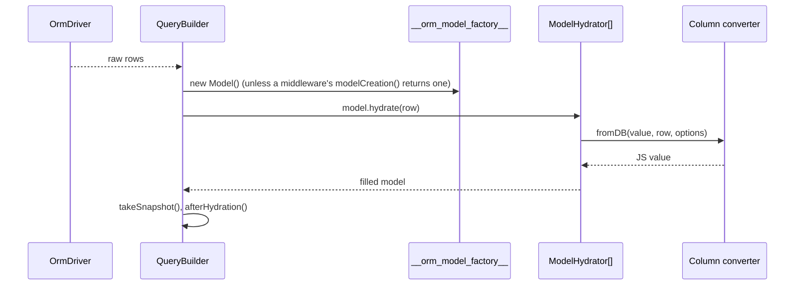

# Converters and hydration

A value converter turns one column's database value into a JS value and back: a SQL datetime into a luxon `DateTime`, `0`/`1` into a boolean, a JSON string into an object. Hydrators fill a model from a row or a DTO; dehydrators and `toSql()` turn a model back into plain data for a response or a statement.

## How it works

### Attaching converters at boot

1. A converter decorator (`@DateTime()`, `@Json()`, ...) records `{ Class, Options }` in the model descriptor's `Converters` map, keyed by property name.
2. `Orm.resolve()` calls `reloadTableInfo()`, which reads every model's columns with `driver.tableInfo()`.
3. For each `Converters` entry whose column exists in the table, `Orm` checks `connection.Container.hasRegistered()` for the class and then for each of its base classes. When one is registered, it resolves the declared class and stores the instance in `column.Converter`. A subclass of a shipped converter therefore runs without its own registration.
4. A column still without a converter gets one from the `__orm_db_value_converters__` map, looked up by its lowercased native type.
5. The resolved instance stays on the column descriptor and is shared by every instance of the model.

### Reading a row

1. The builder runs the driver query and the `afterQuery()` result middlewares.
2. It creates one model per row: the first builder middleware whose `modelCreation()` returns a model wins (see [Discrimination maps](14-discrimination-maps.md)); otherwise `__orm_model_factory__` calls `new Model()`.
3. `model.hydrate(row)` resolves every `ModelHydrator` from the connection's container and runs them in registration order:
   - `DbPropertyHydrator` sets each key that is a model column, through `column.Converter.fromDB(value, row, options)`.
   - `NonDbPropertyHydrator` copies every other key unchanged.
   - `OneToManyRelationHydrator` and `OneToOneRelationHydrator` turn nested relation data into relation objects with hydrated target models. A belongs-to row whose values are all `null` or `undefined` (a `NULL` foreign key) gives a `SingleRelation` with `Value` `undefined` and `Populated` `true`; the rows of belongs-to relations populated under it are checked the same way and do not count as data.
   - `JunctionModelPropertyHydrator` fills `@JunctionTable()` properties from the row's `JunctionModel` data.
4. The builder calls `takeSnapshot()`, then the `afterHydration()` middlewares.



### Writing a model

1. `insert()`, `update()`, `archive()` and the unit of work call `model.toSql()`.
2. `toSql()` resolves `ModelToSqlConverter` from the connection's container. `StandardModelToSqlConverter`:
   - skips `Virtual` columns and foreign-key columns a relation manages;
   - throws `OrmException` (`Field <name> cannot be null`) for a non-key, non-nullable column holding `null`, `undefined` or `''`;
   - writes `column.Converter.toDB(value, model, column, options)`, or the raw value;
   - writes each `@BelongsTo` foreign key from the related model's join column. Without a related model it writes the raw column; after a detach, `NULL`. The key goes through the foreign-key column's converter like any other column (`NULL` stays `NULL`); a driver's converter gets these keys from the protected `relationForeignKeys(model)` of the `ModelToSqlConverter` base class.
3. `toSql(true)` keeps only the columns in `changeSet()`.
4. Static `insert()` of a plain object uses `ObjectToSqlConverter` instead. `StandardObjectToSqlConverter` skips `undefined` properties, calls `toDB(value, undefined, column, options)`, and turns a model held under a `@BelongsTo` property into its key, converted the same way.

### Serializing a model

1. `dehydrate(options)` resolves `StandardModelDehydrator`; `dehydrateWithRelations(options)` resolves `StandardModelWithRelationsDehydrator`. Both add the model's `@Hidden()` properties to `options.omit`.
2. For each column the dehydrator:
   - skips columns in `omit`;
   - reads an empty foreign-key column from the related model's key, when the relation holds one;
   - skips a `Virtual` column without a value;
   - throws `OrmException` (`Field <name> cannot be null`) for a non-key, non-nullable column holding `null`, `undefined` or `''`, unless `ignoreNullable` is set;
   - writes `column.Converter.toDB(value, model, column, converterOptions, options)`, then applies `skipNull`, `skipUndefined` and `skipEmptyArray`.
3. `StandardModelWithRelationsDehydrator` adds relations. A `@BelongsTo` holding a model (populated or attached) becomes that model, dehydrated recursively; one holding none is absent. A `@HasMany` or many-to-many relation becomes an array, `[]` when empty. Nested models start from an empty `omit` list and apply their own `@Hidden()`.
4. `toJSON()` returns `dehydrate()`, so `JSON.stringify(model)` carries columns only, no relations.

### `IDehydrateOptions`

| Key | Type | Default | Allowed values | Meaning |
| --- | --- | --- | --- | --- |
| `omit` | `string[]` | `[]` | property names | Columns and relations to leave out, added to `@Hidden()`. |
| `skipNull` | `boolean` | `false` | | Leave out columns whose converted value is `null`. |
| `skipUndefined` | `boolean` | `false` | | Leave out columns whose converted value is `undefined`. |
| `skipEmptyArray` | `boolean` | `false` | | Leave out columns whose converted value is `[]`. |
| `ignoreNullable` | `boolean` | `false` | | Do not throw for an empty non-nullable column. |
| `dateTimeFormat` | `string` | unset | `'iso'`, `'sql'`, `'unix'` | Datetime rendering, read by the driver's datetime converter. |

### Built-in converters

| Converter | Registered by | `toDB` | `fromDB` |
| --- | --- | --- | --- |
| `JsonValueConverter` | `OrmDriver.resolve()` | `JSON.stringify(value)`; `null` and `undefined` as they are, so the column holds SQL NULL | `null` for SQL NULL; a value that is not a string (an object, array, number or boolean the driver parsed already) as it is; a string through `JSON.parse`, so the text `null` gives `null` and `123` the number; a string that is not JSON text as it is |
| `UuidConverter` | `OrmDriver.resolve()` | A dashed uuid to a 16-byte `Buffer`; a 16-byte `Buffer` or `Uint8Array` returned as it is, other byte lengths throw `InvalidArgument`; empty values to `null` | A 16-byte `Buffer` or `Uint8Array` (a view at an offset too) to the dashed 36-character form; bytes of another length to their hex text; a string to the dashed form when it is 32 characters long without its dashes, otherwise returned as it is; empty values to `null` |
| `UniversalValueConverter` | `OrmDriver.resolve()` | By the model's type column: `boolean` to `'true'`/`'false'`, `datetime`/`date`/`time` to ISO text, `number`/`float` to decimal text, `json` to JSON, anything else as-is | By the row's type column: the reverse, with dates read by `DateTime.fromISO` |
| `Int64ValueConverter` | `OrmDriver.resolve()` | A `bigint` to decimal text, a safe integer as is, a decimal string trimmed of surrounding whitespace; anything else throws `InvalidArgument` | Any driver form (string, number, bigint) to the decorator's `as`: `'string'` (default), `'number'` (throws `OrmException` beyond `Number.MAX_SAFE_INTEGER`) or `'bigint'`. A number that is not a safe integer throws `OrmException`: the driver already lost precision. |
| `DatetimeValueConverter` | the driver (`SqlDatetimeValueConverter` on MySQL, `IsoDatetimeValueConverter` on PostgreSQL, SQLite and MSSQL) | luxon `DateTime` in any zone, `Date`, ISO 8601 or SQL text (no offset = UTC) to the dialect's UTC text; for a numeric column unix seconds, or milliseconds under `@DateTime({ unit: 'milliseconds' })`; ISO 8601 in UTC when dehydrating without `dateTimeFormat` | Any driver form (`Date`, `DateTime`, ISO 8601 or SQL text, a number or numeric text in the declared unit) to a `DateTime` in UTC; `null` for an empty value and for one that is not a valid datetime |
| `TimeValueConverter` | the driver (`SqlTimeValueConverter`) | `TimeSpan` to `HH:MM:SS` | `TIME` text to `TimeSpan` |
| `BooleanValueConverter` | the driver (`SqlBooleanValueConverter`) | `1`/`0` in statements, a boolean when dehydrating; `null` and `undefined` give `0` (`false` when dehydrating), or `null` with `@Bool({ nullable: true })` | `true` for `1`, `true` or `'1'`, otherwise `false`; NULL gives `false`, or `null` with `@Bool({ nullable: true })` |
| `SetValueConverter` | the driver (`SqlSetConverter`) | Array joined with `,` | String split on `,` |

The last four are tokens: `ValueConverter`'s own methods throw `MethodNotImplemented` with a message that names the converter class, and each driver binds its implementation in its container. See [`@spinajs/orm-sql` value converters](../orm-sql/05-value-converters-and-defaults.md).

Two exported helpers hold the instant rules the datetime converters share; use them in a custom datetime converter:

| Function | Behaviour |
| --- | --- |
| `toInstant(value, column?, unit = 'seconds')` | Write side. A `DateTime`, a `Date`, a number of `unit` since the epoch, or ISO 8601 / SQL text (no offset = UTC) to a valid `DateTime` in UTC. `null`, `undefined` and `''` give `null`, and so does an invalid `DateTime` or `Date`. Text that is neither ISO 8601 nor SQL, or any other type, throws `InvalidArgument` naming `column`. |
| `instantFromDb(value, unit = 'seconds')` | Read side. The same inputs to a `DateTime` in UTC, and numeric text that is not ISO 8601 or SQL (pg `int8`, MSSQL `bigint` and mysql2 `DECIMAL` arrive as text) as a number of `unit`. Short numeric text stays ambiguous, because ISO 8601 and SQL parsing run first: `'2026'` reads as a year, `'123456'` as a time of day, `'20261019'` as a date; 10- and 13-digit epochs are not affected. Never throws: an empty value or one that does not parse gives `null`. |

Three exported types describe the `options` argument these converters receive: `DateTimeUnit` (`'seconds' | 'milliseconds'`), `IDateTimeConverterOptions` (`{ unit?: DateTimeUnit }`) and `IBoolConverterOptions` (`{ nullable?: boolean }`).

Default `__orm_db_value_converters__` map, registered by `Orm.registerDefaultConverters()`:

| Keys | Converter |
| --- | --- |
| `Date`, `DateTime` | `DatetimeValueConverter` |
| `Boolean`, `Bool`, `boolean`, `bool` | `BooleanValueConverter` |
| `Time`, `time`, `TimeSpan`, `timespan` | `TimeValueConverter` |

Column lookup lowercases the native type, so only the lowercase keys match a column. The capitalized keys match the class name of a value in a `WHERE` binding or an `UPDATE` `SET` value, which `@spinajs/orm-sql` converts by type.

### The `IValueConverter` contract

| Member | Called with | Notes |
| --- | --- | --- |
| `toDB(value, model, column, options, dehydrateOptions?)` | `toSql()`: 4 arguments. `dehydrate()`: 5, the last being the dehydrate options. Static insert of a plain object: `model` is `undefined`. An `orm-sql` `where()`, `whereIn()` or BETWEEN binding: `model` is `null`; `column` is the model's column descriptor (`undefined` for a wrapped column or a query without a model); `options` is the column's declared converter options, or `null` when the converter is chosen by the value's class. | One method serves statements and serialization; tell them apart by the argument count. |
| `fromDB(value, rawData, options)` | `rawData` is the whole row or DTO; `options` is the decorator's `Options`. | Also runs on `hydrate()` of a DTO, so accept values that are already converted. |
| `snapshotValue?(value)` | When the snapshot baseline is taken. | Implement with `snapshotEquals` when `fromDB` returns a mutable instance of a class the ORM does not own. |
| `snapshotEquals?(a, b)` | When the model is diffed. | Without both hooks such a column is reported as changed on every diff. See [Unit of work](07-unit-of-work.md). |

## Decorators

| Decorator | Target | Options | Effect |
| --- | --- | --- | --- |
| `@DateTime(options?)` | property typed `DateTime` (luxon); `DateTime \| null` with `nullable: true` | `unit`: `'seconds'` (default) or `'milliseconds'`, what a numeric column counts since the epoch; `nullable`: accept the design type `Object` that `DateTime \| null` emits | Attaches `DatetimeValueConverter` with `{ unit }`. The unit applies to the column's values and to `where()` / `whereIn()` bindings, so a number bound for the column is read in the same unit. Text columns ignore it. Throws `Error` when the design type is not `DateTime` (or `Object` with `nullable`), `InvalidArgument` for another unit or when a converter is already attached. |
| `@Bool(options?)` | property typed `boolean`; `boolean \| null` with `nullable: true` | `nullable`, default `false` | Attaches `BooleanValueConverter` with the options; also publishes the column as `boolean` in the JSON schema (with `nullable: true` when the column is nullable). Without `nullable` a NULL cell reads as `false` and `null` writes as `0`; with it NULL stays `null` both ways. Throws `InvalidArgument` for another type or a second converter. |
| `@Json()` | property | none | Attaches `JsonValueConverter`, replacing any earlier converter. |
| `@Int64(as = 'string')` | property typed `string`, `number` or `bigint` | `as`: `'string'`, `'number'` or `'bigint'` | Attaches `Int64ValueConverter` with `{ as }`, so a 64-bit integer column hydrates to the same JS type on every driver (pg returns `int8` as text, sqlite3 and mysql2 as a number). Throws `InvalidArgument` for another mode or a second converter. Named `Int64`, not `BigInt`, so it does not shadow the global. |
| `@UniversalConverter(typeColumn?)` | property | `typeColumn`, default `'Type'` | Attaches `UniversalValueConverter` with `{ TypeColumn }`. |
| `@Set()` | property typed as an array | none | Attaches `SetValueConverter`. Throws `Error` for a non-array type, `InvalidArgument` for a second converter. |
| `@Uuid()` | property | none | Marks the column `Uuid` and attaches `UuidConverter`. The constructor fills the column with a fresh uuid only when the model's columns come from the manifest (`db.Models.Source: 'manifest'`); with columns read from the database the table info replaces the flag and the column stays empty. |
| `@CreatedAt()`, `@UpdatedAt()`, `@SoftDelete()`, `@Archived()` | property typed `DateTime` | none | Attach `DatetimeValueConverter` as well as their own feature. See [Models](02-models.md). |

Import `DateTime` and `Set` under an alias (`DateTime as DateTimeColumn`, `Set as SetColumn`) next to luxon's `DateTime` and the global `Set`.

## Services and extension points

| Service | Role | Default implementation | How to override |
| --- | --- | --- | --- |
| `ValueConverter` | Base class of column converters | none | Subclass it, register it in DI, attach it with a property decorator. |
| `DatetimeValueConverter`, `TimeValueConverter`, `BooleanValueConverter`, `SetValueConverter` | Dialect-specific converters | the driver's | Subclass the driver and register yours in `resolve()`, after `super.resolve()`. |
| `__orm_db_value_converters__` | Native type or value class name to converter class | the map above | `DI.register(Converter).asMapValue('__orm_db_value_converters__', '<key>')` before `Orm` resolves. |
| `ModelHydrator` | Fills a model from plain data; all registrations run | `DbPropertyHydrator`, `NonDbPropertyHydrator`, `OneToManyRelationHydrator`, `OneToOneRelationHydrator`, `JunctionModelPropertyHydrator` | `@Injectable(ModelHydrator)` on a subclass adds one. |
| `StandardModelDehydrator` | `dehydrate()` and `toJSON()` | itself | `DI.register(Sub).as(StandardModelDehydrator)`. |
| `StandardModelWithRelationsDehydrator` | `dehydrateWithRelations()` | itself | `DI.register(Sub).as(StandardModelWithRelationsDehydrator)`. |
| `ModelToSqlConverter` | Model to statement payload (`toSql()`) | `StandardModelToSqlConverter`; `SqliteModelToSqlConverter` on SQLite | Register in the driver's container in its `resolve()`. |
| `ObjectToSqlConverter` | Plain object to payload (static `insert()`) | `StandardObjectToSqlConverter` | Register in the driver's container in its `resolve()`. |
| `__orm_model_factory__` | Creates the model instance before hydration | `_modelProxyFactory`: `new model()` | `DI.register(factory).as('__orm_model_factory__')`. |

Replace a dialect converter by subclassing the driver. The driver's own registration lives in its child container and shadows anything registered on `DI`:

```ts
import { Injectable } from '@spinajs/di';
import { DatetimeValueConverter } from '@spinajs/orm';
import { SqliteOrmDriver } from '@spinajs/orm-sqlite';

@Injectable('orm-driver-sqlite-custom')
export class CustomSqliteDriver extends SqliteOrmDriver {
  public resolve() {
    super.resolve();
    this.Container.register(MyDatetimeConverter).as(DatetimeValueConverter);
  }
}
// connection config: Driver: 'orm-driver-sqlite-custom'
```

Attach a converter to every column of one native type:

```ts
import { DI } from '@spinajs/di';
import { JsonValueConverter } from '@spinajs/orm';

// keys are matched against the lowercased native type reported by tableInfo()
DI.register(JsonValueConverter).asMapValue('__orm_db_value_converters__', 'json');
```

## Important behaviour

- Converters attach once, during `Orm.resolve()`, and only to columns found in the reflected table. A model whose table does not exist gets none, and `hydrate()` copies every value raw through `NonDbPropertyHydrator`.
- A decorator's converter class that is not registered in DI, and does not extend a registered class, is skipped without an error. Register it, for example with `@Injectable()`.
- A column may declare a subclass of a shipped converter (`JsonValueConverter`, `UuidConverter`, `DatetimeValueConverter`, `BooleanValueConverter`, `TimeValueConverter`, `SetValueConverter`, `Int64ValueConverter`, `UniversalValueConverter`). The subclass runs on write and read, not the class the driver registers for its base. A subclass of `SqlBooleanValueConverter` or `SqlSetConverter` is skipped: those classes implement their base instead of extending it.
- A subclass of a token (`DatetimeValueConverter`, `BooleanValueConverter`, `TimeValueConverter`, `SetValueConverter`) runs its own methods, not the driver's implementation of the token. An empty one throws `MethodNotImplemented` on write, on read and in `new Model(data)`. Extend the driver's implementation instead (`SqlTimeValueConverter`, `IsoDatetimeValueConverter`, `SqliteDatetimeValueConverter`, ...), or implement both `toDB()` and `fromDB()`; a boolean or set subclass has only the second way, by the limit above.
- A subclass is resolved by the connection's container on its own, as a singleton keyed by its class name. It does not get the arguments a driver passes to a converter it registers through a factory: MySQL builds its `DatetimeValueConverter` with the session zone, while a subclass of `MySqlDatetimeValueConverter` runs with UTC. Two unregistered subclasses with the same class name on one connection share one instance, the one resolved first.
- A subclass's `toDB()` must return the database form. A returned `Date`, `DateTime`, `boolean` or `TimeSpan` is converted again, by the driver's converter for that class, when the statement is compiled.
- A row that a converter's `fromDB()` cannot read rejects the whole query, not that row alone.
- The native-type lookup never attaches a datetime converter: no lowercase datetime key exists in the default map. Declare `@DateTime()` on datetime columns.
- `@DateTime()` reads the emitted design type. `DateTime | null` emits `Object` and throws at class definition unless the decorator is given `nullable: true`. `@CreatedAt()`, `@UpdatedAt()`, `@SoftDelete()` and `@Archived()` keep the strict check and always use seconds.
- On SQLite a column declared with a numeric type in any case (`INTEGER`, `BIGINT`, `REAL`, `NUMERIC`, ...) receives Unix seconds from `@DateTime()`, `@CreatedAt()`, `@UpdatedAt()`, `@SoftDelete()` and `@Archived()`; they share `DatetimeValueConverter`. A numeric column that holds ISO text written by an earlier version needs a one-time conversion; see [Migration](../orm-sqlite/04-schema-and-ddl.md#migration).
- `@DateTime({ unit: 'milliseconds' })` changes only numeric columns. A fraction of a millisecond is dropped (floored). `toJSON()` and `dehydrate()` still emit ISO 8601, and `dateTimeFormat: 'unix'` still emits seconds.
- `DateTimeHydrator` in `@spinajs/http` reads a numeric query or body value as Unix **seconds**, whatever the column's unit; send ISO 8601 or replace the hydrator. See [Argument hydrators](../http/06-argument-hydrators.md#datetimehydrator).
- `@Bool()` reads the emitted design type too: `boolean | null` emits `Object` and throws unless the decorator is `@Bool({ nullable: true })`. `where(column, null)` compiles to `IS NULL` with or without the option. `whereIn(column, [null, true])` binds `NULL`, which matches no row in SQL, so it finds only the `true` rows; use `whereNull(column)` for the NULL rows, and for both `where(function () { this.whereIn(column, [true]).orWhere(column, null); })`.
- Decorators run bottom-up. `@DateTime()`, `@Bool()` and `@Set()` throw when a converter is already attached; `@Json()`, `@UniversalConverter()`, `@Uuid()` and the timestamp decorators replace it.
- `toDB()` produces both statement values and API payloads. Whatever it returns for a column is what `dehydrate()` and `toJSON()` emit, unless the converter checks for the fifth argument.
- `@spinajs/orm-sql` applies a column's converter to `where(column, value)` and `whereIn(column, values)` bindings. Static `Model.update(data)` runs each value through its column's converter too, as `insert()` does; see [Model API](03-model-api.md). A value whose key has no column converter is converted by its runtime type, through `__orm_db_value_converters__`; in `where()`, `whereIn()` and BETWEEN that converter is handed the model's column too, so a `Date` bound against a numeric column binds Unix seconds in all three.
- Datetimes are instants. The converters write UTC whatever the zone of the value or the process, and `fromDB()` returns a `DateTime` in the UTC zone: call `.setZone()` or `.toLocal()` to display local time. Text without an offset is read as UTC. `toJSON()` and `dehydrate()` without `dateTimeFormat` emit ISO 8601 in UTC (`2026-10-19T12:00:00.123Z`) on every dialect. The ORM stamps `@CreatedAt`, `@UpdatedAt`, `@SoftDelete` and `@Archived` with `DateTime.utc()`.
- A `Date` or luxon `DateTime` bound to a raw statement (`RawQuery` bindings, `driver.executeOnDb(sql, params)`) is converted by the connection's `DatetimeValueConverter` in the driver, just before the statement is sent, so raw SQL compares with the values models wrote. Other parameters reach the driver as given.
- `UniversalValueConverter` reads the type column from the model. With no model (static insert of a plain object) it falls back to `typeof value`, so a `DateTime` is written unconverted.
- `hydrate()` keeps a stored value when the payload carries `undefined` and clears it on `null`, for columns and other properties alike.
- `hydrate()` never changes the primary key of a model that has a snapshot, and never writes `null` or `undefined` into a key column. A body-supplied id cannot redirect an `UPDATE` to another row.
- `hydrate()` accepts a model instance on a foreign-key column (stores its key) and under a `@BelongsTo` name (attaches it and sets the foreign key).
- `dehydrate()` emits a relation's foreign-key column even when the relation is not populated; `dehydrateWithRelations()` never emits a `@BelongsTo` that holds no model, so the key is never typed as a number under the relation's name.
- `@Uuid()` writes a 16-byte `Buffer`. Store it in a `BINARY(16)` column; the schema builder's `table.uuid()` creates one. A value that is already 16 bytes is written as it is, so a key copied from a raw row, or a database-generated key that `save()` read back through `RETURNING`, can be written to a foreign key.
- A foreign key the ORM takes from a relation passes the foreign-key column's converter wherever it is written: `toSql()`, the junction rows of a relation's `sync()` / `update()`, and the keys `save()` resolves for children and junction rows. It is stored in the form `where()` binds, so a `@Uuid()` foreign key is 16 bytes whether it was assigned or came from the relation.
- `whereInSet()` on a `@Set()` column throws `InvalidArgument` for a value containing `,` or `null`.
- `SqliteModelToSqlConverter` leaves `undefined` columns out of the payload so table defaults apply; `StandardModelToSqlConverter` writes them. See [`@spinajs/orm-sqlite`](../orm-sqlite/README.md).
- Converters and hydrators are shared instances. Keep them stateless.
- `sqlite3` and `mysql2` return a 64-bit integer as a JS number, so a value beyond 2^53 is already rounded when it reaches `Int64ValueConverter`; the converter throws instead of returning it. On PostgreSQL every `int8` value arrives exact.
- `where()` and `whereIn()` bindings on an `@Int64` column go through `toDB`, so they must be integers (a safe number, a decimal string, surrounding whitespace allowed, or a `bigint`); any other value throws `InvalidArgument`.
- `toDB` also serves `dehydrate()`, so an `@Int64('bigint')` property serializes to JSON as decimal text.

## Best practices

- Put `@DateTime()` on every datetime column and `@Bool()` on every boolean stored as `tinyint`.
- Pass `dateTimeFormat: 'iso'` to `dehydrate()` for API payloads, or register a dehydrator that sets it once.
- Implement `snapshotValue()` and `snapshotEquals()` in a converter whose `fromDB()` returns a mutable class instance, such as a money or geometry object.
- Write a small property decorator that calls `extractDecoratorPropertyDescriptor()` and sets `model.Converters`, rather than editing descriptors by hand.
- Return `dehydrateWithRelations()` from endpoints that must include relations; `toJSON()` never does.

## Patterns and antipatterns

```ts
// Don't: the design type of `DateTime | null` is Object, so @DateTime() throws at class definition
@DateTimeColumn()
public PaidAt: DateTime | null;

// Do: declare the property nullable
@DateTimeColumn({ nullable: true })
public PaidAt: DateTime | null;
```

```ts
// Don't: epoch milliseconds kept as a raw number, so the property is no DateTime and toJSON() emits a number
public At: number;

// Do: an INTEGER column of epoch milliseconds, read and written as a DateTime
@DateTimeColumn({ unit: 'milliseconds' })
public At: DateTime;

await Reading.where('At', '>=', DateTime.utc().minus({ hours: 1 })); // bound as milliseconds
```

```ts
// Don't: @CreatedAt() runs first and attaches a converter, then @DateTime() throws InvalidArgument
@DateTimeColumn()
@CreatedAt()
public CreatedAt: DateTime;

// Do: @CreatedAt() attaches the datetime converter itself
@CreatedAt()
public CreatedAt: DateTime;
```

```ts
// Don't: static update() runs the @Json converter, so the column holds a JSON string of a JSON string
await Product.update({ Attributes: JSON.stringify(attributes) }).where('Id', id);

// Do: pass the value; the converter serializes it once
await Product.update({ Attributes: attributes }).where('Id', id);
```

```ts
// Don't: toJSON() is dehydrate(); the Items relation is missing from the response
return JSON.stringify(order);

// Do
return order.dehydrateWithRelations();
```

## Examples

### Store money as integer cents

```ts sample
import { Injectable } from '@spinajs/di';
import { Connection, extractDecoratorPropertyDescriptor, IColumnDescriptor, IDehydrateOptions, IModelDescriptor, Model, ModelBase, Primary, ValueConverter } from '@spinajs/orm';

// @Injectable() registers the class: Orm skips a decorator converter that is not registered
@Injectable()
export class CentsConverter extends ValueConverter {
  public toDB(value: number | null | undefined, _model?: ModelBase<unknown>, _column?: IColumnDescriptor, _options?: unknown, ...dehydrating: [IDehydrateOptions?]): number | null {
    if (value === null || value === undefined) {
      return null;
    }

    // dehydrate() passes a fifth argument: keep the decimal amount in API payloads
    return dehydrating.length > 0 ? value : Math.round(value * 100);
  }

  public fromDB(value: number | null): number | null {
    return value === null ? null : value / 100;
  }
}

export function Cents(): PropertyDecorator {
  return extractDecoratorPropertyDescriptor((model: IModelDescriptor, _target: unknown, propertyKey: string) => {
    model.Converters.set(propertyKey, { Class: CentsConverter });
  });
}

@Connection('default')
@Model('orders')
export class Order extends ModelBase<Order> {
  @Primary()
  public Id: number;

  @Cents()
  public Total: number;
}

export async function ordersAbove(amount: number): Promise<Order[]> {
  // the WHERE binding goes through CentsConverter as well
  return await Order.where('Total', '>', amount);
}
```

### Keep product attributes as JSON and tags as a set

```ts sample
import { Connection, Json, Model, ModelBase, Primary, Set as SetColumn } from '@spinajs/orm';

@Connection('default')
@Model('products')
export class Product extends ModelBase<Product> {
  @Primary()
  public Id: number;

  @Json()
  public Attributes: Record<string, string>;

  @SetColumn()
  public Tags: string[];
}

export async function productsTagged(tag: string): Promise<Product[]> {
  return await Product.query().whereInSet('Tags', [tag]);
}
```

### Read typed values from a key-value settings table

```ts sample
import { Connection, Model, ModelBase, Primary, UniversalConverter } from '@spinajs/orm';

@Connection('default')
@Model('tenant_settings')
export class TenantSetting extends ModelBase<TenantSetting> {
  @Primary()
  public Id: number;

  public Key: string;

  // 'boolean' | 'number' | 'float' | 'datetime' | 'date' | 'time' | 'json' | 'string'
  public Type: string;

  @UniversalConverter('Type')
  public Value: unknown;
}

export async function readSetting(key: string): Promise<unknown> {
  const setting = await TenantSetting.where('Key', key).first();
  return setting?.Value;
}
```

### Normalize e-mail addresses on every hydrate

```ts sample
import { Injectable } from '@spinajs/di';
import { Connection, Model, ModelBase, ModelHydrator, Primary } from '@spinajs/orm';

@Connection('default')
@Model('users')
export class User extends ModelBase<User> {
  @Primary()
  public Id: number;

  public Email: string;
}

// registered after the built-in hydrators, so it runs after DbPropertyHydrator set the raw value
@Injectable(ModelHydrator)
export class UserEmailHydrator extends ModelHydrator {
  public hydrate(target: unknown, values: Record<string, unknown>): void {
    const email = values['Email'];
    if (target instanceof User && typeof email === 'string') {
      target.Email = email.trim().toLowerCase();
    }
  }
}
```

### Serialize datetimes as ISO 8601 in every response

```ts sample
import { DI } from '@spinajs/di';
import { IDehydrateOptions, ModelBase, StandardModelDehydrator } from '@spinajs/orm';

export class IsoDatesDehydrator extends StandardModelDehydrator {
  public dehydrate(model: ModelBase, options?: IDehydrateOptions) {
    return super.dehydrate(model, { dateTimeFormat: 'iso', ...options });
  }
}

// covers dehydrate() and toJSON(); dehydrateWithRelations() resolves StandardModelWithRelationsDehydrator
DI.register(IsoDatesDehydrator).as(StandardModelDehydrator);
```

## Migration

### Datetimes are UTC instants

`fromDB()` returns a `DateTime` in the UTC zone, and `toJSON()` / `dehydrate()` without `dateTimeFormat` emit ISO 8601 in UTC with `Z`. Code that formatted a hydrated datetime as local time, or parsed the serialized SQL text, changes:

```ts
// Before: DueAt came back in the process zone, toJSON() gave '2026-10-19 14:00:00'
const label = invoice.DueAt.toFormat('dd.MM.yyyy HH:mm');

// After: DueAt is UTC, toJSON() gives '2026-10-19T12:00:00.000Z'
const label = invoice.DueAt.setZone('Europe/Warsaw').toFormat('dd.MM.yyyy HH:mm');
```

Rows written as local wall-clock text keep their value and read as UTC. Rewrite them to UTC before relying on them; see "Check stored datetimes" in the [release notes](../../RELEASE_NOTES.md).

### Static `update(data)` and `whereIn()` convert values

Static `Model.update(data)` and `whereIn()` on a model column run each value through the column converter. Pass JS values, not database text:

```ts
// Before: the converter was skipped, so the caller serialized by hand
await Product.update({ Attributes: JSON.stringify(attributes) }).where('Id', id);

// After
await Product.update({ Attributes: attributes }).where('Id', id);
```

A `@DateTime` value in `update(data)` must be a `DateTime`, a `Date`, a number of unix seconds (milliseconds under `unit: 'milliseconds'`) or ISO 8601 / SQL text; anything else throws `InvalidArgument` when `update()` is called.

### Foreign keys taken from a relation pass the column converter

A foreign key written from a relation (a `@BelongsTo` target, a junction row of `sync()`, `update()` or `save()`) was stored without its column's converter. Rows written that way keep the unconverted value: on SQLite a `@Uuid()` foreign key holds the dashed text instead of 16 bytes, and `where()` and `populate()` of the parent do not find them.

Repair these rows before the first `sync()`, `update()` or `save()` of such a relation. If you skip the repair, the first `sync()` of an owner deletes every junction row of that owner still in text form, including the rows of the members it keeps, and does not write them again. The read of existing links accepts both forms, so a kept member counts as linked and is not inserted; the orphan delete binds the kept keys as bytes, so it matches the text row. Those links are lost. `update()` and `save()` delete no text row, but `save()` writes a second, converted row for a member linked in text form, so a repair after it leaves that link twice.

On SQLite 3.41 or later, rewrite the rows once per table and column:

```sql
UPDATE note SET tag_id = unhex(replace(tag_id, '-', '')) WHERE typeof(tag_id) = 'text';
```

The statement covers `@Uuid()` foreign keys only. A foreign key column with another converter needs its own statement, one that writes what that converter's `toDB()` returns. On MySQL a `BINARY(16)` column never held the 36-character text. In strict mode the write was rejected. Without strict mode the text was truncated to its first 16 characters, and those rows cannot be repaired: the rest of the key is gone.

### A column runs the subclass of a shipped converter it declares

A column that declares a subclass of a shipped converter was converted by the driver's class for its base, or not at all. It now runs the subclass on write and on read, so rows written before keep the driver's form while new rows take the subclass's:

- A subclass of `UuidConverter`: old rows hold the 36-character text, new rows 16 bytes. `where()` binds the bytes, so a lookup by key misses an old row.
- A subclass of the datetime, boolean or time converter: old rows hold the driver's ISO text, `1` / `0` or `HH:MM:SS`. A subclass with a format of its own reads them wrongly or throws, and a throw rejects the whole query.
- A subclass of `JsonValueConverter` on SQLite: old rows hold `[object Object]` and read back as that text. Nothing is left to recover from it: write the values again, or set them to NULL.

Rewrite those rows in the subclass's form, the one its `toDB()` returns. For the JSON case:

```sql
UPDATE product SET attributes = NULL WHERE attributes = '[object Object]';
```

An empty subclass of a token (`DatetimeValueConverter`, `BooleanValueConverter`, `TimeValueConverter`, `SetValueConverter`) was converted by the driver's implementation of the token. It now throws `MethodNotImplemented` on write, on read and in `new Model(data)`. Extend the driver's implementation instead, or implement both `toDB()` and `fromDB()`.

`JsonValueConverter.fromDB()` returns a string that is not JSON text as it is, where it threw a `SyntaxError`. A string value written through `@Json()` reads back as written where the driver hands the stored text over (SQLite, MSSQL); where the driver parses JSON itself (PostgreSQL, PGlite, a MySQL `JSON` column) a string that is itself JSON text comes back as its JSON value (`'123'` as `123`), as before.

## Related

- [Models](02-models.md): `@Uuid()`, `@Hidden()`, `@Ignore()` and the timestamp decorators.
- [Model API](03-model-api.md): the calls that hydrate and persist models.
- [Unit of work](07-unit-of-work.md): how `snapshotValue()` and `snapshotEquals()` drive dirty tracking.
- [JSON schema](11-json-schema.md): how a column's converter shapes its published type.
- [Architecture](12-architecture.md): where converters sit in query compilation.
- [`@spinajs/orm-sql`](../orm-sql/README.md): the dialect converters and how `WHERE` values are converted.
- [`@spinajs/orm-sqlite`](../orm-sqlite/README.md), [`@spinajs/orm-mysql`](../orm-mysql/README.md), [`@spinajs/orm-mssql`](../orm-mssql/README.md): dialect type mapping.
- [`@spinajs/orm-http`](../orm-http/README.md): hydrates models from request bodies and DTOs.
