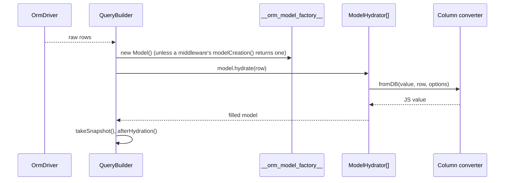

# Converters and hydration

A value converter turns one column's database value into a JS value and back: a SQL datetime into a luxon `DateTime`, `0`/`1` into a boolean, a JSON string into an object. Hydrators fill a model from a row or a DTO; dehydrators and `toSql()` turn a model back into plain data for a response or a statement.

## How it works

### Attaching converters at boot

1. A converter decorator (`@DateTime()`, `@Json()`, ...) records `{ Class, Options }` in the model descriptor's `Converters` map, keyed by property name.
2. `Orm.resolve()` calls `reloadTableInfo()`, which reads every model's columns with `driver.tableInfo()`.
3. For each `Converters` entry whose column exists in the table, `Orm` checks `connection.Container.hasRegistered(Class)`. When registered, it resolves the class and stores the instance in `column.Converter`.
4. A column still without a converter gets one from the `__orm_db_value_converters__` map, looked up by its lowercased native type.
5. The resolved instance stays on the column descriptor and is shared by every instance of the model.

### Reading a row

1. The builder runs the driver query and the `afterQuery()` result middlewares.
2. It creates one model per row: the first builder middleware whose `modelCreation()` returns a model wins (see [Discrimination maps](14-discrimination-maps.md)); otherwise `__orm_model_factory__` calls `new Model()`.
3. `model.hydrate(row)` resolves every `ModelHydrator` from the connection's container and runs them in registration order:
   - `DbPropertyHydrator` sets each key that is a model column, through `column.Converter.fromDB(value, row, options)`.
   - `NonDbPropertyHydrator` copies every other key unchanged.
   - `OneToManyRelationHydrator` and `OneToOneRelationHydrator` turn nested relation data into relation objects with hydrated target models.
   - `JunctionModelPropertyHydrator` fills `@JunctionTable()` properties from the row's `JunctionModel` data.
4. The builder calls `takeSnapshot()`, then the `afterHydration()` middlewares.



### Writing a model

1. `insert()`, `update()`, `archive()` and the unit of work call `model.toSql()`.
2. `toSql()` resolves `ModelToSqlConverter` from the connection's container. `StandardModelToSqlConverter`:
   - skips `Virtual` columns and foreign-key columns a relation manages;
   - throws `OrmException` (`Field <name> cannot be null`) for a non-key, non-nullable column holding `null`, `undefined` or `''`;
   - writes `column.Converter.toDB(value, model, column, options)`, or the raw value;
   - writes each `@BelongsTo` foreign key from the related model's join column. Without a related model it writes the raw column; after a detach, `NULL`.
3. `toSql(true)` keeps only the columns in `changeSet()`.
4. Static `insert()` of a plain object uses `ObjectToSqlConverter` instead. `StandardObjectToSqlConverter` skips `undefined` properties, calls `toDB(value, undefined, column, options)`, and turns a model held under a `@BelongsTo` property into its key.

### Serializing a model

1. `dehydrate(options)` resolves `StandardModelDehydrator`; `dehydrateWithRelations(options)` resolves `StandardModelWithRelationsDehydrator`. Both add the model's `@Hidden()` properties to `options.omit`.
2. For each column the dehydrator:
   - skips columns in `omit`;
   - reads an empty foreign-key column from the related model's key, when the relation holds one;
   - skips a `Virtual` column without a value;
   - throws `OrmException` (`Field <name> cannot be null`) for a non-key, non-nullable column holding `null`, `undefined` or `''`, unless `ignoreNullable` is set;
   - writes `column.Converter.toDB(value, model, column, converterOptions, options)`, then applies `skipNull`, `skipUndefined` and `skipEmptyArray`.
3. `StandardModelWithRelationsDehydrator` adds relations. A `@BelongsTo` holding a model (populated or attached) becomes that model, dehydrated recursively; one holding none is absent. A `@HasMany` or many-to-many relation becomes an array, `[]` when empty. Nested models start from an empty `omit` list and apply their own `@Hidden()`.
4. `toJSON()` returns `dehydrate()`, so `JSON.stringify(model)` carries columns only, no relations.

### `IDehydrateOptions`

| Key | Type | Default | Allowed values | Meaning |
| --- | --- | --- | --- | --- |
| `omit` | `string[]` | `[]` | property names | Columns and relations to leave out, added to `@Hidden()`. |
| `skipNull` | `boolean` | `false` | | Leave out columns whose converted value is `null`. |
| `skipUndefined` | `boolean` | `false` | | Leave out columns whose converted value is `undefined`. |
| `skipEmptyArray` | `boolean` | `false` | | Leave out columns whose converted value is `[]`. |
| `ignoreNullable` | `boolean` | `false` | | Do not throw for an empty non-nullable column. |
| `dateTimeFormat` | `string` | unset | `'iso'`, `'sql'`, `'unix'` | Datetime rendering, read by the driver's datetime converter. |

### Built-in converters

| Converter | Registered by | `toDB` | `fromDB` |
| --- | --- | --- | --- |
| `JsonValueConverter` | `OrmDriver.resolve()` | `JSON.stringify(value)`; `null` and `undefined` as they are, so the column holds SQL NULL | `null` for SQL NULL; objects and arrays as-is, strings through `JSON.parse` (the text `null` too) |
| `UuidConverter` | `OrmDriver.resolve()` | A dashed uuid to a 16-byte `Buffer`; empty values to `null` | A 16-byte value to the dashed 36-character form; other lengths returned as a string; empty values to `null` |
| `UniversalValueConverter` | `OrmDriver.resolve()` | By the model's type column: `boolean` to `'true'`/`'false'`, `datetime`/`date`/`time` to ISO text, `number`/`float` to decimal text, `json` to JSON, anything else as-is | By the row's type column: the reverse, with dates read by `DateTime.fromISO` |
| `Int64ValueConverter` | `OrmDriver.resolve()` | A `bigint` to decimal text, a safe integer as is, a decimal string trimmed of surrounding whitespace; anything else throws `InvalidArgument` | Any driver form (string, number, bigint) to the decorator's `as`: `'string'` (default), `'number'` (throws `OrmException` beyond `Number.MAX_SAFE_INTEGER`) or `'bigint'`. A number that is not a safe integer throws `OrmException`: the driver already lost precision. |
| `DatetimeValueConverter` | the driver (`SqlDatetimeValueConverter`, `MsSqlDatetimeValueConverter`) | luxon `DateTime` or `Date` to the dialect's datetime | Dialect datetime to `DateTime` |
| `TimeValueConverter` | the driver (`SqlTimeValueConverter`) | `TimeSpan` to `HH:MM:SS` | `TIME` text to `TimeSpan` |
| `BooleanValueConverter` | the driver (`SqlBooleanValueConverter`) | `1`/`0` in statements, a boolean when dehydrating | `true` for `1`, `true` or `'1'` |
| `SetValueConverter` | the driver (`SqlSetConverter`) | Array joined with `,` | String split on `,` |

The last four are tokens: `ValueConverter`'s own methods throw `MethodNotImplemented`, and each driver binds its implementation in its container. See [`@spinajs/orm-sql` value converters](../orm-sql/05-value-converters-and-defaults.md).

Default `__orm_db_value_converters__` map, registered by `Orm.registerDefaultConverters()`:

| Keys | Converter |
| --- | --- |
| `Date`, `DateTime` | `DatetimeValueConverter` |
| `Boolean`, `Bool`, `boolean`, `bool` | `BooleanValueConverter` |
| `Time`, `time`, `TimeSpan`, `timespan` | `TimeValueConverter` |

Column lookup lowercases the native type, so only the lowercase keys match a column. The capitalized keys match the class name of a value in a `WHERE` binding or an `UPDATE` `SET` value, which `@spinajs/orm-sql` converts by type.

### The `IValueConverter` contract

| Member | Called with | Notes |
| --- | --- | --- |
| `toDB(value, model, column, options, dehydrateOptions?)` | `toSql()`: 4 arguments. `dehydrate()`: 5, the last being the dehydrate options. Static insert of a plain object: `model` is `undefined`. An `orm-sql` `WHERE` binding: `model` and `options` are `null`. | One method serves statements and serialization; tell them apart by the argument count. |
| `fromDB(value, rawData, options)` | `rawData` is the whole row or DTO; `options` is the decorator's `Options`. | Also runs on `hydrate()` of a DTO, so accept values that are already converted. |
| `snapshotValue?(value)` | When the snapshot baseline is taken. | Implement with `snapshotEquals` when `fromDB` returns a mutable instance of a class the ORM does not own. |
| `snapshotEquals?(a, b)` | When the model is diffed. | Without both hooks such a column is reported as changed on every diff. See [Unit of work](07-unit-of-work.md). |

## Decorators

| Decorator | Target | Options | Effect |
| --- | --- | --- | --- |
| `@DateTime()` | property typed `DateTime` (luxon) | none | Attaches `DatetimeValueConverter`. Throws `Error` when the design type is not `DateTime`, `InvalidArgument` when a converter is already attached. |
| `@Bool()` | property typed `boolean` | none | Attaches `BooleanValueConverter`; also publishes the column as `boolean` in the JSON schema. Throws `InvalidArgument` for another type or a second converter. |
| `@Json()` | property | none | Attaches `JsonValueConverter`, replacing any earlier converter. |
| `@Int64(as = 'string')` | property typed `string`, `number` or `bigint` | `as`: `'string'`, `'number'` or `'bigint'` | Attaches `Int64ValueConverter` with `{ as }`, so a 64-bit integer column hydrates to the same JS type on every driver (pg returns `int8` as text, sqlite3 and mysql2 as a number). Throws `InvalidArgument` for another mode or a second converter. Named `Int64`, not `BigInt`, so it does not shadow the global. |
| `@UniversalConverter(typeColumn?)` | property | `typeColumn`, default `'Type'` | Attaches `UniversalValueConverter` with `{ TypeColumn }`. |
| `@Set()` | property typed as an array | none | Attaches `SetValueConverter`. Throws `Error` for a non-array type, `InvalidArgument` for a second converter. |
| `@Uuid()` | property | none | Marks the column `Uuid` (a fresh uuid at construction) and attaches `UuidConverter`. |
| `@CreatedAt()`, `@UpdatedAt()`, `@SoftDelete()`, `@Archived()` | property typed `DateTime` | none | Attach `DatetimeValueConverter` as well as their own feature. See [Models](02-models.md). |

Import `DateTime` and `Set` under an alias (`DateTime as DateTimeColumn`, `Set as SetColumn`) next to luxon's `DateTime` and the global `Set`.

## Services and extension points

| Service | Role | Default implementation | How to override |
| --- | --- | --- | --- |
| `ValueConverter` | Base class of column converters | none | Subclass it, register it in DI, attach it with a property decorator. |
| `DatetimeValueConverter`, `TimeValueConverter`, `BooleanValueConverter`, `SetValueConverter` | Dialect-specific converters | the driver's | Subclass the driver and register yours in `resolve()`, after `super.resolve()`. |
| `__orm_db_value_converters__` | Native type or value class name to converter class | the map above | `DI.register(Converter).asMapValue('__orm_db_value_converters__', '<key>')` before `Orm` resolves. |
| `ModelHydrator` | Fills a model from plain data; all registrations run | `DbPropertyHydrator`, `NonDbPropertyHydrator`, `OneToManyRelationHydrator`, `OneToOneRelationHydrator`, `JunctionModelPropertyHydrator` | `@Injectable(ModelHydrator)` on a subclass adds one. |
| `StandardModelDehydrator` | `dehydrate()` and `toJSON()` | itself | `DI.register(Sub).as(StandardModelDehydrator)`. |
| `StandardModelWithRelationsDehydrator` | `dehydrateWithRelations()` | itself | `DI.register(Sub).as(StandardModelWithRelationsDehydrator)`. |
| `ModelToSqlConverter` | Model to statement payload (`toSql()`) | `StandardModelToSqlConverter`; `SqliteModelToSqlConverter` on SQLite | Register in the driver's container in its `resolve()`. |
| `ObjectToSqlConverter` | Plain object to payload (static `insert()`) | `StandardObjectToSqlConverter` | Register in the driver's container in its `resolve()`. |
| `__orm_model_factory__` | Creates the model instance before hydration | `_modelProxyFactory`: `new model()` | `DI.register(factory).as('__orm_model_factory__')`. |

Replace a dialect converter by subclassing the driver. The driver's own registration lives in its child container and shadows anything registered on `DI`:

```ts
import { Injectable } from '@spinajs/di';
import { DatetimeValueConverter } from '@spinajs/orm';
import { SqliteOrmDriver } from '@spinajs/orm-sqlite';

@Injectable('orm-driver-sqlite-utc')
export class UtcSqliteDriver extends SqliteOrmDriver {
  public resolve() {
    super.resolve();
    this.Container.register(UtcDatetimeConverter).as(DatetimeValueConverter);
  }
}
// connection config: Driver: 'orm-driver-sqlite-utc'
```

Attach a converter to every column of one native type:

```ts
import { DI } from '@spinajs/di';
import { JsonValueConverter } from '@spinajs/orm';

// keys are matched against the lowercased native type reported by tableInfo()
DI.register(JsonValueConverter).asMapValue('__orm_db_value_converters__', 'json');
```

## Important behaviour

- Converters attach once, during `Orm.resolve()`, and only to columns found in the reflected table. A model whose table does not exist gets none, and `hydrate()` copies every value raw through `NonDbPropertyHydrator`.
- A decorator's converter class that is not registered in DI is skipped without an error. Register it, for example with `@Injectable()`.
- The native-type lookup never attaches a datetime converter: no lowercase datetime key exists in the default map. Declare `@DateTime()` on datetime columns.
- `@DateTime()` reads the emitted design type. `DateTime | null` emits `Object` and throws at class definition.
- Decorators run bottom-up. `@DateTime()`, `@Bool()` and `@Set()` throw when a converter is already attached; `@Json()`, `@UniversalConverter()`, `@Uuid()` and the timestamp decorators replace it.
- `toDB()` produces both statement values and API payloads. Whatever it returns for a column is what `dehydrate()` and `toJSON()` emit, unless the converter checks for the fifth argument.
- `@spinajs/orm-sql` applies a column's converter to `where(column, value)` and `whereIn(column, values)` bindings. Static `Model.update(data)` runs each value through its column's converter too, as `insert()` does; see [Model API](03-model-api.md). A value whose key has no column converter is converted by its runtime type only, through `__orm_db_value_converters__`.
- `UniversalValueConverter` reads the type column from the model. With no model (static insert of a plain object) it falls back to `typeof value`, so a `DateTime` is written unconverted.
- `hydrate()` keeps a stored value when the payload carries `undefined` and clears it on `null`, for columns and other properties alike.
- `hydrate()` never changes the primary key of a model that has a snapshot, and never writes `null` or `undefined` into a key column. A body-supplied id cannot redirect an `UPDATE` to another row.
- `hydrate()` accepts a model instance on a foreign-key column (stores its key) and under a `@BelongsTo` name (attaches it and sets the foreign key).
- `dehydrate()` emits a relation's foreign-key column even when the relation is not populated; `dehydrateWithRelations()` never emits a `@BelongsTo` that holds no model, so the key is never typed as a number under the relation's name.
- `@Uuid()` writes a 16-byte `Buffer`. Store it in a `BINARY(16)` column; the schema builder's `table.uuid()` creates one.
- `whereInSet()` on a `@Set()` column throws `InvalidArgument` for a value containing `,` or `null`.
- `SqliteModelToSqlConverter` leaves `undefined` columns out of the payload so table defaults apply; `StandardModelToSqlConverter` writes them. See [`@spinajs/orm-sqlite`](../orm-sqlite/README.md).
- Converters and hydrators are shared instances. Keep them stateless.
- `sqlite3` and `mysql2` return a 64-bit integer as a JS number, so a value beyond 2^53 is already rounded when it reaches `Int64ValueConverter`; the converter throws instead of returning it. On PostgreSQL every `int8` value arrives exact.
- `where()` and `whereIn()` bindings on an `@Int64` column go through `toDB`, so they must be integers (a safe number, a decimal string, surrounding whitespace allowed, or a `bigint`); any other value throws `InvalidArgument`.
- `toDB` also serves `dehydrate()`, so an `@Int64('bigint')` property serializes to JSON as decimal text.

## Best practices

- Put `@DateTime()` on every datetime column and `@Bool()` on every boolean stored as `tinyint`.
- Pass `dateTimeFormat: 'iso'` to `dehydrate()` for API payloads, or register a dehydrator that sets it once.
- Implement `snapshotValue()` and `snapshotEquals()` in a converter whose `fromDB()` returns a mutable class instance, such as a money or geometry object.
- Write a small property decorator that calls `extractDecoratorPropertyDescriptor()` and sets `model.Converters`, rather than editing descriptors by hand.
- Return `dehydrateWithRelations()` from endpoints that must include relations; `toJSON()` never does.

## Patterns and antipatterns

```ts
// Don't: the design type of `DateTime | null` is Object, so @DateTime() throws at class definition
@DateTimeColumn()
public PaidAt: DateTime | null;

// Do: attach the converter without the design-type check
export const NullableDateTime = (): PropertyDecorator =>
  extractDecoratorPropertyDescriptor((model, _target, key) => {
    model.Converters.set(key, { Class: DatetimeValueConverter });
  });

@NullableDateTime()
public PaidAt: DateTime | null;
```

```ts
// Don't: @CreatedAt() runs first and attaches a converter, then @DateTime() throws InvalidArgument
@DateTimeColumn()
@CreatedAt()
public CreatedAt: DateTime;

// Do: @CreatedAt() attaches the datetime converter itself
@CreatedAt()
public CreatedAt: DateTime;
```

```ts
// Don't: static update() skips column converters; @Cents() Total is written as 12.5, not 1250
await Order.update({ Total: 12.5 }).where('Id', id);

// Do: the instance path runs toSql() and the converter
const order = await Order.getOrFail(id);
await order.update({ Total: 12.5 });
```

```ts
// Don't: toJSON() is dehydrate(); the Items relation is missing from the response
return JSON.stringify(order);

// Do
return order.dehydrateWithRelations();
```

## Examples

### Store money as integer cents

```ts sample
import { Injectable } from '@spinajs/di';
import { Connection, extractDecoratorPropertyDescriptor, IColumnDescriptor, IDehydrateOptions, IModelDescriptor, Model, ModelBase, Primary, ValueConverter } from '@spinajs/orm';

// @Injectable() registers the class: Orm skips a decorator converter that is not registered
@Injectable()
export class CentsConverter extends ValueConverter {
  public toDB(value: number | null | undefined, _model?: ModelBase<unknown>, _column?: IColumnDescriptor, _options?: unknown, ...dehydrating: [IDehydrateOptions?]): number | null {
    if (value === null || value === undefined) {
      return null;
    }

    // dehydrate() passes a fifth argument: keep the decimal amount in API payloads
    return dehydrating.length > 0 ? value : Math.round(value * 100);
  }

  public fromDB(value: number | null): number | null {
    return value === null ? null : value / 100;
  }
}

export function Cents(): PropertyDecorator {
  return extractDecoratorPropertyDescriptor((model: IModelDescriptor, _target: unknown, propertyKey: string) => {
    model.Converters.set(propertyKey, { Class: CentsConverter });
  });
}

@Connection('default')
@Model('orders')
export class Order extends ModelBase<Order> {
  @Primary()
  public Id: number;

  @Cents()
  public Total: number;
}

export async function ordersAbove(amount: number): Promise<Order[]> {
  // the WHERE binding goes through CentsConverter as well
  return await Order.where('Total', '>', amount);
}
```

### Keep product attributes as JSON and tags as a set

```ts sample
import { Connection, Json, Model, ModelBase, Primary, Set as SetColumn } from '@spinajs/orm';

@Connection('default')
@Model('products')
export class Product extends ModelBase<Product> {
  @Primary()
  public Id: number;

  @Json()
  public Attributes: Record<string, string>;

  @SetColumn()
  public Tags: string[];
}

export async function productsTagged(tag: string): Promise<Product[]> {
  return await Product.query().whereInSet('Tags', [tag]);
}
```

### Read typed values from a key-value settings table

```ts sample
import { Connection, Model, ModelBase, Primary, UniversalConverter } from '@spinajs/orm';

@Connection('default')
@Model('tenant_settings')
export class TenantSetting extends ModelBase<TenantSetting> {
  @Primary()
  public Id: number;

  public Key: string;

  // 'boolean' | 'number' | 'float' | 'datetime' | 'date' | 'time' | 'json' | 'string'
  public Type: string;

  @UniversalConverter('Type')
  public Value: unknown;
}

export async function readSetting(key: string): Promise<unknown> {
  const setting = await TenantSetting.where('Key', key).first();
  return setting?.Value;
}
```

### Normalize e-mail addresses on every hydrate

```ts sample
import { Injectable } from '@spinajs/di';
import { Connection, Model, ModelBase, ModelHydrator, Primary } from '@spinajs/orm';

@Connection('default')
@Model('users')
export class User extends ModelBase<User> {
  @Primary()
  public Id: number;

  public Email: string;
}

// registered after the built-in hydrators, so it runs after DbPropertyHydrator set the raw value
@Injectable(ModelHydrator)
export class UserEmailHydrator extends ModelHydrator {
  public hydrate(target: unknown, values: Record<string, unknown>): void {
    const email = values['Email'];
    if (target instanceof User && typeof email === 'string') {
      target.Email = email.trim().toLowerCase();
    }
  }
}
```

### Serialize datetimes as ISO 8601 in every response

```ts sample
import { DI } from '@spinajs/di';
import { IDehydrateOptions, ModelBase, StandardModelDehydrator } from '@spinajs/orm';

export class IsoDatesDehydrator extends StandardModelDehydrator {
  public dehydrate(model: ModelBase, options?: IDehydrateOptions) {
    return super.dehydrate(model, { dateTimeFormat: 'iso', ...options });
  }
}

// covers dehydrate() and toJSON(); dehydrateWithRelations() resolves StandardModelWithRelationsDehydrator
DI.register(IsoDatesDehydrator).as(StandardModelDehydrator);
```

## Related

- [Models](02-models.md): `@Uuid()`, `@Hidden()`, `@Ignore()` and the timestamp decorators.
- [Model API](03-model-api.md): the calls that hydrate and persist models.
- [Unit of work](07-unit-of-work.md): how `snapshotValue()` and `snapshotEquals()` drive dirty tracking.
- [JSON schema](11-json-schema.md): how a column's converter shapes its published type.
- [Architecture](12-architecture.md): where converters sit in query compilation.
- [`@spinajs/orm-sql`](../orm-sql/README.md): the dialect converters and how `WHERE` values are converted.
- [`@spinajs/orm-sqlite`](../orm-sqlite/README.md), [`@spinajs/orm-mysql`](../orm-mysql/README.md), [`@spinajs/orm-mssql`](../orm-mssql/README.md): dialect type mapping.
- [`@spinajs/orm-http`](../orm-http/README.md): hydrates models from request bodies and DTOs.
