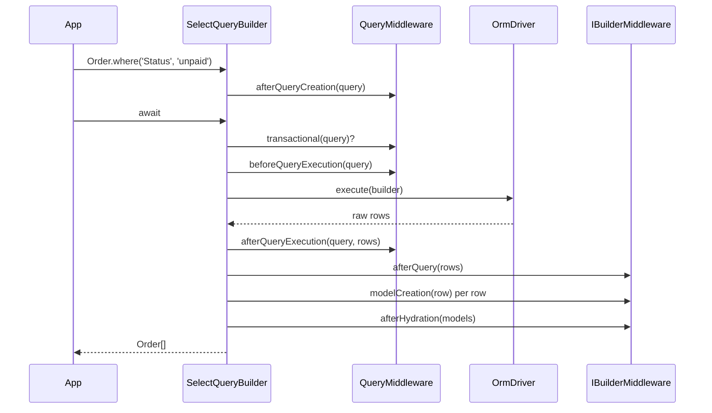

# Query builder

Fluent builders that compose `SELECT`, `INSERT`, `UPDATE` and `DELETE` statements and run them on `await`. Start from a model static (`Order.where(...)`) to get hydrated models, or from a connection (`driver.select().from('orders')`) to get raw rows. Query middlewares hook every builder for cross-cutting rules such as tenant scoping or access control.

## How it works

1. An entry point creates a builder:
   - Model statics call `createQuery(model, BuilderClass)`. It resolves the model's connection through the `OrmConnection` factory and resolves the builder from that connection's `driver.Container`, passing the driver and the model class.
   - `OrmDriver.select<T>()`, `insert()`, `update<T>()` and `del<T>()` resolve a builder with no model.
2. The builder constructor sets `QueryContext` and resolves every registered `QueryMiddleware` from the root container, sorted by `order`. `SelectQueryBuilder`, `InsertQueryBuilder`, `UpdateQueryBuilder` and `DeleteQueryBuilder` call `afterQueryCreation(query)` on each of them.
3. `createQuery()` then finishes the builder:
   1. Binds the methods of the model's `_queryScopes` object to a select, update or delete builder. See [Scopes and builder extensions](16-scopes-and-builder-extensions.md).
   2. Adds a `DiscriminationMapMiddleware`. See [Discrimination maps](14-discrimination-maps.md).
   3. Sets the table to the model's `TableName`.
   4. On a select of a `@SoftDelete` or `@Archived` model, adds `WHERE <DeletedAt> IS NULL` or `<ArchivedAt> IS NULL`, when that column is among the reflected columns.
   5. Calls `database()` with the connection's `Database` option, when set.
4. Each chained call (`where`, `select`, `join`, `order`, ...) validates its arguments and resolves a statement object (`WhereStatement`, `InStatement`, `JoinStatement`, ...) from the builder's container. Nothing is compiled yet. Invalid arguments throw synchronously.
5. `await` calls `then()`, which calls `execute()`. The first call starts the run and stores its promise; every later `await` of the same builder returns that promise.
6. When no transaction is in scope and any middleware's `transactional(query)` returns `true`, steps 7 to 9 run inside `driver.transaction()`.
7. `beforeQueryExecution(query)` of every query middleware is awaited, in order.
8. `driver.execute(builder)` compiles the builder with `toDB()` and sends the SQL. See [Architecture](12-architecture.md). Then `afterQueryExecution(query, result)` of every query middleware is awaited, in order, with the raw driver result.
9. The result is post-processed:
   - `asRaw()` returns the raw driver result here.
   - Otherwise every builder middleware's `afterQuery(data)` transforms the result.
   - For a select with a model, each row becomes a model instance: the first builder middleware whose `modelCreation(row)` returns a non-null value wins, otherwise the model factory creates one. The instance is hydrated and snapshotted, then `afterHydration(models)` of every builder middleware runs in parallel.
   - `takeFirst()` / `first()` unwrap the first row, or `undefined` for an empty result.
10. A middleware that throws, a sort on an unknown column (checked in `toDB()`), or a driver error rejects the promise.



### Entry points

| Call | Builder | Model bound | `await` resolves with |
| --- | --- | --- | --- |
| `Model.select()` | `SelectQueryBuilder` with `select('*')` | yes | model instances |
| `Model.where(...)` | `SelectQueryBuilder` with `select('*')` and the condition | yes | model instances |
| `Model.query()` | `SelectQueryBuilder`, no column list | yes | model instances |
| `Model.all(page?, perPage?)` | `select('*')`, plus `take(perPage).skip(page * perPage)` when `page >= 0` and `perPage > 0` | yes | model instances |
| `Model.update(data)` | `UpdateQueryBuilder` with `update(data)`; a model instance as `data` throws `OrmException` | yes | driver result |
| `Model.destroy(pks)` | `DeleteQueryBuilder` filtered by `whereAnyPk()`; an `UpdateQueryBuilder` setting `DeletedAt` for a `@SoftDelete` model | yes | driver result |
| `createQuery(Model, BuilderClass, injectModel = true)` | any `QueryBuilder` subclass; returns `{ query, description, model, container }` | when `injectModel` is `true` | depends on the builder |
| `driver.select<T>()` | `SelectQueryBuilder<T>` | no | raw rows typed `T` |
| `driver.insert()` | `InsertQueryBuilder` | no | driver result |
| `driver.update<T>()` | `UpdateQueryBuilder<T>` | no | driver result |
| `driver.del<T>()` | `DeleteQueryBuilder<T>` | no | driver result |

Insert, update, delete and truncate builders resolve with whatever the dialect driver returns for that `QueryContext`; the declared type is `IUpdateResult` (`RowsAffected`, `LastInsertId`). <!-- TODO(docs-hook): verify the runtime shape each dialect driver resolves for UPDATE and DELETE statements -->

`Model.insert()`, `get()`, `find()`, `first()` and the other model statics are covered in [Model API](03-model-api.md). `driver.truncate()`, `schema()` and `index()` are covered in [Schema builder](09-schema-builder.md).

### Filtering

`SelectQueryBuilder`, `UpdateQueryBuilder` and `DeleteQueryBuilder` mix in `WhereBuilder` (`IWhereBuilder<T>`). Every method returns the builder.

| Method | Emits | Notes |
| --- | --- | --- |
| `where(column, value)` | `column = ?` | `null` value emits `column IS NULL`. `undefined` or `NaN` throws `InvalidArgument`. |
| `where(column, operator, value)` | `column <OP> ?` | `operator` is an `Op`: `=`, `!=`, `<>`, `<`, `<=`, `>`, `>=`, `<=>`, `like`, `rlike`, `regexp`. An unknown operator throws `InvalidArgument`. With `null`: `=` emits `IS NULL`, `!=` / `<>` emit `IS NOT NULL`, any other operator throws. |
| `where({ Status: 'paid', Region: ['EU', 'US'], ClosedAt: null })` | `whereObject()` | Each key becomes `= ?`; an array becomes `whereIn()`; `null` becomes `whereNull()`; `undefined` keys are skipped. |
| `where(function () { ... })` | `( ... )` | Nested group. `this` inside the callback is a new `WhereBuilder` on the same model and alias. |
| `where(true)` / `where(false)` | `1 = 1` / `1 = 0` | Constants every dialect accepts (T-SQL has no `TRUE`/`FALSE`). |
| `where(RawQuery.create(sql, bindings))` | `sql` verbatim | Columns are not quoted or qualified. |
| `where(column, operator?, RawQuery.create(sql, bindings))` | `column <OP> sql` | The raw SQL stands in for the value: no `?`, no converter; its bindings follow. |
| `where('ExpiresAt', '>', driver.now())` | `ExpiresAt > <dialect now>` | `OrmDriver.now()` is the database's current instant: `CURRENT_TIMESTAMP` (PostgreSQL), `UTC_TIMESTAMP(3)` (MySQL), `SYSDATETIMEOFFSET()` (MSSQL), `strftime('%Y-%m-%dT%H:%M:%fZ', 'now')` (SQLite). On PostgreSQL that is the start of the current transaction, the same for every statement in it; the other dialects give the time of the statement. PostgreSQL rounds a value it stamps itself to the column's precision (`TIMESTAMPTZ(3)`: milliseconds), so it can lie up to half a millisecond after the clock. In raw SQL use `driver.now().Query`. |
| `where(new Lazy(fn))` | statements `fn` adds | `Lazy` from `@spinajs/util`. `fn` runs at compile time against a clone of the query, with columns, joins, group-by and where cleared. |
| `where(Wrapper.Date(column), operator?, value)` | dialect date wrap, eg. `DATE(column) >= ?` | `Wrapper.Date` / `Wrapper.DateTime` build a `Wrap`. Pass a value: a `Wrap` alone throws `InvalidArgument`. |
| `where(Wrapper.Text(column), operator, value)`, `whereIn(Wrapper.Text(column), values)` | `CAST(column AS TEXT)`; `CHAR` on MySQL, `NVARCHAR(4000)` on MSSQL | Compares a column of any type with text. Values are bound unconverted. `whereIn()` / `whereNotIn()` with a wrapped column and a sub-query throw `InvalidArgument`. |
| `where('Customer.Country', 'PL')` | condition inside the populated relation | A dotted column populates the relation and filters inside it. See [Relations](06-relations.md). |
| `where('Customer', 7)` | `<ForeignKey> = ?` | A relation name resolves to the relation's foreign key. |
| `where(null)` / `where(undefined)` (single argument) | nothing | No-op. |
| `orWhere(...)` / `andWhere(...)` | `OR` / `AND` before the next statement | Same argument forms as `where()`. The connector applies to the next statement only. |
| `when(condition, callback, elseCallback?)` | | Runs `callback` (or `elseCallback`) with `this` set to the builder. |
| `whereNull(column)` / `whereNotNull(column)` | `IS NULL` / `IS NOT NULL` | |
| `whereNot(column, value)` | `column != ?` | |
| `whereIn(column, values \| subQuery)` / `whereNotIn(...)` | `IN (?, ...)` / `IN ( SELECT ... )` | An empty array emits `1 = 0` (`whereIn`) or `1 = 1` (`whereNotIn`). A non-array, non-builder value throws `InvalidArgument`. Values are converted like `where()` values. PostgreSQL, SQLite and MSSQL bind a long list as one parameter; see [`@spinajs/orm-sql` statements](../orm-sql/03-statements.md). |
| `whereBetween(column, [from, to])` / `whereNotBetween(...)` | `BETWEEN ? AND ?` | |
| `whereExist(subQuery \| relation, callback?)` / `whereNotExists(...)` | `EXISTS ( ... )` / `NOT EXISTS ( ... )` | A relation name dispatches to the `ExistsRelationHandler` of its type. See [Relations](06-relations.md). A ready sub-query is correlated with the builder the call is made on (its `CorrelationSource`) unless it has one; `whereIn()` / `whereNotIn()` with a sub-query do the same. |
| `whereColumn(left, operator, right)` | `left <OP> right` over two columns | Each side is a column name or a `Wrap`; `right` may be `outer(column, levels = 1)`. A side is qualified by its query's alias, or by the table when the query has none. |
| `outer(column, levels = 1)` | a column of an enclosing query | The `right` of `whereColumn()` inside a sub-query given to `whereExist()`, `whereNotExists()`, `whereIn()` or `whereNotIn()`. `levels` 1 is the query the sub-query is attached to, 2 the query that one is attached to. Resolved when the query compiles, so it follows a later `setAlias()` and a `clone()`. Outside such a sub-query it throws `InvalidOperation`. |
| `whereInSet(column, values)` / `whereNotInSet(...)` | dialect membership test on a `@Set()` column | `null`, `undefined` or a value containing `SET_DELIMITER` (`,`) throws `InvalidArgument`. |
| `whereStartsWith(column, prefix)` | dialect prefix test | Every character of `prefix` is literal (`%`, `_`, `~`, and `[`, `*`, `?` where the dialect reads them). Case variants match only where the dialect's test follows a column collation that ignores case (MySQL, MSSQL); PostgreSQL and SQLite never match them. A prefix that is not a string throws `InvalidArgument` when the query compiles. |
| `whereOnJoin(callback)` | conditions from `callback` | In a populated relation they go to the relation's `JOIN ... ON`; on a root query they act as `WHERE`. |
| `clearWhere()` | | Drops every where statement. |

On a builder bound to a model, `where()` and `whereNull()` / `whereNotNull()` throw `InvalidArgument` (`column X not exists in model Y`) for a column that is neither a descriptor column, a primary key column nor a property on the model prototype.

#### Primary key helpers

Take any `IWhereBuilder` or `IOrderByBuilder` and the model descriptor (`Model.getModelDescriptor()`). Composite keys are supported.

| Function | Emits |
| --- | --- |
| `wherePk(builder, descriptor, value)` | `pk = ?`, or `( a = ? AND b = ? )` for a composite key |
| `whereAnyPk(builder, descriptor, values)` | `pk IN (...)`, or OR-ed tuples. Empty `values` emits `1 = 0`. |
| `whereNotAnyPk(builder, descriptor, values)` | `pk NOT IN (...)`, or AND-ed negated tuples. Empty `values` adds nothing. |
| `orderByPk(builder, descriptor, order)` | One `ORDER BY` term per key column. Returns `false` when the model has no primary key. |

All four except `orderByPk` throw `OrmException` for a model without a primary key. A composite value is an array in key order or an object keyed by column name.

### Columns and aggregates

Available on `SelectQueryBuilder`. `InsertQueryBuilder` shares `columns()` and `clearColumns()`.

| Method | Effect |
| --- | --- |
| `select(column, alias?)` | Adds one column. On a model-bound builder, a column that is not a non-virtual descriptor column throws `InvalidArgument`. `'*'` is always accepted. |
| `select(RawQuery)` | Adds a raw expression. |
| `select(new Map([[column, alias]]))` | Adds several aliased columns. Only non-virtual model columns are added, so on a builder with no model it adds nothing. |
| `columns(names)` | Replaces the column list. |
| `clearColumns()` | Empties the column list. |
| `distinct()` | `SELECT DISTINCT`. Throws `InvalidOperation` when the column list is empty or starts with `*`. |
| `min` / `max` / `sum` / `avg(column, as?)` | Adds an aggregate column. |
| `count(column = '*', as = 'count')` | Replaces the column list with `COUNT(column) AS as`. |
| `selectCount(column?, as?)` | Runs `count()` + `takeFirst()` + `asRaw()` and resolves with the count as a `number` on every driver, or `0`. |
| `asRaw<T>()` | Executes and resolves with the driver rows, skipping builder middlewares and hydration. |
| `getColumns()` | The column statements. |

### Sorting, grouping and limits

| Method | Effect |
| --- | --- |
| `order(column, direction?)` | Appends `ORDER BY column direction`. `direction` defaults to `ASC`. |
| `order(sort \| sorts[])` | Appends `ISort` entries. An entry with no `column` is dropped; a column already sorted on is not repeated. |
| `order('Customer.Name', SortOrder.ASC)` | Sorts by a column of a to-one relation, which is populated as a join. A to-many relation throws `InvalidArgument`. |
| `orderBy(column)` / `orderByDescending(column)` | `order(column, ASC)` / `order(column, DESC)`. |
| `orderable(...aliases)` | Declares aliases of raw selects as sortable. |
| `getSort()` / `getSorts()` | First sort entry or `null` / every sort entry. |
| `sortOrderOf(order)` | Normalizes a direction: `undefined` / `null` → `ASC`, `''` → `NONE`, `'asc'` / `'DESC'` → enum value. Anything else throws `InvalidArgument`. |
| `groupBy(column \| RawQuery)` / `clearGroupBy()` | `GROUP BY`. |
| `take(n)` | `LIMIT n`. `n <= 0` throws `InvalidArgument`. |
| `skip(n)` | `OFFSET n`. `n < 0` throws `InvalidArgument`. |
| `takeFirst()` | `LIMIT 1`; the builder resolves with one row or `undefined`. |
| `first()` | `takeFirst()` and execute. |
| `firstOrFail()` | Like `first()`; throws `OrmNotFoundException` carrying the SQL and bindings when nothing is found. |
| `firstOrThrow(error \| (output) => Error)` | Like `first()`; throws the given error, or the factory's error built from the compiled `ICompilerOutput`. |
| `orThrow(error \| (output) => Error)` | Executes; throws when the result is `undefined` or an empty array. |
| `getLimits()` | `IQueryLimit` (`limit`, `offset`; `-1` when unset). |

`toDB()` of a select validates every sort column: a column that is neither a non-virtual model column, a select alias, a declared `orderable()` alias nor a relation sort throws `InvalidArgument`. A query that selects a `RawQuery` and declares no `orderable()` alias skips the check. A builder with no model skips it.

### Other select members

| Member | Effect |
| --- | --- |
| `from(table, alias?)` / `setTable(table, alias?)` | Sets the table. A blank table throws `InvalidArgument`. |
| `setAlias(alias?)` | Sets the table alias and re-stamps it on existing statements. A blank alias generates `<AliasSeparator><table><AliasSeparator>`. |
| `database(name)` | Sets the schema / database qualifier. |
| `withDeleted()` / `withArchived()` | Removes the default `DeletedAt IS NULL` / `ArchivedAt IS NULL` filter. |
| `withRecursive(rcKeyName, pkName)` / `clearRecursive()` | Compiles the query as a recursive CTE that walks descendants: rows whose `rcKeyName` matches the `pkName` of a row already found. |
| `populate(relation, callback?)` | Loads a relation. See [Relations](06-relations.md). |
| `all()` | Executes; resolves with the full result. Useful for typing after scopes. |
| `resultExists()` | Executes; `true` for a non-empty array or a non-null value. |
| `clone()` | Independent copy with its own execution. Query middlewares do not run again. |
| `middleware(m)` | Adds an `IBuilderMiddleware`. |
| `toDB()` | Compiles without executing. Returns `ICompilerOutput` (`expression`, `bindings`). |
| `execute()` / `then()` / `catch()` / `finally()` | Run the query once; see step 5. |
| `Statements`, `Relations`, `IsDistinct`, `Table`, `TableAlias`, `Database`, `Model`, `Driver`, `Container`, `QueryContext` | Read-only state, used by middlewares. |

### Joins

`SelectQueryBuilder` mixes in `JoinBuilder`: `innerJoin`, `leftJoin`, `leftOuterJoin`, `rightJoin`, `rightOuterJoin`, `fullOuterJoin`, `crossJoin`, and `join(method: JoinMethod, ...)`. Each accepts:

| First argument | Meaning |
| --- | --- |
| Relation name (`'Customer'`) | Joins the relation's target model. For a to-one relation the ON clause is `source.<ForeignKey> = target.<PrimaryKey>`; otherwise `source.<PrimaryKey> = target.<ForeignKey>`. Needs a model-bound builder; throws `InvalidOperation` without a model or relations, `InvalidArgument` for an unknown name. |
| Model class | Same, finding the relation whose target is that class. |
| `IJoinStatementOptions` | Explicit join, see the table below. |
| `RawQuery` | Emits `<METHOD> <raw sql>`. |

With a relation name or model class, the second argument is a where callback whose conditions are appended to the `ON` clause. The third is a callback on a select builder for the joined model, whose columns and sorts are merged into the outer query; it runs only when the second argument is given.

| `IJoinStatementOptions` key | Type | Meaning |
| --- | --- | --- |
| `joinModel` | `Constructor<ModelBase>` | Joined model; its table, alias and driver are read from its descriptor. |
| `joinTable` | `string` | Joined table when no model is given. |
| `joinTableAlias` | `string` | Alias of the joined table. Defaults to `<AliasSeparator><model name><AliasSeparator>`. |
| `joinTableForeignKey` | `string` | Column of the joined table in the `ON` clause. |
| `sourceTablePrimaryKey` | `string` | Column of the source table in the `ON` clause. |
| `joinTableDriver` | `OrmDriver` | Driver of the joined table; required with `joinTable`. |
| `sourceModel` / `sourceTableAlias` / `sourceTableDatabase` / `joinTableDatabase` | | Source side overrides. |
| `callback` | where callback or `Lazy` | Conditions appended to `ON` with `AND`. Applied only with `joinModel`. |
| `queryCallback` | select callback | Runs on the joined model's select builder. Applied only with `joinModel` and `callback`. |
| `query` | `RawQuery` | Raw join. |
| `method` / `builder` / `onStatements` / `nestedJoins` | | Set by the builder and by relations. |

```ts
// raw table join with no models: joinTableDriver is required
driver
  .select<OrderRow[]>()
  .from('orders')
  .leftJoin({ joinTable: 'customers', joinTableAlias: 'c', sourceTablePrimaryKey: 'CustomerId', joinTableForeignKey: 'Id', joinTableDriver: driver });
```

Joined columns are not selected unless a `queryCallback` or a `select(RawQuery)` adds them. Source and joined model must use the same driver class; otherwise the compiler throws `InvalidArgument`.

### Insert, update and delete

| Builder | Member | Effect |
| --- | --- | --- |
| `InsertQueryBuilder` | `into(table, alias?)` | Sets the table. The second argument is passed to `setTable()` as the alias. |
| | `values(row \| rows[])` | Sets the column list from the keys (the union of keys for an array) and appends one value row per object. |
| | `splitByDriverLimits()` | The payload as one builder per statement within the driver's `maxBindParameters` and `maxInsertRows`; `[this]` when it fits one statement. Throws `OrmException` when a single row needs more parameters than the limit. |
| | `orIgnore()` / `orReplace()` | Sets `Ignore` / `Replace`; the dialect emits its insert-or-ignore / replace form. |
| | `onDuplicate(columns?)` | Upsert. Returns an `OnDuplicateQueryBuilder`. Without `columns`, a model-bound builder uses the model's unique columns. Sets `QueryContext.Upsert`. |
| | `returning(columns)` | Asks the dialect to echo the inserted rows. Throws `NotSupported` when `supportedFeatures().insertReturning` is `false`. Sets `QueryContext.InsertReturning`. |
| | `getColumnValues(column)` | The value of `column` on every row, in row order; `[]` when the payload lacks it. |
| | `forceColumn(column, value)` | Overwrites (or adds) `column` on every row. |
| | `Values`, `Ignore`, `Update`, `Replace`, `Returning`, `DuplicateQueryBuilder` | Read-only state. |
| `OnDuplicateQueryBuilder` | `update(columns \| RawQuery[])` | Columns to update on conflict. |
| | `then()` / `execute()` / `toDB()` | Delegate to the insert builder. |
| | `getColumn()`, `getColumnsToUpdate()`, `getReturning()`, `getParent()` | Read by compilers. |
| `UpdateQueryBuilder` | `update(values)` / `increment(column, by = 1)` / `in(table)` / `Value` / `Increments` | Values to set; `column = column + ?` after them (calls on one column add up, `by` may be negative, a non-finite `by` or an empty column throws `InvalidArgument`); table; the set values; the increments. A column both set and incremented throws `InvalidArgument` when the query compiles. Plus every filtering method. |
| `DeleteQueryBuilder` | filtering methods, `take(n)` | `take` limits the rows deleted where the dialect supports it. |

### Enums

| Enum | Values |
| --- | --- |
| `SqlOperator` | `LT`, `LTE`, `GT`, `GTE`, `NOT` (`!=`), `NOT_2` (`<>`), `EQ`, `EQ_NULL` (`<=>`), `IN`, `NOT_IN`, `NULL`, `NOT_NULL`, `BETWEEN`, `NOT_BETWEEN`, `LIKE`, `RLIKE`, `REGEXP` |
| `WhereBoolean` | `AND`, `OR` |
| `JoinMethod` | `INNER`, `LEFT`, `LEFT_OUTER`, `RIGHT`, `RIGHT_OUTER`, `FULL_OUTER`, `CROSS`, `RECURSIVE` |
| `SortOrder` | `ASC`, `DESC`, `NONE` (`''`) |
| `ColumnMethods` | `MIN`, `MAX`, `SUM`, `AVG`, `COUNT` |
| `QueryMethod` | `SELECT`, `INSERT`, `UPDATE`, `DELETE`, `WHERE`, `SCHEMA` |
| `QueryContext` | `Select`, `Insert`, `InsertReturning`, `Upsert`, `Update`, `Delete`, `Schema`, `Transaction` |

## Configuration

| Key | Type | Default | Allowed values | Meaning |
| --- | --- | --- | --- | --- |
| `db.Connections[].AliasSeparator` | `string` | `$` | | Wraps generated table aliases (`setAlias()` with no argument, joins, relations). See [Connections](01-connections.md). |

```ts
db: { Connections: [{ Name: 'main', Driver: 'orm-driver-mysql', AliasSeparator: '$' }] }
```

## Services and extension points

| Service | Role | Default implementation | How to override |
| --- | --- | --- | --- |
| `QueryMiddleware` | Hooks every builder: `afterQueryCreation`, `beforeQueryExecution`, optional `afterQueryExecution` and `transactional`, ordered by `order`. | none | Extend it and register with `@Injectable(QueryMiddleware)` or `DI.register(MyMiddleware).as(QueryMiddleware)`. |
| `IBuilderMiddleware` | Per-builder result pipeline: `afterQuery`, `modelCreation`, `afterHydration`. | Relation and discrimination middlewares added by the ORM | `builder.middleware(new MyMiddleware())`. |
| `ExistsRelationHandler` | Builds `whereExist` / `whereNotExists` for a relation name, one per `RelationType`. | `OneExistsRelationHandler`, `ManyExistsRelationHandler`, `ManyToManyExistsRelationHandler` | See [Relations](06-relations.md). |
| `ModelMiddleware` | Abstract class with `onInsert`, `onUpdate`, `onDelete`, `onSelect`. | none | Nothing in `@spinajs/orm` resolves or calls it. |
| Statements and compilers | Turn builder state into SQL. | `@spinajs/orm-sql` | See [Architecture](12-architecture.md). |

### `QueryMiddleware` hooks

| Member | Called | Use it to |
| --- | --- | --- |
| `order` | | Position in the pipeline. Default `0`; lower runs first; ties and non-finite values keep registration order. `authz-orm`'s access guard uses `95`, `intl-orm` uses `1000`. |
| `afterQueryCreation(query)` | From the select, insert, update and delete constructors | Add constraints (`where`). The model and `QueryContext` are set; the table name, the caller's conditions and the insert payload are not. |
| `beforeQueryExecution(query)` | Once per builder, before the driver call, for every builder type | Inspect or rewrite the finished query, eg. `forceColumn()` on an insert. May be async; awaited in order. |
| `afterQueryExecution?(query, result)` | Once per builder, after the driver call | React to the raw result. Awaited in order. |
| `transactional?(query)` | Before the before-hooks, only when no transaction is in scope | Return `true` to run before-hooks, statement and after-hooks in one `driver.transaction()`. Must answer synchronously. |

```ts sample
import { AsyncLocalStorage } from 'node:async_hooks';
import { Injectable } from '@spinajs/di';
import { extractModelDescriptor, InsertQueryBuilder, IWhereBuilder, QueryBuilder, QueryMiddleware } from '@spinajs/orm';

export const tenantContext = new AsyncLocalStorage<{ tenantId: number }>();

function hasTenantColumn(query: QueryBuilder): boolean {
  const descriptor = query.Model ? extractModelDescriptor(query.Model) : null;
  return descriptor !== null && descriptor.Columns.some((c) => c.Name === 'TenantId');
}

@Injectable(QueryMiddleware)
export class TenantMiddleware extends QueryMiddleware {
  public order = 50;

  public afterQueryCreation(query: QueryBuilder): void {
    const tenant = tenantContext.getStore();
    if (!tenant || !hasTenantColumn(query) || query instanceof InsertQueryBuilder) {
      return;
    }

    // select, update and delete builders all mix in WhereBuilder
    (query as unknown as IWhereBuilder<unknown>).where('TenantId', tenant.tenantId);
  }

  public beforeQueryExecution(query: QueryBuilder): void {
    const tenant = tenantContext.getStore();
    if (tenant && query instanceof InsertQueryBuilder && hasTenantColumn(query)) {
      // the payload exists only now; values() ran after construction
      query.forceColumn('TenantId', tenant.tenantId);
    }
  }
}
```

## Important behaviour

- `driver.now()` is the database's clock, a bound `Date` is the application's. Compare one stored column with one of them consistently: on hosts whose clocks drift apart the two disagree near a boundary.
- A builder executes at most once. Awaiting it again resolves with the memoized result and runs no hook. Call `clone()` on a select for a second round trip.
- `afterQueryCreation` runs inside the constructor, before `createQuery()` sets the table and before the caller's `where()` / `values()`. `beforeQueryExecution` and `afterQueryExecution` run for every builder that executes, schema builders included.
- `clone()` does not run `afterQueryCreation` again. It copies the statements, which already carry the middleware constraints.
- When a middleware asks for a transaction, a throwing before-hook skips the statement and rolls back; a throwing after-hook rolls the statement back. Without a transaction an after-hook error cannot undo the statement.
- Inside a caller's `driver.transaction()`, `transactional()` is not asked and no savepoint is taken; the hooks and the statement join the caller's transaction.
- Query middlewares are resolved from the root DI container, so they apply to every connection.
- `orWhere()` sets the connector of the next statement only. `where(a).where(b).orWhere(c).where(d)` compiles to `a AND b OR c AND d`, which SQL reads as `(a AND b) OR (c AND d)`.
- `whereIn(column, [])` matches nothing, never everything. `whereObject()` maps an empty array the same way.
- An update without a `where()` throws `InvalidArgument` when it compiles, for `Model.update()` and `driver.update()` alike. Add `.where(true)` to update every row on purpose.
- `Model.destroy()` with no keys throws `OrmException`. On a `@SoftDelete` model it builds an `UPDATE` that sets `DeletedAt`.
- The soft-delete and archive filters are added to selects only. Updates and deletes built by `createQuery()` see deleted and archived rows.
- `insert().into(table, x)` treats `x` as the table alias. Use `database()` for a schema.
- `values()` resets the column list on each call and appends rows. Pass all rows to one `values([...])` call.
- A multi-row insert larger than the driver's `maxBindParameters` or `maxInsertRows` runs as several statements, in order, inside one transaction: the caller's when one is open, otherwise its own. A failing statement rolls all of them back. The result sums `RowsAffected`, concatenates `Returning` in insert order and reports the last statement's `LastInsertId`. Query middlewares run once for the whole insert.
- `returning()` must run before `onDuplicate()`: the duplicate builder copies the returning columns when it is created, and `onDuplicate()` sets `QueryContext.Upsert` either way.
- For a belongsTo relation without a callback, `whereExist(relation)` and `whereNotExists(relation)` both add `<ForeignKey> IS NOT NULL`.
- `getSort()` returns only the first sort. `SqliteOrderByCompiler` in `@spinajs/orm-sqlite` reads `getSort()`, so on SQLite only the first `ORDER BY` column reaches the SQL. See [`@spinajs/orm-sqlite`](../orm-sqlite/README.md).
- `escapeLikeValue()` escapes `%`, `_` and `~` with `LIKE_ESCAPE_CHARACTER` (`~`). A plain `where(column, 'like', value)` emits no `ESCAPE` clause.

## Best practices

- Group mixed `AND` / `OR` conditions in `where(function () { ... })` instead of relying on operator precedence.
- Pass user-supplied sort input through `order({ column, order })`: `sortOrderOf()` rejects bad directions and `toDB()` rejects unknown columns with `InvalidArgument`, not a driver error.
- Append a primary key fallback when paging: `order([requested, { column: 'Id', order: SortOrder.DESC }])` or `orderByPk()`.
- Use `selectCount()` for counts; it skips hydration and returns `0` for no rows.
- Constrain in `afterQueryCreation`, inspect or amend the payload in `beforeQueryExecution` with `getColumnValues()` / `forceColumn()`.
- Set `order` on every middleware that depends on another one, eg. translate after scoping.
- Use `toDB()` in unit tests to assert on SQL and bindings without a database.

## Patterns and antipatterns

```ts
// Don't: no WHERE - this archives every order in the table
await Order.update({ Status: 'archived' });

// Do
await Order.update({ Status: 'archived' }).where('Status', 'cancelled').where('UpdatedAt', '<', cutoff);
```

```ts
// Don't: reads as (CustomerId = ? AND Status = 'unpaid') OR Status = 'overdue',
// returning overdue orders of every customer
Order.where('CustomerId', customerId).where('Status', 'unpaid').orWhere('Status', 'overdue');

// Do
Order.where('CustomerId', customerId).where(function () {
  this.where('Status', 'unpaid').orWhere('Status', 'overdue');
});
```

```ts
// Don't: `_` and `%` typed by the user act as wildcards
Customer.where('Name', 'like', `${term}%`);

// Do: escape the value and declare the escape character
Customer.where(RawQuery.create(`Name LIKE ? ESCAPE '${LIKE_ESCAPE_CHARACTER}'`, [`${escapeLikeValue(term)}%`]));
```

```ts
// Don't: the second await returns the first result; nothing is re-read
const query = Invoice.where('Status', 'pending');
await query;
await processPayments();
const stillPending = await query;

// Do
const query = Invoice.where('Status', 'pending');
await query;
await processPayments();
const stillPending = await query.clone();
```

```ts
// Don't: values() has not been called yet, the payload is empty here
public afterQueryCreation(query: QueryBuilder) {
  if (query instanceof InsertQueryBuilder) query.forceColumn('TenantId', tenantId);
}

// Do
public beforeQueryExecution(query: QueryBuilder) {
  if (query instanceof InsertQueryBuilder) query.forceColumn('TenantId', tenantId);
}
```

```ts
// Don't: Model.destroy() without keys throws "Cannot destroy without primary keys"
await Order.destroy().where('Status', 'cancelled');

// Do: build the DELETE explicitly (a hard delete, even for @SoftDelete models)
const { query } = createQuery(Order, DeleteQueryBuilder);
await query.where('Status', 'cancelled');
```

## Examples

### List a customer's overdue or large unpaid orders, newest first

```ts sample
import { Connection, IWhereBuilder, Model, ModelBase, Primary, SortOrder } from '@spinajs/orm';

@Connection('default')
@Model('orders')
export class Order extends ModelBase<Order> {
  @Primary()
  public Id: number;

  public CustomerId: number;

  public Status: string;

  public Total: number;

  public CreatedAt: string;
}

export async function ordersNeedingAttention(customerId: number, page: number): Promise<Order[]> {
  return await Order.where('CustomerId', customerId)
    .where(function (this: IWhereBuilder<Order[]>) {
      this.where('Status', 'overdue').orWhere(function (this: IWhereBuilder<Order[]>) {
        this.where('Status', 'unpaid').where('Total', '>=', 1000);
      });
    })
    .order([
      { column: 'CreatedAt', order: SortOrder.DESC },
      { column: 'Id', order: SortOrder.DESC },
    ])
    .take(25)
    .skip(page * 25);
}
```

### Count paid orders and report revenue per customer

```ts sample
import { Connection, Model, ModelBase, OrmDriver, Primary } from '@spinajs/orm';

@Connection('default')
@Model('orders')
export class Order extends ModelBase<Order> {
  @Primary()
  public Id: number;

  public CustomerId: number;

  public Status: string;

  public Total: number;
}

export async function paidOrderCount(customerId: number): Promise<number> {
  return await Order.where('CustomerId', customerId).where('Status', 'paid').selectCount();
}

interface RevenueRow {
  CustomerId: number;
  Revenue: number;
}

export async function revenuePerCustomer(driver: OrmDriver): Promise<RevenueRow[]> {
  return await driver
    .select<RevenueRow[]>()
    .from('orders')
    .select('CustomerId')
    .sum('Total', 'Revenue')
    .where('Status', 'paid')
    .groupBy('CustomerId')
    .orderByDescending('Revenue');
}
```

### Upsert a newsletter subscriber and purge expired sessions

```ts sample
import { IUpdateResult, OrmDriver } from '@spinajs/orm';

export async function subscribe(driver: OrmDriver, email: string, name: string): Promise<void> {
  await driver.insert().into('newsletter_subscribers').values({ Email: email, Name: name }).onDuplicate('Email').update(['Name']);
}

export async function purgeExpiredSessions(driver: OrmDriver, now: Date): Promise<IUpdateResult> {
  return await driver.del().from('user_sessions').where('ExpiresAt', '<', now);
}
```

### Fail with a domain error when an invoice is missing

```ts sample
import { Connection, ICompilerOutput, Model, ModelBase, Primary } from '@spinajs/orm';

@Connection('default')
@Model('invoices')
export class Invoice extends ModelBase<Invoice> {
  @Primary()
  public Id: number;

  public InvoiceNo: string;
}

export class InvoiceNotFound extends Error {}

export async function invoiceByNumber(invoiceNumber: string): Promise<Invoice> {
  return await Invoice.where('InvoiceNo', invoiceNumber).firstOrThrow(
    (output: ICompilerOutput) => new InvoiceNotFound(`no invoice ${invoiceNumber} (${output.expression ?? ''})`),
  );
}
```

## Related

- [Model API](03-model-api.md): model statics that create these builders.
- [Scopes and builder extensions](16-scopes-and-builder-extensions.md): your own builder methods, per model or for every builder.
- [Relations](06-relations.md): `populate()`, relation middlewares, exists handlers, relation sorting.
- [Converters and hydration](04-converters-and-hydration.md): how rows become models after step 9.
- [Transactions](08-transactions.md): `driver.transaction()` used by transactional middlewares.
- [Schema builder](09-schema-builder.md): DDL builders, `truncate()`, `index()`.
- [Architecture](12-architecture.md): how `toDB()` turns a builder into SQL.
- [Discrimination maps](14-discrimination-maps.md): the middleware `createQuery()` adds to every model query.
- [`@spinajs/orm-sql`](../orm-sql/README.md): the SQL each statement and compiler emits.
- [`@spinajs/orm-http`](../orm-http/README.md): request filtering and paging on top of `SelectQueryBuilder`.
