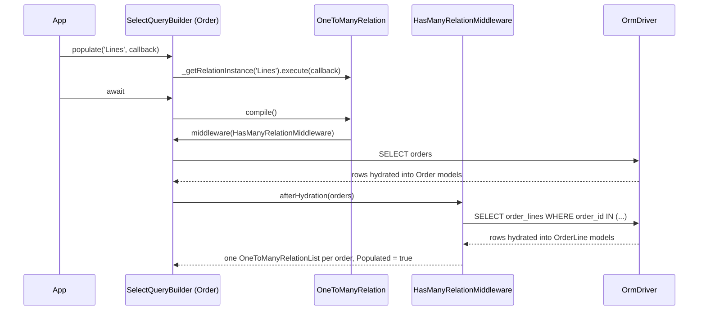

# Relations

Relations link models to each other: a belongs-to reference, a one-to-many list, a many-to-many list through a junction table, or a custom query. Declare them with decorators on model properties, load them with `populate()`, filter by them with `whereExist()`, and change them through relation objects.

## How it works

Eager loading with `populate()`:

1. `SelectQueryBuilder.populate(relation, callback?)` normalizes its argument. A dotted path (`'Lines.Product'`) populates the first segment and nests the rest. An array populates each entry. A model class finds the relation whose `TargetModel` is that class. `null` or `undefined` does nothing. An object populates each of its keys; a non-null value is populated on the outer query, not inside that relation, so nest with a dotted path instead.
2. `SelectQueryBuilder._getRelationInstance()` looks the name up in the model descriptor, case-insensitively, and creates one relation object per name. It throws `InvalidArgument` (`Relation <name> not exists in model ...`) for an unknown name. The class depends on the descriptor:
   - `Recursive: true` → `BelongsToRecursiveRelation`
   - `RelationType.One` → `BelongsToRelation`
   - `RelationType.Many` → `OneToManyRelation`
   - `RelationType.ManyToMany` → `ManyToManyRelation`
   - `RelationType.Query` → `QueryRelation`
   - `RelationType.Virtual` → `VirtualRelation`
3. `IOrmRelation.execute(callback)` runs the callback with `this` bound to the relation query (the target-side builder). A `QueryRelation` binds it to the owner query instead. A `VirtualRelation` stores it for later.
4. When the query compiles, each relation's `compile()` runs once:
   - `BelongsToRelation` adds a `LEFT JOIN` on the target table to the same query. Target columns come back aliased as `<sep><Relation><sep>.<column>`. `BelongsToRelationResultTransformMiddleware` nests them, and `BelongsToPopulateDataMiddleware` runs the nested relations' middlewares.
   - `OneToManyRelation` adds `HasManyRelationMiddleware`. After the owners hydrate, it runs one query: `WHERE <ForeignKey> IN (<owner keys>)`.
   - `ManyToManyRelation` adds `HasManyToManyRelationMiddleware`. It runs one query on the junction table joined to the target table, filtered by `<JunctionModelSourceModelFKey_Name> IN (<owner keys>)`.
   - `QueryRelation` adds `QueryRelationMiddleware`. It calls the `@Query` callback once with all owners, then the mapper once per owner.
   - `VirtualRelation` adds `VirtualRelationMiddleware`. For every owner it resolves the relation class and awaits its `populate()`.
5. Every loaded relation object gets `Populated = true` and the owner records it with `snapshotRelation()`.



Filtering with `whereExist()`:

1. `whereExist(relation, callback?)` or `whereNotExists(relation, callback?)` on any where-capable builder (select, update, delete) calls `buildExistsClause()`.
2. A ready sub-query (an `ISelectQueryBuilder`) becomes an `ExistsQueryStatement` directly.
3. A relation name resolves the relation descriptor with `getRelationDescriptor()`, then the `ExistsRelationHandler` whose `Type` matches. No handler throws `OrmException` (`no ExistsRelationHandler registered for relation type ...`). Query and Virtual relations have none.
4. The handler returns a correlated sub-query, which the builder wraps in `EXISTS` / `NOT EXISTS`:
   - `OneExistsRelationHandler` (belongs-to) always adds `<ForeignKey> IS NOT NULL`. Only with a callback does it add an `EXISTS` on the target table, correlated on `<target>.<PrimaryKey> = <source>.<ForeignKey>`.
   - `ManyExistsRelationHandler` (has-many) correlates the target table on `<target>.<ForeignKey> = <source>.<primary key>`. The callback filters the target.
   - `ManyToManyExistsRelationHandler` correlates the junction table on its source column. With a callback it right-joins the target table and applies the callback there.
5. The sub-query alias is `<table>_exists`. The outer alias is read at compile time, so a later `setAlias()` and `clone()` stay correct.

## Decorators

| Decorator | Target | Options | Effect |
| --- | --- | --- | --- |
| `@BelongsTo(targetModel, foreignKey?, primaryKey?)` | Property typed `SingleRelation<T>` | `targetModel`: class or class name string. `foreignKey`: column on this model. `primaryKey`: join column on the target. | One-to-one reference, `RelationType.One`. Eager populate is a `LEFT JOIN`. |
| `@ForwardBelongsTo(forwardRef(() => T), foreignKey?, primaryKey?)` | Property typed `SingleRelation<T>` | Same as `@BelongsTo`, target given as an `IForwardReference`. | `@BelongsTo` whose target is read lazily. <!-- TODO(docs-hook): verify ForwardBelongsTo resolves through Orm.wireRelations, which matches TargetModelType.name and no test covers it --> |
| `@HasMany(targetModel, options?)` | Property typed `Relation<T, Owner>` | `IHasManyDecoratorOptions`: `foreignKey`, `primaryKey`, `orphan`, `factory`, `type` | One-to-many list, `RelationType.Many`. Loaded by a second query. |
| `@HasManyToMany(junctionModel, targetModel, options?)` | Property typed `Relation<T, Owner>` | `IHasManyToManyDecoratorOptions`: `sourceModelPKey`, `targetModelPKey`, `junctionModelSourcePk`, `junctionModelTargetPk`, `joinMode`, `orphan`, `factory`, `type` | Many-to-many list through `junctionModel`, `RelationType.ManyToMany`. |
| `@JunctionTable()` | Property of the many-to-many target model, typed as the junction model | none | Receives the junction row's columns as a junction model instance when the target is loaded through a many-to-many populate. |
| `@Recursive()` | A relation property, placed above its relation decorator | none | Sets `Recursive: true`. Populate loads the whole tree with a recursive CTE. Throws `InvalidOperation` when the relation is not declared yet. |
| `@Query(callback, mapper)` | Property typed `Relation<T, Owner>` | `callback(owners)` returns a select builder. `mapper(owner, rows)` returns one model or an array. | Custom relation, `RelationType.Query`. Read-only. |
| `@Virtual(relationClass?)` | Property typed as a `Relation` subclass | `relationClass`: defaults to the property's declared type | Custom relation, `RelationType.Virtual`. Populate calls `relationClass.populate()` once per owner. |

Decorators run in property order. Declare `@Primary()` above every relation that defaults a key from this model.

### Default key names

| Decorator | Descriptor key | Option | Default |
| --- | --- | --- | --- |
| `@BelongsTo` | `ForeignKey` (column on this model) | `foreignKey` | `<property name lowercased>_id`, e.g. `Customer` → `customer_id` |
| `@BelongsTo` | `PrimaryKey` (column on the target) | `primaryKey` | The target's primary key. For a string target it is read when first accessed. |
| `@HasMany` | `ForeignKey` (column on the target) | `foreignKey` | `<source class name lowercased>_id`, e.g. `Order` → `order_id` |
| `@HasMany` | `PrimaryKey` (column on this model) | `primaryKey` | This model's primary key |
| `@HasManyToMany` | `PrimaryKey` (this model's key) | `sourceModelPKey` | This model's primary key |
| `@HasManyToMany` | `ForeignKey` (the target's key) | `targetModelPKey` | The target's primary key |
| `@HasManyToMany` | `JunctionModelSourceModelFKey_Name` | `junctionModelSourcePk` | `<source class name lowercased>_id` |
| `@HasManyToMany` | `JunctionModelTargetModelFKey_Name` | `junctionModelTargetPk` | `<target class name lowercased>_id` |

A relation joins on exactly one column per side. `_relationDefaultKey()` throws `InvalidOperation` (`relation <name> cannot default its join column: model <M> has a composite primary key ...`) when a default would come from a composite key. Pass the key explicitly in that case.

### Relation option interfaces

| Interface | Field | Type | Meaning |
| --- | --- | --- | --- |
| `IRelationDecoratorOptions` | `factory` | `(owner, relation, container) => Relation` | Builds the relation object instead of the default class. |
| `IRelationDecoratorOptions` | `type` | `Constructor<Relation>` | Relation class to instantiate instead of the default. |
| `IHasManyDecoratorOptions` | `foreignKey`, `primaryKey` | `string` | Join columns, see the defaults above. |
| `IHasManyDecoratorOptions` | `orphan` | `OrphanPolicy` | What `save()` does with a removed child. |
| `IHasManyToManyDecoratorOptions` | `sourceModelPKey`, `targetModelPKey`, `junctionModelSourcePk`, `junctionModelTargetPk` | `string` | Join columns, see the defaults above. |
| `IHasManyToManyDecoratorOptions` | `joinMode` | `'LeftJoin' \| 'RightJoin'` | Join from the junction to the target on eager populate. Default `LeftJoin`. |
| `IHasManyToManyDecoratorOptions` | `orphan` | `OrphanPolicy` | What `save()` does with the target row of a removed member. The junction row is always deleted. |

## Services and extension points

| Service | Role | Default implementation | How to override |
| --- | --- | --- | --- |
| `'__orm_relation_has_many_factory__'` | Maps a `@HasMany` property's declared type to the list class | Returns `OneToManyRelationList` for a property typed `Relation`, any other declared class as-is | `DI.register(factory).as('__orm_relation_has_many_factory__')` program-wide, or the `type` option per relation |
| `'__orm_relation_has_many_to_many_factory__'` | Same for `@HasManyToMany` | Returns `ManyToManyRelationList` for `Relation`, any other class as-is | Same, with this key |
| `ExistsRelationHandler` | Builds the `EXISTS` clause for one `RelationType` | `OneExistsRelationHandler`, `ManyExistsRelationHandler`, `ManyToManyExistsRelationHandler` | Subclass it, implement `Type` and `apply()`, register with `@Injectable(ExistsRelationHandler)`. The first handler whose `Type` matches wins. <!-- TODO(docs-hook): verify whether a user handler registered for One/Many/ManyToMany is ordered before the built-in one --> |
| `Relation` subclasses | List object a relation property holds | `OneToManyRelationList`, `ManyToManyRelationList`, `ManyQueryRelationList` | Type the property as your subclass, or pass `type` / `factory` |

Relation object classes:

| Class | Holds | Created for |
| --- | --- | --- |
| `SingleRelation<R, O>` | `Value: R \| null \| undefined` | `@BelongsTo`, `@ForwardBelongsTo` |
| `OneToManyRelationList<T, O>` | Array of `T` | `@HasMany` |
| `ManyToManyRelationList<T, O>` | Array of `T` | `@HasManyToMany` |
| `ManyQueryRelationList<R, O>` | Array of `R`, read-only | `@Query` when the mapper returns an array |
| `SingleQueryRelation<R, O>` | `Value: R` | `@Query` when the mapper returns one model |

Relation (list) methods, from `IRelation` and the abstract `Relation` class:

| Member | Writes to the database | Behaviour |
| --- | --- | --- |
| `Populated: boolean` | — | `true` once data was loaded, even when nothing was found. |
| `TargetModelDescriptor` | — | Descriptor of the target model. |
| `populate(callback?)` | no (reads) | Loads the owner's members into this list. |
| `remove(predicate)` / `remove(model \| models)` | no | Removes members, matched by primary key; unsaved models by reference. Returns the removed members. |
| `set(models \| (members, pKey) => models)` | no | Replaces all members. Accepts a `Dataset` closure. |
| `union(dataset, comparator?)` | no | Adds members not present yet. The list's own instance wins over a duplicate. |
| `diff(dataset, comparator?)` | no | Returns the symmetric difference. Pure. |
| `intersection(dataset, comparator?)` | no | Returns the dataset's members also in the list. Pure. |
| `empty()` / `clear()` | no | Empties the list. `clear()` is async. |
| `update()` | yes | Inserts or updates; deletes nothing. |
| `sync()` | yes | Inserts or updates, then removes rows missing from the list. |

`Dataset.diff()`, `Dataset.intersection()` and `Dataset.union()` return closures `(members, pKey) => models` for `set()`.

`SingleRelation` methods:

| Member | Writes to the database | Behaviour |
| --- | --- | --- |
| `attach(model \| null)` | no | Sets `Value` and writes the target's join column into the owner's foreign key (`null` on detach). |
| `detach()` | no | `attach(null)`. |
| `set(model)` | yes | `attach()` then `owner.update()`, in one transaction. |
| `remove()` | yes | `detach()`, `Value.destroy()`, `owner.update()`, in one transaction. |
| `populate(callback?)` | no (reads) | Loads the target where `<PrimaryKey> = owner.<ForeignKey>`. |

## Important behaviour

- **A `where()` in a belongs-to populate callback filters the parent rows.** The relation query is merged into the parent query. Wrap conditions in `whereOnJoin()` to put them in the `LEFT JOIN ... ON` clause instead.
- Joins added inside a belongs-to populate callback nest inside that relation's `LEFT JOIN`. They do not filter parent rows.
- Has-many and many-to-many run one extra query per relation, not per owner. When the parent query returns no rows, the extra query is skipped.
- Belongs-to columns are aliased with the connection's `AliasSeparator` (default `$`, so `$Customer$.Name`). See [Connections](./01-connections.md).
- `compile()` runs once per relation object. Calling `toDB()` twice produces the same SQL.
- `populate()` matches relation names case-insensitively. The static `Model.populate(relation, owner)` uses `Relations.has()` and is case-sensitive.
- The static `Model.populate(relation, owner)` returns a builder for the related rows. It throws `OrmException` for Query and Virtual relations.
- `Orm` resolves every `TargetModel` by class name when it starts. An unknown name throws `OrmException` (`type <T> not found for relation <name> in model <M> in file <file>`).
- The junction model of a `@HasManyToMany` must be a registered model. Otherwise eager populate throws `InvalidOperation` (`model <J> not exists in orm module`).
- `ManyToManyRelationList.populate()`, `update()` and `sync()` find the junction's relations by target class. The junction model must declare a `@BelongsTo` to both sides, or they throw `OrmException` (`junction model <J> of relation <name> declares no relation targeting <T>; add a @BelongsTo for it`).
- `ManyToManyRelationList.sync()` throws `OrmException` when the target has a composite primary key.
- Eager many-to-many populate joins the target on the column named by `sourceModelPKey`. <!-- TODO(docs-hook): verify eager many-to-many populate and many-to-many whereExist when source and target primary key names differ (both use IRelationDescriptor.PrimaryKey as the target join column) -->
- A model with a `@JunctionTable()` property cannot be hydrated outside a many-to-many populate. `JunctionModelPropertyHydrator` hydrates the junction model from `values.JunctionModel`, which is then missing.
- `Populated` separates "loaded and empty" from "never loaded". `save()` skips relations that were never loaded. See [Unit of work](./07-unit-of-work.md).
- Lists built by a `@Recursive()` populate are plain `OneToManyRelationList` objects without `Populated` set.
- `SingleRelation.populate()` uses `firstOrFail()` when the owner's foreign key column is not nullable, so a missing target throws.
- `OneToManyRelationList.populate()` sets each child's back-reference relation (the child relation with the same `ForeignKey`) to the owner. It does not mark the owner dirty.
- `remove()`, `set()`, `union()`, `diff()` and `intersection()` change memory only. Persist with `sync()`, `update()` or `save()`.
- Set operations without a comparator compare by primary key. A model without primary key columns throws `OrmException` (`set operation compares by primary key, but the model declares no primary key columns ...`). Unsaved models are equal only to themselves.
- `slice()`, `filter()`, `map()` and `splice()` on a relation return a plain `Array`, not a relation.
- `OneToManyRelationList.sync()` deletes the target rows that point at the owner but are missing from the list. A `@SoftDelete` target is stamped instead. It does **not** read the orphan policy; only `save()` does.
- `sync()` and `update()` run in a transaction; inside a caller's transaction they take a savepoint. See [Transactions](./08-transactions.md).
- `ManyToManyRelationList.sync()` skips members that already have a junction row, so repeated calls do not duplicate links.
- `ManyQueryRelationList` is read-only. `remove()`, `set()`, `union()`, `diff()`, `intersection()`, `sync()`, `update()` and `populate()` throw `OrmException` synchronously.
- `ModelBase.attach(model)` adds the model to **every** relation whose target is the model's class. With two relations to the same model, push into the specific relation instead.
- `whereNotExists()` on a belongs-to relation without a callback adds `<ForeignKey> IS NOT NULL`, the same clause as `whereExist()`.
- The builder method is `whereExist()`; the static model method is `whereExists()`.
- Without an explicit `orphan`, `save()` nullifies a removed child's foreign key. When that column is reflected as `NOT NULL`, it throws `OrmException` instead of deleting. `OrphanPolicy`: `Nullify` (`'nullify'`), `Delete` (`'delete'`), `SoftDelete` (`'soft-delete'`), `Disable` (`'disable'`). See [Unit of work](./07-unit-of-work.md).
- `@Hidden()` on a relation property drops it from `dehydrateWithRelations()` and from the response schema. See [Models](./02-models.md) and [JSON schema](./11-json-schema.md).

## Best practices

- Name a target declared later in the same file by string (`@HasMany('Order', ...)`). `Orm` resolves it when it starts.
- Pass `foreignKey` explicitly when the column does not follow `<name>_id`. The defaults come from class and property names, not from the database.
- Use `whereOnJoin()` for conditions on an optional belongs-to target; use `where()` only when the parent row must match.
- Use `whereExist()` to filter by a relation without loading it. It works on update and delete builders too.
- Give every junction model a `@BelongsTo` to both sides, so `sync()` and lazy `populate()` work.
- Declare `orphan` on every `@HasMany` whose foreign key is `NOT NULL`.
- Use `Dataset.union(...)` with `set()` to merge incoming members, then `sync()` once.

## Patterns and antipatterns

```ts
// Don't: the where() lands in the parent WHERE and drops orders without a VIP customer
Order.query().populate('Customer', function () {
  this.where('Vip', true);
});

// Do: keep every order, attach the customer only when it matches
Order.query().populate('Customer', function () {
  this.whereOnJoin(function () {
    this.where('Vip', true);
  });
});
```

```ts
// Don't: Order is declared further down; the decorator reads it before it exists
@HasMany(Order, { foreignKey: 'customer_id' })
public Orders: Relation<Order, Customer>;

// Do: name it, Orm resolves the class when it starts
@HasMany('Order', { foreignKey: 'customer_id' })
public Orders: Relation<Order, Customer>;
```

```ts
// Don't: an array type is used as-is by the relation factory, so no relation list is created
@HasMany(OrderLine, { foreignKey: 'order_id' })
public Lines: OrderLine[];

// Do: declare the Relation class, the factory maps it to OneToManyRelationList
@HasMany(OrderLine, { foreignKey: 'order_id' })
public Lines: Relation<OrderLine, Order>;
```

```ts
// Don't: remove() changes memory only, nothing reaches the database
order.Lines.remove(cancelledLine);

// Do: persist the change
order.Lines.remove(cancelledLine);
await order.Lines.sync();
```

```ts
// Don't: on a belongs-to relation this compiles to "customer_id IS NOT NULL"
const orphans = await Order.query().whereNotExists('Customer');

// Do: test the foreign key column
const orphans = await Order.query().whereNull('customer_id');
```

## Examples

### Declare an order with its customer, lines and tags

```ts sample
import { BelongsTo, Connection, HasMany, HasManyToMany, Model, ModelBase, Primary, Relation, SingleRelation } from '@spinajs/orm';

@Connection('default')
@Model('customers')
export class Customer extends ModelBase<Customer> {
  @Primary()
  public Id: number;

  public Name: string;

  @HasMany('Order', { foreignKey: 'customer_id' })
  public Orders: Relation<Order, Customer>;
}

@Connection('default')
@Model('tags')
export class Tag extends ModelBase<Tag> {
  @Primary()
  public Id: number;

  public Label: string;
}

@Connection('default')
@Model('order_tags')
export class OrderTag extends ModelBase<OrderTag> {
  @Primary()
  public Id: number;

  @BelongsTo('Order', 'order_id')
  public Order: SingleRelation<Order>;

  @BelongsTo(Tag, 'tag_id')
  public Tag: SingleRelation<Tag>;
}

@Connection('default')
@Model('order_lines')
export class OrderLine extends ModelBase<OrderLine> {
  @Primary()
  public Id: number;

  public order_id: number;

  public Sku: string;

  public Quantity: number;

  @BelongsTo('Order', 'order_id')
  public Order: SingleRelation<Order>;
}

@Connection('default')
@Model('orders')
export class Order extends ModelBase<Order> {
  @Primary()
  public Id: number;

  public customer_id: number;

  public Status: string;

  @BelongsTo(Customer, 'customer_id')
  public Customer: SingleRelation<Customer>;

  @HasMany(OrderLine, { foreignKey: 'order_id' })
  public Lines: Relation<OrderLine, Order>;

  @HasManyToMany(OrderTag, Tag)
  public Tags: Relation<Tag, Order>;
}
```

### Load an order for an invoice

```ts sample
import { BelongsTo, Connection, HasMany, Model, ModelBase, Primary, Relation, SingleRelation } from '@spinajs/orm';

@Connection('default')
@Model('customers')
export class Customer extends ModelBase<Customer> {
  @Primary()
  public Id: number;

  public Name: string;

  public Active: boolean;
}

@Connection('default')
@Model('order_lines')
export class OrderLine extends ModelBase<OrderLine> {
  @Primary()
  public Id: number;

  public order_id: number;

  public Quantity: number;
}

@Connection('default')
@Model('orders')
export class Order extends ModelBase<Order> {
  @Primary()
  public Id: number;

  public customer_id: number;

  @BelongsTo(Customer, 'customer_id')
  public Customer: SingleRelation<Customer>;

  @HasMany(OrderLine, { foreignKey: 'order_id' })
  public Lines: Relation<OrderLine, Order>;
}

export async function loadForInvoice(orderId: number): Promise<Order> {
  return await Order.where('Id', orderId)
    .populate('Customer', function () {
      this.whereOnJoin(function () {
        this.where('Active', true);
      });
    })
    .populate('Lines', function () {
      this.where('Quantity', '>', 0);
    })
    .firstOrFail();
}

export async function loadLinesLater(orderId: number): Promise<number> {
  const order = await Order.getOrFail(orderId);

  await order.Lines.populate();
  await order.Customer.populate();

  return order.Lines.length;
}
```

### Replace an order's tags

```ts sample
import { BelongsTo, Connection, Dataset, HasManyToMany, Model, ModelBase, Primary, Relation, SingleRelation } from '@spinajs/orm';

@Connection('default')
@Model('tags')
export class Tag extends ModelBase<Tag> {
  @Primary()
  public Id: number;

  public Label: string;
}

@Connection('default')
@Model('order_tags')
export class OrderTag extends ModelBase<OrderTag> {
  @Primary()
  public Id: number;

  @BelongsTo('Order', 'order_id')
  public Order: SingleRelation<Order>;

  @BelongsTo(Tag, 'tag_id')
  public Tag: SingleRelation<Tag>;
}

@Connection('default')
@Model('orders')
export class Order extends ModelBase<Order> {
  @Primary()
  public Id: number;

  @HasManyToMany(OrderTag, Tag)
  public Tags: Relation<Tag, Order>;
}

export async function replaceTags(order: Order, tags: Tag[]): Promise<void> {
  await order.Tags.populate();

  // in memory: keep only the requested tags
  order.Tags.set(tags);

  // inserts missing junction rows, deletes the others
  await order.Tags.sync();
}

export async function addTags(order: Order, tags: Tag[]): Promise<void> {
  await order.Tags.populate();
  order.Tags.set(Dataset.union(tags));
  await order.Tags.update();
}
```

### Find customers with open orders

```ts sample
import { Connection, HasMany, Model, ModelBase, Primary, Relation } from '@spinajs/orm';

@Connection('default')
@Model('orders')
export class Order extends ModelBase<Order> {
  @Primary()
  public Id: number;

  public customer_id: number;

  public Status: string;
}

@Connection('default')
@Model('customers')
export class Customer extends ModelBase<Customer> {
  @Primary()
  public Id: number;

  @HasMany(Order, { foreignKey: 'customer_id' })
  public Orders: Relation<Order, Customer>;
}

export async function customersWithOpenOrders(): Promise<Customer[]> {
  return await Customer.query().whereExist('Orders', function () {
    this.where('Status', 'open');
  });
}

export async function customersWithoutOrders(): Promise<Customer[]> {
  return await Customer.query().whereNotExists('Orders');
}
```

### Load a category tree

```ts sample
import { Connection, HasMany, Model, ModelBase, Primary, Recursive, Relation } from '@spinajs/orm';

@Connection('default')
@Model('categories')
export class Category extends ModelBase<Category> {
  @Primary()
  public Id: number;

  public Name: string;

  @Recursive()
  @HasMany('Category', { foreignKey: 'parent_id' })
  public Children: Relation<Category, Category>;
}

export async function loadCategoryTree(): Promise<Category[]> {
  // start from the roots; every level below is attached to its parent's Children
  return await Category.query().whereNull('parent_id').populate('Children');
}
```

<!-- TODO(docs-hook): verify @Recursive() on a @BelongsTo relation (only the self-referencing @HasMany form is covered by tests) -->

### Attach each customer's open orders with a custom query

```ts sample
import { Connection, Model, ModelBase, Primary, Query, Relation } from '@spinajs/orm';

@Connection('default')
@Model('orders')
export class Order extends ModelBase<Order> {
  @Primary()
  public Id: number;

  public customer_id: number;

  public Status: string;
}

@Connection('default')
@Model('customers')
export class Customer extends ModelBase<Customer> {
  @Primary()
  public Id: number;

  @Query<Customer, Order>(
    (customers) => Order.query().whereIn('customer_id', customers.map((c) => c.Id)).where('Status', 'open'),
    (customer, orders) => orders.filter((o) => o.customer_id === customer.Id),
  )
  public OpenOrders: Relation<Order, Customer>;
}

export async function customersForDashboard(): Promise<Customer[]> {
  // one query for all customers, then the mapper splits the rows per customer
  return await Customer.query().populate('OpenOrders');
}
```

### Add behaviour to a relation list

```ts sample
import { BelongsTo, Connection, HasMany, Model, ModelBase, OneToManyRelationList, Primary, SingleRelation } from '@spinajs/orm';

@Connection('default')
@Model('order_lines')
export class OrderLine extends ModelBase<OrderLine> {
  @Primary()
  public Id: number;

  public order_id: number;

  public Price: number;

  public Quantity: number;

  @BelongsTo('Order', 'order_id')
  public Order: SingleRelation<Order>;
}

export class OrderLineList extends OneToManyRelationList<OrderLine, Order> {
  public get Total(): number {
    return this.reduce((sum, line) => sum + line.Price * line.Quantity, 0);
  }
}

@Connection('default')
@Model('orders')
export class Order extends ModelBase<Order> {
  @Primary()
  public Id: number;

  // the declared class is not `Relation`, so the factory uses OrderLineList as-is
  @HasMany(OrderLine, { foreignKey: 'order_id' })
  public Lines: OrderLineList;
}

export async function orderTotal(orderId: number): Promise<number> {
  const order = await Order.where('Id', orderId).populate('Lines').firstOrFail();
  return order.Lines.Total;
}
```

### Mark a relation as virtual

A virtual relation is a `Relation` subclass whose `populate()` loads the data itself. It runs once per owner.

```ts
@Virtual(RecentInvoices)
public Invoices: RecentInvoices;

// RecentInvoices extends Relation<Invoice, Customer> and implements populate(), sync() and update()
```

## Related

- [Models](./02-models.md): `@Primary`, `@Hidden`, `@SoftDelete` and descriptor inheritance that relations read.
- [Model API](./03-model-api.md): `where()`, `query()`, `getOrFail()`, `attach()` and `dehydrateWithRelations()`.
- [Converters and hydration](./04-converters-and-hydration.md): `OneToOneRelationHydrator`, `OneToManyRelationHydrator`, `JunctionModelPropertyHydrator`.
- [Query builder](./05-query-builder.md): joins, `whereOnJoin()`, builder middleware (`IBuilderMiddleware`).
- [Unit of work](./07-unit-of-work.md): how `save()` persists relation changes and applies `OrphanPolicy`.
- [Transactions](./08-transactions.md): the transaction `sync()`, `update()` and `SingleRelation.set()` run in.
- [JSON schema](./11-json-schema.md): how relations appear in a model's schema.
- [Discrimination maps](./14-discrimination-maps.md): `DiscriminationMapMiddleware` runs on has-many and many-to-many populates.
- [`@spinajs/orm-http` filtering](../orm-http/03-filtering.md): `exists` / `n-exists` filters built on `whereExist()`.
- [`@spinajs/orm-sql`](../orm-sql/README.md): compiles the joins and `EXISTS` sub-queries.
