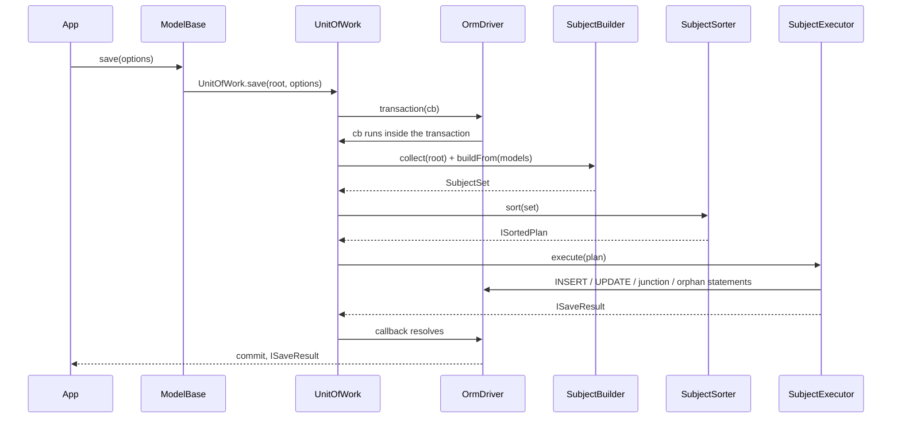

# Unit of work

`model.save()` persists a model and every model reachable from it in one transaction. It diffs each model against the snapshot taken when it was loaded, orders the statements so parents are inserted before children, and writes only the columns that changed. Use it when you edit a graph (an order, its customer, its lines and tags) and want one atomic write.

## How it works

1. `ModelBase.save(options?)` calls `UnitOfWork.save(root, options)`.
2. `UnitOfWork.save` reads the root's descriptor and resolves its connection as `OrmConnection`. A model without `@Model` or with an unknown connection throws `OrmException`.
3. It opens `OrmDriver.transaction()`. Inside a caller's transaction this becomes a savepoint; see [Transactions](08-transactions.md).
4. `UnitOfWork.identityMapFor()` picks the identity map: the one stored on the current transaction context (`ITransactionContext.IdentityMap`), created on first use, or a fresh `IdentityMap` when no transaction is in scope.
5. `SubjectBuilder.collect(root)` walks the graph breadth-first and canonicalizes every model through `IIdentityMap.add()`, so a row reached by two paths yields one instance. It follows:
   - a `@BelongsTo` whose `SingleRelation.Value` is set, populated or not;
   - a `@HasMany` or `@HasManyToMany` **only when its `Populated` flag is `true`**;
   - never a `Query` or `Virtual` relation.
6. `UnitOfWork.assertSingleConnection()` throws `OrmException` when a collected model declares another `@Connection` name than the root.
7. With `{ reload: true }`, `UnitOfWork.reloadSnapshots()` re-reads every persisted model (one `SELECT` per model class) and rebases its baseline. See [Important behaviour](#important-behaviour).
8. `SubjectBuilder.buildFrom(models)` creates one `Subject` per model and fills a `SubjectSet`:
   - `SubjectOperation.Insert` when `model.IsNew`, `Update` when `model.IsDirty`, otherwise `None`. An update subject records `ChangedColumns` from `model.changeSet()`.
   - Every `@BelongsTo` with a value adds an `IPendingForeignKey` (column, target model, target join column). The value is read later, because the target may not have a key yet.
   - Every populated `@HasMany` produces an `IRelationDelta` (`Added`, `Kept`, `RemovedKeys`) against the owner's relation snapshot, and adds the owner's key as a pending foreign key on each member.
   - Every populated `@HasManyToMany` produces an `IJunctionDelta`: junction rows to insert and to delete.
   - `buildOrphans()` turns removed `@HasMany` keys into `IOrphanDelta`s. It calls `resolveOrphanPolicy()`, which can throw (see [Orphan policy](#orphan-policy)). A key still alive somewhere in the graph (re-parented) is not an orphan.
9. `SubjectSorter.sort(set)` returns an `ISortedPlan`:
   - `Inserts`: topologically sorted, parents first. A cycle between rows of the **same table** is broken by moving the foreign key to `DeferredForeignKeys`; a cycle between different tables throws `OrmCycleException`.
   - `Updates`: update subjects, `None` subjects carrying a pending foreign key (re-parent candidates), then inserts with deferred keys.
   - `Junctions`: unchanged.
   - `Orphans`: children before parents.
10. `SubjectExecutor.execute(plan)` runs four phases in order: inserts, updates, junctions, orphans. See [Execution phases](#execution-phases).
11. `UnitOfWork.resnapshotRelations()` re-records the member keys of every populated relation, so a second `save()` sees no membership change.
12. The transaction commits and `save()` resolves with an `ISaveResult`. Any throw rolls the whole graph back.



### Execution phases

| Phase | Method | What it writes |
| --- | --- | --- |
| Inserts | `SubjectExecutor.runInserts()` | One `INSERT` per model, in sorted order. Pending foreign keys are read from their targets just before each statement. |
| Updates | `SubjectExecutor.runUpdates()` | One `UPDATE ... WHERE <pk>` per model with a non-empty diff, primary key columns excluded. Deferred self-references are written here. |
| Junctions | `SubjectExecutor.runJunctions()` | Per many-to-many delta: junction `INSERT`s first, then junction `DELETE`s scoped to the owner. |
| Orphans | `SubjectExecutor.runOrphans()` | `nullify` and `soft-delete` as `UPDATE`s first, then `delete` as `DELETE`s. |

Before each insert, `generateClientSideKeys()` fills empty `uuid` keys and `assertAssignedKeys()` throws `OrmException` for an empty `assigned` key. When a key column is `auto`, the executor asks for `RETURNING` if the driver reports `insertReturning`, else it reads `LastInsertId`. An empty `auto` key with neither `RETURNING` rows nor a `LastInsertId` throws `OrmException` (`insert of <Model#key> returned no generated key ...`).

Every inserted or updated model gets `takeSnapshot()` right after its statement, so it reads clean afterwards.

### What `save()` returns

`ISaveResult` counts what was written.

| Field | Counts |
| --- | --- |
| `Inserted` | Model `INSERT`s. |
| `Updated` | Model `UPDATE`s, including deferred self-reference updates, plus rows nullified by the `nullify` orphan policy. |
| `Deleted` | Rows hard-deleted by the `delete` orphan policy. |
| `SoftDeleted` | Rows stamped by the `soft-delete` orphan policy, or by `delete` on a `@SoftDelete` model. |
| `JunctionInserted` | Junction rows inserted. |
| `JunctionDeleted` | Junction rows deleted. |

## Decorators

These decorators are described in [Models](02-models.md) and [Relations](06-relations.md). This table lists only what they change in `save()`.

| Decorator | Target | Options | Effect |
| --- | --- | --- | --- |
| `@HasMany(target, options)` | Property | `orphan?: OrphanPolicy` | Decides what `save()` does with a child removed from the populated relation. |
| `@HasManyToMany(junction, target, options)` | Property | `orphan?: OrphanPolicy` | Not read by `save()`. A removed member only loses its junction row; the target row is never touched. |
| `@BelongsTo(target, foreignKey?, primaryKey?)` | Property | — | A set `Value` is always followed and inserted first if new. The foreign key is written from the target's `primaryKey` column. |
| `@Primary({ generated })` | Property | `'auto'` (default), `'uuid'`, `'assigned'` | `auto`: key read back after insert. `uuid`: generated client-side before insert. `assigned`: insert throws when empty. |
| `@SoftDelete()` | Property | — | Required by `OrphanPolicy.SoftDelete`. Turns `OrphanPolicy.Delete` into a soft delete. |
| `@UpdatedAt()` | Property | — | Set to `DateTime.now()` on every `UPDATE` that has at least one other changed column. |

### Orphan policy

`OrphanPolicy` decides the fate of a row removed from a populated `@HasMany`.

| Value | Effect |
| --- | --- |
| `OrphanPolicy.Nullify` (`'nullify'`) | `UPDATE` sets the child's foreign key to `NULL`. Default. |
| `OrphanPolicy.Delete` (`'delete'`) | `DELETE` the child row. Degrades to `soft-delete` when the child model has `@SoftDelete`. |
| `OrphanPolicy.SoftDelete` (`'soft-delete'`) | `UPDATE` stamps the child's `@SoftDelete` column with `DateTime.now()`. Throws `OrmException` when the child has no `@SoftDelete` column. |
| `OrphanPolicy.Disable` (`'disable'`) | Nothing. You manage removed rows yourself. |

With no `orphan` option, `resolveOrphanPolicy()` picks `Nullify`. It throws `OrmException` instead when the foreign key column is reflected from the database (non-empty `NativeType`) and is `NOT NULL`: deleting rows is never inferred. Declare a policy on the relation to fix it.

## Configuration

`save()` takes an `ISaveOptions` object. There are no configuration-file keys.

| Key | Type | Default | Allowed values | Meaning |
| --- | --- | --- | --- | --- |
| `ISaveOptions.reload` | `boolean` | `false` | `true`, `false` | Re-read every persisted model inside the transaction and diff against the current row instead of the hydration snapshot. |
| `ISaveOptions.chunk` | `number` | `DEFAULT_SAVE_CHUNK` (`100`) | Positive integer; `0` or less falls back to `100` | Maximum rows per batched statement: junction inserts and deletes, orphan key lists. Model inserts are never batched. |

```ts
await order.save({ reload: true, chunk: 500 });
```

## Services and extension points

None of these are resolved through DI: `UnitOfWork.save()` constructs them with `new`. They are exported so you can inspect a plan or drive the pipeline yourself.

| Service | Role | Default implementation | How to override |
| --- | --- | --- | --- |
| `UnitOfWork` | `save()` entry point: transaction, identity map, reload, build, sort, execute | `UnitOfWork.save()` | Not replaceable; call the pipeline classes directly for custom flows. |
| `SubjectBuilder` | Graph walk and diff into a `SubjectSet` | `new SubjectBuilder(identityMap)` | Subclass and call `build(root)` yourself. |
| `SubjectSorter` | Orders a `SubjectSet` into an `ISortedPlan`; throws `OrmCycleException` | `new SubjectSorter()` | Subclass and call `sort(set)` yourself. |
| `SubjectExecutor` | Runs an `ISortedPlan`; does **not** open a transaction | `new SubjectExecutor(options)` | Subclass; wrap `execute(plan)` in `driver.transaction()`. |
| `IIdentityMap` | `(table, primary key) -> instance` for one save or one transaction | `IdentityMap` | Implement `get`, `has`, `add`, `Size`, `clear`; pass it to `SubjectBuilder`. |
| Value converter snapshot hooks | Copy and compare a mutable column value for the diff | Built-in copy rules in `snapshotValue()` / `snapshotEquals()` | Implement `snapshotValue` and `snapshotEquals` on the column's converter. See [Converters and hydration](04-converters-and-hydration.md). |

### Snapshot and dirty-tracking API

Every `ModelBase` instance carries a diff baseline (`IModelSnapshot`): a value copy of each non-virtual column, plus the member primary keys of each populated relation.

| Member | Meaning |
| --- | --- |
| `Snapshot` | The baseline, or `null` when the row has never been in the database. Read-only. |
| `IsNew` | `true` while `Snapshot` is `null`. Classifies the model as an insert. A pre-filled key (for example a `uuid`) does not change this. |
| `IsDirty` | `true` when `IsNew`, or when any column or relation-managed foreign key differs from the baseline. No setter. |
| `changeSet()` | `IModelChange[]` (`Column`, `OldValue`, `NewValue`) for every differing column, in descriptor order. With no baseline, every column with `OldValue: undefined`. |
| `takeSnapshot()` | Records the current column values as the new baseline and drops recorded relation keys. |
| `snapshotRelation(name)` | Records the current member keys of relation `name`. No-op without a baseline. |
| `clearSnapshot()` | Drops the baseline; the next `save()` inserts the model. |

The ORM takes a snapshot when a `SELECT` hydrates a model, after `insert()`, `update()`, `archive()` and `refresh()`, after a static `insert()` of model instances, and after each `save()` statement. A relation snapshot is taken when the relation is populated.

`snapshotValue()` copies `Buffer`, `Date`, plain arrays and plain objects, and keeps primitives and luxon `DateTime` as they are. Any other object becomes the `UNCOPYABLE` marker, which never compares equal: that column is written on every save rather than silently never. `snapshotEquals()` treats `null` and `undefined` as different, compares `DateTime` and `Date` by instant, `Buffer` by content, and objects deeply.

## Important behaviour

- **An unpopulated relation is invisible.** `save()` reads a `@HasMany` or `@HasManyToMany` only when `Populated` is `true`. An empty array on a new or freshly loaded model deletes nothing, and pushing onto an unpopulated relation inserts nothing.
- **Every relation of a new model starts unpopulated.** Set `order.Lines.Populated = true` before pushing children onto a model you constructed, or load with `.populate('Lines')`.
- **Emptying a populated relation applies the orphan policy to every former member.** `order.Lines.empty()` after `populate()` removes or nullifies every line on the next save.
- **Re-parenting is not orphaning.** A child removed from one owner and pushed onto another owner in the same graph gets its foreign key rewritten by an `UPDATE`. Both relations must be populated and both owners reachable from the root.
- **Many-to-many never touches targets.** Removing a tag from an order deletes the junction row only. A new tag is inserted before its junction row.
- **One transaction per call.** A failure in any phase rolls back every statement of the save. An unchanged graph still opens and commits a transaction, with no other statements.
- **Snapshots move inside the transaction.** Models are re-snapshotted as their statements succeed. A rollback, of `save()` or of an enclosing transaction, does not restore them: the in-memory models read clean, and new ones carry a snapshot and a key that are not in the database.
- **The identity map is shared per transaction.** Several `save()` calls inside one caller transaction share one `IdentityMap`. The first instance saved for a row is canonical: a later save of a different instance of the same row walks the first instance, so edits made only on the second instance are not written.
- **The identity map keys on table name.** A `@DiscriminationMap` subclass instance and its base-class instance of the same row are one entry. See [Discrimination maps](14-discrimination-maps.md).
- **One connection per graph.** A related model on another `@Connection` name throws `OrmException` before anything is written. Save each connection's graph separately.
- **Self-referencing trees insert in one call.** A category and its new parent category insert parent first; when two new rows of one table point at each other, one foreign key is written by a follow-up `UPDATE`. A cycle across two tables throws `OrmCycleException`.
- **`reload` is last-write-wins, not conflict detection.** A column you edited keeps your value; a column you did not touch adopts the current database value and is not written. Two callers editing the same column still race. A row deleted meanwhile is re-inserted (its snapshot is cleared).
- **Model inserts are one statement per row.** `chunk` does not batch them, because each generated key is needed by the next statement.
- **`save()` does not check affected-row counts.** An `UPDATE` that matches no row (deleted by another process) still counts in `Updated`, and `NoRowsAffected` is never thrown. `NoRowsAffected` comes from the `insertModel()` and `deleteModel()` helpers; see [Model API](03-model-api.md).
- **The `UPDATE` payload excludes primary key columns.** Changing a key value on a loaded model is not written by `save()`.

## Best practices

- Load the relations you intend to change with `.populate('Lines')` (or `await order.Lines.populate()`) before editing them; `save()` ignores the rest.
- Declare `orphan` on every `@HasMany` whose child foreign key is `NOT NULL`. `OrphanPolicy.Delete` for owned children (order lines), `OrphanPolicy.Disable` when another process owns cleanup.
- Use `relation.attach(model)` for a `@BelongsTo`, not a direct foreign-key write: the relation wins in `toSql()` and in the diff.
- Read `changeSet()` once before `save()` to build an audit entry; it is computed on demand on each call.
- Use `{ reload: true }` on long-lived models edited across requests, so untouched columns pick up other writers' values.
- Raise `chunk` when a save links or unlinks thousands of many-to-many members, to cut round trips.

## Patterns and antipatterns

```ts
// Don't: Lines was never populated, so save() inserts the order and ignores the line.
const order = new Order({ Status: 'new' });
order.Lines.push(new OrderLine({ Sku: 'SKU-1', Quantity: 2 }));
await order.save();

// Do
const order = new Order({ Status: 'new' });
order.Lines.Populated = true;
order.Lines.push(new OrderLine({ Sku: 'SKU-1', Quantity: 2 }));
await order.save();
```

```ts
// Don't: rely on the default policy for a NOT NULL foreign key; save() throws once the
// column is reflected from the database.
@HasMany(OrderLine, { foreignKey: 'order_id' })
public Lines: Relation<OrderLine, Order>;

// Do
@HasMany(OrderLine, { foreignKey: 'order_id', orphan: OrphanPolicy.Delete })
public Lines: Relation<OrderLine, Order>;
```

```ts
// Don't: write the foreign key column; the attached relation overrides it.
order.customer_id = otherCustomer.Id;

// Do
order.Customer.attach(otherCustomer);
```

```ts
// Don't: load a second instance of a row inside one transaction and save it;
// the first saved instance is canonical and these edits are lost.
await Order.transaction(async () => {
  await order.save();
  const again = await Order.getOrFail(order.Id);
  again.Status = 'shipped';
  await again.save();
});

// Do: keep editing the instance you already saved.
await Order.transaction(async () => {
  await order.save();
  order.Status = 'shipped';
  await order.save();
});
```

## Examples

### Place an order with new lines, then edit it

```ts sample
import { BelongsTo, Connection, HasMany, IModelChange, ISaveResult, Model, ModelBase, OrphanPolicy, Primary, Relation, SingleRelation } from '@spinajs/orm';

@Connection('default')
@Model('customers')
export class Customer extends ModelBase<Customer> {
  @Primary()
  public Id: number;

  public Email: string;
}

@Connection('default')
@Model('order_lines')
export class OrderLine extends ModelBase<OrderLine> {
  @Primary()
  public Id: number;

  public Sku: string;

  public Quantity: number;

  public order_id: number;

  @BelongsTo('Order', 'order_id', 'Id')
  public Order: SingleRelation<Order>;
}

@Connection('default')
@Model('orders')
export class Order extends ModelBase<Order> {
  @Primary()
  public Id: number;

  public Status: string;

  public customer_id: number;

  @BelongsTo(Customer, 'customer_id', 'Id')
  public Customer: SingleRelation<Customer>;

  @HasMany(OrderLine, { foreignKey: 'order_id', primaryKey: 'Id', orphan: OrphanPolicy.Delete })
  public Lines: Relation<OrderLine, Order>;
}

// One INSERT for the order, then one per line, with order_id filled from the new order key.
export async function placeOrder(customerId: number, skus: string[]): Promise<ISaveResult> {
  const customer = await Customer.getOrFail(customerId);

  const order = new Order({ Status: 'new' });
  order.Customer.attach(customer);
  order.Lines.Populated = true;

  for (const sku of skus) {
    order.Lines.push(new OrderLine({ Sku: sku, Quantity: 1 }));
  }

  return await order.save();
}

// Removes one line (OrphanPolicy.Delete) and updates only the changed columns of the order.
export async function cancelLine(orderId: number, sku: string): Promise<IModelChange[]> {
  const order = await Order.where('Id', orderId).populate('Lines').firstOrFail();

  order.Lines.remove((line) => line.Sku === sku);
  order.Status = 'amended';

  const audit = order.changeSet();
  await order.save({ reload: true });

  return audit;
}
```

### Preview what `save()` would write

`SubjectBuilder` and `SubjectSorter` touch no database, so you can log a plan before saving. Building may still throw for an undeclared orphan policy on a `NOT NULL` key, and sorting may throw `OrmCycleException`.

```ts sample
import { IdentityMap, ModelBase, SubjectBuilder, SubjectSorter } from '@spinajs/orm';

export function describeSave(root: ModelBase): string[] {
  const set = new SubjectBuilder(new IdentityMap()).build(root);
  const plan = new SubjectSorter().sort(set);

  return [
    ...plan.Inserts.map((s) => `insert ${s.Identity}`),
    ...plan.Updates.map((s) => `update candidate ${s.Identity}: ${s.ChangedColumns.join(', ')}`),
    ...plan.Junctions.map((j) => `link ${j.Added.length} / unlink ${j.RemovedKeys.length} on ${j.Descriptor.Name}`),
    ...plan.Orphans.map((o) => `${o.Policy} ${o.PrimaryKeys.length} row(s) of ${o.TargetDescriptor.Name}`),
  ];
}
```

## Related

- [Transactions](08-transactions.md): `save()` runs in `OrmDriver.transaction()` and becomes a savepoint inside yours.
- [Models](02-models.md): `@Primary` key generation, `@SoftDelete`, `@UpdatedAt` used by the executor.
- [Model API](03-model-api.md): `insert()`, `update()`, `destroy()` and the `NoRowsAffected` helpers, which bypass the unit of work.
- [Converters and hydration](04-converters-and-hydration.md): `snapshotValue` / `snapshotEquals` converter hooks; hydration that takes the first snapshot.
- [Relations](06-relations.md): relation objects, `populate()`, and `sync()` / `update()`, which write one relation without `save()`.
- [Discrimination maps](14-discrimination-maps.md): why the identity map keys on table name.
- [`@spinajs/orm-sqlite`](../orm-sqlite/README.md), [`@spinajs/orm-mysql`](../orm-mysql/README.md), [`@spinajs/orm-mssql`](../orm-mssql/README.md): drivers that decide `insertReturning` and transaction behaviour.
