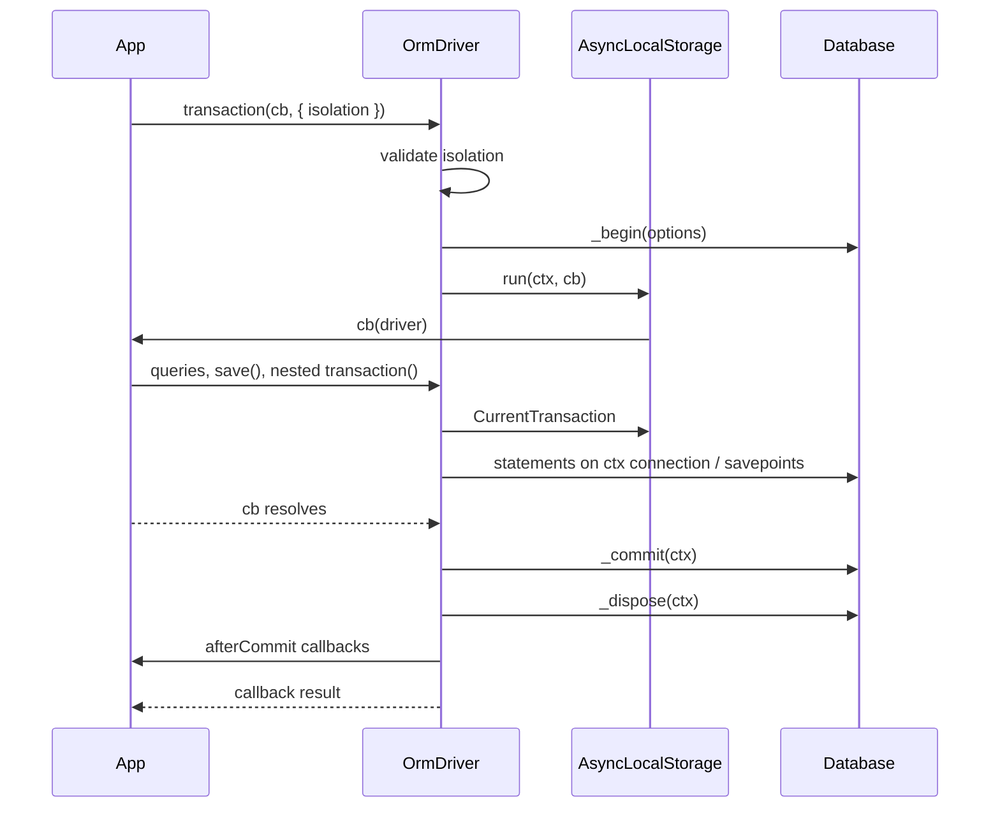

# Transactions

`OrmDriver.transaction(cb, options?)` runs a callback inside a database transaction: it commits when the callback resolves and rolls back when it throws. Every query, model write and `save()` issued inside the callback joins the transaction automatically, and a nested call becomes a savepoint.

## How it works

1. You call `driver.transaction(cb, options?)`, or `Model.transaction(cb, options?)`, which forwards to the driver of the model's connection.
2. `OrmDriver.transaction()` checks `options.isolation` against `OrmDriver.SupportedIsolationLevels`. An unlisted level throws `OrmException` (`isolation level <level> not supported by driver <driver>`) before anything reaches the database.
3. It reads the ambient context from the driver's `AsyncLocalStorage` (`OrmDriver.CurrentTransaction`).
4. **No transaction in scope:** the driver's `_begin(options)` opens one and returns an `ITransactionContext` with `depth = 0`. The callback runs inside `AsyncLocalStorage.run(ctx, ...)` and receives the driver.
5. Every statement executed inside the callback reads the context and runs on the transaction's connection. Nothing is passed by hand.
6. The callback resolves: `_commit(ctx)`. The callback or the commit throws: `_rollback(ctx)`, and the original error is rethrown. A failing rollback is swallowed so it cannot hide that error.
7. `_dispose(ctx)` releases the connection, exactly once, on every path.
8. Callbacks queued with `afterCommit()` run in registration order, outside the transaction. Then `transaction()` resolves with the callback's return value.
9. **A transaction already in scope:** the call takes a savepoint named `sp_<n>` with `_savepoint()`, runs the callback, then `_releaseSavepoint()` on success or `_rollbackToSavepoint()` on a throw, and rethrows. The enclosing transaction stays open.



### Who opens a transaction for you

| Caller | When |
| --- | --- |
| `ModelBase.save()` | Always; the whole graph is one transaction. See [Unit of work](07-unit-of-work.md). |
| `SingleRelation.set()`, `SingleRelation.remove()` | Always; attach or delete plus the owner update. |
| `OneToManyRelationList.sync()` / `update()`, `ManyToManyRelationList.sync()` / `update()` | Always; see [Relations](06-relations.md). |
| A query builder | When a `QueryMiddleware.transactional(query)` returns `true` and no transaction is in scope. See [Query builder](05-query-builder.md). |
| The migration service | Per `MigrationTransactionMode`; see [Migrations](10-migrations.md). |

Each of these becomes a savepoint when you call it inside your own `transaction()`. A transactional query middleware joins your transaction as it is, with no savepoint.

## Configuration

`transaction()` takes an `ITransactionOptions` object. There are no configuration-file keys; migration transactions are configured in [Migrations](10-migrations.md).

| Key | Type | Default | Allowed values | Meaning |
| --- | --- | --- | --- | --- |
| `ITransactionOptions.isolation` | `IsolationLevel` | unset (database default) | `'READ UNCOMMITTED'`, `'READ COMMITTED'`, `'REPEATABLE READ'`, `'SERIALIZABLE'`, limited to the driver's `SupportedIsolationLevels` | Isolation level of the outermost transaction. A nested call only validates it; the savepoint inherits the enclosing level. |

```ts
await driver.transaction(async () => reserveStock(orderId), { isolation: 'SERIALIZABLE' });
```

`OrmDriver.SupportedIsolationLevels` is empty on the base class, so a driver that declares nothing rejects every explicit level. Check each driver's page for its list: [`@spinajs/orm-sqlite`](../orm-sqlite/README.md), [`@spinajs/orm-mysql`](../orm-mysql/README.md), [`@spinajs/orm-mssql`](../orm-mssql/README.md).

## Services and extension points

| Service | Role | Default implementation | How to override |
| --- | --- | --- | --- |
| `OrmDriver.transaction(cb, options?)` | Owns the transaction lifecycle: begin, commit or rollback, dispose, savepoints, `afterCommit` | Implemented on the abstract `OrmDriver` | Not overridden; a driver implements the primitives below. |
| `OrmDriver.afterCommit(cb)` | Queues `cb` until the outermost commit; runs it at once outside a transaction | Implemented on `OrmDriver` | Not overridden. |
| `OrmDriver.CurrentTransaction` | The `ITransactionContext` in scope on this async path, or `undefined` | Reads the driver's `AsyncLocalStorage` | Not overridden. |
| `ModelBase.transaction(cb, options?)` | Runs `cb` in a transaction on the model's connection | Static model mixin forwarding to the descriptor's driver | Not overridden. |
| Transaction primitives `_begin`, `_commit`, `_rollback`, `_savepoint`, `_releaseSavepoint`, `_rollbackToSavepoint`, `_dispose` | Dialect SQL for each step; `_begin` acquires a pooled connection and stores it on `ITransactionContext.connection` | Each dialect driver | Implement them in a driver subclass and declare `SupportedIsolationLevels`. See [Architecture](12-architecture.md) and [`@spinajs/orm-sql`](../orm-sql/README.md). |

### Types

| Type | Shape |
| --- | --- |
| `TransactionCallback<R>` | `(driver: OrmDriver) => Promise<R>`; its result becomes the result of `transaction()`. |
| `IsolationLevel` | `'READ UNCOMMITTED' \| 'READ COMMITTED' \| 'REPEATABLE READ' \| 'SERIALIZABLE'`. |
| `ITransactionOptions` | `{ isolation?: IsolationLevel }`. |
| `ITransactionContext` | `connection?` (driver handle, absent for a single shared handle such as SQLite), `depth` (savepoints taken so far), `IdentityMap?` (shared by every `save()` in the transaction), `afterCommit?` (queued callbacks, owned by `OrmDriver`). |
| `ITransaction` | `{ commit(); rollback() }`. Exported, but no `@spinajs/orm` API returns it; use `transaction()`. |
| `MigrationTransactionMode` | `None`, `PerMigration`, `PerRun`. See [Migrations](10-migrations.md). |

## Important behaviour

- **The context is per driver.** Each `OrmDriver` instance has its own `AsyncLocalStorage`. A query on another connection inside the callback does not join the transaction and is not rolled back with it.
- **The callback's promise is the boundary.** Commit runs once the callback resolves. A statement you start but do not await can run after commit and dispose.
- **A builder joins when it executes, not when it is built.** Builders run when awaited; one created before `transaction()` and awaited inside the callback runs in the transaction.
- **Nesting is savepoints, never a second transaction.** A failing nested call rolls back only its own work; catch its error to keep the outer transaction alive. An uncaught error unwinds every level.
- **Drivers without concurrent transactions queue outermost calls.** When `supportedFeatures().concurrentTransactions` is `false` (SQLite), an outermost `transaction()` waits until the previous one on the same driver has committed or rolled back; calls run in call order. Nested calls are savepoints and never wait. The queue moves on before `afterCommit` callbacks run, so a callback may open a transaction of its own. A transaction callback that waits for work started on another async path of the same driver, where that work needs its own outermost transaction, never resolves.
- **Savepoints assume sequential work.** Savepoint names come from an incrementing counter on the shared context, and `afterCommit` bookkeeping assumes savepoints of one transaction run one after another. Do not run nested `transaction()` or `save()` calls concurrently inside one transaction.
- **`afterCommit` callbacks never run for rolled-back work.** A rollback of the outermost transaction, or a failed commit, drops every queued callback. A rolled-back savepoint drops the callbacks queued since it began. A released savepoint keeps them for the outermost commit.
- **`afterCommit` errors are logged, not thrown.** A failing callback is logged on the driver's log and the next one still runs. `transaction()` still resolves with the callback's value.
- **`afterCommit` callbacks run outside the transaction.** `CurrentTransaction` is `undefined` inside them, and the connection is already released.
- **The identity map lives as long as the transaction.** Every `save()` inside one transaction shares `ITransactionContext.IdentityMap`; it is discarded with the context. See [Unit of work](07-unit-of-work.md#important-behaviour).
- **In-memory models are not rolled back.** A rollback restores the database, not model fields or snapshots set by statements that ran inside it.
- **`ModelBase.transaction` needs a booted model.** `Orm` installs the static mixin on registered models; on a class it never registered, the call throws `Not implemented`.
- **Isolation on a nested call is ignored.** It is still validated against `SupportedIsolationLevels`, so an unsupported level throws even when nested.

## Best practices

- Prefer `Model.transaction()` in application code; it picks the model's connection for you. Use `model.driver()` when you already hold an instance.
- Use `driver.afterCommit()` for side effects that must not happen on rollback: emails, queue messages, cache invalidation.
- Wrap an optional step in a nested `transaction()` and catch its error, so the step can fail without losing the outer work.
- Request `isolation` only for the outermost call, and only a level the driver lists in `SupportedIsolationLevels`.
- Check `driver.CurrentTransaction !== undefined` in a service that must run inside a caller's transaction, and fail fast otherwise.
- Keep everything that must be atomic on one connection; a second connection needs its own `transaction()`.

## Patterns and antipatterns

```ts
// Don't: the email goes out even if the commit fails or a later statement throws.
await Invoice.transaction(async () => {
  invoice.Status = 'paid';
  await invoice.update();
  await mailer.sendReceipt(invoice.Id);
});

// Do
await Invoice.transaction(async (driver) => {
  invoice.Status = 'paid';
  await invoice.update();
  await driver.afterCommit(() => mailer.sendReceipt(invoice.Id));
});
```

```ts
// Don't: concurrent savepoints on one transaction.
await Order.transaction(async () => {
  await Promise.all(orders.map((o) => o.save()));
});

// Do
await Order.transaction(async () => {
  for (const o of orders) {
    await o.save();
  }
});
```

```ts
// Don't: fire-and-forget inside the callback; it may run after commit.
await Order.transaction(async () => {
  void auditLog.insert();
  await order.save();
});

// Do
await Order.transaction(async () => {
  await auditLog.insert();
  await order.save();
});
```

## Examples

### Transfer a balance between two accounts

```ts sample
import { Connection, Model, ModelBase, Primary } from '@spinajs/orm';

@Connection('default')
@Model('accounts')
export class Account extends ModelBase<Account> {
  @Primary()
  public Id: number;

  public Balance: number;
}

export async function transfer(fromId: number, toId: number, amount: number): Promise<void> {
  await Account.transaction(
    async () => {
      const from = await Account.getOrFail(fromId);
      const to = await Account.getOrFail(toId);

      if (from.Balance < amount) {
        // Rolls back: nothing has been written yet, and nothing will be.
        throw new Error(`account ${fromId} has insufficient funds`);
      }

      from.Balance -= amount;
      to.Balance += amount;

      await from.update();
      await to.update();
    },
    { isolation: 'SERIALIZABLE' },
  );
}
```

### Pay an invoice, award optional loyalty points, notify after commit

```ts sample
import { Connection, Model, ModelBase, Primary } from '@spinajs/orm';

@Connection('default')
@Model('invoices')
export class Invoice extends ModelBase<Invoice> {
  @Primary()
  public Id: number;

  public Status: string;

  public customer_id: number;
}

@Connection('default')
@Model('loyalty_points')
export class LoyaltyPoints extends ModelBase<LoyaltyPoints> {
  @Primary()
  public Id: number;

  public customer_id: number;

  public Points: number;
}

export interface IAccountingNotifier {
  invoicePaid(invoiceId: number): Promise<void>;
}

export async function payInvoice(invoiceId: number, notifier: IAccountingNotifier): Promise<void> {
  await Invoice.transaction(async (driver) => {
    const invoice = await Invoice.getOrFail(invoiceId);
    invoice.Status = 'paid';
    await invoice.save();

    try {
      // Savepoint: a failure here undoes only the points, not the payment.
      await driver.transaction(async () => {
        await new LoyaltyPoints({ customer_id: invoice.customer_id, Points: 10 }).save();
      });
    } catch {
      // Loyalty points are optional.
    }

    // Runs once the payment is committed; dropped if the transaction rolls back.
    await driver.afterCommit(() => notifier.invoicePaid(invoice.Id));
  });
}
```

## Related

- [Unit of work](07-unit-of-work.md): `save()` opens a transaction, shares the identity map through `ITransactionContext`, and nests as a savepoint.
- [Query builder](05-query-builder.md): `QueryMiddleware.transactional` wraps a single statement and its hooks in a transaction.
- [Relations](06-relations.md): relation writes that run in their own transaction.
- [Migrations](10-migrations.md): `MigrationTransactionMode` and per-migration opt-out.
- [Architecture](12-architecture.md): how a driver implements the transaction primitives.
- [Observability and resilience](13-observability-and-resilience.md): reconnect and retry behaviour around transactions.
- [`@spinajs/orm-sqlite`](../orm-sqlite/README.md), [`@spinajs/orm-mysql`](../orm-mysql/README.md), [`@spinajs/orm-mssql`](../orm-mssql/README.md): supported isolation levels and dialect notes such as non-transactional DDL.
