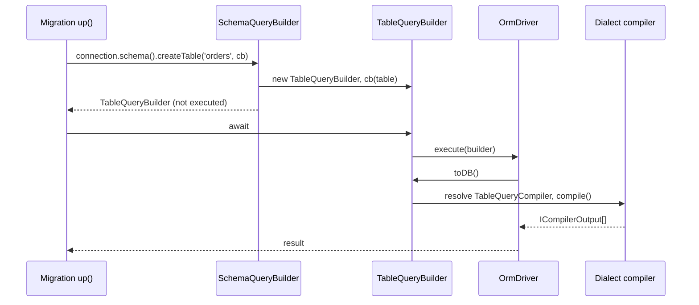

# Schema builder

The schema builder creates, alters and drops database objects: tables, columns, indexes, foreign keys, views, databases and scheduled events. You use it inside migrations through `connection.schema()`. Each call builds a statement that runs when you `await` it, compiled to SQL by the connection's dialect.

## How it works

1. `OrmDriver.schema()` resolves a `SchemaQueryBuilder` from the connection's child container. `OrmDriver.index()` and `OrmDriver.truncate(table)` return the two builders that sit outside it.
2. A `SchemaQueryBuilder` method creates one statement builder. Methods that take a callback (`createTable`, `alterTable`, `createView`, `createEvent`, `cloneTable`, `createDatabase`) call it synchronously with the new builder and return that builder.
3. Inside the callback, column methods such as `table.int('Id')` push a `ColumnQueryBuilder` (or an `AlterColumnQueryBuilder` in `alterTable`) and return it for chaining modifiers.
4. `await builder` calls `Builder.then()`, which calls `Builder.execute()`. Execution runs every registered `QueryMiddleware.beforeQueryExecution()`, then `OrmDriver.execute(builder)`.
5. The driver calls `builder.toDB()`. `toDB()` resolves the dialect compiler for that builder (`TableQueryCompiler`, `AlterTableQueryCompiler`, `CreateViewCompiler`, ...) from the container and returns one `ICompilerOutput` or an array of them.
6. The driver sends the SQL to the database. A builder runs at most once: awaiting it again resolves with the memoized result.
7. A compiler throws `MethodNotImplemented` or `NotSupported` for a clause its engine does not have. The SQL compilers throw `InvalidArgument` for unsafe names (see [Important behaviour](#important-behaviour)).



## Entry points

| Method | Returns | Statement |
| --- | --- | --- |
| `schema().createTable(name, cb)` | `TableQueryBuilder` | `CREATE TABLE` |
| `schema().alterTable(name, cb)` | `AlterTableQueryBuilder` | `ALTER TABLE`, one statement per alteration |
| `schema().dropTable(name, schema?)` | `DropTableQueryBuilder` | `DROP TABLE` |
| `schema().cloneTable(cb)` | `CloneTableQueryBuilder` | structure copy, optionally with `INSERT ... SELECT` |
| `schema().tableExists(name, schema?)` | `Promise<boolean>` | dialect-specific existence probe |
| `schema().createView(name, cb)` | `CreateViewQueryBuilder` | `CREATE VIEW` |
| `schema().dropView(name, schema?)` | `DropViewQueryBuilder` | `DROP VIEW` |
| `schema().createDatabase(name, cb?)` | `CreateDatabaseQueryBuilder` | `CREATE DATABASE` |
| `schema().dropDatabase(name)` | `DropDatabaseQueryBuilder` | `DROP DATABASE` |
| `schema().createEvent(name, cb)` | `EventQueryBuilder` | `CREATE EVENT` |
| `schema().dropEvent(name)` | `DropEventQueryBuilder` | `DROP EVENT` |
| `schema().raw(query, bindings?)` | `RawSchemaQueryBuilder` | the given SQL, passed through |
| `driver.index()` | `IndexQueryBuilder` | `CREATE [UNIQUE] INDEX` |
| `driver.truncate(table)` | `TruncateTableQueryBuilder` | `TRUNCATE TABLE` |

The optional `schema` argument of `dropTable`, `dropView` and `tableExists` qualifies the name with a schema or database, through `QueryBuilder.database()`.

## Tables

### `TableQueryBuilder`

| Method | Effect |
| --- | --- |
| `<columnType>(name, ...args)` | Adds a column; see [Column types](#column-types). |
| `increments(name)` | Shorthand for `int(name).autoIncrement().notNull().primaryKey()`. |
| `uuid(name)` | Shorthand for `binary(name, 16)`, the 16-byte form `UuidConverter` writes. |
| `foreignKey(column)` | Adds a `ForeignKeyBuilder` for `column` and returns it. |
| `ifExists()` | The SQL compilers emit `CREATE TABLE IF NOT EXISTS`. |
| `temporary()` | `CREATE TEMPORARY TABLE`. |
| `trackHistory()` | Adds a `<table>__history` table and triggers that record every change; see [Historical models](02-models.md). |
| `comment(text)`, `charset(name)` | Store the value only. No shipped compiler emits a table comment or charset, and both return `void`. |

Several columns marked `primaryKey()` form a composite key: the SQL compiler emits one table-level `PRIMARY KEY (a, b)`.

### Column types

`ColumnType` lists every column method. Both `TableQueryBuilder` and `AlterTableQueryBuilder` get one method per value, generated at load time.

| Method | `ColumnType` | Extra arguments |
| --- | --- | --- |
| `int`, `bigint`, `tinyint`, `smallint`, `mediumint` | `INTEGER`, `BIG_INTEGER`, `TINY_INTEGER`, `SMALL_INTEGER`, `MEDIUM_INTEGER` | none |
| `string` | `STRING` | `length?` (`VARCHAR(255)` in the SQL compiler when omitted) |
| `text`, `tinytext`, `mediumtext`, `longtext` | `TEXT`, `TINY_TEXT`, `MEDIUM_TEXT`, `LONG_TEXT` | none |
| `float`, `double`, `decimal` | `FLOAT`, `DOUBLE`, `DECIMAL` | `precision?`, `scale?` |
| `boolean`, `bit` | `BOOLEAN`, `BIT` | none |
| `date`, `dateTime`, `time`, `timestamp` | `DATE`, `DATE_TIME`, `TIME`, `TIMESTAMP` | none |
| `enum` | `ENUM` | `values: any[]` |
| `set` | `SET` | `allowed: string[]` (`TableQueryBuilder` only) |
| `json` | `JSON` | none |
| `binary` | `BINARY` | `size: number` |
| `tinyblob`, `mediumblob`, `longblob` | `TINY_BLOB`, `MEDIUM_BLOB`, `LONG_BLOB` | none |

`smalltext` is declared on both builders but has no `ColumnType` value, so calling it throws `TypeError: table.smalltext is not a function`. Use `text`.

How each type maps to SQL is dialect business: see [`@spinajs/orm-sql` compilers](../orm-sql/02-query-compilers.md#ddl) and the [SQLite type mapping](../orm-sqlite/04-schema-and-ddl.md#type-mapping).

### `ColumnQueryBuilder`

Every modifier returns the column builder, except `default()`.

| Method | Effect |
| --- | --- |
| `notNull()` | `NOT NULL`. Columns are nullable by default. |
| `unique()` | `UNIQUE`. |
| `unsigned()` | `UNSIGNED`. |
| `autoIncrement()` | Dialect auto-increment (`AUTO_INCREMENT`, `AUTOINCREMENT`, `IDENTITY(1,1)`). |
| `primaryKey()` | Marks the column as (part of) the primary key. |
| `comment(text)` | Column comment. |
| `charset(name)`, `collation(name)` | Column character set and collation. |
| `caseSensitive()` | The dialect's binary collation, so case and accent variants are different values: MySQL `CHARACTER SET '<charset>' COLLATE '<charset>_bin'` (`<charset>` is `charset()` or `utf8mb4`), PostgreSQL `COLLATE "C"`, MSSQL `COLLATE Latin1_General_100_BIN2` with a `string()` column written `NVARCHAR(n)`, SQLite nothing (its default `BINARY` is exact). An explicit `collation()` wins. MySQL's `_bin` collations and MSSQL's `=` still ignore trailing blanks. |
| `default()` | Returns a `DefaultValueBuilder`; each of its methods returns the column builder. |

| `DefaultValueBuilder` method | Default value |
| --- | --- |
| `value(val: string \| number)` | A literal. |
| `date()` | The current date. |
| `dateTime()` | The current date and time. |
| `raw(query: RawQuery)` | The given SQL expression. |

`InlinePrimaryKey` is a public flag the dialect compilers clear to move a key to a table-level constraint (SQLite does this for composite keys). Leave it alone.

### Foreign keys

`table.foreignKey(column)` returns a `ForeignKeyBuilder`.

| Method | Effect |
| --- | --- |
| `references(table, primaryKey)` | Parent table and its key column. |
| `onDelete(action)` | `ON DELETE` action. Default `ReferentialAction.NoAction`. |
| `onUpdate(action)` | `ON UPDATE` action. Default `ReferentialAction.NoAction`. |
| `cascade()` | Sets both actions to `ReferentialAction.Cascade`. |

| `ReferentialAction` | SQL |
| --- | --- |
| `Cascade` | `CASCADE` |
| `SetNull` | `SET NULL` |
| `Restrict` | `RESTRICT` |
| `NoAction` | `NO ACTION` |
| `SetDefault` | `SET DEFAULT` |

### Altering a table

`alterTable(name, cb)` hands the callback an `AlterTableQueryBuilder`. Its column methods return an `AlterColumnQueryBuilder`, a `ColumnQueryBuilder` with an alteration mode.

| Method | `ColumnAlterationType` | Effect |
| --- | --- | --- |
| `addColumn()` | `Add` | Adds the column. This is the default mode. |
| `modify()` | `Modify` | Changes the existing column's definition. |
| `rename(newName)` | `Rename` | Renames the column; `OldName` keeps the name you passed to the column method. |
| `after(column)` | n/a | Places the column after `column`. SQLite ignores it. |

| `AlterTableQueryBuilder` method | Effect |
| --- | --- |
| `dropColumn(column)` | Drops the column. Returns `void`. |
| `rename(newTableName)` | Renames the table. Returns `void`. |

`default()` returns the column typed as `ColumnQueryBuilder`, which has no `addColumn()` or `modify()`. Set the mode first, or keep a reference to the column:

```ts
await connection.schema().alterTable('invoices', (table) => {
  const dueDays = table.int('DueDays');
  dueDays.default().value(14);
  dueDays.addColumn();
});
```

SQLite supports little beyond adding and renaming; see [SQLite `ALTER TABLE` limitations](../orm-sqlite/04-schema-and-ddl.md#alter-table-limitations).

### Indexes

`driver.index()` returns an `IndexQueryBuilder`. It is not part of `SchemaQueryBuilder`.

| Method | Effect |
| --- | --- |
| `name(name)` | Index name. |
| `table(name)` | Table to index. |
| `columns(names)` | Indexed columns, in order. |
| `unique()` | `CREATE UNIQUE INDEX`. |

### Drop, truncate, clone, exists

| Builder | Methods | Notes |
| --- | --- | --- |
| `DropTableQueryBuilder` | `ifExists()` | `DROP TABLE [IF EXISTS]`. |
| `TruncateTableQueryBuilder` | none | SQLite emits `DELETE FROM` and keeps its auto-increment counter. |
| `CloneTableQueryBuilder` | `shallowClone(src, target)`, `deepClone(src, target, filter?)` | A shallow clone copies the structure. A deep clone also copies the rows, filtered by the `SelectQueryBuilder` callback when given. `deepClone` is `async`. |
| `TableExistsQueryBuilder` | none | Used by `tableExists()`; each dialect registers its own `TableExistsCompiler`. |

## Views

`createView(name, cb)` hands the callback a `CreateViewQueryBuilder`. Set the body with `as()`. A view without a body fails at compile time with `InvalidOperation`.

| Method | Effect |
| --- | --- |
| `as(body)` | The view body: a callback receiving a fresh `SelectQueryBuilder`, a ready `SelectQueryBuilder`, or a `RawQuery`. |
| `columns(names)` | Explicit view column names. |
| `orReplace()` | `OR REPLACE` (`OR ALTER` on MSSQL). |
| `ifNotExists()` | `IF NOT EXISTS`. |
| `temporary()` | `TEMPORARY` (`TEMP` on SQLite). |
| `algorithm(value: ViewAlgorithm)` | `ALGORITHM=`; one of `'UNDEFINED'`, `'MERGE'`, `'TEMPTABLE'`. |
| `security(value: ViewSecurity)` | `SQL SECURITY`; one of `'DEFINER'`, `'INVOKER'`. |
| `checkOption(option?: ViewCheckOption)` | `WITH CHECK OPTION`; with `'CASCADED'` or `'LOCAL'` it emits `WITH <option> CHECK OPTION`. |

`algorithm()`, `security()` and `checkOption()` throw `InvalidArgument` for a value outside the list, because these values reach the SQL unquoted. The body's bindings are inlined into the view SQL by the dialect's `LiteralQuoter`.

`dropView(name, schema?)` returns a `DropViewQueryBuilder` with `ifExists()`.

## Databases

| Builder | Methods | Notes |
| --- | --- | --- |
| `CreateDatabaseQueryBuilder` | `ifNotExists()`, `charset(name)`, `collation(name)` | `Name` holds the database name, separate from `QueryBuilder.Database`. |
| `DropDatabaseQueryBuilder` | `ifExists()` | Drops the database with all its content. |

## Events

`createEvent(name, cb)` hands the callback an `EventQueryBuilder`: a job the database engine runs on a schedule. Check `connection.supportedFeatures().events` before you use it.

| Method | Effect |
| --- | --- |
| `every(value, unit)` | Repeat at the interval. |
| `at(dateTime)` | Run once at a luxon `DateTime`. |
| `fromNow(value, unit)` | Run once, the interval from now. |
| `starts(dateTime)`, `ends(dateTime)` | Window for a repeating event. |
| `preserve()` | Keep the event after its last run (`ON COMPLETION PRESERVE`). |
| `disabled()` | Create the event disabled. |
| `ifNotExists()` | `IF NOT EXISTS`. |
| `comment(text)` | Event comment. |
| `do(sql)` | The action: one `RawQuery` or `QueryBuilder`, or an array of them wrapped in `BEGIN ... END`. |

- `every()`, `at()` and `fromNow()` are mutually exclusive. A second schedule call throws `InvalidOperation`.
- `value` must be a positive integer, and `unit` an `EventIntervalUnit` (`'YEAR'`, `'QUARTER'`, `'MONTH'`, `'WEEK'`, `'DAY'`, `'HOUR'`, `'MINUTE'`, `'SECOND'`). Anything else throws `InvalidArgument`.
- The parsed interval is stored as an `IEventInterval` (`{ Value, Unit }`) in `Every` or `FromNow`.

`dropEvent(name)` returns a `DropEventQueryBuilder` with `ifExists()`.

## Raw statements

`schema().raw(query, bindings?)` returns a `RawSchemaQueryBuilder`, which passes `Query` and `Bindings` straight to the driver. It accepts a SQL string or a `RawQuery`; with a `RawQuery`, the `bindings` argument is ignored and the query's own bindings are used.

## Dialect support

Which statements and clauses work depends on the connection's driver. A compiler throws for what its engine lacks rather than emitting another dialect's SQL. `ISupportedFeature.events` is the only schema feature a driver declares; check the rest against this table.

| Feature | MySQL | SQLite | MSSQL |
| --- | --- | --- | --- |
| `createEvent` / `dropEvent` (`supportedFeatures().events`) | yes | throws `MethodNotImplemented` | throws `MethodNotImplemented` |
| `createDatabase` / `dropDatabase` | yes | throws `NotSupported` | yes, `charset()` throws `NotSupported` |
| View `orReplace()` | `OR REPLACE` | throws | `OR ALTER` |
| View `ifNotExists()`, `temporary()` | throws | yes | throws |
| View `algorithm()`, `security()` | yes | throws | throws |
| View `checkOption()` | every form | throws | plain form only |
| View with a database prefix | yes | yes | throws `MethodNotImplemented` |

See the dialect pages for the details: [MySQL](../orm-mysql/06-schema-views-and-events.md), [SQLite](../orm-sqlite/04-schema-and-ddl.md), [MSSQL](../orm-mssql/06-schema-dialect.md), and the [generic SQL compilers](../orm-sql/02-query-compilers.md).

<!-- TODO(docs-hook): verify which dialects compile trackHistory(); the shipped SqlTableHistoryQueryCompiler emits MySQL-only syntax (CREATE TABLE ... LIKE, DELIMITER, triggers). -->

## Services and extension points

| Service | Role | Default implementation | How to override |
| --- | --- | --- | --- |
| `DefaultValueBuilder<T>` | Builds the `DEFAULT` clause of a column; `ColumnQueryBuilder.default()` resolves it with the column as its owner. | `SqlDefaultValueBuilder` from `@spinajs/orm-sql` | Register a subclass against `DefaultValueBuilder` in the driver's container. |
| Schema compilers (`TableQueryCompiler`, `AlterTableQueryCompiler`, `ColumnQueryCompiler`, `IndexQueryCompiler`, `CreateViewCompiler`, `EventQueryCompiler`, ...) | Turn a builder into SQL. | The `Sql*` compilers of `@spinajs/orm-sql`, overridden per dialect | See [Architecture](12-architecture.md) and [overriding a compiler](../orm-sql/02-query-compilers.md#services-and-extension-points). |
| `ISupportedFeature` | `driver.supportedFeatures()`; `events` gates the event API. | Declared by each driver | Implement `supportedFeatures()` in a custom driver; see [Adding a new SQL dialect](../orm-sql/07-adding-a-sql-dialect.md#feature-flags). |

## Important behaviour

- Nothing runs until you `await` the builder (or call `execute()`, `then()`, `catch()`, `finally()`). A builder that is only created is silently dropped.
- A builder executes at most once. Awaiting it again returns the memoized result and sends nothing.
- `toDB()` compiles without executing. Use it to preview the SQL a builder produces.
- `alterTable`, a deep `cloneTable` and `createTable` with `trackHistory()` compile to several statements. `SqlDriver.execute()` sends an array of statements together through `Promise.all`, not one after another. When one alteration depends on another, use separate `alterTable` calls.
- Schema statements pass through query middlewares like every other builder: `QueryMiddleware.beforeQueryExecution()` runs before the driver call. See [Query builder](05-query-builder.md).
- Names that reach the SQL unquoted are validated, not escaped: view options and event units against fixed lists in `@spinajs/orm`, and database charset and collation names against `[A-Za-z0-9_]` in `@spinajs/orm-sql`.
- DDL is not transactional on MySQL: a migration transaction does not undo a `CREATE TABLE`. See [MySQL: DDL is not transactional](../orm-mysql/06-schema-views-and-events.md#ddl-is-not-transactional) and [Migrations](10-migrations.md#transaction-modes).
- `TableQueryBuilder.ifExists()` emits `IF NOT EXISTS` in the SQL compilers, despite its name.

## Best practices

- Call `connection.schema()` on the `OrmDriver` your migration's `up()` receives, so the statement runs on that connection and inside its migration transaction.
- Guard dialect-specific statements with `connection.supportedFeatures().events` or a check on `connection.Options.Driver`, so one migration runs on every driver your project uses.
- Use `increments('Id')` for a single auto-increment key; on SQLite an auto-increment column cannot be part of a composite key.
- Add `unique()` to a column you upsert on. `InsertQueryBuilder.onDuplicate()` derives its conflict columns from unique columns, not from the primary key.
- Use `schema().tableExists()` before creating objects a peer process might have created; the migration service does exactly this for its own tracking tables.

## Patterns and antipatterns

```ts
// Don't: the builder is created but never awaited, so no SQL is sent
public async up(connection: OrmDriver) {
  connection.schema().createTable('orders', (table) => {
    table.increments('Id');
  });
}

// Do
public async up(connection: OrmDriver) {
  await connection.schema().createTable('orders', (table) => {
    table.increments('Id');
  });
}
```

```ts
// Don't: chaining after default() loses the alter-mode methods (compile error on addColumn)
await connection.schema().alterTable('invoices', (table) => {
  table.int('DueDays').default().value(14).addColumn();
});

// Do: addColumn() is the default mode, or set the mode before default()
await connection.schema().alterTable('invoices', (table) => {
  table.int('DueDays').addColumn().default().value(14);
});
```

```ts
// Don't: rename and modify the same column in one alterTable; the statements are sent concurrently
await connection.schema().alterTable('customers', (table) => {
  table.string('Mail').rename('Email');
  table.string('Email', 320).modify();
});

// Do: one dependent step per alterTable call
await connection.schema().alterTable('customers', (table) => {
  table.string('Mail').rename('Email');
});
await connection.schema().alterTable('customers', (table) => {
  table.string('Email', 320).modify();
});
```

## Examples

### Create the orders schema of a shop

```ts sample
import { Migration, OrmMigration, OrmDriver, ReferentialAction } from '@spinajs/orm';

@Migration('default')
export class CreateOrders_2026_10_01_09_00_00 extends OrmMigration {
  public async up(connection: OrmDriver): Promise<void> {
    await connection.schema().createTable('customers', (table) => {
      table.increments('Id');
      table.string('Email', 320).notNull().unique();
      table.string('Name').notNull();
      table.dateTime('CreatedAt').notNull().default().dateTime();
    });

    await connection.schema().createTable('orders', (table) => {
      table.increments('Id');
      table.int('customer_id').notNull();
      table.decimal('Total', 10, 2).notNull().default().value(0);
      table.enum('Status', ['pending', 'paid', 'shipped']).notNull().default().value('pending');
      table.json('ShippingAddress');
      table.dateTime('CreatedAt').notNull().default().dateTime();

      table.foreignKey('customer_id').references('customers', 'Id').onDelete(ReferentialAction.Cascade);
    });

    await connection.index().name('orders_status_idx').table('orders').columns(['Status', 'CreatedAt']);
  }

  public async down(connection: OrmDriver): Promise<void> {
    await connection.schema().dropTable('orders').ifExists();
    await connection.schema().dropTable('customers').ifExists();
  }
}
```

### Add a column to a table that already holds invoices

```ts sample
import { Migration, OrmMigration, OrmDriver } from '@spinajs/orm';

@Migration('default')
export class AddInvoiceDueDays_2026_10_02_09_00_00 extends OrmMigration {
  public async up(connection: OrmDriver): Promise<void> {
    await connection.schema().alterTable('invoices', (table) => {
      // A default makes NOT NULL legal on a populated table
      table.int('DueDays').notNull().default().value(14);
    });
  }

  public async down(connection: OrmDriver): Promise<void> {
    await connection.schema().alterTable('invoices', (table) => {
      table.dropColumn('DueDays');
    });
  }
}
```

### Expose paid orders as a view

```ts sample
import { Migration, OrmMigration, OrmDriver, RawQuery } from '@spinajs/orm';

@Migration('default')
export class CreatePaidOrdersView_2026_10_03_09_00_00 extends OrmMigration {
  public async up(connection: OrmDriver): Promise<void> {
    await connection.schema().createView('paid_orders', (view) => {
      view.columns(['Id', 'Total']).as(new RawQuery('SELECT Id, Total FROM orders WHERE Status = ?', ['paid']));
    });
  }

  public async down(connection: OrmDriver): Promise<void> {
    await connection.schema().dropView('paid_orders').ifExists();
  }
}
```

### Purge expired password-reset tokens every hour

```ts sample
import { Migration, OrmMigration, OrmDriver, RawQuery } from '@spinajs/orm';

@Migration('default')
export class SchedulePasswordResetPurge_2026_10_04_09_00_00 extends OrmMigration {
  public async up(connection: OrmDriver): Promise<void> {
    if (!connection.supportedFeatures().events) {
      return;
    }

    await connection.schema().createEvent('purge_password_resets', (event) => {
      event
        .every(1, 'HOUR')
        .ifNotExists()
        .comment('Delete reset tokens older than a day')
        .do(new RawQuery('DELETE FROM password_resets WHERE CreatedAt < NOW() - INTERVAL 1 DAY'));
    });
  }

  public async down(connection: OrmDriver): Promise<void> {
    if (!connection.supportedFeatures().events) {
      return;
    }

    await connection.schema().dropEvent('purge_password_resets').ifExists();
  }
}
```

### Archive last year's orders into a copy table

```ts sample
import { Migration, OrmMigration, OrmDriver } from '@spinajs/orm';

@Migration('default')
export class ArchiveOrders_2026_10_05_09_00_00 extends OrmMigration {
  public async up(connection: OrmDriver): Promise<void> {
    if (await connection.schema().tableExists('orders_archive')) {
      return;
    }

    await connection.schema().cloneTable((clone) => {
      clone.shallowClone('orders', 'orders_archive');
    });
  }

  public async down(connection: OrmDriver): Promise<void> {
    await connection.schema().dropTable('orders_archive').ifExists();
  }
}
```

## Related

- [Migrations](10-migrations.md): where schema statements run, and how they are tracked, locked and wrapped in transactions.
- [Connections](01-connections.md): `OrmDriver`, which owns `schema()`, `index()` and `truncate()`.
- [Query builder](05-query-builder.md): `SelectQueryBuilder` and `RawQuery`, used for view bodies, clone filters and event actions; also `ColumnMethods` aggregates.
- [Architecture](12-architecture.md): how a builder becomes SQL, and the compiler extension points.
- [Models](02-models.md): `@Historical` reads the history table `trackHistory()` creates.
- [`@spinajs/orm-sql`](../orm-sql/README.md): the generic SQL compilers behind every statement on this page.
- [`@spinajs/orm-sqlite`](../orm-sqlite/README.md), [`@spinajs/orm-mysql`](../orm-mysql/README.md), [`@spinajs/orm-mssql`](../orm-mssql/README.md): dialect limits.
