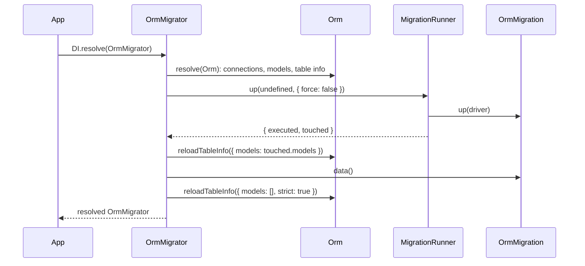
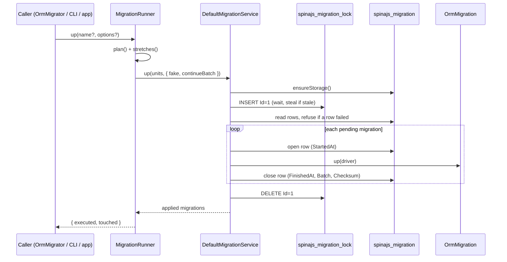

# Migrations

Migrations change the database schema in ordered, tracked steps. Each migration is an `OrmMigration` class bound to one connection with `@Migration()`. `Orm.resolve()` discovers them; `OrmMigrator` applies the pending ones in timestamp order across every connection, re-reads the table info of the models they touched, runs their `data()` seeds, records each run in a tracking table, and guards runs with a cross-process lock.

## How it works

### Discovery, at `Orm.resolve()`

1. `Orm.resolve()` creates the connections, then calls `Orm.discoverMigrations()`.
2. `discoverMigrations()` resolves every registered `MigrationSource` and merges what they return. Two ship by default:
   - `FilesystemMigrationSource` scans the directories in `system.dirs.migrations` (or the [fallback directories](#discovery-directories)) and imports each matching file.
   - `DiRegistryMigrationSource` returns every class `@Migration()` registered in the DI container under `__migrations__`, so migrations reached by a plain `import` count too.
3. For each entry, `resolveMigrationEnv()` reads the environment from the file name suffix (`parseMigrationFileEnv()`) and from the class's own `@Migration({ Env })`. When both are present and differ, it throws `OrmException`.
4. Entries sharing a class name merge into one. The same class found twice keeps one environment (`mergeMigrationEnv()`, which throws on two different ones) and prefers a real file path over the `<di>` sentinel. Two different classes with the same name log a warning, and the first one wins.
5. Entries whose environment is set and differs from the normalized `APP_ENV` are dropped. They never reach `orm.Migrations`, so `up`, `down` and `status` all ignore them.
6. `Orm.registerMigration()` checks each class name against `MIGRATION_FILE_REGEXP` and throws `OrmException` for a name without a valid `_yyyy_MM_dd_HH_mm_ss` timestamp.

`Orm.resolve()` applies nothing. It reads table info (failing on a missing table of a connection without `Migration.OnStartup` when `db.StrictTableCheck` is on), wires relations and installs the model statics; see [Connections](01-connections.md).

### The boot pass, `DI.resolve(OrmMigrator)`

1. `OrmMigrator.resolve()` resolves the `Orm` from its container first. With `{ MigrateOnStartup: false }` it resolves it as a migration tool: `Orm.resolve()` skips its `db.StrictTableCheck` check.
2. It assigns `Runner = new MigrationRunner(orm)`. With `{ MigrateOnStartup: false }` it clears `AwaitsStartupMigration` on every connection and returns.
3. Otherwise it calls `migrate({ force: false })`. `force: false` runs only connections whose `Migration.OnStartup` is `true`. Model queries of the pass (the migrations' `up()` and `data()` and what they call) pass the `Migration.OnStartup` gate; any other code is refused until step 7.
4. `migrate()` calls `Runner.up()`, then `orm.reloadTableInfo({ models: touched.models })` for the models whose tables the applied migrations changed, then `runDataPhase(executed)`.
5. `runDataPhase()` calls `data()` on every migration the pass applied. Every hook runs even when an earlier one throws; the failures are reported together in one `OrmException` whose `inner` is the first one.
6. With `db.StrictTableCheck` on (the default), it calls `orm.reloadTableInfo({ models: [], strict: true })`: only the models an earlier read recorded missing are read again, so a table created since counts as present, and one `OrmException` names every registered model whose table is still missing, for example `Missing tables (db.StrictTableCheck): model PolicyRecord: table authz_policy on connection authz (main). Create them (run their migrations) or set db.StrictTableCheck to false`.
7. It clears `AwaitsStartupMigration` on every connection: model queries on `Migration.OnStartup` connections work from here on.
8. A migration that throws in step 4 rejects `DI.resolve(OrmMigrator)` with that error. The `data()` phase does not run. A failed pass leaves the gate closed and the `Orm` cached with its connections open; the process calls `await DI.dispose()` before it exits or retries (see [Connections](01-connections.md#important-behaviour)).



### Touched models

`MigrationRunner.up()` records, while a run executes, the tables every schema statement names:

| Statement | Recorded |
| --- | --- |
| `schema().createTable()`, `alterTable()` (including `rename()`), `dropTable()`, `cloneTable()`, `createView()`, `dropView()`, `index()` | the table or view names |
| `createEvent()`, `dropEvent()`, `createDatabase()`, `tableExists()`, any DML | nothing |
| `schema().raw()`, `dropDatabase()`, another builder in schema context | every table of the connection |
| SQL sent straight to any connection's driver (`executeOnDb()`) inside `up()` | every table of that connection |
| any migration applied by a custom `OrmMigrationService` | every table of the connection |

`touched.models` are the registered models whose `TableName` (case-insensitive) and connection match. Connections are matched by the driver's `Name`, so a statement through an alias, or through another driver instance of the same connection, counts for it. `wireRelations()` reads no column info, so relations are not wired again. A faked run (`fake: true`) touches nothing.

### A run, `MigrationRunner.up()`

1. `MigrationRunner.plan()` validates and orders the registry:
   - With a `name`, it keeps that migration only and throws `OrmException` when nothing is registered under it.
   - It parses each name's timestamp and throws `OrmException` for an invalid one, refusing the whole set.
   - It sorts by `(timestamp, name)`.
   - It reads each class's connection with `extractMigrationDescriptor()`. A migration without `@Migration()` or naming a connection that is not configured is skipped with a warning.
   - With a `connection` option, it resolves the name to a driver (aliases included) and throws `OrmException` when no connection answers to it.
   - With `force: false`, it skips connections whose `Migration.OnStartup` is off, warning once per connection.
   - It groups units by driver, so two names aliased to one connection run once.
2. `MigrationRunner.stretches()` asks each connection's service for `status()`, keeps pending and failed units, sorts them globally by `(timestamp, name)`, and cuts them into runs of consecutive same-connection migrations. A connection with nothing pending still gets an empty run at the end, so its failed-row guard still applies.
3. For each run, `MigrationRunner` resolves the connection's `OrmMigrationService` (the `Migration.Service` token, or `DefaultMigrationService`) and calls `service.up(units, { fake, continueBatch })`. Returning to a connection continues the batch it opened earlier in the same call.
4. `DefaultMigrationService.up()`:
   1. `ensureStorage()` creates or upgrades the tracking table and the lock table.
   2. `withLock()` takes the connection's migration lock (see [Locking](#locking)).
   3. It reads the tracking rows and throws `OrmException` when any row is in the failed state.
   4. It filters out applied units and warns about [interrupted](#migration-states) ones it is about to re-run.
   5. It resolves every pending migration from the connection's container with the driver as constructor argument.
   6. It picks the batch: one past the highest applied batch, or the same batch with `continueBatch`.
   7. With `fake`, it records every pending migration as applied without calling `up()` and returns.
   8. Otherwise, per migration and inside the [transaction mode](#transaction-modes): it opens the row (`StartedAt`), warns on a checksum mismatch, calls `migration.up(driver)`, then closes the row with `FinishedAt`, `Batch` and `Checksum`.
5. On failure, the service waits for the transaction to unwind, writes the error message and stack into the row's `Logs`, and throws `OrmException('Migration <name> failed on connection <connection>: ...')` with the original error as `inner`. Later migrations do not run. The lock is released in either case.
6. `up()` resolves with `IMigrationUpResult`: `executed`, the `OrmMigration` instances it applied, and `touched.models` (see [Touched models](#touched-models)).



### Rollback, `MigrationRunner.down()`

1. `plan()` runs as for `up()`. There is no global reordering: each connection rolls back in turn.
2. `DefaultMigrationService.down()` ensures storage and takes the lock.
3. Failed rows do not block a rollback. The service warns that they stay blocking afterwards.
4. It targets the last batch, or every applied migration with `all: true`.
5. Applied rows without a registered class are warned about as orphans and stay applied.
6. It runs `down(driver)` newest first, by `(timestamp, name)` descending, inside the transaction mode, and deletes each row after its `down()` succeeds. With `fake`, it deletes the rows without calling `down()`.
7. A failing `down()` throws `OrmException('Migration <name> failed to roll back on connection <connection>: ...')`. No `Logs` row is written, so `down()` stays available as a recovery path.

### Status and resolve

- `MigrationRunner.status()` returns one `IMigrationStatusEntry` per registered migration whose connection is configured, `OnStartup` or not. It never takes the lock.
- `MigrationRunner.resolve(name, action)` forces the recorded state of a failed or interrupted migration without running it. It never takes the lock, because the run that died may still hold it.

## Writing a migration

| Member | Required | Called | Purpose |
| --- | --- | --- | --- |
| `up(connection: OrmDriver): Promise<void>` | yes | by `up()` | Apply the schema change. Models are wired, but models of tables this run creates have no columns until the run ends. |
| `down(connection: OrmDriver): Promise<void>` | yes | by `down()` | Undo `up()`. |
| `data(): Promise<void>` | no | by `OrmMigrator.migrate()`, for the migrations it applied | Seed data once every migration of the run is applied and the touched models are re-read. |
| `transaction = false` | no | by the service | Run this migration outside any wrapping transaction. |

- The class name is the migration's identity: it is stored in the `Migration` column and must match `MIGRATION_FILE_REGEXP`, `<Name>_yyyy_MM_dd_HH_mm_ss`. The timestamp is the only ordering the runner has; equal timestamps fall back to the name.
- `transaction = false` is read from the instance, the prototype or a static property.
- Use the `OrmDriver` passed to `up()` and `down()`. Its schema builder is described in [Schema builder](09-schema-builder.md).
- `up()` and `data()` may resolve any service that injects the `Orm`, such as a users or token store: the `Orm` is resolved before the migrator runs. Such services must not inject `OrmMigrator`.
- Prefer the schema builder over raw SQL: raw SQL makes the run re-read every model of the connection.

### Environments

A migration belongs to every environment unless it is tagged:

| Declaration | Example | Belongs to |
| --- | --- | --- |
| No tag | `CreateInvoices_2026_10_06_09_00_00.ts` | every environment |
| File suffix | `SeedDemoCustomers_2026_10_07_09_00_00.local.ts` | `local` |
| Decorator option | `@Migration('default', { Env: 'local' })` | `local` |
| Both, agreeing | `.dev.ts` with `{ Env: 'development' }` | `dev` |

- Environments are compared after `normalizeEnvironment()`: `development` becomes `dev`, `production` becomes `prod`, an unset or empty `APP_ENV` is `prod`. Case is kept.
- `FilesystemMigrationSource` never imports a file tagged for another environment.
- These throw `OrmException`: a file with two tags (`Foo_..._00.dev.local.ts`), an empty tag (`Foo_..._00..ts`), a suffix and a decorator that disagree, and an `APP_ENV` outside `SAFE_ENV_NAME_REGEXP` (`[A-Za-z0-9_-]+`).
- `.test`, `.spec` and `.d.ts` middle segments are not environment tags.
- `Env` is read from the class's own `@Migration()` only. A subclass inherits its parent's connection, but not its environment.

### Discovery directories

`FilesystemMigrationSource` scans the directories in `system.dirs.migrations`. When the key is absent or empty, it scans `DEFAULT_MIGRATION_DIRS`: `src/migrations`, `lib/migrations`, `dist/migrations`, `build/migrations` and `migrations`, under `process.cwd()`.

In each directory it matches `**/!(*.*).{ts,js,cjs,mjs}` (no environment tag) and `**/*.<env>.{ts,js,cjs,mjs}`. It keeps only exports that extend `OrmMigration` and whose class name carries a timestamp.

| Import failure | Directory | Result |
| --- | --- | --- |
| `.ts` file | any | Skipped at trace level. A compiled deployment finds the `.js` copy. |
| other file | configured in `system.dirs.migrations` | `OrmException`, with the import error as `inner`. |
| other file | fallback directory | Warning; the migration is not registered. |

## Running migrations

### `OrmMigrator`

| Member | Meaning |
| --- | --- |
| `constructor(options?: IOrmMigratorOptions)` | `MigrateOnStartup?: boolean`, default `true`. `false` resolves the migrator without the boot pass: `Runner` and `migrate()` work, nothing is applied on the way in. |
| `MigrateOnStartup` | Read-only `boolean`. `false` when resolved with `MigrateOnStartup: false`: its resolve ran no boot pass and created no table. A `di.resolved.OrmMigrator` listener reads it to tell a migration tool from a migrated boot. |
| `Runner` | The `MigrationRunner` over the `Orm`'s migrations and connections. Assigned in `resolve()`. |
| `migrate(options?: IOrmMigrateOptions)` | `IMigrationUpOptions` plus `name`. Applies (`force` defaults to `true`), re-reads the touched models, runs `data()` (not with `fake`). Resolves with the applied migrations. |
| `resolve()` | The boot pass, see [above](#the-boot-pass-diresolveormmigrator). |

`OrmMigrator` is a DI singleton: the options apply only to the resolve that constructs it. It leaves the cache once another `Orm` resolves in its container (after `DI.uncache(Orm)`), so the next `DI.resolve(OrmMigrator)` runs against the new `Orm`.

### `MigrationRunner`

`OrmMigrator.Runner` is the `MigrationRunner` of the resolved `Orm`.

| Method | Options | Result |
| --- | --- | --- |
| `up(name?, options?: IMigrationUpOptions)` | `force` (default `true`), `fake`, `connection` | `Promise<IMigrationUpResult>`: `executed` and `touched.models`. Runs no `data()` and reads no table info; use `OrmMigrator.migrate()` for that. |
| `down(name?, options?: IMigrationDownFacadeOptions)` | `force` (default `true`), `fake`, `connection`, `all` | `Promise<OrmMigration[]>`: the migrations rolled back. |
| `status()` | none | `Promise<IMigrationStatusEntry[]>` |
| `resolve(name, action: MigrationResolveAction)` | `'applied'` or `'rolled-back'` | `Promise<void>` |

| Option | Meaning |
| --- | --- |
| `force` | `true` ignores `Migration.OnStartup`. Only the migrator's boot pass passes `false`. |
| `fake` | Record the outcome without calling `up()` / `down()`. |
| `connection` | Limit the run to one connection, by name or alias. |
| `all` | `down()` only: roll back every batch instead of the last one. |

`@spinajs/orm-cli` exposes the same operations as `migrate-up` (`OrmMigrator.migrate()`), `migrate-down`, `migrate-status`, `migrate-resolve` and `migrate-create`. It resolves `OrmMigrator` with `MigrateOnStartup: false`, so booting the CLI applies nothing on its own.

### Migration states

| `IMigrationStatusEntry` field | Row shape | Meaning |
| --- | --- | --- |
| `applied` | `FinishedAt` set, `RolledBackAt` null | Applied; skipped by `up()`. |
| `failed` | `FinishedAt` null, `Logs` set | `up()` threw. Blocks every later `up()` on the connection. |
| `interrupted` | `StartedAt` set; `FinishedAt`, `Logs`, `RolledBackAt` null; no fresh lock | The process died mid-run. Still pending; `up()` re-runs it with a warning. |
| `rolledBack` | `RolledBackAt` set | Resolved as rolled back; pending again. |
| `pending` | no row, or not applied and not failed | Will run on the next `up()`. |
| `checksumMismatch` | stored `Checksum` differs | The class source changed after it was applied. Advisory. |

The entry also carries `name`, `connection`, `batch`, `startedAt` and `finishedAt`.

### Recovering from a failed run

1. Read the row's `Logs` column to see what broke.
2. Fix the database by hand, or roll the partial change back.
3. Call `migrator.Runner.resolve(name, 'applied')` (or `migrate-resolve`) when the change is complete, or `resolve(name, 'rolled-back')` to make the migration pending again.

`resolve()` accepts failed and interrupted rows only; any other row throws `OrmException`. `'applied'` stamps `FinishedAt`, the next batch number and the checksum; `'rolled-back'` stamps `RolledBackAt` and clears `Logs`. A failed row whose class no longer exists cannot be resolved: delete it from the tracking table by hand.

## Transaction modes

`Migration.Transaction.Mode` decides how `up()` and `down()` wrap migrations in `driver.transaction()`.

| `MigrationTransactionMode` | Wrapping |
| --- | --- |
| `None` (default) | No transaction. |
| `PerMigration` | One transaction per migration. |
| `PerRun` | One transaction per stretch of consecutive migrations on the connection. A migration with `transaction = false` splits the stretch and runs outside it. |

In every mode, a migration with `transaction = false` runs without a transaction. Under `PerRun`, a failure rolls back every migration of its stretch, and the failure row names the migration that threw. Engines that commit DDL implicitly, such as MySQL, keep schema changes despite the rollback; see [MySQL: DDL is not transactional](../orm-mysql/06-schema-views-and-events.md#ddl-is-not-transactional) and [Transactions](08-transactions.md).

## Locking

One migration run per connection at a time, across processes:

1. `acquireLock()` inserts row `Id = 1` into `<Table>_lock`, with `AcquiredAt` and `Owner` (`<hostname>:<pid>`). The unique `Id` lets the database pick the winner.
2. When the insert fails and the holder's `AcquiredAt` is older than `Lock.StaleAfter`, the service logs a warning, deletes the row and retries at once. One acquisition steals at most `MIGRATION_LOCK_MAX_STEALS` (3) times.
3. Otherwise it polls every `MIGRATION_LOCK_POLL_INTERVAL` (500 ms) until `Lock.Timeout`, then throws `OrmException` naming the holder.
4. `releaseLock()` deletes row `Id = 1` in a `finally`. A failed release is logged, not thrown, and the row goes stale.

Staleness is judged by the client clock, so hosts whose clocks disagree steal early or wait long by the skew. `status()` and `resolve()` never take the lock. With `Lock.Enabled: false`, runs are not guarded and `status()` reports every open row as interrupted.

## Decorators

| Decorator | Target | Options | Effect |
| --- | --- | --- | --- |
| `@Migration(connection, options?)` | class extending `OrmMigration` | `connection: string`: connection name from `db.Connections`. `options.Env?: string`: environment the migration belongs to. | Records a migration descriptor (`Connection`, `Env`, `SourceFile`) and registers the class in DI under `__migrations__`. |

- `SourceFile` is the file `@Migration()` was applied in, captured from the stack with `captureSourceFile()`. A bundler that mangles paths leaves it `undefined`.
- Read the descriptor with `extractMigrationDescriptor()` (walks the prototype chain) or `extractOwnMigrationDescriptor()` (own class only).
- Decorating a subclass creates its own descriptor and leaves the parent's untouched.

## Configuration

| Key | Type | Default | Allowed values | Meaning |
| --- | --- | --- | --- | --- |
| `db.Connections[].Migration.OnStartup` | `boolean` | unset (off) | `true`, `false` | Apply this connection's migrations during `OrmMigrator`'s boot pass. Model queries on the connection throw outside the pass until it succeeded. |
| `db.StrictTableCheck` | `boolean` | `true` | `true`, `false` | Fail the boot when a registered model has no table: `Orm.resolve()` for the connections without `Migration.OnStartup`, the boot pass for every connection. See [Connections](01-connections.md#configuration). |
| `db.Connections[].Migration.Table` | `string` | `spinajs_migration` | table name | Tracking table. The lock table is `<Table>_lock`. |
| `db.Connections[].Migration.Service` | `string` | unset (`DefaultMigrationService`) | DI token | `OrmMigrationService` implementation for this connection. |
| `db.Connections[].Migration.Transaction.Mode` | `MigrationTransactionMode` | `None` | `None`, `PerMigration`, `PerRun` | See [Transaction modes](#transaction-modes). |
| `db.Connections[].Migration.Lock.Enabled` | `boolean` | `true` | `true`, `false` | Guard runs with the lock table. |
| `db.Connections[].Migration.Lock.Timeout` | `number` (ms) | `30000` | positive integer | How long to wait for the lock before throwing. |
| `db.Connections[].Migration.Lock.StaleAfter` | `number` (ms) | `600000` | positive integer | Age after which a held lock counts as abandoned and is stolen. |
| `system.dirs.migrations` | `string[]` | `[]` (fallback directories) | directory paths | Directories `FilesystemMigrationSource` scans. A non-empty value replaces the fallbacks. |
| `process.env.APP_ENV` | `string` | unset (`prod`) | `[A-Za-z0-9_-]+` | Environment the process runs as; selects tagged migrations. |

`MigrateOnStartup` is not configuration: pass it when resolving the migrator, as `DI.resolve(OrmMigrator, [{ MigrateOnStartup: false }])`. Its default is `true`.

```ts
import { MigrationTransactionMode } from '@spinajs/orm';

export default {
  db: {
    Connections: [
      {
        Name: 'default',
        Driver: 'orm-driver-mysql',
        Host: '127.0.0.1',
        Database: 'shop',
        Migration: {
          OnStartup: true,
          Table: 'spinajs_migration',
          Transaction: { Mode: MigrationTransactionMode.PerMigration },
          Lock: { Enabled: true, Timeout: 30_000, StaleAfter: 600_000 },
        },
      },
    ],
  },
  system: {
    dirs: {
      migrations: ['lib/migrations'],
    },
  },
};
```

## Schema

`DefaultMigrationService.ensureStorage()` creates both tables before every `up()`, `down()`, `status()` and `resolve()`. It tolerates a peer process creating them at the same moment, and adds missing columns to a tracking table from an older layout, copying `CreatedAt` into the missing `StartedAt` and `FinishedAt` and setting `Batch` to `1`.

### `spinajs_migration`

The name comes from `Migration.Table`. `IMigrationRecord` is the row type.

| Column | Type | Meaning |
| --- | --- | --- |
| `Migration` | `string`, unique, not null | Migration class name. |
| `CreatedAt` | `dateTime`, not null | When the row was first written. |
| `StartedAt` | `dateTime`, not null | When the last attempt started. |
| `FinishedAt` | `dateTime` | When it was applied; null while running, failed or after a rolled-back resolution. |
| `RolledBackAt` | `dateTime` | Set by `resolve(name, 'rolled-back')`. |
| `Logs` | `text` | Error message and stack of a failed `up()`. |
| `Checksum` | `string(64)` | `migrationChecksum()`: SHA-256 of the class source text. |
| `Batch` | `int`, not null, default `1` | Run that applied the migration; `down()` rolls back the highest. |

`down()` deletes the row of a rolled-back migration rather than stamping it.

### `spinajs_migration_lock`

| Column | Type | Meaning |
| --- | --- | --- |
| `Id` | `int`, unique, not null | Always `1`; the unique constraint makes the insert the lock. |
| `AcquiredAt` | `dateTime`, not null | Client time the lock was taken. |
| `Owner` | `string(255)`, not null | `<hostname>:<pid>` of the holder. |

## Services and extension points

| Service | Role | Default implementation | How to override |
| --- | --- | --- | --- |
| `OrmMigrationService` | Per-connection storage, locking, run, rollback, status and resolve. Contract: `ensureStorage()`, `up()`, `down()`, `status()`, `resolve()`. | `DefaultMigrationService` | Register a subclass under a string token and set `Migration.Service` to it. |
| `MigrationSource` | Discovers migration classes; never constructs or runs them. | `FilesystemMigrationSource` and `DiRegistryMigrationSource`, both active | Add a source with `@Injectable(MigrationSource)`; every registered source is merged. |
| `OrmMigrator` | Boot pass, `migrate()`, data phase; owns `Runner`. | `OrmMigrator` | Not overridden. Resolve it with `IOrmMigratorOptions`. |
| `MigrationRunner` | Cross-connection planning and ordering; `OrmMigrator.Runner`. | `MigrationRunner` | Not resolved through DI. Construct one over any `IMigrationRunnerHost` (`Migrations`, `Connections`, optional `Models` for the touched report) for tooling or tests. |

`DefaultMigrationService` also has `applied()`, which returns the raw applied rows of its connection.

```ts sample
import { DI } from '@spinajs/di';
import { DefaultMigrationService, IMigrationRunOptions, IMigrationUnit, OrmException, OrmMigration } from '@spinajs/orm';

/** Refuses schema changes outside the 02:00-05:00 UTC maintenance window. */
export class MaintenanceWindowMigrationService extends DefaultMigrationService {
  public async up(units: IMigrationUnit[], options?: IMigrationRunOptions): Promise<OrmMigration[]> {
    const hour = new Date().getUTCHours();

    if (units.length > 0 && !options?.fake && (hour < 2 || hour >= 5)) {
      throw new OrmException(`Refusing ${units.length} migration(s) outside the maintenance window`);
    }

    return super.up(units, options);
  }
}

// Then set db.Connections[n].Migration.Service to 'maintenance-window-migrations'
DI.register(MaintenanceWindowMigrationService).as('maintenance-window-migrations');
```

## Important behaviour

- `Migration.OnStartup` is off unless set, so the boot pass applies nothing for a connection without it. `migrate()`, `Runner.up()` and the CLI ignore the flag.
- The table check of the boot pass does not depend on `Migration.OnStartup`: a connection that migrates through the CLI must be migrated before the app starts.
- An app that resolves only `Orm` gets the table check of the connections without `Migration.OnStartup` only and, on a `Migration.OnStartup` connection, a model query that throws `connection <Name> migrates on startup; resolve OrmMigrator before using it`.
- `migrate()` re-reads only the touched models. `Runner.up()` reads no table info: models of the tables it created have no reflected columns until you call `orm.reloadTableInfo()`.
- A re-read model holds what its table holds after the run: a column a migration dropped or renamed leaves the model. See [Models](02-models.md#how-it-works).
- A migration on a `db.Aliases` name whose target connection does not exist is skipped with a warning, like one on an unknown connection.
- `data()` runs in `OrmMigrator.migrate()` (the boot pass and `migrate-up`), only for the migrations that call applied, and never with `fake`. `Runner.up()` never calls it.
- When a run applies M1 and then fails on M2, M1 is recorded as applied but its `data()` never runs, on that run or any later one. Nothing reports it.
- During `up()` and `data()` the `Orm` is resolved: `DI.resolve(Orm)` and services injecting it resolve at once.
- `up()` applies pending migrations in `(timestamp, name)` order across all connections, not connection by connection.
- A failed row on a connection blocks every later `up()` there, even one with nothing pending, until `resolve()` clears it.
- An interrupted migration re-runs from the top. Under `MigrationTransactionMode.None`, whatever it applied before the crash is still in the database, and non-idempotent data changes apply twice.
- The checksum hashes the transpiled class source, so a compiler upgrade changes it as readily as an edit. A mismatch only logs a warning.
- `down(name)` passes a one-element unit list to the service, which warns that the other applied migrations of that batch are orphans. The warning is wrong in this case; the rollback itself is correct.
- `resolve('applied')` through `MigrationRunner` stores the checksum. Calling the service's `resolve()` without the `unit` argument leaves `Checksum` null, so drift is never reported for that row.
- A migration naming a connection that is not configured is skipped with a warning, not an error.

## Best practices

- Scaffold migrations with `migrate-create`, which stamps the class name with the current time, and never rename an applied migration: the name is the row key.
- Write `data()` so that running it twice is harmless, for example with `InsertBehaviour.InsertOrIgnore`.
- Set `Lock.StaleAfter` above your longest migration run. A live run that outlasts it gets its lock stolen, and two runs proceed at once.
- Resolve `OrmMigrator` at application boot when any connection has `Migration.OnStartup`, before serving.
- Resolve `OrmMigrator` with `MigrateOnStartup: false` in processes that inspect or operate on migrations, such as deploy gates.
- Use `PerMigration` or `PerRun` on engines with transactional DDL, and mark the statements that cannot run in a transaction with `transaction = false`.
- Run `migrator.Runner.status()` in a deploy gate and fail on `failed`, `interrupted` or `pending` entries.

## Patterns and antipatterns

```ts
// Don't: the store injects the migrator; a seed resolving the store waits on the migrator running the seed
export class InvoiceStore {
  @Autoinject(OrmMigrator)
  protected Migrator: OrmMigrator;
}

// Do: inject the Orm, which is resolved before any migration runs
export class InvoiceStore {
  @Autoinject(Orm)
  protected Orm: Orm;
}
```

```ts
// Don't: no timestamp in the name; Orm.resolve() throws for the whole application
@Migration('default')
export class CreateInvoices extends OrmMigration { /* ... */ }

// Do
@Migration('default')
export class CreateInvoices_2026_10_06_09_00_00 extends OrmMigration { /* ... */ }
```

```ts
// Don't: data() inserts unconditionally; any rerun or partial seed duplicates rows
public async data(): Promise<void> {
  await Currency.insert([{ Code: 'EUR' }, { Code: 'USD' }]);
}

// Do: seed idempotently
public async data(): Promise<void> {
  await Currency.insert([{ Code: 'EUR' }, { Code: 'USD' }], InsertBehaviour.InsertOrIgnore);
}
```

```ts
// Don't: the suffix and the decorator disagree; discovery throws OrmException
// file: SeedDemoCustomers_2026_10_07_09_00_00.local.ts
@Migration('default', { Env: 'dev' })
export class SeedDemoCustomers_2026_10_07_09_00_00 extends OrmMigration { /* ... */ }

// Do: declare the environment once
// file: SeedDemoCustomers_2026_10_07_09_00_00.local.ts
@Migration('default')
export class SeedDemoCustomers_2026_10_07_09_00_00 extends OrmMigration { /* ... */ }
```

```ts
// Don't: delete the failed row by hand; the half-applied change stays and nothing records it
await connection.del().from('spinajs_migration').where({ Migration: 'AddInvoiceDueDays_2026_10_02_09_00_00' });

// Do: fix the database, then record the truth
await migrator.Runner.resolve('AddInvoiceDueDays_2026_10_02_09_00_00', 'applied');
```

## Examples

### Create the invoices table

```ts sample
import { Migration, OrmMigration, OrmDriver } from '@spinajs/orm';

@Migration('default')
export class CreateInvoices_2026_10_06_09_00_00 extends OrmMigration {
  public async up(connection: OrmDriver): Promise<void> {
    await connection.schema().createTable('invoices', (table) => {
      table.increments('Id');
      table.string('Number', 32).notNull().unique();
      table.int('customer_id').notNull();
      table.decimal('Total', 10, 2).notNull();
      table.dateTime('IssuedAt').notNull();
    });
  }

  public async down(connection: OrmDriver): Promise<void> {
    await connection.schema().dropTable('invoices').ifExists();
  }
}
```

### Seed demo customers on developer machines only

```ts sample
import { Migration, OrmMigration, OrmDriver } from '@spinajs/orm';

@Migration('default', { Env: 'local' })
export class SeedDemoCustomers_2026_10_07_09_00_00 extends OrmMigration {
  public async up(connection: OrmDriver): Promise<void> {
    await connection
      .insert()
      .into('customers')
      .values([
        { Email: 'alice@example.test', Name: 'Alice' },
        { Email: 'bob@example.test', Name: 'Bob' },
      ]);
  }

  public async down(connection: OrmDriver): Promise<void> {
    await connection.del().from('customers').where('Email', 'like', '%@example.test');
  }
}
```

### Build an index outside the migration transaction

```ts sample
import { Migration, OrmMigration, OrmDriver } from '@spinajs/orm';

@Migration('default')
export class IndexInvoicesByCustomer_2026_10_08_09_00_00 extends OrmMigration {
  // Opts out of PerMigration / PerRun wrapping for this migration only
  public transaction = false;

  public async up(connection: OrmDriver): Promise<void> {
    await connection.index().name('invoices_customer_idx').table('invoices').columns(['customer_id', 'IssuedAt']);
  }

  public async down(connection: OrmDriver): Promise<void> {
    await connection.index().name('invoices_customer_idx').table('invoices').drop();
  }
}
```

### Migrate on startup and seed an admin account

```ts sample
import { AsyncService, Autoinject, DI } from '@spinajs/di';
import { Migration, Orm, OrmDriver, OrmMigration, OrmMigrator } from '@spinajs/orm';

/** An ORM-backed service: it injects the Orm, never the migrator. */
export class AdminAccounts extends AsyncService {
  @Autoinject(Orm)
  protected Orm: Orm;

  public async ensure(email: string): Promise<void> {
    await this.Orm.Connections.get('default')!.insert().into('accounts').values({ Email: email, Role: 'admin' }).orIgnore();
  }
}

@Migration('default')
export class CreateAccounts_2026_10_21_09_00_00 extends OrmMigration {
  public async up(connection: OrmDriver): Promise<void> {
    await connection.schema().createTable('accounts', (table) => {
      table.increments('Id');
      table.string('Email', 255).notNull().unique();
      table.string('Role', 32).notNull();
    });
  }

  public async down(connection: OrmDriver): Promise<void> {
    await connection.schema().dropTable('accounts').ifExists();
  }

  public async data(): Promise<void> {
    // the Orm is resolved by now, so this does not wait on the migrator running it
    await (await DI.resolve(AdminAccounts)).ensure('admin@example.test');
  }
}

export async function boot(): Promise<void> {
  // resolves the Orm, then applies the Migration.OnStartup connections and seeds them
  await DI.resolve(OrmMigrator);
}
```

### Block a deploy when the schema is not current

```ts sample
import { DI } from '@spinajs/di';
import { OrmMigrator } from '@spinajs/orm';

export async function assertSchemaIsCurrent(): Promise<void> {
  // MigrateOnStartup: false - inspect the migrations without applying any
  const migrator = await DI.resolve(OrmMigrator, [{ MigrateOnStartup: false }]);
  const entries = await migrator.Runner.status();

  const blocking = entries.filter((e) => e.failed || e.interrupted || e.pending);

  if (blocking.length > 0) {
    const lines = blocking.map((e) => `${e.connection}/${e.name}: ${e.failed ? 'failed' : e.interrupted ? 'interrupted' : 'pending'}`);
    throw new Error(`Schema is not current:\n${lines.join('\n')}`);
  }
}
```

### Ship migrations from a plugin package

```ts sample
import { ClassInfo, Injectable } from '@spinajs/di';
import { Migration, MigrationSource, OrmDriver, OrmMigration } from '@spinajs/orm';

@Migration('default')
export class CreateBillingPlans_2026_10_09_09_00_00 extends OrmMigration {
  public async up(connection: OrmDriver): Promise<void> {
    await connection.schema().createTable('billing_plans', (table) => {
      table.increments('Id');
      table.string('Code', 64).notNull().unique();
      table.decimal('MonthlyPrice', 10, 2).notNull();
    });
  }

  public async down(connection: OrmDriver): Promise<void> {
    await connection.schema().dropTable('billing_plans').ifExists();
  }
}

/** Lists the plugin's migrations explicitly instead of relying on a directory scan. */
@Injectable(MigrationSource)
export class BillingPluginMigrationSource extends MigrationSource {
  public async getMigrations(): Promise<Array<ClassInfo<OrmMigration>>> {
    return [CreateBillingPlans_2026_10_09_09_00_00].map((type) => ({ file: 'billing-plugin', name: type.name, type }));
  }
}
```

### Roll back the last deploy on one connection

```ts sample
import { DI } from '@spinajs/di';
import { OrmMigrator } from '@spinajs/orm';

export async function rollbackLastDeploy(connection: string): Promise<string[]> {
  const migrator = await DI.resolve(OrmMigrator, [{ MigrateOnStartup: false }]);
  const rolledBack = await migrator.Runner.down(undefined, { connection });

  return rolledBack.map((m) => m.constructor.name);
}
```

## Migration

### Migrations run on `OrmMigrator`, and `up()` returns `IMigrationUpResult`

`Orm.Migration` is removed; the runner is `OrmMigrator.Runner`. `MigrationRunner.up()` resolves with `{ executed, touched }` instead of the applied migrations, and runs no `data()`. Call `OrmMigrator.migrate()` to apply, re-read the touched models and seed in one step.

```ts
// Before
const orm = await DI.resolve(Orm);
const applied = await orm.Migration.up();

// After: apply, re-read the touched models, run data()
const migrator = await DI.resolve(OrmMigrator, [{ MigrateOnStartup: false }]);
const applied = await migrator.migrate();

// After, runner only: no data(), no table info read
const { executed, touched } = await migrator.Runner.up();
await orm.reloadTableInfo({ models: touched.models });
```

## Related

- [Schema builder](09-schema-builder.md): the statements a migration's `up()` and `down()` issue.
- [Connections](01-connections.md): `db.Connections`, `OrmDriver`, the `Orm` bootstrap and the `Migration.OnStartup` query gate.
- [Transactions](08-transactions.md): `driver.transaction()`, which the transaction modes use.
- [Model API](03-model-api.md): the model statics `data()` seeds with.
- [`@spinajs/orm-mysql` migrations](../orm-mysql/06-schema-views-and-events.md#migrations): non-transactional DDL on MySQL.
- [`@spinajs/orm-sqlite`](../orm-sqlite/README.md), [`@spinajs/orm-mssql`](../orm-mssql/README.md): dialect limits that affect `up()` and `down()`.
