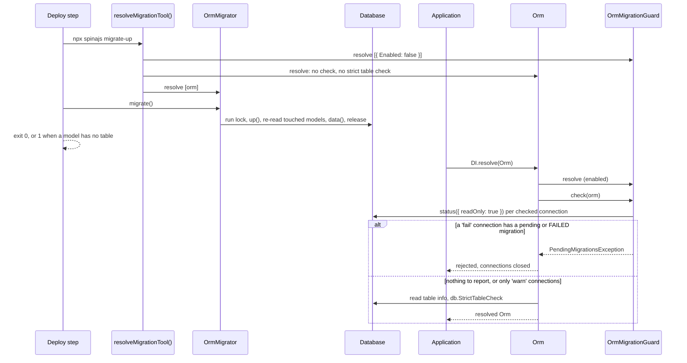
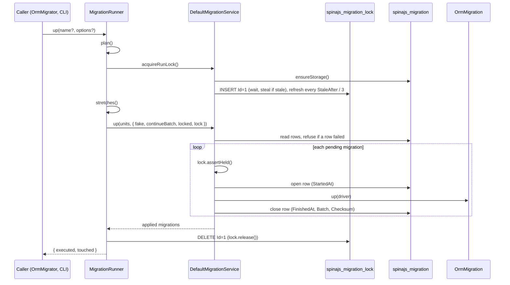

# Migrations

Migrations change the database schema in ordered, tracked steps. Each migration is an `OrmMigration` class bound to one connection with `@Migration()`. `OrmMigrator` applies the pending ones in timestamp order across every connection, re-reads the table info of the models they touched, runs their `data()` seeds, records each run in a tracking table, and guards runs with a cross-process lock. It runs from `npx spinajs migrate-up` ([`@spinajs/orm-cli`](../orm-cli/01-applying-migrations.md)), as a deploy step before the application starts.

The application never migrates. `Orm.resolve()` discovers the migrations and checks, through `OrmMigrationGuard`, that none is pending or failed on any connection; while one is, it fails with `PendingMigrationsException` and applies nothing.

## How it works

### Discovery, at `Orm.resolve()`

1. `Orm.resolve()` creates the connections, then calls `Orm.discoverMigrations()`.
2. `discoverMigrations()` resolves every registered `MigrationSource` and merges what they return. Two ship by default:
   - `FilesystemMigrationSource` scans the directories in `system.dirs.migrations` (or the [fallback directories](#discovery-directories)) and imports each matching file.
   - `DiRegistryMigrationSource` returns every class `@Migration()` registered in the DI container under `__migrations__`, so migrations reached by a plain `import` count too.
3. For each entry, `resolveMigrationEnv()` reads the environment from the file name suffix (`parseMigrationFileEnv()`) and from the class's own `@Migration({ Env })`. When both are present and differ, it throws `OrmException`.
4. Entries sharing a class name merge into one. The same class found twice keeps one environment (`mergeMigrationEnv()`, which throws on two different ones) and prefers a real file path over the `<di>` sentinel. Two different classes with the same name log a warning, and the first one wins.
5. Entries whose environment is set and differs from the normalized `APP_ENV` are dropped. They never reach `orm.Migrations`, so `up`, `down` and `status` all ignore them.
6. `Orm.registerMigration()` checks each class name against `MIGRATION_FILE_REGEXP` and throws `OrmException` for a name without a valid `_yyyy_MM_dd_HH_mm_ss` timestamp.

`Orm.resolve()` then runs the boot check (below), reads table info, wires relations and installs the model statics; see [Connections](01-connections.md).

### Deploying migrations

Migrations and their seeds run in a process of their own, `npx spinajs migrate-up`, before the application starts:

1. `npx spinajs migrate-up` (with `--env <env>` when the application runs with one) boots through `resolveMigrationTool()`: it resolves `OrmMigrationGuard` with `[{ Enabled: false }]`, then the `Orm`, which picks up that disabled guard, checks nothing and skips its `db.StrictTableCheck` check, then `OrmMigrator` over that `Orm`.
2. `OrmMigrator.migrate()` takes the run lock of every connection (see [Locking](#locking)), applies the pending migrations in `(timestamp, name)` order across connections, re-reads the table info of the models they touched and runs the `data()` seeds of the migrations it applied. See [A run](#a-run-migrationrunnerup).
3. After a full run the command checks the model tables as the application's boot will, and exits `1` when a registered model still has no table. See [Applying migrations](../orm-cli/01-applying-migrations.md).

Run it as a release step, a Kubernetes `Job` or init container, or a `predeploy` script. Replicas that run it at the same time are safe: each run holds one lock per connection for the whole run, seeds included, so the second one waits for the first and then finds nothing pending.

Seeds also run on demand, with `npx spinajs migrate-seed` ([Seeding](../orm-cli/09-seeding.md)). A desktop or Electron main process that has no deploy step migrates itself, explicitly, before anything else resolves the `Orm`:

```ts sample
import { resolveMigrationTool } from '@spinajs/orm';

export async function migrateOnLaunch(): Promise<void> {
  const migrator = await resolveMigrationTool();
  await migrator.migrate();

  // the tool's Orm skipped its table check; make it now that the tables exist
  if (migrator.Orm.StrictTableCheck) {
    await migrator.Orm.reloadTableInfo({ strict: true });
  }
}
```

The `Orm` that call cached is the one the rest of the process gets from `DI.resolve(Orm)`: it was booted without the check, so the strict table check runs explicitly after `migrate()`. An app that boots first and migrates only when the boot fails works the same way: the failed boot caches nothing, so `resolveMigrationTool()` runs right after it. Over an `Orm` that did boot, the tool refuses; such an app (booted with `'warn'`) migrates with `new OrmMigrator(orm).migrate()`.

```ts sample
import { DI } from '@spinajs/di';
import { Orm, PendingMigrationsException, resolveMigrationTool } from '@spinajs/orm';

export async function bootOrMigrate(): Promise<Orm> {
  try {
    return await DI.resolve(Orm);
  } catch (err) {
    if (!(err instanceof PendingMigrationsException)) {
      throw err;
    }

    const migrator = await resolveMigrationTool();
    await migrator.migrate();
    await migrator.Orm.reloadTableInfo({ strict: true });
    return migrator.Orm;
  }
}
```

### Boot check, `DI.resolve(Orm)`

1. Once the migrations, models and converters are registered, `Orm.resolve()` resolves `OrmMigrationGuard` from its container and keeps it as the protected `MigrationGuard`. A guard already cached in that container, such as the disabled one `resolveMigrationTool()` resolved, is reused. `OrmMigrationGuard` is `@PerChildInstance()`: one per container, so a migration tool resolved in a `DI.child()` gets its own guard, not the enabled one an application left in the parent.
2. When the guard is disabled (`Enabled` is `false`), steps 3 to 6 are skipped.
3. `OrmMigrationGuard.check(orm)` first refuses a configuration that still sets `db.Connections[].Migration.OnStartup`, with any value and whatever the check mode, with one `OrmException` naming every such key: `Migration.OnStartup is no longer supported (set in db.Connections[main].Migration.OnStartup): the application never migrates. Remove the key and run "npx spinajs migrate-up" as a deploy step.` Alias and `default` entries are not named twice.
4. It reads each connection's check mode, `Migration.Check`, else `db.MigrationCheck`, else `'fail'`. A connection set to `'off'` is not read at all. For the others it calls `MigrationRunner.status({ readOnly: true })`, so each connection's own `Migration.Service` answers, and no tracking table or lock table is created or upgraded.
5. Pending and failed migrations on `'warn'` connections are logged, one warning per connection through the `ORM` logger, and the boot goes on. Those on `'fail'` connections are thrown together in one `PendingMigrationsException` (`pending`, `failed`), sorted by connection, then in run order. Its message names the pending migrations per connection, then each failed one:

   ```text
   Database is not migrated: 2 pending migration(s) on connection main (CreateInvoices_2026_10_06_09_00_00, AddInvoiceDueDays_2026_10_07_09_00_00). The application never migrates on its own: run "npx spinajs migrate-up" (add --env <env> when the application runs with one), then start it again.
   Migration AddInvoiceIndex_2026_10_08_09_00_00 on connection main FAILED in an earlier run and blocks migrate-up: inspect it with "npx spinajs migrate-status", then record what happened with "npx spinajs migrate-resolve --name AddInvoiceIndex_2026_10_08_09_00_00 --applied" (or --rolled-back).
   ```

   (one line in the real message; split here for reading).
6. A throw in step 3 or 5 makes `Orm.resolve()` close its connections and reject with that error. The `Orm` is not cached.
7. `Orm.resolve()` reads the table info of every registered model once. With `db.StrictTableCheck` on (the default) and the guard enabled, one `OrmException` names every registered model, on any connection, whose table is missing, for example `Missing tables (db.StrictTableCheck): model PolicyRecord: table authz_policy on connection authz (main). Create them (run their migrations) or set db.StrictTableCheck to false`. The `Orm` closes its connections and is not cached. A disabled guard skips this check, and each missing table is logged as a warning instead.
8. It wires relations and installs the model statics. The `Orm` is cached. No migration and no `data()` runs.



The CLI commands of other packages that open the database (`@spinajs/authn-keys`, `authn-local`, `authn-orm`, `authn-token`, `authn-totp`, `authz-orm`, `authz-rbac`, `scheduler`, `upload` and `users`) boot the `Orm` as an application does, so they refuse to run on a database with pending migrations: run `migrate-up` first.

### Touched models

`MigrationRunner.up()` records, while a run executes, the tables every schema statement names:

| Statement | Recorded |
| --- | --- |
| `schema().createTable()`, `alterTable()` (including `rename()`), `dropTable()`, `cloneTable()`, `createView()`, `dropView()`, `index()` | the table or view names |
| `createEvent()`, `dropEvent()`, `createDatabase()`, `tableExists()`, any DML | nothing |
| `schema().raw()`, `dropDatabase()`, another builder in schema context | every table of the connection |
| SQL sent straight to any connection's driver (`executeOnDb()`) inside `up()` | every table of that connection |
| any migration applied by a custom `OrmMigrationService` | every table of the connection |

`touched.models` are the registered models whose `TableName` (case-insensitive) and connection match. Connections are matched by the driver's `Name`, so a statement through an alias, or through another driver instance of the same connection, counts for it. `wireRelations()` reads no column info, so relations are not wired again. A faked run (`fake: true`) touches nothing.

### A run, `MigrationRunner.up()`

1. `MigrationRunner.plan()` validates and orders the registry:
   - With a `name`, it keeps that migration only and throws `OrmException` when nothing is registered under it.
   - It parses each name's timestamp and throws `OrmException` for an invalid one, refusing the whole set.
   - It sorts by `(timestamp, name)`.
   - It reads each class's connection with `extractMigrationDescriptor()`. A migration without `@Migration()` or naming a connection that is not configured is skipped with a warning.
   - With a `connection` option, it resolves the name to a driver (aliases included) and throws `OrmException` when no connection answers to it.
   - It groups units by driver, so two names aliased to one connection run once.
2. The runner takes the run lock of every connection in the plan, in connection-name order, and holds it until the call ends (see [Locking](#locking)).
3. `MigrationRunner.stretches()` asks each connection's service for `status()`, keeps pending and failed units, sorts them globally by `(timestamp, name)`, and cuts them into runs of consecutive same-connection migrations. A connection with nothing pending still gets an empty run at the end, so its failed-row guard still applies.
4. For each run, `MigrationRunner` resolves the connection's `OrmMigrationService` (the `Migration.Service` token, or `DefaultMigrationService`), checks the run lock and calls `service.up(units, { fake, continueBatch, locked, lock })`. Returning to a connection continues the batch it opened earlier in the same call.
5. `DefaultMigrationService.up()`:
   1. `ensureStorage()` creates or upgrades the tracking table and the lock table.
   2. With `locked`, it takes no lock of its own; otherwise `withLock()` takes the connection's lock for this call.
   3. It reads the tracking rows and throws `OrmException` when any row is in the failed state.
   4. It filters out applied units and warns about [interrupted](#migration-states) ones it is about to re-run.
   5. It resolves every pending migration from the connection's container with the driver as constructor argument.
   6. It picks the batch: one past the highest applied batch, or the same batch with `continueBatch`.
   7. With `fake`, it records every pending migration as applied without calling `up()` and returns.
   8. Otherwise, per migration and inside the [transaction mode](#transaction-modes): it checks the lock (`lock.assertHeld()`), opens the row (`StartedAt`), warns on a checksum mismatch, calls `migration.up(driver)`, then closes the row with `FinishedAt`, `Batch` and `Checksum`.
6. On failure, the service waits for the transaction to unwind, writes the error message and stack into the row's `Logs`, and throws `OrmException('Migration <name> failed on connection <connection>: ...')` with the original error as `inner`. Later migrations do not run. A lost lock throws `MigrationLockLostException` before the next migration starts and writes no `Logs`. The lock is released in either case.
7. `up()` resolves with `IMigrationUpResult`: `executed`, the `OrmMigration` instances it applied, and `touched.models` (see [Touched models](#touched-models)).



### Rollback, `MigrationRunner.down()`

1. `plan()` runs as for `up()`. There is no global reordering: each connection rolls back in turn.
2. The runner holds the run lock of each connection in the plan; `DefaultMigrationService.down()` ensures storage and checks the lock before each migration.
3. Failed rows do not block a rollback. The service warns that they stay blocking afterwards.
4. It targets the last batch, or every applied migration with `all: true`.
5. Applied rows without a registered class are warned about as orphans and stay applied.
6. It runs `down(driver)` newest first, by `(timestamp, name)` descending, inside the transaction mode, and deletes each row after its `down()` succeeds. With `fake`, it deletes the rows without calling `down()`.
7. A failing `down()` throws `OrmException('Migration <name> failed to roll back on connection <connection>: ...')`. No `Logs` row is written, so `down()` stays available as a recovery path.

### Status and resolve

- `MigrationRunner.status(options?)` returns one `IMigrationStatusEntry` per registered migration whose connection is configured. It never takes the lock. `connection` limits the report to one connection and throws for a name nothing answers to. `readOnly: true` issues no DDL: it creates and upgrades no tracking table, reports every unit pending when the table is absent, and reads a legacy row without `FinishedAt` as applied, as the upgrade backfill would. `OrmMigrationService.status(units, { readOnly })` is the per-connection equivalent. The boot check, `migrate-status`, `migrate-up --dry-run` and `migrate-seed` read with `readOnly: true`. A custom service that ignores the option stays valid, but one written before 3.1, which never saw the option, may create or upgrade its own storage when the application boots.
- `MigrationRunner.resolve(name, action)` forces the recorded state of a failed or interrupted migration without running it. It holds the connection's run lock, so it waits for a run in progress. A run that died does not keep the lock: a session lock ends with its session, and a lock-table row nobody refreshes goes stale after `Lock.StaleAfter`.

## Writing a migration

| Member | Required | Called | Purpose |
| --- | --- | --- | --- |
| `up(connection: OrmDriver): Promise<void>` | yes | by `up()` | Apply the schema change through `connection`. |
| `down(connection: OrmDriver): Promise<void>` | yes | by `down()` | Undo `up()`. |
| `data(): Promise<void>` | no | by `OrmMigrator.migrate()` (`migrate-up`), for the migrations it applied; by `OrmMigrator.seed()` (`migrate-seed`), for the applied migrations | Seed data once every migration of the run is applied and the models hold the migrated columns. Must be safe to run again. |
| `transaction = false` | no | by the service | Run this migration outside any wrapping transaction. |

- The class name is the migration's identity: it is stored in the `Migration` column and must match `MIGRATION_FILE_REGEXP`, `<Name>_yyyy_MM_dd_HH_mm_ss`. The timestamp is the only ordering the runner has; equal timestamps fall back to the name.
- `transaction = false` is read from the instance, the prototype or a static property.
- Use the `OrmDriver` passed to `up()` and `down()`. Its schema builder is described in [Schema builder](09-schema-builder.md).
- `up()` runs in the migration tool, over an `Orm` that resolved before the run. The models' columns were read at that resolve, before `up()` created or changed their tables, and are re-read only after the last `up()` of the run. Change the schema through `connection` in `up()`; model work belongs in `data()`.
- `data()` runs after the touched models were re-read and may resolve any service that injects the `Orm`, such as a users or token store.
- Prefer the schema builder over raw SQL: raw SQL makes the run re-read every model of the connection.

### Environments

A migration belongs to every environment unless it is tagged:

| Declaration | Example | Belongs to |
| --- | --- | --- |
| No tag | `CreateInvoices_2026_10_06_09_00_00.ts` | every environment |
| File suffix | `SeedDemoCustomers_2026_10_07_09_00_00.local.ts` | `local` |
| Decorator option | `@Migration('default', { Env: 'local' })` | `local` |
| Both, agreeing | `.dev.ts` with `{ Env: 'development' }` | `dev` |

- Environments are compared after `normalizeEnvironment()`: `development` becomes `dev`, `production` becomes `prod`, an unset or empty `APP_ENV` is `prod`. Case is kept.
- `FilesystemMigrationSource` never imports a file tagged for another environment.
- These throw `OrmException`: a file with two tags (`Foo_..._00.dev.local.ts`), an empty tag (`Foo_..._00..ts`), a suffix and a decorator that disagree, and an `APP_ENV` outside `SAFE_ENV_NAME_REGEXP` (`[A-Za-z0-9_-]+`).
- `.test`, `.spec` and `.d.ts` middle segments are not environment tags.
- `Env` is read from the class's own `@Migration()` only. A subclass inherits its parent's connection, but not its environment.

### Discovery directories

`FilesystemMigrationSource` scans the directories in `system.dirs.migrations`. When the key is absent or empty, it scans `DEFAULT_MIGRATION_DIRS` plus `currentBuildMigrationDir()`:

- `src/migrations`, `lib/migrations`, `dist/migrations`, `build/migrations` and `migrations`, under `process.cwd()`;
- `lib/mjs/migrations` under ESM (`DI.setESMModuleSupport()`), `lib/cjs/migrations` otherwise.

In each directory it matches `**/!(*.*).{ts,js,cjs,mjs}` (no environment tag) and `**/*.<env>.{ts,js,cjs,mjs}`. It keeps only exports that extend `OrmMigration` and whose class name carries a timestamp.

| Import failure | Directory | Result |
| --- | --- | --- |
| `.ts` file | any | Skipped at trace level. A compiled deployment finds the `.js` copy. |
| other file | configured in `system.dirs.migrations` | `OrmException`, with the import error as `inner`. |
| other file | fallback directory | Warning; the migration is not registered. |

## Running migrations

### `OrmMigrator`

| Member | Meaning |
| --- | --- |
| `constructor(Orm: Orm)` | Builds `Runner` over `Orm`. `resolveMigrationTool()` resolves it as `container.resolve(OrmMigrator, [orm])`. |
| `Orm` | Read-only: the `Orm` the migrator runs over. |
| `Runner` | The `MigrationRunner` over the `Orm`'s migrations and connections. |
| `migrate(options?: IOrmMigrateOptions)` | `IMigrationUpOptions` plus `name` and `skipSeed`. Under one run lock per connection: applies, re-reads the touched models, runs `data()` (not with `fake` or `skipSeed`). Resolves with the applied migrations. With `name`, it locks only that migration's connection, and an unknown name throws before any lock is taken or storage created. |
| `seed(options?: IOrmSeedOptions)` | `name`, `connection`. Under the run lock (with `name`, only of the connection it runs on): runs `data()` of every applied migration (or only `name`, or only one connection's) in `(timestamp, name)` order; every hook runs and the failures are reported in one `OrmException`. It reads the tracking table without DDL. When no connection in scope has anything applied, it takes no lock and creates no table; otherwise taking the run locks creates any missing tracking and lock table of each connection it locks, also of one with nothing applied. A `name` that is registered but not applied throws `Migration <name> is not applied on any configured connection - nothing to seed` (`on connection <connection>` with `connection`). Resolves with the seeded migrations. What `migrate-seed` runs. |
| `plan(options?: { name?, connection? })` | `Promise<IMigrationPlanEntry[]>`: what `migrate()` with the same options would apply, in order, as `{ name, connection, batch }`, then the FAILED migrations that stop it, with `failed: true`. Read-only: no tracking table is created, no lock taken, nothing applied. What `migrate-up --dry-run` prints. |

The `Orm` never resolves `OrmMigrator`, and resolving it migrates nothing. It is a DI singleton, so it keeps the `Orm` it was first constructed over.

`resolveMigrationTool(container = DI.RootContainer): Promise<OrmMigrator>` is how a migration tool boots (`@spinajs/orm-cli`, `migrateTestDatabase()`, a desktop main process):

1. It resolves `OrmMigrationGuard` with `[{ Enabled: false }]` in `container`. When the guard cached there is enabled (something resolved the `Orm` or the guard first, so the `Orm` there was or will be booted as an application), it throws `OrmException`: `resolveMigrationTool() needs the boot guard disabled, but the guard in this container is enabled ...`.
2. It resolves the `Orm`, which picks up that disabled guard: no boot check and no `db.StrictTableCheck` check, so it boots on a database with pending or failed migrations and before their tables exist.
3. When that `Orm` comes from a parent container that booted it as an application (an `Orm` cached there, or registered there and built there with the parent's guard), it throws `OrmException` naming the container to use instead.
4. It resolves `OrmMigrator` with `[orm]` and returns it. When the cached `OrmMigrator` runs over another `Orm` (the `Orm` was uncached alone), it throws `OrmException`: `The cached OrmMigrator runs over an Orm that is no longer cached: uncache Orm and OrmMigrator together ( or DI.clearCache() ) before resolving the migration tool again`.

Call it before anything else resolves the `Orm` in `container`, and in the container that registers the `Orm` when the application registers its own subclass. An application boot that failed (a pending migration, or a missing table under `db.StrictTableCheck`) caches neither the `Orm` nor its guard, so the tool can run right after it in the same process. A tool's boot does not read `Migration.OnStartup`, so `migrate-up` runs on a configuration still written for 3.0; the application's boot then names the key.

### `MigrationRunner`

`OrmMigrator.Runner` is the `MigrationRunner` of the resolved `Orm`.

| Method | Options | Result |
| --- | --- | --- |
| `up(name?, options?: IMigrationUpOptions)` | `fake`, `connection`, `locked` | `Promise<IMigrationUpResult>`: `executed` and `touched.models`. Runs no `data()` and reads no table info; use `OrmMigrator.migrate()` for that. |
| `down(name?, options?: IMigrationDownFacadeOptions)` | `fake`, `connection`, `locked`, `all` | `Promise<OrmMigration[]>`: the migrations rolled back. |
| `status(options?: IMigrationRunnerStatusOptions)` | `readOnly`, `connection` | `Promise<IMigrationStatusEntry[]>`, see [Status and resolve](#status-and-resolve) |
| `pending(name?, connection?)` | as `up()` | `Promise<IMigrationPlanEntry[]>`: what `up()` would apply, in run order; `batch` is one past the connection's highest applied batch. The FAILED migrations of every connection the run would touch follow, with `failed: true`, whatever `name` is: `up()` throws at the first stretch of such a connection, so nothing from there on, on any connection, is listed as applied. `batch` counts registered migrations only, so an applied row whose class is gone, in a higher batch, makes it lower than the one the run records. Read-only. |
| `resolve(name, action: MigrationResolveAction)` | `'applied'` or `'rolled-back'` | `Promise<void>` |
| `withRunLock(connection, fn, name?)` | connection name, or `undefined` for all; migration name | Holds the run lock of every connection with registered migrations (or only `connection`, or only the connection `name` runs on) while `fn` runs, and resolves with its result. Locks an enclosing call already holds are reused. An unknown `name` throws before any lock is taken. |
| `assertRunLocksHeld()` | none | Rejects with `MigrationLockLostException` when a lock of the enclosing `withRunLock()` was lost. |

| Option | Meaning |
| --- | --- |
| `fake` | Record the outcome without calling `up()` / `down()`. |
| `connection` | Limit the run to one connection, by name or alias. |
| `locked` | The caller holds `withRunLock()`; the call takes no lock of its own. |
| `all` | `down()` only: roll back every batch instead of the last one. |

`@spinajs/orm-cli` exposes the same operations as `migrate-up` (`OrmMigrator.migrate()`), `migrate-seed` (`OrmMigrator.seed()`), `migrate-down`, `migrate-status`, `migrate-resolve` and `migrate-create`. It boots through `resolveMigrationTool()`, so booting the CLI applies nothing on its own and is not refused by the boot check: `migrate-status` reports pending work and `migrate-resolve` reaches a FAILED row.

### Migration states

| `IMigrationStatusEntry` field | Row shape | Meaning |
| --- | --- | --- |
| `applied` | `FinishedAt` set, `RolledBackAt` null | Applied; skipped by `up()`. |
| `failed` | `FinishedAt` null, `Logs` set | `up()` threw. Blocks every later `up()` on the connection. |
| `interrupted` | `StartedAt` set; `FinishedAt`, `Logs`, `RolledBackAt` null; no fresh lock | The process died mid-run. Still pending; `up()` re-runs it with a warning. |
| `rolledBack` | `RolledBackAt` set | Resolved as rolled back; pending again. |
| `pending` | no row, or not applied and not failed | Will run on the next `up()`. |
| `checksumMismatch` | stored `Checksum` differs | The class source changed after it was applied. Advisory. |

The entry also carries `name`, `connection`, `batch`, `startedAt` and `finishedAt`.

### Recovering from a failed run

1. Read the row's `Logs` column to see what broke.
2. Fix the database by hand, or roll the partial change back.
3. Call `migrator.Runner.resolve(name, 'applied')` (or `migrate-resolve`) when the change is complete, or `resolve(name, 'rolled-back')` to make the migration pending again.

`resolve()` accepts failed and interrupted rows only; any other row throws `OrmException`. `'applied'` stamps `FinishedAt`, the next batch number and the checksum; `'rolled-back'` stamps `RolledBackAt` and clears `Logs`. A failed row whose class no longer exists cannot be resolved: delete it from the tracking table by hand.

## Tests

`@spinajs/orm/testing` migrates a test database explicitly, as `migrate-up` migrates a deployed one:

```ts
import { DI } from '@spinajs/di';
import { migrateTestDatabase } from '@spinajs/orm/testing';

beforeEach(async () => {
  DI.clearCache();
  DI.register(TestConfiguration).as(Configuration);

  // before anything else resolves the Orm: an http app, a queue, an authz service
  const { orm, migrator, executed } = await migrateTestDatabase(DI.RootContainer);
});
```

`migrateTestDatabase(container = DI.RootContainer, options?: IMigrateTestDatabaseOptions): Promise<IMigratedTestDatabase>`:

1. refuses with `OrmException` (`... is a test helper and refuses to run ...`) when `NODE_ENV` is `production` or `APP_ENV` is `prod` or `production`. It reads the raw variables, because an unset `APP_ENV` counts as production elsewhere and every test process has one;
2. resolves `OrmMigrationGuard` with `[{ Enabled: false }]` in `container` and refuses with `OrmException` (`migrateTestDatabase() must run before anything resolves the Orm or OrmMigrationGuard in this container ( or after Orm, OrmMigrator and OrmMigrationGuard were uncached together, or DI.clearCache() ): the boot guard here is enabled, so the Orm was booted as an application boots it`) when the cached guard is enabled: something resolved the `Orm` or the guard in that container first;
3. resolves the migrator through `resolveMigrationTool(container)`, which refuses a cached `OrmMigrator` left over an `Orm` uncached alone;
4. calls `migrator.migrate()`, with seeds unless `options.seed` is `false`;
5. with `db.StrictTableCheck` on, calls `orm.reloadTableInfo({ strict: true })`, so a model without a table fails the helper as it would fail a boot.

It resolves with `{ orm, migrator, executed }`. The database is then migrated and seeded, so a boot check run on it later finds nothing pending. Later `DI.resolve(Orm)` calls in `container` get the helper's `Orm`, booted without the check. A second call on the same cached container returns `executed: []`; after only `OrmMigrator` was uncached it runs again, over the cached `Orm`. To migrate again from scratch, uncache `Orm`, `OrmMigrator` and `OrmMigrationGuard` together, or call `DI.clearCache()`.

A harness that uncaches the `Orm` and `OrmMigrator` between tests uncaches `OrmMigrationGuard` with them: the guard is cached per container and keeps the options it was first resolved with.

A harness that boots an application `Orm` and then creates its tables by hand (`Runner.up()`, `new X().up(driver)`, or a fake driver with no tracking table) would now be refused by the boot check, because the migrations registered in the process are pending. Set `db.MigrationCheck: 'off'` in its configuration, or migrate with `migrateTestDatabase()` instead.

```ts
// Before (3.0)
db: { Connections: [{ Name: 'default', Driver: 'orm-driver-sqlite', Filename: ':memory:', Migration: { OnStartup: true } }] }
const orm = await DI.resolve(Orm);
await orm.Migrator.ready();

// After
db: { Connections: [{ Name: 'default', Driver: 'orm-driver-sqlite', Filename: ':memory:' }] }
const { orm } = await migrateTestDatabase(DI.RootContainer);

// After, for a harness that migrates by hand
db: { MigrationCheck: 'off', Connections: [{ Name: 'default', Driver: 'orm-driver-sqlite', Filename: ':memory:' }] }
```

The package's lint configuration bans `@spinajs/orm/testing` in `packages/*/src/**`, so framework code never ships it: static imports and re-exports, the deep `@spinajs/orm/lib/<format>/testing` path, a relative path to `orm/src/testing` (`./testing` inside `packages/orm/src`), and a dynamic `import()`, `require()` or `createRequire()(...)` call given one of those names as a string literal (`no-restricted-imports`, `no-restricted-syntax`). A module name computed at runtime escapes the rule; the helper's production refusal (step 1) is the runtime backstop. Applications migrate with `npx spinajs migrate-up` as a deploy step.

## Transaction modes

`Migration.Transaction.Mode` decides how `up()` and `down()` wrap migrations in `driver.transaction()`.

| `MigrationTransactionMode` | Wrapping |
| --- | --- |
| `None` (default) | No transaction. |
| `PerMigration` | One transaction per migration. |
| `PerRun` | One transaction per stretch of consecutive migrations on the connection. A migration with `transaction = false` splits the stretch and runs outside it. |

In every mode, a migration with `transaction = false` runs without a transaction. Under `PerRun`, a failure rolls back every migration of its stretch, and the failure row names the migration that threw. Engines that commit DDL implicitly, such as MySQL, keep schema changes despite the rollback; see [MySQL: DDL is not transactional](../orm-mysql/06-schema-views-and-events.md#ddl-is-not-transactional) and [Transactions](08-transactions.md).

## Locking

One migration run per connection at a time, across processes. `up()`, `down()` and `resolve()` of `MigrationRunner` each hold the run lock of every connection in their plan for the whole call. `OrmMigrator.migrate()` (`migrate-up`) holds it across the migrations and their `data()` seeds, so a second run waits for the seeds too. `status()` never takes it.

1. The runner takes the locks before it reads anything, in connection-name order (code-unit order), so two runs cannot deadlock each other, and releases them in reverse. A failed release is logged, not thrown.
2. Each lock comes from `service.acquireRunLock()`. `DefaultMigrationService` runs `ensureStorage()`, then takes the `MigrationLock` registered in the driver's container. The runner passes `{ locked: true, lock }` to the service, which then takes no lock of its own.
3. The lock is checked before each migration: the runner checks it before each stretch, `DefaultMigrationService` before each migration, and `migrate()` before the seeds. A lost lock throws `MigrationLockLostException`, the run stops, and no failure is recorded, because the next migration never started.
4. A custom `OrmMigrationService` without `acquireRunLock()` gets no run lock and no `locked` option, and keeps locking inside its own calls. One that implements it should honour `locked` and call `lock.assertHeld()` before each migration.
5. `Lock.Enabled: false` takes no lock at all.

### The lock-table row, `TableMigrationLock`

`OrmDriver.resolve()` registers `TableMigrationLock` as `MigrationLock`, so every driver has it unless the driver registers its own class over the token. `Lock.Mode: 'table'` forces it even then; use it behind PgBouncer in transaction pooling mode, which does not keep a session. `Lock.Mode: 'table'` resolves the `TableMigrationLock` token, so a subclass of it is registered both `.as(MigrationLock)` and `.as(TableMigrationLock)`.

1. It inserts row `Id = 1` into `<Table>_lock`, with `AcquiredAt` and `Owner` (`<hostname>:<pid>:<nonce>`). The unique `Id` lets the database pick the winner.
2. When the insert fails and the holder's `AcquiredAt` is older than `Lock.StaleAfter`, it logs a warning, deletes the row where `Owner` and `AcquiredAt` are still the ones it read and retries at once. Two runs that judge one dead row together cannot both win: the second DELETE matches nothing, and neither does a DELETE of a row its holder refreshed after it was read. One acquisition steals at most `MIGRATION_LOCK_MAX_STEALS` (3) times.
3. Otherwise it polls every `MIGRATION_LOCK_POLL_INTERVAL` (500 ms) until `Lock.Timeout` (a row written under this run's own session lock can run it past that, see below), then throws `OrmException` naming the holder and the time its row goes stale. `migrate-resolve` after a crash waits the same way: wait until then, or delete the row from `<Table>_lock` by hand.
4. While held, it refreshes `AcquiredAt` every `StaleAfter / 3` where `Owner` is its own (a row taken under an advisory lock at most every `MIGRATION_LOCK_ADVISORY_HEARTBEAT`, 5 s), so only the row of a holder that stopped refreshing goes stale. A failed refresh is logged.
5. `assertHeld()` fails once no refresh has gone through for longer than `StaleAfter`, or once a refresh matched no row: another run may have taken the row, or has. A refresh counts by the time its UPDATE returned, so one held back past `StaleAfter` still fails the run. A driver that reports no row count, such as mssql with `NOCOUNT ON`, leaves only the `StaleAfter` rule.
6. `release()` stops the refresh and deletes row `Id = 1` only while `Owner` is its own, so a run that lost the row never deletes the row of the run that took it.

A dialect lock that also takes the row calls `acquireUnderAdvisory(request)` while it holds its advisory lock. The row's `Owner` then ends with `migrationLockAdvisoryMark(request.key)`: `:advisory:` and the first 8 hex chars of the SHA-256 of the key. A row with the same mark found by the next advisory holder is deleted once that holder has seen it go two heartbeats unrefreshed: its writer lost that advisory lock, and either crashed or, when the server ended its session, is still migrating and refreshing the row. The two heartbeats are timed by the waiting process, not by `AcquiredAt`, so clock skew does not shorten them, and such a row's age is not judged at all: neither a `StaleAfter` below the heartbeat nor a clock running ahead takes over a row that is still refreshed. A marked row found unrefreshed at `request.timeout` is watched past it, for at most two heartbeats and a poll interval (10.5 s), so a shorter timeout still takes over a crashed run's row; the wait ends as soon as the row is refreshed. Any other row keeps the `StaleAfter` rule: a row without a mark, a row of an earlier release ending in `:advisory`, and a row marked under another key, which two configs spelling one table differently (`Schema` unset and `'public'`) both reach. `acquire()` keeps the rule for every row. Call `acquireUnderAdvisory()` only while holding the advisory lock exclusively for this acquisition, on a session of its own: advisory locks are re-entrant per session.

`StaleAfter` is the staleness rule of this lock only; the session locks below take their row refresh and keep-alive intervals from it. Staleness is judged by the client clock, so hosts whose clocks disagree steal early or wait long by the skew. `status()` reports a row as interrupted only once no fresh lock row exists, so with `Lock.Enabled: false` it reports every open row as interrupted.

### A driver's own lock

A driver registers its lock in its `resolve()`, after `super.resolve()`, over the `MigrationLock` token:

```ts
this.Container.register(MyMigrationLock).as(MigrationLock);
```

`MigrationLock` is constructed with the driver. `acquire(request)` waits up to `request.timeout` and resolves with an `IMigrationLockHandle` (`holder`, `assertHeld()`, `release()`); `isHeld(request)` answers `status()` and never takes the lock. `request.key` is `migrationLockKey(driver, table)`, `spinajs_migration:<Database>:<Options.Schema>:<Table>`; `advisoryKeyPair(key)` turns it into the two int32 halves of its SHA-256. `assertHeld()` must reject with `MigrationLockLostException` on any failure to verify the lock.

### Session locks: postgres, mysql and mssql

`SessionMigrationLock` is the base for a lock the database keeps for a session. The postgres, mysql and mssql drivers register one each:

| Driver | Lock | Session | Inspect |
|---|---|---|---|
| `orm-driver-postgres` | `PostgresMigrationLock`: `pg_try_advisory_lock(k1, k2)` with `advisoryKeyPair(key)` | a `pg.Client` outside the pool | `pg_locks` where `locktype = 'advisory'` |
| `orm-driver-mysql`, `orm-driver-mysql-ssh` | `MySqlMigrationLock`: `GET_LOCK('spinajs_mig_<sha1 of key>', 0)` | a connection outside the pool (through its own SSH channel) | `SELECT IS_USED_LOCK(name)` |
| `orm-driver-mssql` | `MsSqlMigrationLock`: `sp_getapplock` with `@LockOwner = 'Session'` | a pool of exactly one connection | `sys.dm_tran_locks` where `resource_type = 'APPLICATION'` |

1. `acquire()` opens the session and polls a non-blocking attempt every `MIGRATION_LOCK_POLL_INTERVAL` until `Lock.Timeout`. Holding the lock takes no pooled connection, so `Pool.Max: 1` still serves the migrations, but the row refresh does: see the `Pool.Max: 1` caveat in [Best practices](#best-practices). The session is named `spinajs-migration-lock:<connection>`, and its idle limit is turned off where the server has one (mysql `wait_timeout`, postgres 14+ `idle_session_timeout`; SQL Server has none).
2. It then takes the lock-table row with `TableMigrationLock.acquireUnderAdvisory()`, with its refresh, inside the same `Lock.Timeout`. A process of an earlier 3.x release takes only the row, so during a rolling deploy old and new processes still exclude each other. If the row cannot be taken, the session lock is given back. The row is planned to go in 4.x.
3. `assertHeld()` asks the lock's own session whether it still holds the lock. A dead or killed session frees the lock, and the run stops with `MigrationLockLostException` before its next migration. It also checks the row. Between migrations the session is asked the same every `min(StaleAfter / 3, MIGRATION_LOCK_SESSION_KEEPALIVE)` (30 s), so a proxy or gateway does not drop it as idle; a failed answer marks the lock lost for good.
4. `release()` deletes the row, then unlocks and closes the session.
5. `isHeld()` is true when any session holds the lock or a fresh row exists.

A crashed run leaves its row behind, marked with the key's advisory mark, and its session lock is freed. The next run that takes the session lock for the same key deletes that row once it has seen it go two heartbeats (10 s) unrefreshed, so it does not wait for `StaleAfter`. A run whose session the server ended while it still migrates keeps refreshing its row, so the next run waits until that run stops before its next migration and releases the row, or until `Lock.Timeout`, plus the overrun described next. A `Lock.Timeout` shorter than the two heartbeats does not prevent the takeover: a run that finds the row unrefreshed at its timeout goes on watching it, for at most 10.5 s (two heartbeats and a poll interval) past the timeout, and fails at once if the row is refreshed meanwhile. So a run facing a live holder that lost its session but still refreshes its row fails at that holder's next refresh, up to about 5 s past `Lock.Timeout`, and the error names the wait made. The wait is timed with a monotonic clock, so a step of the waiting host's wall clock does not shorten it. Its error says which: the row is still being refreshed (that run may still be migrating), or it was not watched long enough to tell. An unmarked row, from an earlier release or `Lock.Mode: 'table'`, still waits for `StaleAfter`.

A host that disappears without closing its connections (power loss, a network partition) leaves its session open on the server, and the lock with it, until the server's TCP keepalive gives up on the connection, often two hours with operating-system defaults. Until then the next run fails after `Lock.Timeout` naming the lock; end the session by hand (`pg_terminate_backend`, `KILL`) to go on sooner.

Use `Lock.Mode: 'table'` where a session lock does not exclude: postgres behind PgBouncer in transaction pooling (or any pooler that does not pin a session), where the lock and its checks land on different server connections, and mysql multi-primary clusters (Galera / Percona XtraDB Cluster, Group Replication in multi-primary mode), where `GET_LOCK` is local to one node. Set it before upgrading to a release with these locks. `release()` after the session died only logs, at debug level, that the unlock failed: the lost lock was already reported by `assertHeld()`.

## Decorators

| Decorator | Target | Options | Effect |
| --- | --- | --- | --- |
| `@Migration(connection, options?)` | class extending `OrmMigration` | `connection: string`: connection name from `db.Connections`. `options.Env?: string`: environment the migration belongs to. | Records a migration descriptor (`Connection`, `Env`, `SourceFile`) and registers the class in DI under `__migrations__`. |

- `SourceFile` is the file `@Migration()` was applied in, captured from the stack with `captureSourceFile()`. A bundler that mangles paths leaves it `undefined`.
- Read the descriptor with `extractMigrationDescriptor()` (walks the prototype chain) or `extractOwnMigrationDescriptor()` (own class only).
- Decorating a subclass creates its own descriptor and leaves the parent's untouched.

## Configuration

| Key | Type | Default | Allowed values | Meaning |
| --- | --- | --- | --- | --- |
| `db.MigrationCheck` | `'fail' \| 'warn' \| 'off'` | `'fail'` | `'fail'`, `'warn'`, `'off'` | What the boot check does with a pending or failed migration: `'fail'` rejects `Orm.resolve()` with `PendingMigrationsException`, `'warn'` logs it and boots, `'off'` reads nothing. See [Boot check](#boot-check-diresolveorm). |
| `db.Connections[].Migration.Check` | `'fail' \| 'warn' \| 'off'` | unset (`db.MigrationCheck`) | `'fail'`, `'warn'`, `'off'` | The same, for this connection; overrides `db.MigrationCheck`. |
| `db.StrictTableCheck` | `boolean` | `true` | `true`, `false` | Fail `Orm.resolve()`, after the boot check, when a registered model on any connection has no table. Checked under every `MigrationCheck` mode, `'warn'` and `'off'` included; skipped by a migration tool (`resolveMigrationTool()`). See [Connections](01-connections.md#configuration). |
| `db.Connections[].Migration.Table` | `string` | `spinajs_migration` | table name | Tracking table. The lock table is `<Table>_lock`. |
| `db.Connections[].Migration.Service` | `string` | unset (`DefaultMigrationService`) | DI token | `OrmMigrationService` implementation for this connection. |
| `db.Connections[].Migration.Transaction.Mode` | `MigrationTransactionMode` | `None` | `None`, `PerMigration`, `PerRun` | See [Transaction modes](#transaction-modes). |
| `db.Connections[].Migration.Lock.Enabled` | `boolean` | `true` | `true`, `false` | Guard runs with the lock table. |
| `db.Connections[].Migration.Lock.Timeout` | `number` (ms) | `30000` | positive integer | How long to wait for the lock before throwing. A session lock that finds a lock-table row of its own key unrefreshed waits for it up to 10.5 s past this, so a shorter value still takes the row over of a crashed run; against a live holder that still refreshes it, the run fails at that holder's next refresh, up to about 5 s past this. |
| `db.Connections[].Migration.Lock.StaleAfter` | `number` (ms) | `600000` | positive integer | Age after which a lock-table row counts as abandoned and is stolen. The holder refreshes it every `StaleAfter / 3`. This applies to unmarked rows (an earlier release, `Lock.Mode: 'table'`) and to rows marked under another key; a row a session lock wrote under this run's own key is taken over by the next holder of that lock once it goes 10 s unrefreshed instead, whatever its age. A session lock also takes its intervals from it: the row refresh every `min(StaleAfter / 3, 5 s)` and the session keep-alive every `min(StaleAfter / 3, 30 s)`. |
| `db.Connections[].Migration.Lock.Mode` | `'auto' \| 'table'` | `'auto'` | `'auto'`, `'table'` | `'auto'` takes the driver's `MigrationLock`; `'table'` forces the lock-table row, for PgBouncer transaction pooling and mysql multi-primary clusters. Any other value fails the run with an `OrmException`. |
| `system.dirs.migrations` | `string[]` | `[]` (fallback directories) | directory paths | Directories `FilesystemMigrationSource` scans. A non-empty value replaces the fallbacks. |
| `process.env.APP_ENV` | `string` | unset (`prod`) | `[A-Za-z0-9_-]+` | Environment the process runs as; selects tagged migrations. |

- `'warn'` boots over pending migrations, but a pending migration that creates a registered model's table still fails the boot through `db.StrictTableCheck`, with `Missing tables (db.StrictTableCheck): ...`. For local development over such migrations, run `migrate-up` after pulling, or set `db.StrictTableCheck: false` as well.
- `db.Connections[].Migration.OnStartup` is removed. It is gone from `IDriverOptions`, so a TypeScript configuration typed with it no longer compiles, and a configuration that still sets it, `true` or `false`, fails the boot (step 3 of [Boot check](#boot-check-diresolveorm)) whatever the `MigrationCheck` mode. Remove the key and run `npx spinajs migrate-up` as a deploy step.
- A custom `Migration.Service` written before 3.1 ignores the `readOnly` option of `status()`, which the boot check passes. It may then run its own DDL, such as creating its tracking table, at every application boot. Make its `status()` honour `readOnly`.

```ts
import { MigrationTransactionMode } from '@spinajs/orm';

export default {
  db: {
    MigrationCheck: 'fail',
    Connections: [
      {
        Name: 'default',
        Driver: 'orm-driver-mysql',
        Host: '127.0.0.1',
        Database: 'shop',
        Migration: {
          Table: 'spinajs_migration',
          Transaction: { Mode: MigrationTransactionMode.PerMigration },
          Lock: { Enabled: true, Timeout: 30_000, StaleAfter: 600_000 },
        },
      },
    ],
  },
  system: {
    dirs: {
      migrations: ['lib/mjs/migrations'],
    },
  },
};
```

## Schema

`DefaultMigrationService.ensureStorage()` creates both tables before every `up()`, `down()`, `resolve()`, run lock and `status()` without `readOnly`. A `status({ readOnly: true })`, as the boot check, `migrate-status` and `migrate-up --dry-run` read it, creates and upgrades nothing. It tolerates a peer process creating them at the same moment, and adds missing columns to a tracking table from an older layout, copying `CreatedAt` into the missing `StartedAt` and `FinishedAt` and setting `Batch` to `1`.

### `spinajs_migration`

The name comes from `Migration.Table`. `IMigrationRecord` is the row type.

| Column | Type | Meaning |
| --- | --- | --- |
| `Migration` | `string`, unique, not null | Migration class name. |
| `CreatedAt` | `dateTime`, not null | When the row was first written. |
| `StartedAt` | `dateTime`, not null | When the last attempt started. |
| `FinishedAt` | `dateTime` | When it was applied; null while running, failed or after a rolled-back resolution. |
| `RolledBackAt` | `dateTime` | Set by `resolve(name, 'rolled-back')`. |
| `Logs` | `text` | Error message and stack of a failed `up()`. |
| `Checksum` | `string(64)` | `migrationChecksum()`: SHA-256 of the class source text. |
| `Batch` | `int`, not null, default `1` | Run that applied the migration; `down()` rolls back the highest. |

`down()` deletes the row of a rolled-back migration rather than stamping it.

### `spinajs_migration_lock`

| Column | Type | Meaning |
| --- | --- | --- |
| `Id` | `int`, unique, not null | Always `1`; the unique constraint makes the insert the lock. |
| `AcquiredAt` | `dateTime`, not null | Client time the lock was taken or last refreshed. |
| `Owner` | `string(255)`, not null | `<hostname>:<pid>:<nonce>` of the holder, with `:advisory:<hash8>` of the advisory key appended when the holder also holds the driver's advisory lock. |

## Services and extension points

| Service | Role | Default implementation | How to override |
| --- | --- | --- | --- |
| `OrmMigrationService` | Per-connection storage, locking, run, rollback, status and resolve. Contract: `ensureStorage()`, `up()`, `down()`, `status()`, `resolve()`. | `DefaultMigrationService` | Register a subclass under a string token and set `Migration.Service` to it. |
| `MigrationLock` | One connection's migration run lock: `acquire()`, `isHeld()`. | `TableMigrationLock`, registered by `OrmDriver.resolve()` | Register a subclass over `MigrationLock` in the driver's `resolve()`, see [A driver's own lock](#a-drivers-own-lock). |
| `MigrationSource` | Discovers migration classes; never constructs or runs them. | `FilesystemMigrationSource` and `DiRegistryMigrationSource`, both active | Add a source with `@Injectable(MigrationSource)`; every registered source is merged. |
| `OrmMigrator` | `migrate()`, `seed()`, `plan()` and the data phase over one `Orm`; owns `Runner`. Never resolved by the `Orm`. | `OrmMigrator` | Not overridden. Get it from `resolveMigrationTool()`. |
| `OrmMigrationGuard` | The boot check: `Enabled`, `check(orm): Promise<IMigrationGuardReport>` (`pending`, `failed`, `warned`). `@PerChildInstance()`: one per DI container. | `OrmMigrationGuard` | Not overridden. Configured with `db.MigrationCheck` and `Migration.Check`; resolved with `[{ Enabled: false }]` before the `Orm` by `resolveMigrationTool()`. |
| `MigrationRunner` | Cross-connection planning and ordering; `OrmMigrator.Runner`. | `MigrationRunner` | Not resolved through DI. Construct one over any `IMigrationRunnerHost` (`Migrations`, `Connections`, optional `Models` for the touched report) for tooling or tests. |

`DefaultMigrationService` also has `applied()`, which returns the raw applied rows of its connection.

```ts sample
import { DI } from '@spinajs/di';
import { DefaultMigrationService, IMigrationRunOptions, IMigrationUnit, OrmException, OrmMigration } from '@spinajs/orm';

/** Refuses schema changes outside the 02:00-05:00 UTC maintenance window. */
export class MaintenanceWindowMigrationService extends DefaultMigrationService {
  public async up(units: IMigrationUnit[], options?: IMigrationRunOptions): Promise<OrmMigration[]> {
    const hour = new Date().getUTCHours();

    if (units.length > 0 && !options?.fake && (hour < 2 || hour >= 5)) {
      throw new OrmException(`Refusing ${units.length} migration(s) outside the maintenance window`);
    }

    return super.up(units, options);
  }
}

// Then set db.Connections[n].Migration.Service to 'maintenance-window-migrations'
DI.register(MaintenanceWindowMigrationService).as('maintenance-window-migrations');
```

## Important behaviour

- `Orm.resolve()` never applies a migration and never runs `data()`. With `'fail'` (the default) it refuses to boot until `migrate-up` ran; with `'warn'` or `'off'` it boots on whatever schema it finds.
- The boot check reads the tracking tables only. An application that changed the database by hand without recording it, or a migration on a connection that is not configured, is not reported.
- `migrate()` re-reads only the touched models. `Runner.up()` reads no table info: models of the tables it created have no reflected columns until you call `orm.reloadTableInfo()`.
- A re-read model holds what its table holds after the run: a column a migration dropped or renamed leaves the model. See [Models](02-models.md#how-it-works).
- A migration on a `db.Aliases` name whose target connection does not exist is skipped with a warning, like one on an unknown connection.
- `data()` runs in `OrmMigrator.migrate()` (`migrate-up`), for the migrations that call applied, never with `fake` or `skipSeed`, and in `OrmMigrator.seed()` (`migrate-seed`). `Runner.up()` never calls it.
- When a run applies M1 and then fails on M2, M1 is recorded as applied but its `data()` never runs, on that run or any later one. Nothing reports it. `migrate-seed --name M1` (`OrmMigrator.seed({ name })`) runs it afterwards.
- `up()` applies pending migrations in `(timestamp, name)` order across all connections, not connection by connection.
- A failed row on a connection blocks every later `up()` there, even one with nothing pending, until `resolve()` clears it.
- An interrupted migration re-runs from the top. Under `MigrationTransactionMode.None`, whatever it applied before the crash is still in the database, and non-idempotent data changes apply twice.
- The checksum hashes the transpiled class source, so a compiler upgrade changes it as readily as an edit. A mismatch only logs a warning.
- `down(name)` passes a one-element unit list to the service, which warns that the other applied migrations of that batch are orphans. The warning is wrong in this case; the rollback itself is correct.
- `resolve('applied')` through `MigrationRunner` stores the checksum. Calling the service's `resolve()` without the `unit` argument leaves `Checksum` null, so drift is never reported for that row.
- A migration naming a connection that is not configured is skipped with a warning, not an error.
- Two connections on one database that share `Migration.Table` share one lock row. A run over both takes the first connection's lock and then waits for itself on the second until `Lock.Timeout`, and fails. Give each connection on a database its own `Migration.Table`.

## Best practices

- Scaffold migrations with `migrate-create`, which stamps the class name with the current time, and never rename an applied migration: the name is the row key.
- Write `data()` so that running it twice is harmless, for example with `InsertBehaviour.InsertOrIgnore`.
- Keep `Lock.StaleAfter` well above the longest stretch a run may go without reaching the database, such as a long synchronous step: the lock-table row is refreshed every `StaleAfter / 3`, and a run that cannot refresh it for `StaleAfter` loses it.
- With `Pool.Max: 1` and the lock-table row (sqlite, or `Lock.Mode: 'table'`), the refresh can wait behind an open `PerRun` or `PerMigration` transaction. Keep `Lock.StaleAfter` above the longest such transaction, or the run stops before its next migration.
- With a session lock (postgres, mysql, mssql) the row refresh shares the pool too. With `Pool.Max: 1`, a single statement longer than 10 s, such as a large `CREATE INDEX`, leaves the row unrefreshed for that long. If the lock session also dies during it, the next run takes the row over after 10 s while that statement is still running. The first run stops at its next `assertHeld()`, before its next migration (with `PerRun` its open transaction rolls back), but the long statement has already run alongside the next run. Use `Pool.Max` of 2 or more for long migrations.
- Run `npx spinajs migrate-up` as a deploy step, before the new application version starts, and let the boot check stop a start that skipped it.
- Boot processes that inspect or operate on migrations, such as deploy gates, with `resolveMigrationTool()`.
- Use `PerMigration` or `PerRun` on engines with transactional DDL, and mark the statements that cannot run in a transaction with `transaction = false`.
- Gate a deploy with `npx spinajs migrate-status` or `migrate-up --dry-run`, which exit `1` while anything is pending or failed, or with `migrator.Runner.status()` in a script.
- Keep `db.MigrationCheck` at `'fail'` in production; use `'warn'` only where an unmigrated boot is expected, such as local development.

## Patterns and antipatterns

```ts
// Don't: the models were read before up() created their table, and are re-read only after the last up()
public async up(connection: OrmDriver): Promise<void> {
  await connection.schema().createTable('invoices', (table) => { /* ... */ });
  await (await DI.resolve(InvoiceStore)).seedDefaults();
}

// Do: schema through connection in up(); services and model statics in data()
public async up(connection: OrmDriver): Promise<void> {
  await connection.schema().createTable('invoices', (table) => { /* ... */ });
}

public async data(): Promise<void> {
  await (await DI.resolve(InvoiceStore)).seedDefaults();
}
```

```ts
// Don't: no timestamp in the name; Orm.resolve() throws for the whole application
@Migration('default')
export class CreateInvoices extends OrmMigration { /* ... */ }

// Do
@Migration('default')
export class CreateInvoices_2026_10_06_09_00_00 extends OrmMigration { /* ... */ }
```

```ts
// Don't: data() inserts unconditionally; any rerun or partial seed duplicates rows
public async data(): Promise<void> {
  await Currency.insert([{ Code: 'EUR' }, { Code: 'USD' }]);
}

// Do: seed idempotently
public async data(): Promise<void> {
  await Currency.insert([{ Code: 'EUR' }, { Code: 'USD' }], InsertBehaviour.InsertOrIgnore);
}
```

```ts
// Don't: the suffix and the decorator disagree; discovery throws OrmException
// file: SeedDemoCustomers_2026_10_07_09_00_00.local.ts
@Migration('default', { Env: 'dev' })
export class SeedDemoCustomers_2026_10_07_09_00_00 extends OrmMigration { /* ... */ }

// Do: declare the environment once
// file: SeedDemoCustomers_2026_10_07_09_00_00.local.ts
@Migration('default')
export class SeedDemoCustomers_2026_10_07_09_00_00 extends OrmMigration { /* ... */ }
```

```ts
// Don't: delete the failed row by hand; the half-applied change stays and nothing records it
await connection.del().from('spinajs_migration').where({ Migration: 'AddInvoiceDueDays_2026_10_02_09_00_00' });

// Do: fix the database, then record the truth
await migrator.Runner.resolve('AddInvoiceDueDays_2026_10_02_09_00_00', 'applied');
```

## Examples

### Create the invoices table

```ts sample
import { Migration, OrmMigration, OrmDriver } from '@spinajs/orm';

@Migration('default')
export class CreateInvoices_2026_10_06_09_00_00 extends OrmMigration {
  public async up(connection: OrmDriver): Promise<void> {
    await connection.schema().createTable('invoices', (table) => {
      table.increments('Id');
      table.string('Number', 32).notNull().unique();
      table.int('customer_id').notNull();
      table.decimal('Total', 10, 2).notNull();
      table.dateTime('IssuedAt').notNull();
    });
  }

  public async down(connection: OrmDriver): Promise<void> {
    await connection.schema().dropTable('invoices').ifExists();
  }
}
```

### Seed demo customers on developer machines only

```ts sample
import { Migration, OrmMigration, OrmDriver } from '@spinajs/orm';

@Migration('default', { Env: 'local' })
export class SeedDemoCustomers_2026_10_07_09_00_00 extends OrmMigration {
  public async up(connection: OrmDriver): Promise<void> {
    await connection
      .insert()
      .into('customers')
      .values([
        { Email: 'alice@example.test', Name: 'Alice' },
        { Email: 'bob@example.test', Name: 'Bob' },
      ]);
  }

  public async down(connection: OrmDriver): Promise<void> {
    await connection.del().from('customers').where('Email', 'like', '%@example.test');
  }
}
```

### Build an index outside the migration transaction

```ts sample
import { Migration, OrmMigration, OrmDriver } from '@spinajs/orm';

@Migration('default')
export class IndexInvoicesByCustomer_2026_10_08_09_00_00 extends OrmMigration {
  // Opts out of PerMigration / PerRun wrapping for this migration only
  public transaction = false;

  public async up(connection: OrmDriver): Promise<void> {
    await connection.index().name('invoices_customer_idx').table('invoices').columns(['customer_id', 'IssuedAt']);
  }

  public async down(connection: OrmDriver): Promise<void> {
    await connection.index().name('invoices_customer_idx').table('invoices').drop();
  }
}
```

### Seed an admin account with migrate-up

`npx spinajs migrate-up` applies `CreateAccounts_2026_10_21_09_00_00` and then runs its `data()`; `npx spinajs migrate-seed --name CreateAccounts_2026_10_21_09_00_00` runs the seed again, which `orIgnore()` makes harmless.

```ts sample
import { AsyncService, Autoinject, DI } from '@spinajs/di';
import { Migration, Orm, OrmDriver, OrmMigration } from '@spinajs/orm';

/** An ORM-backed service: it injects the Orm. */
export class AdminAccounts extends AsyncService {
  @Autoinject(Orm)
  protected Orm: Orm;

  public async ensure(email: string): Promise<void> {
    await this.Orm.Connections.get('default')!.insert().into('accounts').values({ Email: email, Role: 'admin' }).orIgnore();
  }
}

@Migration('default')
export class CreateAccounts_2026_10_21_09_00_00 extends OrmMigration {
  public async up(connection: OrmDriver): Promise<void> {
    await connection.schema().createTable('accounts', (table) => {
      table.increments('Id');
      table.string('Email', 255).notNull().unique();
      table.string('Role', 32).notNull();
    });
  }

  public async down(connection: OrmDriver): Promise<void> {
    await connection.schema().dropTable('accounts').ifExists();
  }

  public async data(): Promise<void> {
    // runs after every migration of the run is applied and the touched models are re-read
    await (await DI.resolve(AdminAccounts)).ensure('admin@example.test');
  }
}
```

### Block a deploy when the schema is not current

From a shell, `migrate-status` is the gate: it exits `1` while anything is pending or failed.

```sh
npx spinajs migrate-status --env production || exit 1
```

From a script, the boot check itself answers, without booting the application. `check()` honours `db.MigrationCheck` and `Migration.Check`: a `'warn'` connection is only logged and reported in `warned`, an `'off'` one is not read.

```ts sample
import { DI } from '@spinajs/di';
import { OrmMigrationGuard, PendingMigrationsException, resolveMigrationTool } from '@spinajs/orm';

export async function assertSchemaIsCurrent(): Promise<boolean> {
  // a tool boot: the Orm resolves on an unmigrated database and applies nothing
  const migrator = await resolveMigrationTool();

  try {
    // the tool's guard is the disabled one, but check() runs whatever Enabled says
    await (await DI.resolve(OrmMigrationGuard)).check(migrator.Orm);
    return true;
  } catch (err) {
    if (err instanceof PendingMigrationsException) {
      for (const m of [...err.pending, ...err.failed]) {
        console.error(`${m.connection}/${m.name}: ${err.failed.includes(m) ? 'FAILED' : 'pending'}`);
      }
      return false;
    }

    throw err;
  } finally {
    await migrator.Orm.dispose();
  }
}
```

### Ship migrations from a plugin package

```ts sample
import { ClassInfo, Injectable } from '@spinajs/di';
import { Migration, MigrationSource, OrmDriver, OrmMigration } from '@spinajs/orm';

@Migration('default')
export class CreateBillingPlans_2026_10_09_09_00_00 extends OrmMigration {
  public async up(connection: OrmDriver): Promise<void> {
    await connection.schema().createTable('billing_plans', (table) => {
      table.increments('Id');
      table.string('Code', 64).notNull().unique();
      table.decimal('MonthlyPrice', 10, 2).notNull();
    });
  }

  public async down(connection: OrmDriver): Promise<void> {
    await connection.schema().dropTable('billing_plans').ifExists();
  }
}

/** Lists the plugin's migrations explicitly instead of relying on a directory scan. */
@Injectable(MigrationSource)
export class BillingPluginMigrationSource extends MigrationSource {
  public async getMigrations(): Promise<Array<ClassInfo<OrmMigration>>> {
    return [CreateBillingPlans_2026_10_09_09_00_00].map((type) => ({ file: 'billing-plugin', name: type.name, type }));
  }
}
```

### Roll back the last deploy on one connection

```ts sample
import { resolveMigrationTool } from '@spinajs/orm';

export async function rollbackLastDeploy(connection: string): Promise<string[]> {
  const migrator = await resolveMigrationTool();
  const rolledBack = await migrator.Runner.down(undefined, { connection });

  return rolledBack.map((m) => m.constructor.name);
}
```

## Migration

### 3.1.0: the application never migrates

`Orm.resolve()` no longer applies migrations or runs `data()` seeds; it checks the tracking tables and fails with `PendingMigrationsException` while a migration is pending or failed. `Migration.OnStartup` is removed: a configuration that still sets it fails the boot naming the key. `Orm.Migrator`, `IOrmMigratorOptions`, `OrmMigrator.MigrateOnStartup`, `OrmMigrator.boot()`, `OrmMigrator.ready()` and `IMigrationUpOptions.force` are removed. `OrmMigrator` is constructed over its `Orm` (`new OrmMigrator(orm)`, `OrmMigrator.Orm`), and `resolveMigrationTool()` builds it.

1. Run `npx spinajs migrate-up` (with `--env <env>` when the application runs with one) before the application starts: a release step, a Kubernetes `Job` or init container, or a `predeploy` script. Several replicas running it at once are safe: the run holds a database lock.
2. Remove `Migration.OnStartup` from every `db.Connections` entry.
3. Seeds run with `migrate-up`, for the migrations it applies; rerun them with `npx spinajs migrate-seed [--name X]`. They must be idempotent.
4. Postgres behind PgBouncer in transaction pooling (or any pooler that does not pin a session) and mysql multi-primary clusters: set `Migration.Lock.Mode: 'table'` before upgrading the driver package (see [Session locks](#session-locks-postgres-mysql-and-mssql)).
5. For local development, set `db.MigrationCheck: 'warn'` to boot over pending migrations with a warning, or keep `'fail'` and run `migrate-up` after pulling.
6. Tests: replace `OnStartup: true` + `DI.resolve(Orm)` + `Migrator.ready()` with `await migrateTestDatabase(container)` from `@spinajs/orm/testing` ([Tests](#tests)).
7. Desktop and Electron main processes that must migrate themselves call `await (await resolveMigrationTool()).migrate()` before resolving anything else, then `await migrator.Orm.reloadTableInfo({ strict: true })` for the table check the tool's boot skipped ([Deploying migrations](#deploying-migrations)).
8. A custom `Migration.Service` must honour the `readOnly` option of `status()`; see [Configuration](#configuration).
9. Replace `DI.resolve(OrmMigrator, [{ MigrateOnStartup: false }])` (and a bare `DI.resolve(OrmMigrator)`) with `await resolveMigrationTool()`, or `await resolveCliMigrator()` in an `@spinajs/orm-cli` host. The old call now fails with an `OrmException` naming `resolveMigrationTool()`.
10. Two connections on one database that share `Migration.Table` now block each other for `Lock.Timeout` and fail: give each its own `Migration.Table`.
11. A database whose schema exists without tracking rows (tables created by SQL scripts, or an application that never ran migrations) fails the boot with every migration pending. Check that the schema matches the migrations, then run `npx spinajs migrate-up --fake` once: it records every pending migration as applied without running `up()` or `data()`. Or set `Migration.Check: 'off'` for that connection.

```ts
// Before (3.0.x)
db: { Connections: [{ Name: 'main', Driver: 'orm-driver-mysql', Migration: { OnStartup: true } }] }
const orm = await DI.resolve(Orm); // applied the pending migrations
await orm.Migrator.ready(); // waited for their seeds

// After (3.1.0)
// deploy step: npx spinajs migrate-up
db: { Connections: [{ Name: 'main', Driver: 'orm-driver-mysql' }] }
const orm = await DI.resolve(Orm); // PendingMigrationsException unless migrate-up ran

// After, a tool
const migrator = await resolveMigrationTool(); // 3.0.x: DI.resolve(OrmMigrator, [{ MigrateOnStartup: false }]), which now throws
await migrator.migrate();
```

The two notes below describe earlier 3.0.x releases. They are kept for upgraders from those releases; their code that uses `Orm.Migrator`, `ready()` or `MigrateOnStartup` no longer works.

### `Orm.resolve()` applies the startup migrations; `DI.resolve(OrmMigrator)` migrates nothing (3.0.x, history)

Superseded by [3.1.0](#310-the-application-never-migrates).

Resolve `Orm`; `DI.resolve(OrmMigrator)` migrates nothing. Move model statics and Orm-injecting services out of `up()` into `data()`. Await `orm.Migrator.ready()` where code needs seed rows. Tools call `resolveMigrationTool()` (or resolve `OrmMigrator` with `{ MigrateOnStartup: false }` before `Orm`).

`OrmDriver.AwaitsStartupMigration` and the query gate are removed. A failed migration or strict check rejects `DI.resolve(Orm)` and closes its connections; no `DI.dispose()` is needed to close them.

```ts
// Before
await DI.resolve(OrmMigrator);
const tool = await DI.resolve(OrmMigrator, [{ MigrateOnStartup: false }]);

// After
const orm = await DI.resolve(Orm);
await orm.Migrator.ready();
const tool = await resolveMigrationTool();
```

### Migrations run on `OrmMigrator`, and `up()` returns `IMigrationUpResult` (3.0.x, history)

`Orm.Migration` is removed; the runner is `OrmMigrator.Runner`. `MigrationRunner.up()` resolves with `{ executed, touched }` instead of the applied migrations, and runs no `data()`. Call `OrmMigrator.migrate()` to apply, re-read the touched models and seed in one step.

```ts
// Before
const orm = await DI.resolve(Orm);
const applied = await orm.Migration.up();

// After: apply, re-read the touched models, run data()
const migrator = await resolveMigrationTool();
const applied = await migrator.migrate();

// After, runner only: no data(), no table info read
const { executed, touched } = await migrator.Runner.up();
await orm.reloadTableInfo({ models: touched.models });
```

## Related

- [Schema builder](09-schema-builder.md): the statements a migration's `up()` and `down()` issue.
- [Connections](01-connections.md): `db.Connections`, `OrmDriver` and the `Orm` bootstrap.
- [Transactions](08-transactions.md): `driver.transaction()`, which the transaction modes use.
- [Model API](03-model-api.md): the model statics `data()` seeds with.
- [`@spinajs/orm-mysql` migrations](../orm-mysql/06-schema-views-and-events.md#migrations): non-transactional DDL on MySQL.
- [`@spinajs/orm-sqlite`](../orm-sqlite/README.md), [`@spinajs/orm-mssql`](../orm-mssql/README.md): dialect limits that affect `up()` and `down()`.
